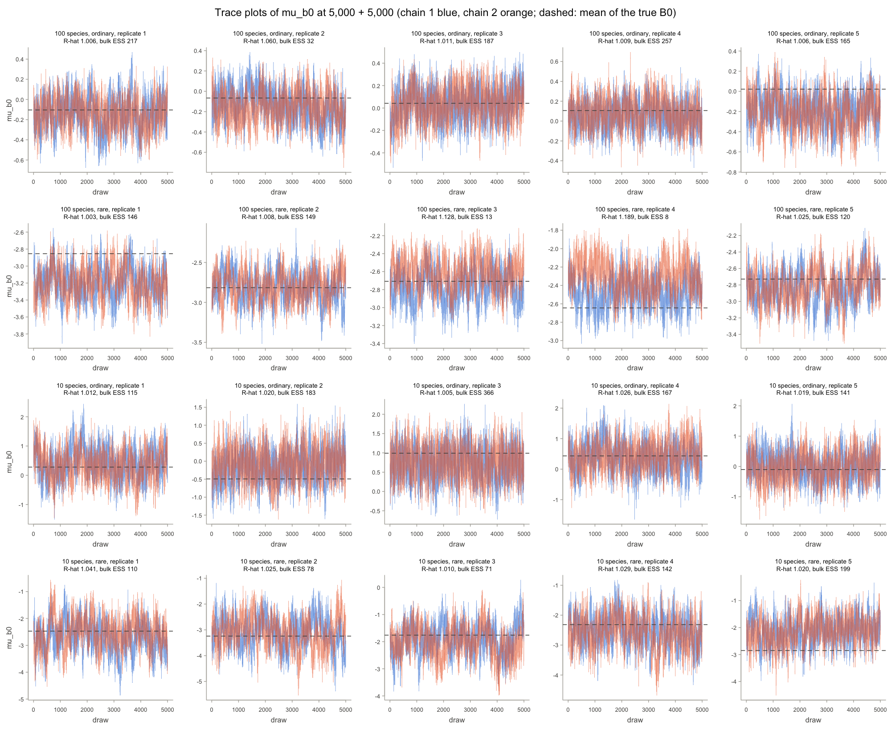

# B0's community mean at 100 species: report, 18 October 2026

**Verdict: the rule fails.** At the package default of 5,000 + 5,000, `mu_b0` has R-hat under 1.05 and bulk ESS of at least 100 in 7 of the 10 fits at 100 species. The three that fail are ordinary replicate 2 (R-hat 1.060, bulk ESS 32) and rare replicates 3 and 4 (R-hat 1.128 and 1.189, bulk ESS 13 and 8). Both communities fail under both readings of the rule set in [README.md](README.md), since both readings require R-hat under 1.05 in every replicate. The same design at 10 species, refitted on the same day, had no fit with R-hat over 1.05.

The failures are occasional fits whose two chains sit apart for the whole run, not a general slowdown. In the other seven fits `mu_b0` mixes as well per draw as at 10 species, and B0 and the collection intercepts mix as well or better. Three failures in 10 fits against none in 10 is not by itself evidence that 100 species is worse than 10 (Fisher's exact test, p = 0.21). But at 10 species the rare-dominated community already sat close to the bar (R-hat up to 1.041, bulk ESS down to 71), so neither species count gives `mu_b0` a comfortable margin at the default chain length.

## What ran

Two arms, `base_cm_s100` (ordinary community, true B0 drawn from Normal(0, 1)) and `base_rare_cm_s100` (rare-dominated, Normal(-2.75, 1)), each `base_cm_m3` or `base_rare_cm_m3` with 100 species: two-stage model, 100 sites, 3 field samples per site, `b0_prior = "community"`. Replicates 1 to 5 of each, 2 chains of 5,000 burn-in and 5,000 kept draws, draws kept. The 10-species comparison refits replicates 1 to 5 of `base_cm_m3` and `base_rare_cm_m3` at the same settings (step `s10`); all 90 statistics it shares with the M = 3 runs' `long-chains.csv` match to 5e-13, the precision of those files, so these are the same fits as in those runs.

The steps ran on 18 October 2026 on 5 workers, one RcppParallel and one BLAS thread per fit (`VECLIB_MAXIMUM_THREADS=1`), R 4.6.1 with Accelerate's `libBLAS.dylib` as `extSoftVersion()` reports it, on mains power with Low Power Mode off, from a clean tree (`*-provenance.txt`): timing 11:04 to 11:07, `s10` 11:08 to 11:15, main 11:15 to 12:17. No fit failed.

## `mu_b0`, replicate by replicate

R-hat, then bulk ESS and tail ESS of 10,000 draws, for replicates 1 to 5:

-   100 species, ordinary: R-hat 1.006, 1.060, 1.011, 1.009, 1.006; bulk ESS 217, 32, 187, 257, 165; tail ESS 449, 406, 1021, 1078, 441.
-   100 species, rare: R-hat 1.003, 1.008, 1.128, 1.189, 1.025; bulk ESS 146, 149, 13, 8, 120; tail ESS 440, 373, 183, 62, 279.
-   10 species, ordinary: R-hat 1.012, 1.020, 1.005, 1.026, 1.019; bulk ESS 115, 183, 366, 167, 141; tail ESS 311, 696, 975, 432, 721.
-   10 species, rare: R-hat 1.041, 1.025, 1.010, 1.029, 1.020; bulk ESS 110, 78, 71, 142, 199; tail ESS 249, 335, 265, 342, 654.

By the rule (`rule.csv`): at 100 species the ordinary arm has 4 of 5 replicates with R-hat under 1.05 and 4 of 5 with bulk ESS at least 100 (median 187), the rare arm 3 of 5 and 3 of 5 (median 120); both fail strictly and on the median. At 10 species the ordinary arm passes both readings, and the rare arm passes on the median (110) but fails strictly (replicates 2 and 3).

## Where the slowness is

-   Typical mixing does not change with the number of species. The slow wander of `mu_b0`, measured as the spread of 500-draw batch means within each chain (a check added after the run, not in the README), is about the same fraction of its posterior sd at both species counts: 0.31 at 100 species against 0.32 at 10 in the ordinary community, 0.45 against 0.41 in the rare one. Median bulk ESS is 187 against 167 (ordinary) and 120 against 110 (rare).
-   The posterior correlations that mark the slow direction do not change either. Within chains, `mu_b0` correlates with the species' mean B0 at 0.74 on average at 100 species against 0.71 at 10 (ordinary) and 0.83 against 0.82 (rare); the mean B0 correlates with the mean collection intercept at -0.58 against -0.53 and -0.43 against -0.42.
-   The failing fits are stuck along the direction of `mu_b0` and the mean B0 together. The species' mean B0 has R-hat 1.10, 1.19 and 1.27 and bulk ESS 21, 9.5 and 6.0 in ordinary replicate 2 and rare replicates 3 and 4, against 1.01 to 1.03 and 93 to 129 in the other seven fits. In ordinary replicate 2 the mean collection intercept is stuck with it (R-hat 1.09, ESS 19). In rare replicates 3 and 4 it is not (R-hat 1.01, ESS about 300), so there the mean B0 is trading off against something whose draws were not kept, most likely the shared site terms (latent factor scores or the spatial field), which move every species' occupancy together. That is a guess this run cannot test.
-   In the trace plots, rare replicate 4's second chain sits above its first for most of the 5,000 draws: the two chain means differ by 0.18, about one posterior sd (0.19). In rare replicate 3 they differ by 0.15. In ordinary replicate 2 they differ by only 0.03, and the R-hat of 1.060 comes from both chains drifting slowly within the run.

## B0 and the collection intercepts

-   B0 at 100 species: median R-hat 1.00 to 1.01 in every fit; the share of species with R-hat over 1.05 is 0 to 2% in the ordinary community (mean 0.6%) and 0 to 6% in the rare one (mean 1.8%, the 6% in replicate 4); median bulk ESS 308 to 408 (ordinary) and 303 to 400 (rare), against 208 to 370 and 112 to 253 at 10 species, where no species exceeded 1.05. The least-mixed species per fit has bulk ESS 30 to 114 (ordinary) and 18 to 167 (rare), against 59 to 135 at 10 species, partly because each fit now has 100 species to take the minimum over.
-   Collection intercepts at 100 species: no species over 1.05 except 1 of 100 in rare replicate 4; median bulk ESS 694 to 862 (ordinary) and 671 to 1006 (rare), against 571 to 807 and 416 to 614 at 10 species.

## `mu_b0`'s posterior

Its posterior sd is 0.140 to 0.161 (mean 0.150) in the ordinary community at 100 species against 0.408 to 0.512 (0.452) at 10, a ratio of 0.33, and 0.183 to 0.198 (0.189) against 0.492 to 0.594 (0.548) in the rare one, a ratio of 0.35; 1 / sqrt(10) is 0.32, as expected. Its 95% interval contains the realised mean of the true B0 in all 20 fits, the three failing ones included.

## Community occupancy error (sanity check)

Mean estimated minus mean true occupancy, over sites and species: -0.029 to +0.001 (mean -0.010) in the ordinary community at 100 species against -0.006 to +0.046 (+0.014) at 10, and -0.052 to -0.020 (mean -0.039) in the rare one against -0.046 to +0.035 (-0.012). The rare community at 100 species is slightly low in all five fits, with its collection intercepts high by +0.08 to +0.29 (mean +0.20); with 5 fits that is worth watching in any full 100-species study but says nothing about mixing. The three failing fits are not visibly worse on this or on B0 coverage (occupancy error -0.013, -0.042 and -0.020; B0 coverage 0.95, 0.93 and 0.97).

## Cost

A 100-species fit at 5,000 + 5,000 took 34 minutes (ordinary) and 27 minutes (rare) on 5 workers, against 3.7 and 3.8 minutes at 10 species; the timing step had projected 36 to 38 minutes. If ESS grew in proportion to the draws, the failing fits (bulk ESS 8 to 32) would need 3 to 13 times as many draws to reach 100, about 2 to 6 hours per fit at 100 species; for chains stuck apart it may grow more slowly than that.

## What it means for PR #36

A default that, at the default chain length, leaves `mu_b0` unconverged in about one fit in three at a realistic species count would put R-hat warnings in front of many users, even if their species-level results are mostly unaffected. Longer chains are an expensive fix at 100 species. A cheaper one would be a sampler step that moves `mu_b0` and all the species' intercepts together (for example an interweaving or non-centred update of `mu_b0`), after which this check could be rerun as it stands. `returnConvergenceDiagnostics()` already reports `mu_b0`'s R-hat and ESS, so users who opt in can see the problem when it happens.

Drafted sentence for decision 2 of PR #36's description:

> A mixing check at 100 species (dev/simstudy/b0-community-s100-20261018 on claude/b0-community-s100) failed its pre-registered rule: at the default 5,000 + 5,000 iterations `mu_b0` did not converge in 3 of 10 two-stage fits at 3 field samples per site (R-hat 1.06 to 1.19, bulk ESS 8 to 32, against none of 10 at 10 species), so we suggest keeping `b0_prior = "community"` opt-in for now, with a note to check `mu_b0` in `returnConvergenceDiagnostics()`, and revisiting the default once `mu_b0` and the species' intercepts are updated jointly.

## Files

-   `README.md`: design, timing and the rule, written before any fit.
-   `launch.sh`, `*-provenance.txt`, `*.log`: the three steps as run.
-   `analyse.R`: writes everything below from the kept draws.
-   `rule.csv`: the rule by arm, both readings. `failures.csv`: R-hat failures at 100 against 10 species, with Fisher's exact test (post hoc).
-   `fits.csv`: one row per fit, every statistic above. `summary.csv`: the same by arm.
-   `reproduction.csv`: the `s10` refits against the M = 3 runs' `long-chains.csv`.
-   `timing.csv`: the 200 + 200 timing fits and their projections.
-   `traces.rds`: per-draw `mu_b0`, mean B0 and mean collection intercept for all 20 fits; `traces-mu-b0.png`: their trace plots.
-   The full draws (418 MB) are in the ignored `draws/` folder of the worktree `.claude/worktrees/nostalgic-mendel-8b7449` only. `launch.sh` regenerates them exactly.
