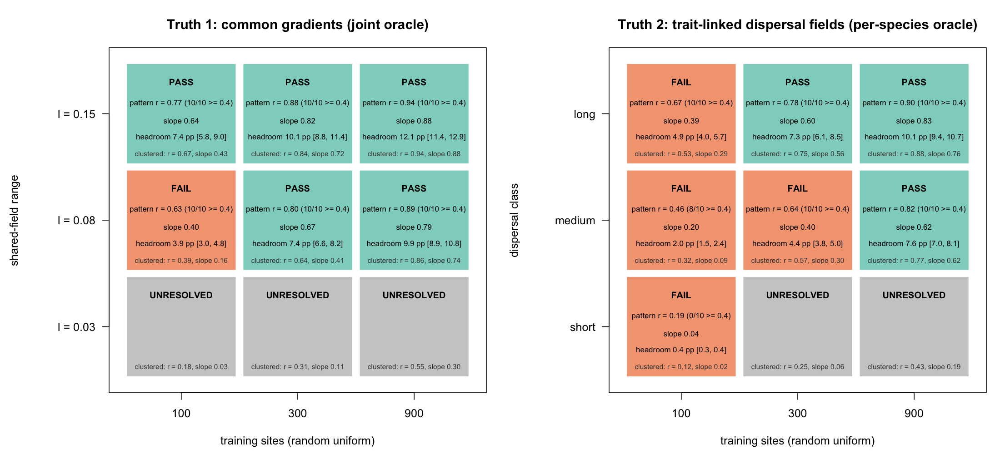

# Spatial recoverability pilot: report

Written 11 October 2026 for Doug. The study design is `dev/superpowers/specs/2026-10-10-spatial-recoverability-pilot-design.md`. Every number below comes from the files in `results/`, from that design's revision record, or (section 4 only) from `DIAGNOSIS-truth1-mixing.md`, and the source is named where it is used.

## How to read this report

This report assumes you have not followed the study. Section 1 gives the answer in plain language. Section 2 builds the idea from first principles: what the data are, what "spatial structure" means, what an oracle is, and how the study decides that structure is recoverable. Section 3 gives the results, each followed by a reading in plain words. Section 4 covers the convergence problems, the two changes made after results were seen, and the numerical details. Sections 5 to 7 give the mechanism caveat, the limits and the decisions that remain with you. A glossary at the end defines every technical term. If you want only the result, read section 1 and then section 3.6, which gives the three readings of the map.

## 1. The short answer

**The question.** Suppose you survey a landscape for species presence and absence at 100, 300 or 900 sites. Can a model recover the hidden spatial pattern behind where each species occurs? This study asks that question for the best possible case: a model that is told every other detail of how the data were made, so that only the hidden pattern is left to find. If even that model cannot find the pattern, no real model can, and there is no point comparing packages on how well they model space. If it can, real models might.

**The answer.** It depends on how the hidden pattern is built and on how many sites there are.

- If twelve species all respond to the same two hidden gradients (truth 1), the pattern is recoverable with 300 sites when the gradients vary over a range of 0.08 of the landscape width, and with 100 sites when the range is 0.15. At range 0.08 with 100 sites it fails on one criterion only: the recovered pattern is too faint (slope 0.40 against a floor of 0.5). At range 0.03 the fits could not be certified at any site count, so the study can say nothing there.
- If each species has its own hidden pattern, with a scale set by how far it disperses (truth 2), more sites are needed: 300 for the long-range class and 900 for the medium-range class. The short-range class fails at 100 sites and could not be judged at 300 or 900.
- By the selection rule fixed before the study began, the recommended positive-control setting is 900 sites, with truth 1 already passing from 300.

**A caveat that matters.** That answer is the map after the resolution extension, a second round of computation. Read strictly by the rule fixed before any data existed, and before that round, the map said stop. It said stop because many fits had not passed an automatic convergence check, not because the data lacked information. The two computational changes (a different sampler for truth 1, then a longer run for the cells that decide the map) were made after results were seen. They were expected to change whether fits were certified, not the estimates, and the evidence in section 4.2 supports that. Section 3.6 gives all three readings of the map, each labelled.

**Why truth 1 needs fewer sites.** Twelve species share the same two hidden fields under truth 1, so each field is informed by up to twelve times as many presence and absence records as any single species' field under truth 2 (the spec's count; each species weights the shared fields by its loadings, so the effective gain is smaller). The advantage follows from pooling, an explanation read off the design, since no control run isolates it. It does not mean the fields themselves are easier to find.

**What this does not show.** The hidden patterns here are statistical footprints in one season of data. Finding them is not evidence that dispersal caused them (section 5). The oracle is also an upper bound: real models must estimate more than the oracle does, so they will do worse (section 6).

**What Doug decides.** Whether to write a stage 2 specification. Under the pre-specified reading before the resolution extension, no stage 2 would be proposed. Under the reading after it, the rule recommends one that compares shared-factor and per-species-range representations at 900 sites. This report does not make that decision (section 7).

## 2. The idea from first principles

### 2.1 What the data are

At each survey site, for each species, the data say present (1) or absent (0). This study assumes detection is perfect, so a recorded absence is a true absence. Binary records carry little information one at a time. One record says a species was there or was not. It does not say how likely the species was to be there. To learn that occupancy is more likely in one corner of the landscape than another, you need many records, and you need them near each other.

### 2.2 What spatial structure is

Where a species occurs is rarely explained by measured environment alone. Soil, microclimate, land-use history and dispersal limitation also vary across the landscape, mostly smoothly. A latent spatial field stands in for all of that. It is a smooth hidden surface, different in every simulated community, added to each species' log-odds of occupancy at each place. Log-odds (the logit scale) is the scale on which occupancy probabilities are modelled: a value of 0 is a 50 percent chance, and adding 1 multiplies the odds of occupancy by about 2.7.

A field has two properties that matter here.

- **Amplitude** is how strongly the field pushes occupancy up or down. Every species here has a spatial standard deviation of 1 on the logit scale.
- **Range** is how far you must move before the field's value stops resembling the value where you started. The study uses a squared-exponential correlation, `exp(-d^2 / (2 * l^2))` for distance d and range l. Correlation falls to one half at about 1.18 times the range. The landscape is a square one unit wide, and the three ranges used, 0.03, 0.08 and 0.15, have half-correlation distances of 0.035, 0.094 and 0.177. A short-range field is many small patches. A long-range field is a few broad ones.

### 2.3 Why a positive control

The first spatial package comparison (on branch `codex/spatial-comparison-plan`) could not decide which way of representing space occJSDM should develop. Even an oracle that knew every nuisance parameter barely recovered held-out spatial structure: its held-out contrast correlation was 0.07, 0.20 and 0.21 for the 5, 25 and 75 percent occupancy groups. With so little to find, differences between packages could not be told apart from a lack of information.

A positive control is a test where you know the signal is there. Before comparing metal detectors you check that there is metal in the ground, and you check how deep it can be before any detector finds it. This study is that check for spatial structure. It fits no packages. It asks only where, across site counts and kinds of spatial pattern, the information needed to recover the pattern exists.

### 2.4 The oracle

The oracle knows everything about how the data were generated except the hidden fields: the occupancy intercepts, the environmental slopes, the ranges, the amplitudes and, under truth 1, the loadings (how strongly each species follows each shared field). From the presence and absence records it estimates only the fields. It then predicts the field at 1,600 places it did not survey.

Because it has so much help, the oracle is an upper reference. It shows what a correctly specified model with perfectly known settings could recover. A real model must also estimate those settings, so it will do worse. Under truth 1 in particular, no fitted factor model will approach the oracle, because a fitted model would also have to estimate the loadings and how many shared fields there are.

### 2.5 The two truths, and why pooling matters

The study simulates two kinds of hidden pattern, each in its own set of communities.

- **Truth 1, common gradients.** Two shared fields stand in for unmeasured environmental drivers that several species respond to. Each species has its own loadings on the two fields. For each species, 90 percent of the spatial variance is shared and 10 percent is a species-specific field with the same range. The range is a design factor: 0.03, 0.08 or 0.15.
- **Truth 2, dispersal-like fields.** Every species has its own independent field, whose range is set by a dispersal trait: the trait is the natural log of the range, and takes one of three values. The ranges are 0.03 (short class), 0.08 (medium class) and 0.15 (long class), with four species per class. Every truth 2 community contains all three classes, so recovery is read out per class.

The two truths differ in how much information there is per field, and this matters for reading every result. Imagine twelve observers who each receive only yes or no answers from different places. Under truth 1 all twelve are looking at the same two hidden maps, each weighting them differently, so every observer's answers help to pin down the same two maps. Under truth 2 each observer is looking at a different hidden map, so only their own answers help. Each shared field under truth 1 is therefore informed by up to twelve times as many binary records as any one species' field under truth 2 (each species weights the fields by its loadings, so the effective gain is smaller). The study expected truth 1 to become recoverable with fewer sites, and every comparison between the two truths below should be read with that in mind.

### 2.6 What was varied

- **Number of training sites, n:** 100, 300 and 900. The largest stands for national-monitoring scale.
- **Arrangement.** In the random uniform arrangement sites are scattered across the square. In the clustered arrangement sites come in clusters of ten (10, 30 or 90 clusters for 100, 300 or 900 sites). The same community, with the same hidden fields, is surveyed both ways. The gate is judged on random uniform, and clustered is reported alongside as the realistic harder case.
- **Species.** Twelve per community, three at each of four regional occupancy targets: 5, 25, 50 and 75 percent.
- **Replication.** Ten independent communities per cell, each with its own seed, so a result is not the luck of one draw.

Coverage explains much of what follows. The file `results/geometry.csv` records how many held-out places lie within one half-correlation distance of a surveyed site. For the short class (half-correlation distance 0.035), the median fraction of places that close to a site is 0.32, 0.68 and 0.96 for random uniform sites at n = 100, 300 and 900, and 0.07, 0.22 and 0.60 for clustered sites, medians taken over communities. A place with no survey site near it carries almost no information about the field there, however clever the model.

### 2.7 How recovery is judged

The oracle predicts a held-out lattice of 1,600 places (a 40 by 40 grid) that were never used in fitting. Predictions are compared with the true field in three ways. All three are needed, and all three are computed on the species at 25, 50 and 75 percent occupancy (the 5 percent species are fitted and reported but are not part of the gate).

First, the study needs a baseline for "no spatial information". The uninformed reference is the best occupancy prediction available without the field: for each species and place, the average of the occupancy probability over the field's prior distribution. The contrast is the oracle's predicted probability minus this baseline, so it isolates the part of the prediction that comes from the hidden field. The true contrast is the same thing computed from the true probability.

- **Pattern.** The correlation between the oracle's contrast and the true contrast. It asks whether the oracle puts the patches in the right places. To pass, the median over the 10 communities must be at least 0.6, and at least 8 of the 10 communities must individually reach 0.4.
- **Amplitude (the slope).** Regress the oracle's field on the true field, after centring both. A slope of 1 means the oracle recovers the field at full strength. A slope of 0.67 means that where the true field is 1 unit above average, the oracle's map is on average 0.67 units above average. To pass, the median slope must lie between 0.5 and 1.5. This criterion exists because a model that puts patches in the right places at a tenth of their true strength barely changes any prediction.
- **Headroom.** How much better the oracle's occupancy probabilities are than the uninformed baseline, measured by root mean squared error (RMSE, the typical size of the gap between predicted and true probabilities). It is expressed in percentage points (pp). To pass, the mean over the 10 communities must be at least 1 pp, with a 95 percent interval across communities that excludes zero. If recovery does not improve predictions, there is nothing for a later package comparison to separate. The report also gives headroom as a fraction of the attainable ceiling, which is the benefit the true probability would have: a value of 0.41 means the oracle captured 41 percent of the improvement that perfect knowledge of the field would give.

A cell passes only if all of these hold. These thresholds were written to `config.rds` before any community was generated, and `verify.R` checks that the file predates every input. They have not been changed.

### 2.8 How the oracle is fitted, and what "unresolved" means

The oracle does not give one answer for the field. It gives a cloud of plausible fields, the posterior distribution, produced by a sampler that wanders through possible fields (elliptical slice sampling, a Markov chain Monte Carlo, or MCMC, method). The study summarises the cloud by its mean, the posterior mean. It uses the mean, not the median, for the field summary that feeds the slope and the correlations.

A sampler can wander too slowly to have explored the cloud properly. To check, each fit runs four chains, discards the first draws (burn-in), and keeps the rest. Two numbers are checked for three summaries of each species (the average of the field over sites, the projection of the field on the true field, and the average occupancy probability).

- **Rhat** compares the chains with each other. A value of 1.00 means they agree. The screen requires at most 1.01.
- **Effective sample size (ESS)** says how many independent draws the correlated draws are worth. Successive draws are similar, so 16,000 draws can be worth far fewer. The screen requires at least 400 for both the bulk and the tail of the distribution.

The initial budget is 3,000 burn-in and 4,000 retained draws per chain. If the screen fails, the fit is extended to 8,000 burn-in and 16,000 retained draws. A species that still fails is unresolved. A cell is unresolved if any of its ten communities has an unresolved species among those the gate uses. **Unresolved is neither pass nor fail.** It means the study could not certify the estimate, so it says nothing about whether the structure is recoverable.

### 2.9 Reading the map: the selection rule

Once each cell is pass, fail or unresolved, the spec fixes a rule for turning the map into a recommendation. It anchors truth 1 on range 0.08 and truth 2 on the medium class.

- **Both:** truth 1 passes at range 0.08 and truth 2 passes for at least the medium class. The recommended setting is the smallest site count at which both hold. Stage 2 would compare shared-factor and per-species-range representations.
- **Only truth 1 passes:** stage 2 would be scoped to shared-factor representations. Truth 2 cells whose screen failed are reported as unresolved, not as unrecoverable.
- **Only truth 2 passes:** this is not expected, and the report must first examine the truth 1 oracle for defects.
- **Neither passes:** a stop result, with no stage 2.

## 3. Results

### 3.1 Design as run

- **Cells and jobs.** Truth 1 has 9 cells (3 ranges by 3 site counts) and truth 2 has 3 (the site counts). Each cell has 10 communities, so 120 communities, each surveyed under both arrangements. A job is one community under one arrangement: 180 truth 1 jobs, each a single joint fit of all twelve species, and 60 truth 2 jobs, each twelve separate per-species fits (720 in all). Seeds are in a new namespace. No community was discarded or replaced after any fit or score. One earlier generation attempt was abandoned before any fit because clipped clustered sites duplicated a corner point; the generator was fixed (commit `8b75843`) and generation restarted from scratch (`HANDOVER.md`).
- **Clustered layouts.** 10, 30 and 90 clusters of ten sites, radius 0.02. The minimum centre separation scales with cluster count as `0.2 * sqrt(10 / k)`, which gives 0.200, 0.115 and 0.067 (from `results/geometry.csv`; this column holds the separation enforced when placing centres, not a separately measured minimum). At 90 clusters the separation is less than twice the cluster diameter of 0.04, so neighbouring clusters nearly touch. Clustered results at different site counts are therefore not simple copies of each other.
- **Oracles.** Truth 2 uses the sweep's per-species elliptical-slice sampler, unmodified. Truth 1 uses a blockwise elliptical-slice sampler over the two shared fields and the twelve species-specific parts, `block-ellipse.cpp`. It replaced the first run's joint sampler after results were seen (section 4.2).
- **Budget and screen.** Four chains. Initial 3,000 burn-in and 4,000 retained draws, with thinning 10. Extension 8,000 and 16,000. Rhat at most 1.01, bulk and tail ESS at least 400. The resolution extension, applied only to cells that decide the map, used four times the extension: 32,000 burn-in and 64,000 retained draws, thinning 160.
- **Runtime.** R 4.5.0 (2025-04-11) through the pinned launcher `run-r`, single-threaded workers, Rcpp 1.1.2, RcppArmadillo 15.4.0.1 and posterior 1.7.0. The configuration was written at 2026-10-10 14:23:59, before any community was generated, at Git revision `8b75843`.
- **Timing probe.** One 900-site truth 2 job took 476.3 seconds and one 900-site, range 0.15 truth 1 job took 579.2 seconds. The upper-bound projection was 36.90 CPU-hours, which across eight workers is 4.61 wall-clock hours, inside the fixed 12-hour rule, so the grid went ahead.
- **Where things live.** Study directory `dev/simstudy/results/spatial-recoverability-20261010/` (ignored by Git). Raw job files are on `/Volumes/occJSDM Research/occJSDM/spatial-recoverability-20261010/` in `jobs/` (the truth 1 re-run and truth 2), `jobs-joint-sampler/` (the first truth 1 run) and `jobs-resolution/` (the refits).

### 3.2 The recoverability map

The figure shows the same 18 cells that are listed below. Left panel: truth 1, with the three ranges as rows. Right panel: truth 2, with the three dispersal classes as rows. Columns are the three site counts. Green is pass, orange is fail, grey is unresolved. Each coloured cell gives the pattern correlation, the slope and the headroom, with the clustered result in small type. The figure and the bullets below show the map after the resolution extension, the second reading in section 3.6. Rows run from the top: ranges 0.15, 0.08 and 0.03 on the left, and the long, medium and short classes on the right.

To read a bullet below, take one as an example: truth 1, range 0.08, n = 300. Its pattern median is 0.80, so the oracle's map of the field's effect on occupancy correlates 0.80 with the truth, and all 10 communities reach at least 0.4. Its slope is 0.67, so the oracle recovers about two thirds of the field's strength. Its headroom is 7.4 percentage points, so the oracle's probabilities are on average 7.4 points closer (in RMSE) to the truth than the best prediction without the field, which is 0.41 of the maximum possible gain. Every bar is cleared, so the cell passes.

Each bullet also gives the between-community standard deviation (SD) of each measure, which shows how much results vary from one community to the next, and the clustered arrangement's pattern, slope and headroom. For unresolved cells the gate reports no numbers; the numbers shown for the clustered arrangement are descriptive, and the count of unresolved clustered communities is given.

- **Truth 1, range 0.03, n = 100: unresolved.** 3 of the 10 random uniform communities have an unresolved species among those the gate uses, so the gate reports no numbers (the descriptive reading is given below). Clustered arrangement: pattern median 0.18, slope median 0.03, headroom mean 0.3 points.
- **Truth 1, range 0.03, n = 300: unresolved.** 10 of the 10 random uniform communities have an unresolved species among those the gate uses, so the gate reports no numbers (the descriptive reading is given below). Clustered arrangement: pattern median 0.31, slope median 0.11, headroom mean 1.0 points (1 of 10 clustered communities unresolved).
- **Truth 1, range 0.03, n = 900: unresolved.** 10 of the 10 random uniform communities have an unresolved species among those the gate uses, so the gate reports no numbers (the descriptive reading is given below). Clustered arrangement: pattern median 0.55, slope median 0.30, headroom mean 3.0 points (10 of 10 clustered communities unresolved).
- **Truth 1, range 0.08, n = 100: fail.** Pattern median 0.63, with 10 of 10 communities at least 0.4. Slope median 0.40. Headroom 3.9 percentage points (95% interval 3.0 to 4.8), which is 0.22 of the attainable ceiling. Between-community SD: pattern 0.08, slope 0.06, headroom 1.24. Clustered arrangement: pattern median 0.39, slope median 0.16, headroom mean 1.5 points.
- **Truth 1, range 0.08, n = 300: pass.** Pattern median 0.80, with 10 of 10 communities at least 0.4. Slope median 0.67. Headroom 7.4 percentage points (95% interval 6.6 to 8.2), which is 0.41 of the attainable ceiling. Between-community SD: pattern 0.03, slope 0.05, headroom 1.13. Clustered arrangement: pattern median 0.64, slope median 0.41, headroom mean 4.5 points.
- **Truth 1, range 0.08, n = 900: pass.** Pattern median 0.89, with 10 of 10 communities at least 0.4. Slope median 0.79. Headroom 9.9 percentage points (95% interval 8.9 to 10.8), which is 0.55 of the attainable ceiling. Between-community SD: pattern 0.02, slope 0.05, headroom 1.31. Clustered arrangement: pattern median 0.86, slope median 0.74, headroom mean 8.8 points.
- **Truth 1, range 0.15, n = 100: pass.** Pattern median 0.77, with 10 of 10 communities at least 0.4. Slope median 0.64. Headroom 7.4 percentage points (95% interval 5.8 to 9.0), which is 0.40 of the attainable ceiling. Between-community SD: pattern 0.05, slope 0.08, headroom 2.26. Clustered arrangement: pattern median 0.67, slope median 0.43, headroom mean 4.9 points.
- **Truth 1, range 0.15, n = 300: pass.** Pattern median 0.88, with 10 of 10 communities at least 0.4. Slope median 0.82. Headroom 10.1 percentage points (95% interval 8.8 to 11.4), which is 0.55 of the attainable ceiling. Between-community SD: pattern 0.03, slope 0.03, headroom 1.80. Clustered arrangement: pattern median 0.84, slope median 0.72, headroom mean 9.1 points.
- **Truth 1, range 0.15, n = 900: pass.** Pattern median 0.94, with 10 of 10 communities at least 0.4. Slope median 0.88. Headroom 12.1 percentage points (95% interval 11.4 to 12.9), which is 0.68 of the attainable ceiling. Between-community SD: pattern 0.01, slope 0.03, headroom 1.03. Clustered arrangement: pattern median 0.94, slope median 0.88, headroom mean 11.7 points.
- **Truth 2, short class, n = 100: fail.** Pattern median 0.19, with 0 of 10 communities at least 0.4. Slope median 0.04. Headroom 0.4 percentage points (95% interval 0.3 to 0.4), which is 0.02 of the attainable ceiling. Between-community SD: pattern 0.02, slope 0.00, headroom 0.06. Clustered arrangement: pattern median 0.12, slope median 0.02, headroom mean 0.1 points.
- **Truth 2, medium class, n = 100: fail.** Pattern median 0.46, with 8 of 10 communities at least 0.4. Slope median 0.20. Headroom 2.0 percentage points (95% interval 1.5 to 2.4), which is 0.11 of the attainable ceiling. Between-community SD: pattern 0.07, slope 0.03, headroom 0.61. Clustered arrangement: pattern median 0.32, slope median 0.09, headroom mean 1.0 points.
- **Truth 2, long class, n = 100: fail.** Pattern median 0.67, with 10 of 10 communities at least 0.4. Slope median 0.39. Headroom 4.9 percentage points (95% interval 4.0 to 5.7), which is 0.25 of the attainable ceiling. Between-community SD: pattern 0.06, slope 0.06, headroom 1.21. Clustered arrangement: pattern median 0.53, slope median 0.29, headroom mean 3.5 points.
- **Truth 2, short class, n = 300: unresolved.** 7 of the 10 random uniform communities have an unresolved species among those the gate uses, so the gate reports no numbers (the descriptive reading is given below). Clustered arrangement: pattern median 0.25, slope median 0.06, headroom mean 0.6 points.
- **Truth 2, medium class, n = 300: fail.** Pattern median 0.64, with 10 of 10 communities at least 0.4. Slope median 0.40. Headroom 4.4 percentage points (95% interval 3.8 to 5.0), which is 0.24 of the attainable ceiling. Between-community SD: pattern 0.05, slope 0.05, headroom 0.85. Clustered arrangement: pattern median 0.57, slope median 0.30, headroom mean 3.4 points.
- **Truth 2, long class, n = 300: pass.** Pattern median 0.78, with 10 of 10 communities at least 0.4. Slope median 0.60. Headroom 7.3 percentage points (95% interval 6.1 to 8.5), which is 0.40 of the attainable ceiling. Between-community SD: pattern 0.05, slope 0.04, headroom 1.69. Clustered arrangement: pattern median 0.75, slope median 0.56, headroom mean 6.4 points.
- **Truth 2, short class, n = 900: unresolved.** 10 of the 10 random uniform communities have an unresolved species among those the gate uses, so the gate reports no numbers (the descriptive reading is given below). Clustered arrangement: pattern median 0.43, slope median 0.19, headroom mean 1.8 points (10 of 10 clustered communities unresolved).
- **Truth 2, medium class, n = 900: pass.** Pattern median 0.82, with 10 of 10 communities at least 0.4. Slope median 0.62. Headroom 7.6 percentage points (95% interval 7.0 to 8.1), which is 0.42 of the attainable ceiling. Between-community SD: pattern 0.02, slope 0.04, headroom 0.76. Clustered arrangement: pattern median 0.77, slope median 0.62, headroom mean 6.8 points.
- **Truth 2, long class, n = 900: pass.** Pattern median 0.90, with 10 of 10 communities at least 0.4. Slope median 0.83. Headroom 10.1 percentage points (95% interval 9.4 to 10.7), which is 0.57 of the attainable ceiling. Between-community SD: pattern 0.02, slope 0.05, headroom 0.90. Clustered arrangement: pattern median 0.88, slope median 0.76, headroom mean 9.7 points.

### 3.3 What the map says, in plain words

- **More sites help, steadily.** The slope, the share of the field's strength recovered, rises with site count wherever it can be read. Truth 1, range 0.15: 0.64, 0.82, 0.88 at n = 100, 300, 900. Truth 1, range 0.08: 0.40, 0.67, 0.79. Truth 2, long class: 0.39, 0.60, 0.83. Truth 2, medium class: 0.20, 0.40, 0.62.
- **Longer ranges are easier.** A long-range field is smooth, so a few well-placed sites say a lot about the places between them. At n = 300 the random uniform pattern median is 0.88 for range 0.15 and 0.80 for range 0.08, against 0.49 for range 0.03 (a descriptive value, since that cell is unresolved; section 3.6).
- **Clustered sites do worse at small site counts and catch up at large ones.** For range 0.15 at n = 100 the pattern median is 0.77 for random uniform and 0.67 for clustered. For range 0.08 at n = 300 it is 0.80 and 0.64. At n = 900 the gap nearly closes: range 0.15 gives 0.94 and 0.94, and range 0.08 gives 0.89 and 0.86. Clustering leaves much of the landscape far from any site: the median distance from a held-out place to the nearest training site, over all communities at that site count, is 0.048, 0.028 and 0.016 for random uniform sites and 0.124, 0.063 and 0.030 for clustered sites at n = 100, 300 and 900.
- **The gains are large where the cell passes.** Across the 13 cells the gate could read, headroom runs from 0.4 pp (truth 2, short class, n = 100) to 12.1 pp (truth 1, range 0.15, n = 900). At the top of that range the oracle captures 0.68 of the improvement that perfect knowledge of the field would give.

### 3.4 Why the slope criterion is the one that fails

Three of the five fails are decided by the slope criterion alone. Truth 1 at range 0.08 with n = 100 has pattern 0.63 and headroom 3.9 pp, both clear, but slope 0.40 against a floor of 0.5. Truth 2's long class at n = 100 has pattern 0.67 and headroom 4.9 pp, but slope 0.39. Truth 2's medium class at n = 300 has pattern 0.64 and headroom 4.4 pp, but slope 0.40. The other two fails (medium class and short class at n = 100) miss several criteria: the medium class has pattern median 0.46 and slope 0.20, and the short class has pattern 0.19, slope 0.04 and headroom 0.4 pp.

The reason the slope binds first has to do with the posterior mean. A correctly specified oracle's posterior mean shrinks toward zero wherever the data are uninformative, and theory then says the slope on the true field equals the share of the true field's variance that the oracle captures, which is also the square of the correlation between the oracle's field and the true field. The results agree: over all 18 rows, the median slope is within 0.04 of the squared median field correlation (largest gap 0.039). A slope floor of 0.5 therefore asks for a field correlation of about 0.71. In every row the pattern correlation and the field correlation are close (the medians differ by at most 0.02), so the pattern criterion, with its floor of 0.6, is met before the slope criterion, with its effective floor of about 0.71, is. In plain words: a map can put the patches in the right places while still being too faint, and the slope is the criterion that notices faintness.

The slope floor is the spec's, set before the data existed, and it is demanding by design: the first comparison's held-out slopes were about 0.04. Nothing here proposes changing it.

### 3.5 Truth 1 against truth 2: pooling at equal ranges

The shared ranges let us compare the two truths at the same field scale. Range 0.15 is truth 1's long range and truth 2's long class. Truth 1 passes at n = 100 (pattern 0.77, slope 0.64). The long class fails at n = 100 (0.67, 0.39) and passes at n = 300 (0.78, 0.60). Range 0.08 is truth 1's middle range and truth 2's medium class. At n = 300 truth 1 passes (0.80, 0.67) and the medium class fails (0.64, 0.40). The medium class passes only at n = 900 (0.82, 0.62), where truth 1 reads 0.89 and 0.79. So truth 1 with 300 sites does about as well as truth 2 with 900 sites. At range 0.03, truth 1 at n = 100 is unresolved and the short class fails.

This follows from twelve species pooling onto two fields, not from the fields differing. Same kernel, same range and the same per-species spatial standard deviation of 1 apply to both. Two design details differ. Truth 1's 10 percent species-specific part makes it slightly less pooled than a purely shared design would be, and its oracle is given the true loadings, which helps it. The pooling explanation is read off the design, since no control run isolates it.

### 3.6 Three readings of the map

The map-reading rule was applied to the results three ways. Each reading is labelled, and all three should be read together.

**Pre-specified reading, before the resolution extension: stop.** This is the reading the rule gave after the truth 1 re-run with the blockwise sampler was scored on 11 October 2026 (the spec's revision record, and `results/earlier-readings/pre-resolution-gate.csv` with `pre-resolution-map.json`). The first run, with the joint sampler, also read stop, with all nine truth 1 cells unresolved (`first-run-gate.csv` and `first-run-map.json` in the same folder). Truth 1 passed at range 0.15 at all three site counts (pattern median 0.77, 0.88 and 0.94; slope 0.64, 0.82 and 0.88; headroom 7.4, 10.1 and 12.1 pp) and was unresolved at ranges 0.03 and 0.08 at every site count. Truth 2's long class passed at n = 300 and was unresolved at n = 900. Its medium class failed at n = 100 and 300 (slope 0.20 and 0.40) and was unresolved at n = 900, where 7 of 10 communities failed the screen. The rule anchors truth 1 on range 0.08 only, so no truth 1 cell counted, and the medium class passed nowhere, so the branch was stop. The spec records the cause as two conservative design choices made before data existed: the map rule uses range 0.08 only, and a cell is unresolved if any one of its ten communities fails the 36-quantity screen. Neither was amended. Note that truth 1 at range 0.15 did pass everywhere, so this stop was not a finding that nothing is recoverable.

**Reading after the resolution extension: both.** The extension refit the cells that decide the map. All 14 truth 1 refit jobs and all 20 truth 2 species refits passed the screen. By the rule, the map now reads both, with a recommended n = 900 and truth 1 passing from n = 300 (`results/map.json`). Truth 1 passes at range 0.08 at n = 300 and 900 and fails at n = 100 on the slope criterion alone (0.40 against 0.5). Range 0.15 passes at every site count, as before. Range 0.03 stays unresolved. Truth 2's medium class passes at n = 900, the long class at 300 and 900, and the short class fails at 100 and is unresolved at 300 and 900. The rule's harder secondary setting is the next-smaller site count, n = 300, where truth 1 passes and truth 2's long class passes but the medium class does not. The other option, the short class at the recommended site count, is not available because that cell is unresolved. Stage 2 would compare shared-factor and per-species-range representations.

**Descriptive reading, all ten communities with their status attached.** Ignoring the screen status and applying the thresholds to the point estimates of all ten communities, the five cells that are still unresolved read as follows.

- **Truth 1, range 0.03, n = 100** (3 of 10 communities unresolved): pattern median 0.32 with 0 of 10 at least 0.4, slope median 0.10, headroom 1.0 points (95% interval 0.8 to 1.1). Read as a point estimate it would fail on pattern, slope and headroom.
- **Truth 1, range 0.03, n = 300** (10 of 10 communities unresolved): pattern median 0.49 with 10 of 10 at least 0.4, slope median 0.25, headroom 2.3 points (95% interval 2.0 to 2.5). Read as a point estimate it would fail on pattern and slope.
- **Truth 1, range 0.03, n = 900** (10 of 10 communities unresolved): pattern median 0.70 with 10 of 10 at least 0.4, slope median 0.50, headroom 5.1 points (95% interval 4.8 to 5.3). Read as a point estimate it would pass every criterion.
- **Truth 2, short class, n = 300** (7 of 10 communities unresolved): pattern median 0.32 with 0 of 10 at least 0.4, slope median 0.11, headroom 0.9 points (95% interval 0.8 to 1.1). Read as a point estimate it would fail on pattern, slope and headroom.
- **Truth 2, short class, n = 900** (10 of 10 communities unresolved): pattern median 0.49 with 10 of 10 at least 0.4, slope median 0.24, headroom 2.3 points (95% interval 2.1 to 2.6). Read as a point estimate it would fail on pattern and slope.

Two things follow. First, the descriptive reading agrees with the reading after resolution. At range 0.08 and for the medium class, where the rule looks, the cells that were unresolved before the extension had point estimates that were the same before and after it. The spec's record of the pre-resolution descriptive values gives pattern 0.63, 0.80 and 0.89 and slope 0.40, 0.67 and 0.79 at range 0.08, and pattern 0.82, slope 0.62 and headroom 7.6 for the medium class at n = 900. The gate now reads identical values to two decimals. Applied to these point estimates, the rule gives both and n = 900 again. Second, the one remaining unresolved cell that would pass as a point estimate, truth 1 at range 0.03 and n = 900, has a slope median of 0.5004 against a floor of 0.5, and all ten of its communities failed the screen. It is not evidence that range 0.03 is recoverable. It lies outside the resolution extension's scope because it would not change the map.

A correction to the spec's record. The first entry of 11 October says the descriptive reading would pass range 0.08 at every site count. At n = 100 its slope of 0.40 is below the floor of 0.5, so that cell would fail on the slope criterion, as the gate shows. This report uses the corrected reading, and the revision record now carries a correction note.

## 4. Convergence, changes made after results were seen, and numerical detail

### 4.1 Unresolved cells, and why they are not a recoverability result

Five of the 18 gate rows are unresolved: truth 1 at range 0.03 for all three site counts, and truth 2's short class at n = 300 and 900. The numbers are in the map bullets above. The rows reach that status through the screen, not through the scores.

Across all fits, the screen passed 5,789 of 6,480 truth 1 quantity results and 2,046 of 2,160 truth 2 quantity results (`results/screen.csv`). At species level, 344 of the 2,160 truth 1 species results and 71 of the 720 truth 2 species results are unresolved, and all of the truth 2 ones are in the short class. At job level, 36 of 180 truth 1 jobs and 27 of 60 truth 2 jobs are unresolved. Two of the truth 1 jobs, at range 0.08 and n = 900, are unresolved only on their 5 percent species, which the gate does not use.

The unresolved fits sit where information is highest, in one sense: the diagnosis (`DIAGNOSIS-truth1-mixing.md`) found that screen failures grow with site count, because more data pin the field more tightly and the sampler's steps shrink. That marks them as a sampling-cost effect and not a recoverability result. Under the first run's joint sampler, the median bulk ESS for truth 1 ranged from 389 to 470 at n = 100, was about 150 at n = 300, and ranged from 45 to 66 at n = 900. Under truth 2, the short class at 25 to 75 percent occupancy had a median bulk ESS of 1,297 at n = 100, falling to 481 at n = 900, while the long class rose to 2,349. A cell that is hard to sample is not a cell that is hard to recover.

The pattern across ranges is different and should not be mixed up with that. At a fixed site count the failures concentrate at short range, where recovery is also worst. In the final screen results for truth 1, the share of quantity results passing at range 0.03 is 0.99, 0.74 and 0.32 at n = 100, 300 and 900, against 0.99 to 1.00 in every cell at ranges 0.08 and 0.15, and the median bulk ESS at n = 900 is 385 at range 0.03 and 3,822 at range 0.15. For truth 2 only the short class stays unresolved. A short-range field has the most nearly independent values for the sampler to move, so it is plausible that the chain mixes worst there, but this report did not test that explanation. The screen result also does not say the short-range structure is unrecoverable: the point estimates at range 0.03 are stable across two independent samplers (section 4.2).

An intuition for the sampler problem. Elliptical slice sampling proposes a move along an ellipse between the current field and a fresh draw from the prior, and shrinks the proposal angle until it is accepted. When data pin a field tightly, only small angles are accepted, so the sampler creeps. The first run's joint sampler used one angle for all fourteen blocks (two shared fields and twelve species-specific parts). It was like turning fourteen dials with one knob: the knob could only move as far as all fourteen dials together allowed, which was less than either shared block would have accepted alone, so the loosely constrained dials crawled. On range 0.08 at n = 300, the diagnosis measured the joint sampler's accepted angle at a median of 0.035 radians. The blockwise sampler gives each block its own angle: the shared blocks accepted mean angles of 0.06 and 0.09 radians and the species-specific blocks 0.5 to 1.0.

### 4.2 The two changes made after results were seen

Both changes were made after results were known, and both are recorded in the spec's revision record.

- **Sampler swap for truth 1 (commit `ae13699`).** The first run's joint sampler failed the screen in all 180 truth 1 jobs after extension, so every truth 1 cell was unresolved and the map read stop. The diagnosis showed a blockwise sampler reaching about ten times the median effective sample size at equal iterations on two test communities. Doug decided to swap it in. The prior, likelihood, loadings, variance split, iteration budget, chains, thinning, extension rule, screen thresholds and seed labels were unchanged. What was known when the change was decided: the first run's screen outcome and its per-species scores.
- **Resolution extension (commit `c0d154a`).** After the re-run, the truth 1 cells at range 0.08 and the truth 2 medium and long classes at n = 900 were still unresolved. The extension refit the jobs and species that decide the map, at four times the extension budget, with the screen thresholds, gate thresholds, map rule, samplers, prior and inputs unchanged. Its scope was written to `resolution.json` by `--mode=prescribe-resolution` before any refit started: 14 truth 1 jobs and 20 truth 2 species refits in 15 truth 2 jobs, 29 refit jobs in all. Cells outside the scope (range 0.03, the short class and the 5 percent species) were not refit because they do not change the map. Run time was 13:21 to 15:42 BST.

Both were expected to change screen status and not posterior means. The first two reasons below were available before the changes were made; the third, and the cell-by-cell comparison after it, are confirmation after the fact.

- On the n = 100 agreement check in the diagnosis, the blockwise and joint samplers' site-field posterior means correlated at 0.9915 with a maximum difference of 0.163 against a median posterior SD of 0.978, the posterior SD ratio had median 1.002, and the 36 trace means agreed to within 0.0101.
- On every job tested in the diagnosis, the first run's posterior means agreed with the blockwise run's to within 0.02 in training slope and correlation, and the unresolved fits' means agreed with resolved runs to within 0.02 in slope and correlation.
- The final gate reads the same to two decimals as the pre-resolution descriptive record, for range 0.08 (pattern 0.63, 0.80 and 0.89; slope 0.40, 0.67 and 0.79) and for the medium class at n = 900 (pattern 0.82, slope 0.62, headroom 7.6). The first run's species-level medians at range 0.08 were pattern 0.61, 0.81 and 0.89 and slope 0.40, 0.67 and 0.79. That is a different aggregation level, but it is close.

Cell-by-cell check after the fact. `results/earlier-readings/agreement.csv`, written by `earlier-readings.R`, compares the final scores with the earlier score sets, for species at 25, 50 and 75 percent occupancy. For the 146 gate species whose fits the resolution extension replaced, the median absolute change in slope is 0.002 and the largest is 0.011; in contrast correlation the median is 0.002 and the largest 0.015. For all 1,620 truth 1 gate-species rows, comparing the first run's joint sampler with the final blockwise sampler, the median absolute change in slope is 0.004 and no cell's median exceeds 0.007. Individual species can move more: the largest change is 0.060 in slope and 0.085 in contrast correlation (range 0.15, n = 100). That is consistent with ordinary Monte Carlo noise between independent runs, which was not tested separately, and it means the within 0.02 statements above hold for the jobs tested and not for every species. At range 0.03, where the screen failed worst and the resolution extension was not run, the median absolute slope change between the first run and the final run is 0.001, 0.003 and 0.005 at n = 100, 300 and 900. Both of those runs are unresolved, so that agreement shows two different samplers reaching the same point estimates, not that either has converged.

A later pass in a truth 1 cell is not evidence that the sampler was tuned to pass, because the estimates moved very little.

The spec also stated, before the re-run, that the map could reach at most the truth 1 only branch, because truth 2 at n = 900 was unresolved under the frozen budget. The resolution extension, decided after that statement, resolved the cells that statement doubted. The report does not read any truth 2 n = 900 cell that was unresolved as a failure.

Timeline, from the spec's revision record: first truth 2 fit 10 October 15:13 to 16:22 BST; first truth 1 run 16:23 to 20:19; scored 20:31; truth 1 re-run 11 October 07:54 to 12:48, scored 13:04; resolution run 13:21 to 15:42; scored 15:54. `verify.R` passed 17 checks after the first run, after the re-run and now 24 after the resolution.

### 4.3 Numerical conditioning, from first principles

To simulate a field, or to run the sampler, the oracle needs a square root of the covariance matrix of the field at the sites. That matrix has one row and column per site, and its entries say how alike the field is at two sites. When two sites are close compared with the field's range, their rows are almost identical, and the matrix becomes nearly singular: it contains directions in which it has almost no variance. The condition number, the ratio of its largest to its smallest eigenvalue, measures how bad this is. Computers round numbers, so when that ratio gets large the usual square-root method, the Cholesky factorisation, loses accuracy or fails outright.

The study's rule (from the spec) is: use the Cholesky factor with a tiny jitter of `1e-8` added unless it fails or the condition number exceeds `1e12`. Otherwise use an eigendecomposition and keep only the directions whose eigenvalues exceed `1e-10` of the largest. The number of directions kept is the rank. The discarded directions are the ones in which the field has too little variance to matter. On the eigendecomposition route the truncated factor is rebuilt into a matrix and compared with the original, and the largest error must be at most `1e-5`. The Cholesky route records no reconstruction error.

Smoother fields (longer ranges), more sites and tighter clustering all make the matrices more singular, which is why the routes below follow the range, the site count and the arrangement. Range 0.03 never needed the eigendecomposition route. Range 0.08 needed it for clustered layouts at n = 300 and for every layout at n = 900. Range 0.15 needed it for clustered layouts at n = 100 and for every layout from n = 300. The list gives the route used for the prior factor in each cell (`results/factors.csv`) and the rank of the lattice conditional factor (`results/conditionals.csv`).

- **Truth 1, range 0.03, n = 100:** prior factor: Cholesky in all 20 jobs. Lattice conditional factor: full rank, 1,600 of 1,600.
- **Truth 1, range 0.03, n = 300:** prior factor: Cholesky in all 20 jobs. Lattice conditional factor: full rank, 1,600 of 1,600.
- **Truth 1, range 0.03, n = 900:** prior factor: Cholesky in all 20 jobs. Lattice conditional factor: full rank, 1,600 of 1,600.
- **Truth 1, range 0.08, n = 100:** prior factor: Cholesky in all 20 jobs. Lattice conditional factor: rank 703 to 750 of 1,600.
- **Truth 1, range 0.08, n = 300:** prior factor: random uniform, Cholesky in all 10 jobs; clustered, eigendecomposition in all 10 jobs. It kept 266 to 274 directions on the eigendecomposition route. Lattice conditional factor: rank 710 to 847 of 1,600.
- **Truth 1, range 0.08, n = 900:** prior factor: eigendecomposition in all 20 jobs. It kept 513 to 641 directions on the eigendecomposition route. Lattice conditional factor: rank 839 to 1,076 of 1,600.
- **Truth 1, range 0.15, n = 100:** prior factor: random uniform, Cholesky in all 10 jobs; clustered, eigendecomposition in all 10 jobs. It kept 77 to 81 directions on the eigendecomposition route. Lattice conditional factor: rank 275 to 338 of 1,600.
- **Truth 1, range 0.15, n = 300:** prior factor: eigendecomposition in all 20 jobs. It kept 154 to 220 directions on the eigendecomposition route. Lattice conditional factor: rank 324 to 437 of 1,600.
- **Truth 1, range 0.15, n = 900:** prior factor: eigendecomposition in all 20 jobs. It kept 217 to 254 directions on the eigendecomposition route. Lattice conditional factor: rank 383 to 1,025 of 1,600.
- **Truth 2, n = 100:** prior factor: short class, Cholesky in all 80 species fits; medium class, Cholesky in all 80 species fits; long class, random uniform Cholesky in all 40 species fits and clustered eigendecomposition in all 40 species fits. It kept 76 to 83 directions on the eigendecomposition route. Lattice conditional factor: rank 266 to 1,600 of 1,600.
- **Truth 2, n = 300:** prior factor: short class, Cholesky in all 80 species fits; medium class, random uniform Cholesky in all 40 species fits and clustered Cholesky in 4 and eigendecomposition in 36 of 40 species fits; long class, eigendecomposition in all 80 species fits. It kept 148 to 275 directions on the eigendecomposition route. Lattice conditional factor: rank 336 to 1,600 of 1,600.
- **Truth 2, n = 900:** prior factor: short class, Cholesky in all 80 species fits; medium class, eigendecomposition in all 80 species fits; long class, eigendecomposition in all 80 species fits. It kept 218 to 645 directions on the eigendecomposition route. Lattice conditional factor: rank 406 to 1,600 of 1,600.

The lattice conditional factor, which is what the oracle uses to predict the 1,600 unsurveyed places, is always built by a truncated eigendecomposition, and its rank is listed above. In all 376 conditional records the solve against the site kernel used the Cholesky route. The 20 refit species at n = 900 in truth 2 each added a prior factor record, and all 20 used the eigendecomposition route, as the original fits of those species did.

On the Cholesky route the largest condition number recorded was 9.80e11, just below the ceiling of 1e12. On the eigendecomposition route 313 of the 416 prior factor records have an infinite recorded condition number, which the code assigns when the smallest computed eigenvalue is zero or negative through rounding. The largest reconstruction errors were 1.35e-08 for the generator's factors, 1.40e-09 for the oracle's prior factors and 2.33e-09 for the lattice conditionals, against a tolerance of 1e-5 (from `results/verification.csv`).

### 4.4 Cost and verification

- **Compute.** The final job files in `results/jobs.csv` total 8.2 CPU-hours for truth 2, 37.7 CPU-hours for the truth 1 re-run and 16.2 CPU-hours for the resolution refits (14.7 truth 1 and 1.5 truth 2), 62.1 in all. These are summed per-job elapsed times, not measured CPU time. The first run's truth 1 jobs are kept aside and are not in that total. The spec's revision record gives about 22 CPU-hours for the resolution run. That does not match `jobs.csv`, which sums to 16.2, and eight workers over 2 hours 21 minutes allow at most 18.8 worker-hours. The `jobs.csv` figure is used here, and the record carries a note. The timing probe's projection was a go or no-go rule, not a forecast: its note in `results/timing.json` says every job was priced at the 900-site cost and that extensions add up to three times for the jobs that need them.
- **Extensions.** 141 of the 180 truth 1 jobs show an extension phase in `results/jobs.csv`, and 14 more were replaced by resolution refits, which are recorded with one resolution phase and no extension phase. All 120 jobs at n = 300 and 900 needed more than the initial budget, against 35 of 60 at n = 100. For truth 2, 421 species fits were extended (42, 168 and 211 at n = 100, 300 and 900, out of 240 per site count), and 20 species were refit at the resolution budget, which replaced their extension phase in the record.
- **Verification.** `verify.R` recomputes every gate decision and the map with code written independently of `score.R`, checks the input hashes and seeds, the status files, the conditioning tolerances and the resolution prescription. All 24 checks pass, including 18 gate rows recomputed with 0 mismatches, the map branch recomputed (both against both), and 29 refit job files prescribed and 29 present (`results/verification.csv`).

## 5. Mechanism attribution is out of reach

The following paragraph is the design document's, verbatim.

> A single-season snapshot cannot distinguish a species-specific spatial pattern caused by local dispersal from one caused by a species-specific response to an unmeasured local gradient. Both produce smooth, species-level patches. Attributing mechanism needs repeat seasons (colonisation depending on neighbours' earlier occupancy), a connectivity covariate, or dispersal traits that predict which species should be patchier. This study tests the statistical footprint that a snapshot can show, namely species-specific spatial structure at trait-linked scales, and every report from it must say that this footprint is not evidence of dispersal as a mechanism. The working assumption, stated by Doug, is that an ecologist can propose good candidate traits that correlate with dispersal; models in a later stage 2 would therefore receive the true trait.

In plain terms: when the truth 2 classes are recoverable, that means the data contain species-specific spatial structure at scales linked to the trait. It does not mean dispersal caused the structure.

## 6. Limits

- **Oracle only.** No package was fitted. The oracle knows every generating parameter except the fields, so it is an upper reference, and under truth 1 it also knows the true loadings, which no fitted factor model will.
- **Convergence screen uses the true field.** The projection on the true field is one of the three screened summaries. That is acceptable for an oracle that knows everything else, and it follows the sweep's practice.
- **Post hoc computational changes.** The sampler swap and the resolution extension were made after results were seen. The evidence in section 4.2 supports the claim that they changed status and not estimates, including a cell-by-cell comparison after the fact, but the comparison cannot show that unresolved fits have converged.
- **Unresolved cells are not results.** Range 0.03, and the short class at n = 300 and 900, could not be judged. The descriptive values are given for completeness only.
- **Coarse count criterion.** With ten communities, the requirement that 8 of 10 reach a pattern of 0.4 has coarse resolution.
- **Perfect detection, one landscape shape, three ranges.** There is no detection error, no eDNA replicate structure, no multi-season data, and one unit-square landscape with one measured covariate.
- **Cluster geometry.** At 90 clusters neighbouring clusters nearly touch, and the geometry file records the enforced minimum separation, not a separately measured one.
- **No mixed truth.** Common gradients and dispersal fields are simulated in separate communities, not combined.
- **Summary is the posterior mean.** The slope and correlations use the posterior mean of the lattice field. The sweep used the median at sites. The two can differ, and this study records the mean.

## 7. Decisions that remain with Doug

- **Stage 2.** Whether to write a stage 2 specification. The rule recommends one under the reading after resolution and proposes none under the pre-specified reading before it. A stage 2 would also need a meaningful difference between arms, which is a development judgement. The spec's sizing guide is that about `7.85 * (s / delta)^2` communities give 80 percent power for a two-sided 5 percent test, and about `15 * (s / delta)^2` give a 95 percent interval narrower than plus or minus delta over two, where s is the between-community SD of a paired difference and delta is the smallest difference that would change a decision. The between-community SDs in section 3.2 are the conservative proxy for s.
- **Whether to spend more compute on the unresolved cells.** Range 0.03 and the short class were outside the resolution extension because they do not change the map.
- **How much weight the post hoc changes carry.** The report presents all three readings so that they can be weighed.

## 8. Files

- `results/gate.csv`: the 18 gate rows. `results/map.json`: the branch and recommended setting. `results/recoverability-map.png`: the map.
- `results/aggregate.csv`: per community, arrangement and group scores. `results/species.csv`: per species scores, 2,880 rows.
- `results/jobs.csv`, `results/screen.csv`: per job and per quantity convergence records.
- `results/factors.csv`, `results/conditionals.csv`, `results/geometry.csv`: factorisation, conditional and layout records.
- `results/verification.csv`, `results/config.json`, `results/timing.json`, `results/input-manifest.csv`: verification, frozen configuration, timing probe and input hashes. `config.json` stores the three package versions and the source hashes as unnamed lists, in the order Rcpp, RcppArmadillo, posterior for the versions.
- `results/earlier-readings/`: the first run's and the pre-resolution gate and map, and `agreement.csv`, written by `earlier-readings.R`.
- Three score sets exist in the ignored study directory: `scores-joint-sampler/` (first run), `scores-before-resolution/` (re-run) and `scores/` (final), plus `logs/` with launch notes including `rerun-t1-notes.txt` and `resolve-notes.txt`.
- `DIAGNOSIS-truth1-mixing.md`, `HANDOVER.md` and `README.md` in this directory.

## Glossary

- **Amplitude.** How strongly a field moves occupancy up or down. Here a spatial standard deviation of 1 on the logit scale.
- **Burn-in.** Early draws from a sampler that are discarded because they still depend on the starting point.
- **Cholesky factorisation.** The fast standard way to take a square root of a covariance matrix. It loses accuracy when the matrix is nearly singular.
- **Chain.** One run of the sampler. The study runs four per fit and compares them.
- **Clustered arrangement.** Sites come in clusters of ten.
- **Condition number.** The ratio of a matrix's largest to its smallest eigenvalue. Large means nearly singular.
- **Contrast.** The oracle's predicted occupancy probability minus the uninformed reference, which isolates the effect of the field.
- **Ceiling (attainable).** The benefit that the true probability would have over the uninformed reference. Headroom as a fraction of it says how much of that benefit the oracle captured.
- **Dispersal class.** Short, medium or long, the range of a species' field under truth 2.
- **Effective sample size (ESS).** The number of independent draws that a set of correlated draws is worth.
- **Eigendecomposition.** A way to split a matrix into directions and their variances. The study keeps only directions above a tolerance.
- **Gate.** The pass or fail test of pattern, slope and headroom, applied per cell.
- **Half-correlation distance.** The distance at which the field's correlation falls to one half, about 1.18 times the range.
- **Headroom.** The oracle's improvement over the uninformed reference in held-out probability RMSE, in percentage points.
- **Held-out lattice.** The 40 by 40 grid of 1,600 places not used in fitting, where predictions are scored.
- **Latent field.** A hidden smooth spatial surface added to a species' log-odds of occupancy.
- **Logit scale.** The log-odds scale, on which occupancy probabilities are modelled.
- **Loadings.** How strongly each species follows each shared field under truth 1.
- **MCMC.** Markov chain Monte Carlo, a way of producing a cloud of plausible values by a random walk.
- **Oracle.** A fit that knows every generating parameter except the fields and estimates only the fields.
- **Pattern.** The correlation between the oracle's contrast and the true contrast.
- **Percentage points (pp).** The unit for differences between probabilities, so a change from 10 to 17 percent is 7 points.
- **Pooling.** Several species informing the same field, as under truth 1.
- **Post hoc.** Decided after results were seen.
- **Posterior mean.** The average of the sampler's draws, used as the field estimate.
- **Positive control.** A test where the signal is known to be present.
- **Random uniform arrangement.** Sites scattered at random across the square.
- **Range.** The distance over which a field's values stay alike.
- **Rank.** The number of directions an eigendecomposition keeps.
- **Resolution extension.** The second, longer run applied to cells that decide the map.
- **Rhat.** A chain-agreement measure. 1.00 is perfect and the screen requires at most 1.01.
- **RMSE.** Root mean squared error, the typical size of a prediction gap.
- **Screen.** The convergence check on Rhat and ESS for three summaries per species.
- **Slope.** The attenuation slope: the oracle's centred field regressed on the true centred field.
- **Uninformed reference.** The best occupancy prediction without spatial information.
- **Unresolved.** A cell or fit that failed the convergence screen. Neither pass nor fail.
