occJSDM: quickstart
================

occJSDM uses eDNA surveys to estimate which species occupy which sites. It allows for false negatives (from imperfect field collection, imperfect PCR detection, or both) and for false positives (from contamination in the field, in the lab, or both). It models the species jointly: their responses to the environment, the role of their traits, and associations between species that the covariates do not explain, optionally with a spatial field, although note that the spatial field submodel requires considerable field data. It can also analyse ordinary presence/absence surveys, in which each species is recorded as present or absent at each site and the records are assumed to be free of detection error. In that case occJSDM fits only the joint species distribution model (JSDM).

This quickstart takes you from raw data to every main result occJSDM produces. It shows how to format the input data, fit a two-stage eDNA model, check that the fit has converged, and then draw each result as a figure and save it as a table. It does not explain the model; the lessons do that.

## The example data

``` r
library(occJSDM)

quickstartdata <- quickstartdata # loads the package's example data into your environment
info <- quickstartdata$info
OTU <- quickstartdata$OTU
traits <- quickstartdata$traits

n_sites <- length(unique(info$Site))
n_species <- ncol(OTU)
samples_per_site <- nrow(unique(info[c("Site", "Sample")])) / n_sites
n_primers <- length(unique(info$Primer))
pcrs_per_primer <- nrow(info) / (n_sites * samples_per_site * n_primers)
```

`quickstartdata` is a simulated eDNA survey of 20 vertebrate species at 100 river sites. It is modelled on the aquatic eDNA survey of the Gaoligongshan mountains in China by [Ji et al. (2025)](https://doi.org/10.1111/ele.70302), but the species and their results are made up: each species is named by its class and order with a running number, such as `Mammalia_Carnivora_1`. At each site, 3 water samples were filtered, and the DNA from each sample was amplified with 2 primers, with 3 PCR replicates per primer. That makes 18 PCRs per site.

The data are an R list with three parts, which is the format `runOccJSDM()` expects for your own data too.

`info` has one row per PCR:

``` r
head(info, 8)
```

    #>   Site Sample Primer elevation   hmi protected water_volume
    #> 1    1      1      1      3008 0.225 protected         3.63
    #> 2    1      1      1      3008 0.225 protected         3.63
    #> 3    1      1      1      3008 0.225 protected         3.63
    #> 4    1      1      2      3008 0.225 protected         3.63
    #> 5    1      1      2      3008 0.225 protected         3.63
    #> 6    1      1      2      3008 0.225 protected         3.63
    #> 7    1      2      1      3008 0.225 protected         0.71
    #> 8    1      2      1      3008 0.225 protected         0.71

- `Site`, `Sample` and `Primer` say which site, which water sample and which primer each PCR belongs to. The PCR replicates of a sample and primer are simply repeated rows.
- `elevation` (metres), `hmi` (the Human Modification Index, from 0 for untouched to 1 for fully modified land) and `protected` describe the site, so they repeat on every row of that site. They will be the occupancy covariates.
- `protected` says whether the stream rises inside a protected area. It is an R factor, with `not_protected` as its first level, so occJSDM reports the effect of `protected` compared with `not_protected`. To make such a column from your own data, use `factor(x, levels = c("not_protected", "protected"))`, putting the comparison level first.
- `water_volume` is the litres of water filtered for each sample, so it repeats on every row of that sample. It will be the collection covariate, which affects the chance that a sample captures a species’ DNA.

To browse the whole table:

``` r
View(info)
```

`OTU` has one column per species and one row for each row of `info`, holding that species’ read count in that PCR:

``` r
OTU[1:8, 1:4]
```

    #>      Mammalia_Carnivora_1 Mammalia_Carnivora_2 Mammalia_Carnivora_3
    #> [1,]                  784                    0                    3
    #> [2,]                  313                    0                   48
    #> [3,]                  788                  275                  167
    #> [4,]                  887                  361                    0
    #> [5,]                    0                    0                  170
    #> [6,]                    0                    0                    0
    #> [7,]                    0                    0                   39
    #> [8,]                    0                  206                  110
    #>      Mammalia_Artiodactyla_1
    #> [1,]                     309
    #> [2,]                     881
    #> [3,]                      51
    #> [4,]                     350
    #> [5,]                       0
    #> [6,]                     147
    #> [7,]                       0
    #> [8,]                       0

You can supply your read counts as they are, without converting your OTU table first. `runOccJSDM()` converts each count to a detection or a non-detection: a PCR with at least `threshold` reads counts as a detection. occJSDM never uses the read counts themselves, only these detections.

> IMPORTANT
>
> Do not filter low-read cells out of your OTU table (for example, by setting cells with 2 or fewer reads to 0). occJSDM needs to see those weak detections to estimate false positives.

`traits` has one row per species, with the row names matching the column names of `OTU`:

``` r
head(traits)
```

    #>                         log10_body_mass red_listed
    #> Mammalia_Carnivora_1              1.238          1
    #> Mammalia_Carnivora_2              0.703          0
    #> Mammalia_Carnivora_3              1.000          1
    #> Mammalia_Artiodactyla_1           2.352          1
    #> Mammalia_Artiodactyla_2           1.679          1
    #> Mammalia_Artiodactyla_3           1.968          0

- `log10_body_mass` is the log10 of body mass in kilograms. A trait as skewed as body mass is best supplied on a log scale, because occJSDM standardises each trait and a few very large species would otherwise dominate.
- `red_listed` is 1 if the species is on the IUCN Red List and 0 if not. A yes/no trait is supplied as 0/1 like this.

`runOccJSDM()` uses the structure of `info` to choose which model to fit. Here each sample has several rows, one per primer and PCR replicate, so it fits the two-stage occupancy model. If instead `info` had only one row per site, with no sample or PCR replicates, `runOccJSDM()` would skip the detection stages and fit a JSDM to the observed presence/absence.

## Fit the model

You can either fit the model live or load the precomputed results, `quickstartresults`. Fitting live takes just over a minute on an M4 MacBook Air, and has the advantage of testing whether your machine can run occJSDM. How long it takes depends mostly on the BLAS library your R uses: the README’s *Speed: use an optimised BLAS* section shows how to check it and, on a Mac, how to switch to Apple’s Accelerate. Using the same seed only reproduces `quickstartresults` *exactly* on the same machine and software (M4 MacBook Air, R 4.6.1, Accelerate BLAS) with the same arguments; elsewhere, expect small numerical differences.

To fit live:

``` r
set.seed(20261101)

fit <- runOccJSDM(
  data = quickstartdata,
  listParams = list(n_factors = 2),
  threshold = 1,
  occCovariates = c("elevation", "hmi", "protected"),
  collCovariates = c("water_volume"),
  MCMCparams = list(nchain = 2, nburn = 2000, niter = 2000,
                    nthin = 2, ncores = 2),
  summarisedLatentPresences = TRUE
)
```

- `threshold`: a PCR with at least this many reads counts as a detection. We recommend leaving it at 1.
- `occCovariates` and `collCovariates` name the columns of `info` to use for occupancy and for collection. The traits are taken from `quickstartdata$traits` automatically.
- `n_factors` is the number of hidden environmental covariates (statistically, latent factors) that capture associations between species that the measured covariates do not explain.
- `MCMCparams` sets the number of chains (`nchain`), the burn-in iterations discarded at the start of each chain (`nburn`), the number of draws kept per chain (`niter`), and the thinning (`nthin = 2` keeps every second iteration, so each chain runs `nburn + niter * nthin` iterations). `ncores = 2` runs the two chains on two cores at once.
- `summarisedLatentPresences = TRUE` stores only the posterior mean of each site’s occupancy state, which keeps the fit small.
- The model has a spatial field, which `spatCovariates` would switch on by naming the site coordinates. This example leaves it out, and we recommend you do too for now, because it needs far more sites than most surveys have.
- The priors have defaults, which `listPriors` changes. `?runOccJSDM` describes every argument.

Or load the precomputed results, which the rest of this page uses:

``` r
fit <- quickstartresults
```

## Check that the chains agree

Before reading any estimate, check that the chains have converged on the same answer. `returnConvergenceDiagnostics()` gives one row per parameter.

``` r
diagnostics <- returnConvergenceDiagnostics(fit)
head(diagnostics[, c("param", "label1", "label2", "rhat", "ess")])
```

    #> # A tibble: 6 × 5
    #>   param     label1                  label2  rhat   ess
    #>   <chr>     <chr>                   <chr>  <dbl> <dbl>
    #> 1 beta0_psi Mammalia_Carnivora_1    1      1.00  1122.
    #> 2 beta0_psi Mammalia_Carnivora_2    1      1.000 1174.
    #> 3 beta0_psi Mammalia_Carnivora_3    1      1.01  1013.
    #> 4 beta0_psi Mammalia_Artiodactyla_1 1      1.00   788.
    #> 5 beta0_psi Mammalia_Artiodactyla_2 1      1.000  881.
    #> 6 beta0_psi Mammalia_Artiodactyla_3 1      1.00   791.

``` r
dim(diagnostics)
```

    #> [1] 221  11

``` r
summary(diagnostics$rhat)
```

    #>    Min. 1st Qu.  Median    Mean 3rd Qu.    Max. 
    #>  0.9998  1.0001  1.0006  1.0015  1.0019  1.0152

``` r
summary(diagnostics$ess)
```

    #>    Min. 1st Qu.  Median    Mean 3rd Qu.    Max. 
    #>   239.6   942.6  1832.4  2126.5  3497.7  4737.7

Look at the `diagnostics` table.

- `param` names the parameter, and `label1` and `label2` say which species, covariate or primer it belongs to.
- `rhat` compares the chains with each other: values close to 1 mean they agree.
- `ess` is the effective sample size, the number of independent draws the chains are worth for that parameter. Draws that follow each other closely are worth less than their number.
- `summary()` is base R’s own function, and for a numeric column it reports the minimum, the quartiles, the mean and the maximum.

The table has 11.05 rows for each of the 20 species:

- `beta0_psi`: the baseline occupancy (1 per species).
- `beta_psi`: the effects of the occupancy covariates `elevation`, `hmi` and `protected` (3).
- `beta_theta`: the collection intercept, whose `label1` is `(Intercept)`, and the effect of water volume (2). (Unlike occupancy, collection keeps its intercept under the same name as its covariate effects.)
- `p` and `q`: the PCR detection and false-positive rates, one of each per primer (2 each), with the primer number in `label1`.
- `theta0`: the field false-positive rate (1).

A common rule of thumb flags for review any parameter with `rhat > 1.01` or `ess < 400`.

``` r
flagged <- diagnostics[diagnostics$rhat > 1.01 | diagnostics$ess < 400,
                       c("param", "label1", "label2", "rhat", "ess")]
flagged
```

    #> # A tibble: 10 × 5
    #>    param      label1                  label2                   rhat   ess
    #>    <chr>      <chr>                   <chr>                   <dbl> <dbl>
    #>  1 beta0_psi  Mammalia_Eulipotyphla_2 1                        1.01  509.
    #>  2 beta_psi   elevation               Mammalia_Rodentia_1      1.01  651.
    #>  3 beta_psi   elevation               Mammalia_Eulipotyphla_2  1.01  721.
    #>  4 beta_psi   elevation               Amphibia_Anura_3         1.01  854.
    #>  5 beta_psi   hmi                     Mammalia_Artiodactyla_1  1.01  733.
    #>  6 beta_psi   protectedprotected      Mammalia_Carnivora_3     1.02  604.
    #>  7 beta_psi   protectedprotected      Mammalia_Rodentia_1      1.00  291.
    #>  8 beta_psi   protectedprotected      Mammalia_Eulipotyphla_2  1.01  240.
    #>  9 beta_psi   protectedprotected      Amphibia_Anura_3         1.00  399.
    #> 10 beta_theta (Intercept)             Mammalia_Rodentia_2      1.01  388.

10 of the 221 parameters are flagged here: 6 for a high `rhat` and 4 for a low `ess`. Take the field false-positive rate (`theta0`) of Mammalia_Carnivora_3, whose `rhat` is 1.015. `plotTraceplot()` shows its two chains beside those of Mammalia_Carnivora_2, whose `theta0` has the lowest `rhat` (1.000):

``` r
plotTraceplot(featured_draws,
              param_name = featured_param,
              dimnames1 = fit$infos$speciesNames[species_pair])
```

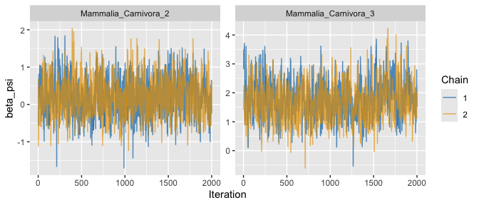<!-- -->

For Mammalia_Carnivora_2 the two chains overlap throughout. For Mammalia_Carnivora_3, chain 1 makes more frequent and higher excursions than the other, so its mean is 1.79 against 1.673. In short, the chains disagree about how high the rate can go, and that disagreement is what `rhat` measures.

What to do about a flagged parameter:

- **Ask whether it matters for your question.** For instance, a flagged field false-positive rate (`theta0`) matters less if you are interested in covariate effects (`beta_psi` and `beta_theta`), but it matters more if you want to know where a species really occurs.
- **Run longer chains and check again.** For this dataset and fit, we have found that a run of 10,000 burn-in and 10,000 kept iterations, without thinning, cleared every flag. More iterations do not always help, though.
- **If a parameter will not settle, the data may not pin it down.** Here the flags belong to Mammalia_Carnivora_3, Mammalia_Artiodactyla_1, Mammalia_Rodentia_1, Mammalia_Rodentia_2, Mammalia_Eulipotyphla_2, and Amphibia_Anura_3. Mammalia_Carnivora_3 is estimated to occupy about 52 of the 100 sites. Its field false-positive rate can only be learned from the sites it does not occupy, and here there are few of them.
- **Report it.** Say which parameters missed the rule and by how much.

When it finishes, `runOccJSDM()` also checks each block of parameters, including some that the `diagnostics` table does not cover, and warns about any block whose largest `rhat` exceeds 1.1 or whose smallest `ess` is below 50. You see these warnings only if you fit live; this fit produced none.

For this quickstart, we now move on to the results.

## Looking at the results

Each section below draws one kind of result and describes what it tells you. The tables that go with them are collected in [Save the results as tables](#save-the-results-as-tables).

### How widespread is each species?

Each species’ baseline occupancy probability, with its 95% credible interval: the chance that it occupies a site with average elevation and human modification that is not protected.

``` r
plotOccupancyRates(fit)
```

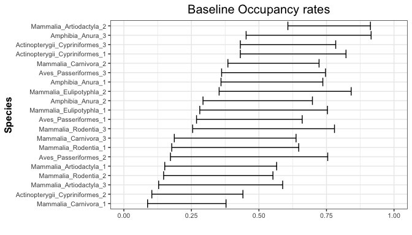<!-- -->

This tells you which species are common and which are rare once missed detections and false positives are allowed for. Here the baseline ranges from 0.21 (Mammalia_Carnivora_1) to 0.78 (Mammalia_Artiodactyla_2).

### Which species are at which sites?

occJSDM gives two occupancy probabilities for every surveyed site and species combination (100 × 20 = 2,000 in this dataset), and they answer different questions:

- The **predictive** probability (`computePredictiveOccupancyProbs()`) comes from the site’s measured environmental covariates and its hidden environmental covariates, which occJSDM estimates from the whole community’s detections at that site. Use it for maps and to compare habitats. For sites that were not surveyed, `predictNewSites()` gives the same kind of probability from the measured covariates alone, because the hidden covariates of a new site are unknown (see [What would occupancy be at new sites?](#what-would-occupancy-be-at-new-sites)).
- The **conditional** probability (`computeConditionalOccupancyProbs()`) also takes into account what was detected for that species at that site. Use it to ask whether a species is actually at a surveyed site. It exists only for sites in the input data.

Both are posterior means; the package does not yet return their intervals.

``` r
predictive <- computePredictiveOccupancyProbs(fit)
conditional <- computeConditionalOccupancyProbs(fit)

occ_site <- data.frame(
  Site = rep(fit$infos$siteNames, times = length(species)),
  species = rep(species, each = length(fit$infos$siteNames)),
  predictive = as.vector(predictive),
  conditional = as.vector(conditional)
)
head(occ_site)
```

    #>   Site              species predictive conditional
    #> 1    1 Mammalia_Carnivora_1 0.94394379     0.99125
    #> 2    2 Mammalia_Carnivora_1 0.01998612     0.00250
    #> 3    3 Mammalia_Carnivora_1 0.37171475     0.08375
    #> 4    4 Mammalia_Carnivora_1 0.30283547     0.03450
    #> 5    5 Mammalia_Carnivora_1 0.72544360     0.99225
    #> 6    6 Mammalia_Carnivora_1 0.01447544     0.00100

To see the difference, here are both probabilities for one species against elevation, with the sites where it was detected at least once shown as filled points:

``` r
library(ggplot2)
detected <- rowsum((OTU > 0) * 1, info$Site) > 0  # site by species: any positive PCR
site_elevation <- info$elevation[match(fit$infos$siteNames, info$Site)]
one <- "Mammalia_Carnivora_1"
one_species <- data.frame(
  elevation = rep(site_elevation, 2),
  probability = c(predictive[, one], conditional[, one]),
  which = factor(rep(c("predictive", "conditional"), each = length(site_elevation)),
                 levels = c("predictive", "conditional")),
  detected = rep(detected[as.character(fit$infos$siteNames), one], 2)
)
ggplot(one_species, aes(elevation, probability, shape = detected)) +
  geom_point() +
  scale_shape_manual(values = c(`TRUE` = 16, `FALSE` = 1)) +
  facet_wrap(~ which) +
  labs(x = "Elevation (m)", y = "Occupancy probability", title = one)
```

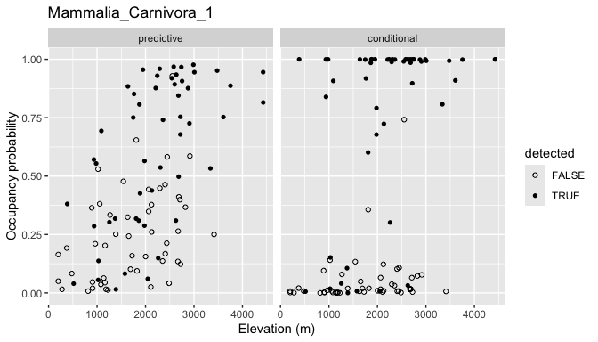<!-- -->

Where Mammalia_Carnivora_1 was not detected, its conditional probability falls below the predictive one, because each non-detection is some evidence of absence. Where it was detected, the conditional probability is mostly close to 1; the few detected sites well below 1 are ones where the model puts the detections down to contamination.

### How do species respond to the environment?

#### `plotOccupancyCovariates()`

Each species’ occupancy coefficient for each covariate, with its 95% credible interval. The coefficients are on the logit scale; elevation and human modification are per standard deviation, and `protectedprotected` is the effect of `protected` compared with `not_protected` (the name joins the column and the level).

``` r
plotOccupancyCovariates(fit, covName = "elevation")
```

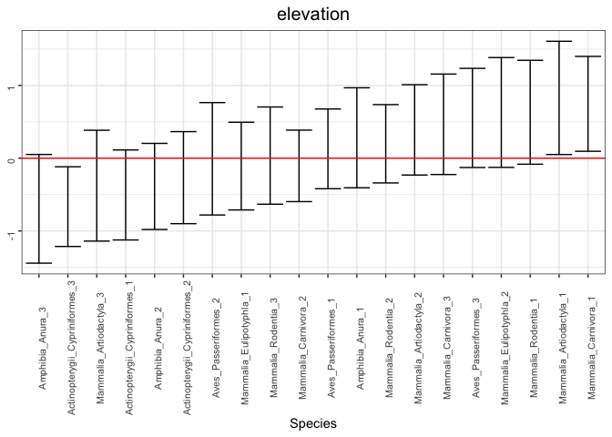<!-- -->

``` r
plotOccupancyCovariates(fit, covName = "hmi")
```

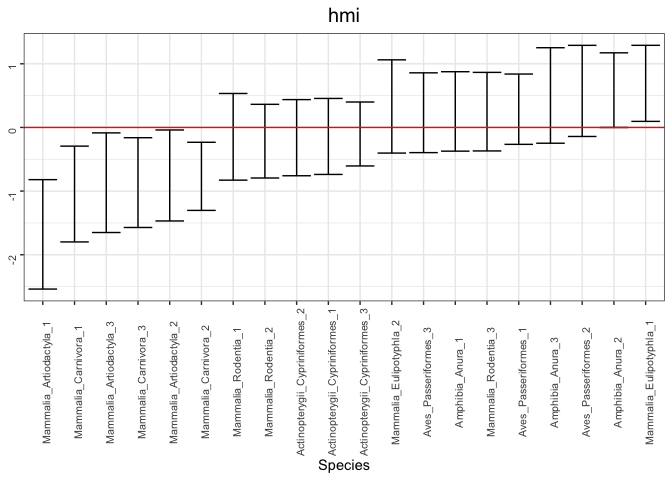<!-- -->

``` r
plotOccupancyCovariates(fit, covName = "protectedprotected")
```

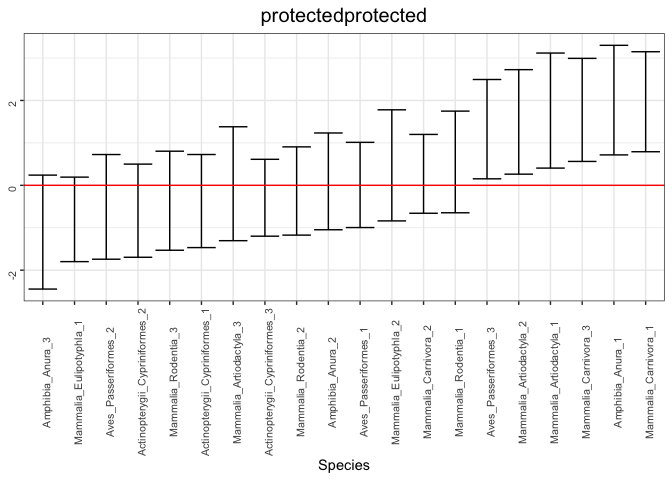<!-- -->

A coefficient whose interval excludes zero is a clear response. Here 3, 7 and 6 of the 20 species respond clearly to elevation, human modification and protection respectively.

#### `plotOccupancyGradient()`

The coefficients above are on the logit scale, which is hard to visualise. The same effects are easier to read as occupancy probabilities. For the numeric covariates, `plotOccupancyGradient()` draws each species’ occupancy against the covariate in its original units, holding the other covariates at typical values (the subtitle says which):

``` r
plotOccupancyGradient(fit, covName = "elevation", idx_species = 1:4)
```

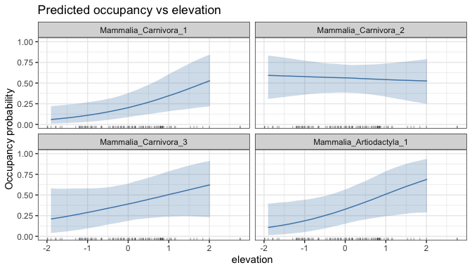<!-- -->

``` r
plotOccupancyGradient(fit, covName = "hmi", idx_species = 1:4)
```

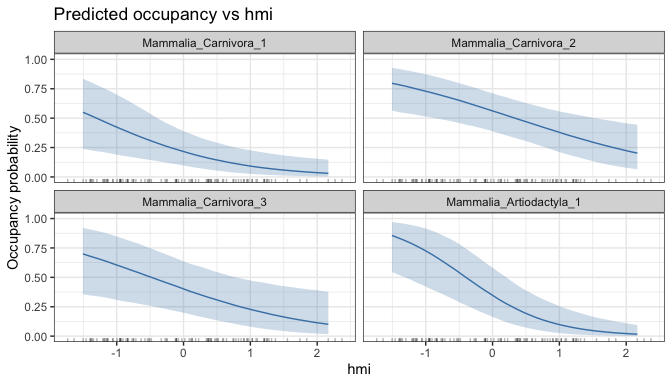<!-- -->

And for the factor, occupancy at each level:

``` r
plotCovariateEffect(fit, covNames = "protected", idx_species = 1:4)[[1]]
```

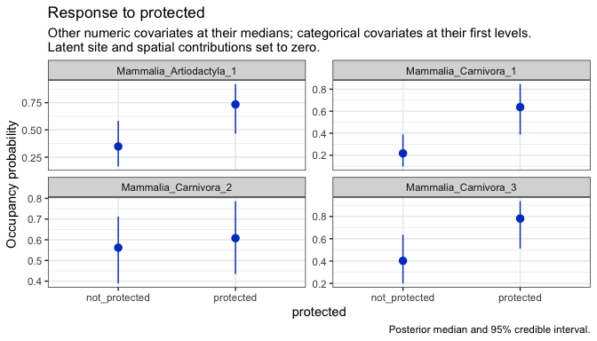<!-- -->

`idx_species` picks which species to draw; leave it out to draw all species.

#### Judging whether a species responds

Overlapping intervals for the two levels do not mean the difference between them is unclear. To judge whether a species responds to a covariate (here, elevation, hmi, protection), use `plotOccupancyCovariates()`, not `plotCovariateEffect()`. For `protected`, the coefficient shown by `plotOccupancyCovariates()` is the difference between the protected and not-protected levels, on the logit scale. For `elevation` and `hmi`, it is the change in occupancy, on the logit scale, for an increase of one standard deviation: 891 m of elevation, or 0.16 of hmi. In both cases, an interval that excludes zero means a clear response: positive if occupancy is higher in protected areas or rises with the covariate, negative if it is lower or falls.

### Do species’ traits explain their responses? (trait x environment interactions)

occJSDM lets each species’ response to a covariate depend partly on its traits. Recall that one of the input tables is `traits`, which measures `log10_body_mass` and Red List status (`red_listed`) for each species. The trait-by-environment coefficient says how much: a negative coefficient for `log10_body_mass` on `hmi` would mean that larger species decline more steeply with human modification. Traits are standardised before fitting, so each coefficient is per standard deviation of the trait (for the 0/1 `red_listed`, one standard deviation is 0.47).

``` r
plotTraitsCoefficients(fit, covName = "hmi")
```

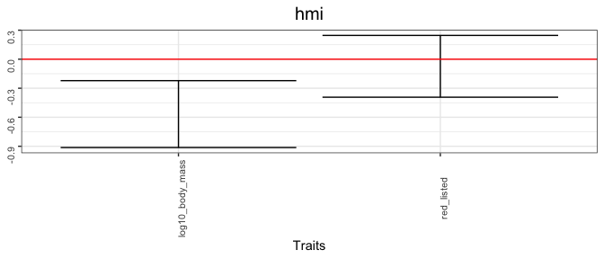<!-- -->

``` r
plotTraitsCoefficients(fit, covName = "protectedprotected")
```

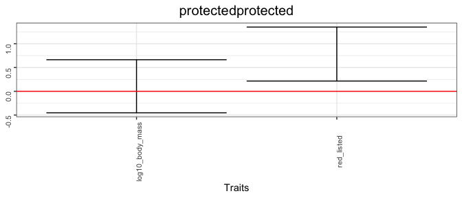<!-- -->

The coefficient of `log10_body_mass` on `hmi` is -0.54 (95% interval -0.87 to -0.24), and that of `red_listed` on protection is 0.80 (0.22 to 1.35).

We can also plot the species responses. Here each species’ estimated response to human modification is plotted against its body mass; `plotTraitsCoefficients()` has already shown us that heavier species respond more negatively to human modification. The plot shows us this for each species. The dashed line is drawn through the centre of the points (the mean body mass and the mean response).

``` r
slopes <- data.frame(
  species = species,
  log10_body_mass = traits[species, "log10_body_mass"],
  red_listed = traits[species, "red_listed"] == 1,
  slope = apply(B[, "hmi", ], 2, mean) # the slopes are the responses
)
# The coefficient is per SD of the trait; convert it to per unit of log10 body mass.
scaling <- fit$infos$list_Tr_mat
line_slope <- median(G[, "hmi", "log10_body_mass"]) / scaling$sd_df[["log10_body_mass"]]
line_intercept <- mean(slopes$slope) - line_slope * mean(slopes$log10_body_mass)
ggplot(slopes, aes(log10_body_mass, slope, shape = red_listed)) +
  geom_abline(intercept = line_intercept, slope = line_slope, linetype = 2) +
  geom_point(size = 2) +
  scale_shape_manual(values = c(`TRUE` = 16, `FALSE` = 1), name = "Red Listed") +
  labs(x = "log10 body mass (kg)", y = "Response to human modification (logit, per SD)")
```

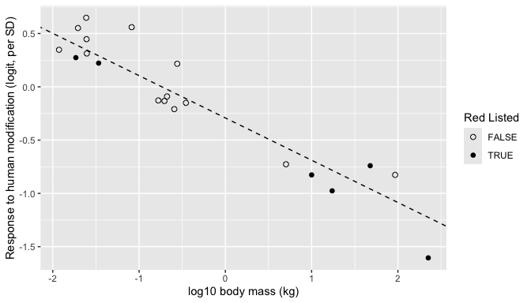<!-- -->

### How well were the species collected and detected?

Detection happens in two stages, each with its own false positives:

- In the field, a water sample from an occupied site collects a species’ DNA with the collection probability; a sample from an unoccupied site can still pick it up through contamination, with the field false-positive rate (`theta0`).
- In the lab, a PCR on a sample containing the DNA detects it with the detection probability (`p`, one per primer); a PCR on a sample without it can still give a positive through contamination, with the lab false-positive rate (`q`).

This figure, laid out like Supplementary Figure 3 of Ji et al. (2025), shows the true-positive probabilities with 95% intervals, and marks the false-positive rates as short ticks at the left:

``` r
summarise_draws <- function(x) c(mean = mean(x),
                                 lower = unname(quantile(x, 0.025)),
                                 upper = unname(quantile(x, 0.975)))

draws <- list(beta_theta = returnPosteriorDraws(fit, "beta_theta"),
              theta0 = returnPosteriorDraws(fit, "theta0"),
              p = returnPosteriorDraws(fit, "p"),
              q = returnPosteriorDraws(fit, "q"))
rows <- list()
for (s in species) {
  # Collection probability at the average water volume: the intercept on the probability scale.
  rows[[length(rows) + 1]] <- data.frame(species = s, stage = "Field", rate = "true positive",
    primer = "field sample", t(summarise_draws(plogis(draws$beta_theta["(Intercept)", s, , ]))))
  rows[[length(rows) + 1]] <- data.frame(species = s, stage = "Field", rate = "false positive",
    primer = "field sample", t(summarise_draws(draws$theta0[1, s, , ])))
  for (k in dimnames(draws$p)$primer) {
    rows[[length(rows) + 1]] <- data.frame(species = s, stage = "Lab", rate = "true positive",
      primer = paste("primer", k), t(summarise_draws(draws$p[k, s, , ])))
    rows[[length(rows) + 1]] <- data.frame(species = s, stage = "Lab", rate = "false positive",
      primer = paste("primer", k), t(summarise_draws(draws$q[k, s, , ])))
  }
}
detection_long <- do.call(rbind, rows)
detection_long$species <- factor(detection_long$species, levels = rev(species))

ggplot(subset(detection_long, rate == "true positive"),
       aes(x = mean, y = species, colour = primer)) +
  geom_pointrange(aes(xmin = lower, xmax = upper),
                  position = position_dodge(width = 0.6), size = 0.2) +
  geom_point(data = subset(detection_long, rate == "false positive"),
             aes(x = -0.04), shape = "|", size = 3,
             position = position_dodge(width = 0.6)) +
  geom_text(data = subset(detection_long, rate == "false positive"),
            aes(x = -0.04, label = round(mean, 2)), hjust = 1.3, size = 2,
            position = position_dodge(width = 0.6), show.legend = FALSE) +
  facet_wrap(~ stage) +
  scale_x_continuous(limits = c(-0.15, 1), breaks = seq(0, 1, 0.25)) +
  labs(x = "Probability (false-positive rate at left)", y = NULL, colour = NULL)
```

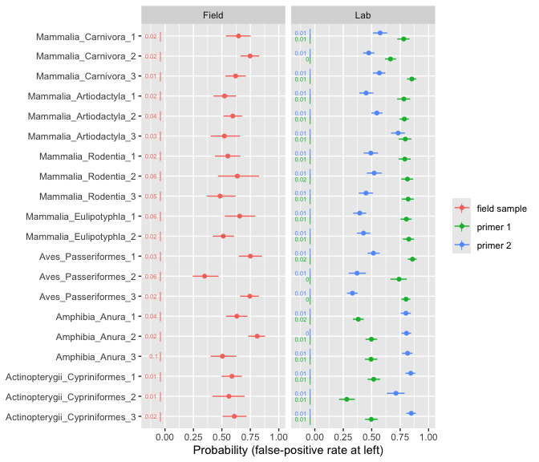<!-- -->

The field panel shows the probability that a sample collects each species’ DNA, given that the species is at the site (for a sample of average water volume), and the lab panel how often a PCR successfully amplifies the species, given that the species’ DNA is in the sample. Primer 1 has the higher detection probability for 14 species and primer 2 for 6, so neither primer is best for every species. The ticks show that false positives are rare: the highest estimated rate is 0.1, the field rate of Amphibia_Anura_3.

occJSDM can draw these separately and together.

``` r
plotCollectionRates(fit)   # collection probability (field)
```

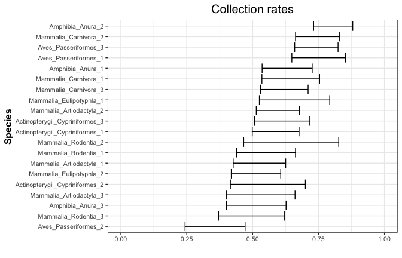<!-- -->

``` r
plotDetectionRates(fit)    # PCR detection probability (lab), per primer
```

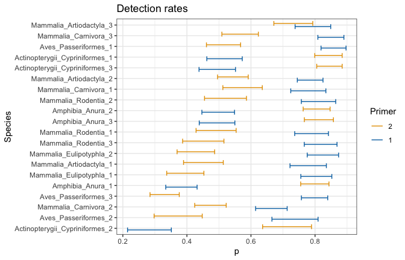<!-- -->

``` r
plotStage1FPRates(fit)     # field false-positive rate (theta0)
```

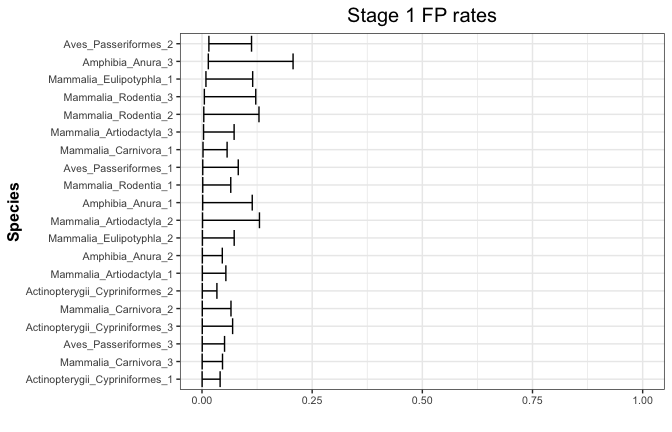<!-- -->

``` r
plotStage2FPRates(fit)     # PCR false-positive rate (q), per primer
```

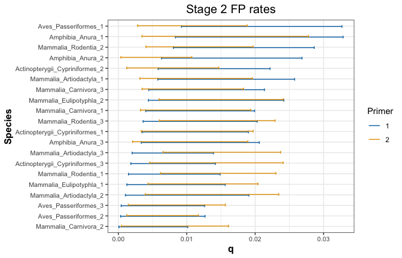<!-- -->

``` r
plotFPTPStage2Rates(fit)  # detection and false-positive rates together, for primer 1
```

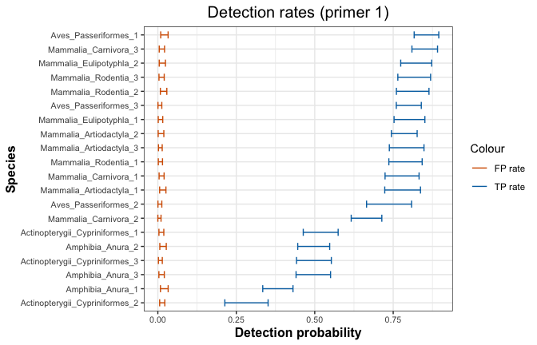<!-- -->

Each function takes `idx_species` to choose a subset of species, and `plotFPTPStage2Rates()` also takes `primerName` to choose the primer (it draws primer 1 by default):

``` r
plotFPTPStage2Rates(fit, idx_species = 1:4, primerName = 2)  # detection and false-positive rates for one primer
```

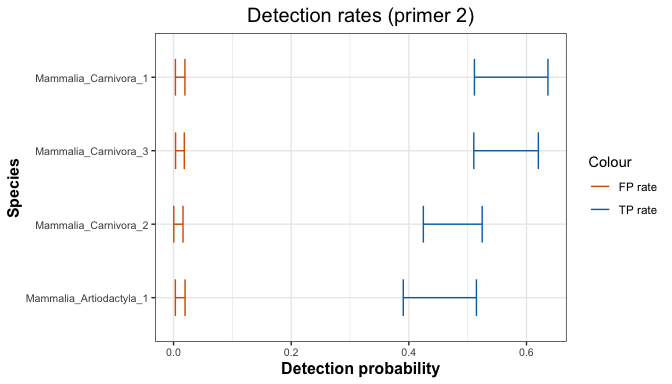<!-- -->

Finally, we can ask whether water volume affected the probability of collection. For 16 of the 20 species, a larger water sample clearly increases the probability of collecting their DNA:

``` r
plotCollectionCovariates(fit, covName = "water_volume")
```

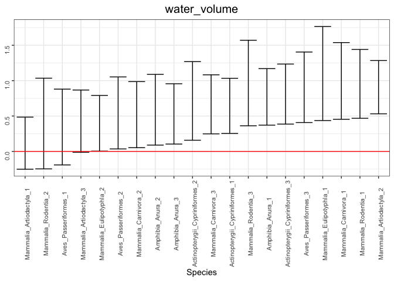<!-- -->

### What are the values of the hidden environmental covariates?

**Species can occur together, or avoid each other, more than the measured environmental covariates explain**, because they respond to the same *unmeasured* conditions (or because they interact). These leftover co-occurrence patterns are what occJSDM uses to estimate hidden environmental covariates, and the residual correlation matrix summarises them, with red for positive and blue for negative. Correlations whose 95% interval includes zero are crossed out, so the clear associations are the squares without a cross.

``` r
plotResidualCorrelationMatrix(fit)
```

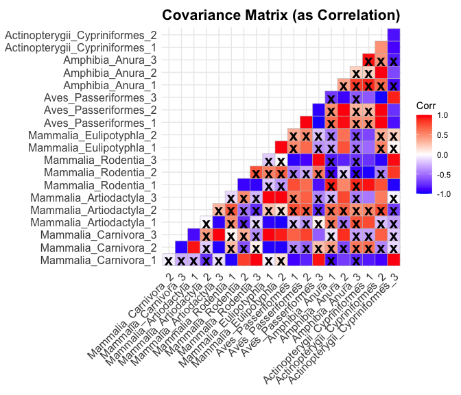<!-- -->

Of the 190 species pairs, 37 are clearly positively associated and 38 clearly negatively associated, beyond what the measured covariates explain. Such pairs share, or divide, some unmeasured habitat, which may be worth measuring in the next survey.

The values themselves are shown in an ordination, which plots the two hidden environmental covariates that the model estimated. Each point is a site, placed at its estimated values of the two hidden covariates, on a standardised scale, so sites close together have similar unmeasured conditions. Each arrow shows how a species responds: the species is more likely to occur at sites in the direction it points, and a longer arrow means a stronger response. Species whose arrows point the same way tend to occur at the same sites, and species pointing in opposite directions tend to occur at different sites, *after removing the effects of the measured covariates*. Unlike in a PCA, the axes are not ranked by importance, and neither is a particular real variable: an unmeasured condition can lie in any direction on the plot. (By convention, axis 1 points along the first species in the data, here Mammalia_Carnivora_1.)

``` r
plotBiplot(fit)
```

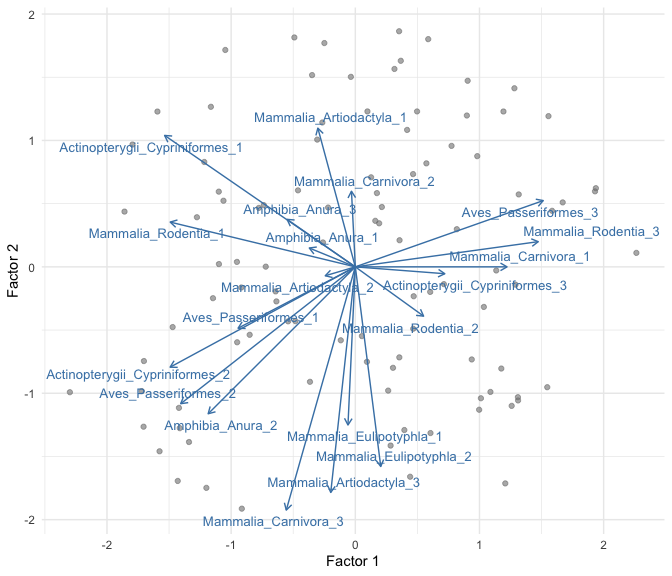<!-- -->

`returnOrdinationScores()` returns them as numbers: the median and 95% interval for each site and hidden covariate. The medians for the first few sites:

``` r
scores <- returnOrdinationScores(fit)  # 2.5%, 50% and 97.5% by site by hidden covariate
hidden <- data.frame(
  site = dimnames(scores)[[2]],
  hidden_1 = scores["50%", , 1],
  hidden_2 = scores["50%", , 2],
  row.names = NULL
)
head(hidden)
```

    #>   site   hidden_1     hidden_2
    #> 1    1  0.7964221  0.307639275
    #> 2    2 -0.7516902 -0.006430534
    #> 3    3 -1.0866117  0.666239701
    #> 4    4 -0.9429887 -0.600878532
    #> 5    5  0.5346641  1.233754370
    #> 6    6 -1.4612268 -1.269311308

The value at any one site is uncertain: 82% of their 95% intervals include zero, and a typical interval is 3 units wide on a scale whose standard deviation is about 1. So read the ordination and the medians as broad patterns across many sites, not as a value to trust at a single site.

If you later measure a candidate covariate for the unmeasured condition at the same sites, compare it with both hidden covariates together, for example by regressing it on `hidden_1` and `hidden_2` with `lm()`. Because neither axis is a particular real variable, a real condition usually lines up with a combination of the two, and comparing it with one axis alone can miss it. Using this method to identify hidden environmental covariates is one of the advantages of JSDMs over stacked SDMs.

### How much do the measured covariates explain?

For each species, the share of its occupancy variation explained by the measured covariates and the share left to the hidden environmental covariates:

``` r
vp <- returnVariationPartitioning(fit)
vp_long <- data.frame(
  species = factor(rep(vp$Species, 2), levels = rev(vp$Species)),
  source = rep(c("Measured covariates", "Hidden environmental covariates"), each = nrow(vp)),
  share = c(vp$Env, vp$Biotic)
)
ggplot(vp_long, aes(share, species, fill = source)) +
  geom_col() +
  labs(x = "Share of occupancy variation", y = NULL, fill = NULL) +
  theme(legend.position = "bottom")
```

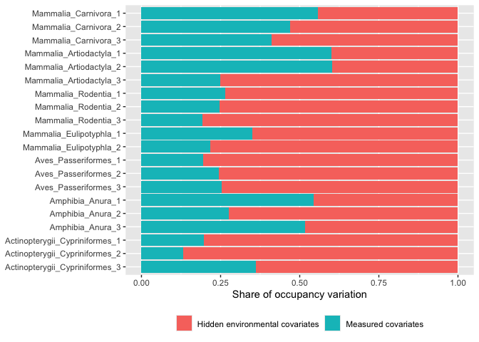<!-- -->

The measured covariates explain between 13% and 60% of each species’ variation. (`plotVariationPartitioning()` draws a ternary plot with a third share for the spatial field, which this fit does not include.)

### How many species are at each site?

The expected number of species at a site is the sum of its conditional occupancy probabilities (e.g. `0.1 + 0.72 + 0.38 + 0.95 + ...`). Because the species are named by class and order, the same sum over a subset gives the expected number of mammals, carnivores and so on:

``` r
classes <- sub("_.*", "", species)
orders <- sub("^[^_]+_([^_]+)_.*$", "\\1", species)
group_sums <- function(group) sapply(split(species, group), function(g) rowSums(conditional[, g, drop = FALSE]))
richness_wide <- cbind(All = rowSums(conditional), group_sums(classes), group_sums(orders))
richness <- data.frame(
  Site = rep(fit$infos$siteNames, times = ncol(richness_wide)),
  group = rep(colnames(richness_wide), each = nrow(richness_wide)),
  expected_richness = as.vector(richness_wide)
)
head(richness)
```

    #>   Site group expected_richness
    #> 1    1   All          10.66125
    #> 2    2   All           9.14125
    #> 3    3   All          10.53225
    #> 4    4   All          11.01675
    #> 5    5   All           8.30225
    #> 6    6   All          12.46825

``` r
ggplot(subset(richness, group %in% c("All", unique(classes))),
       aes(rep(site_elevation, length(unique(group))), expected_richness)) +
  geom_point(size = 1) +
  facet_wrap(~ group, scales = "free_y") +
  labs(x = "Elevation (m)", y = "Expected number of species")
```

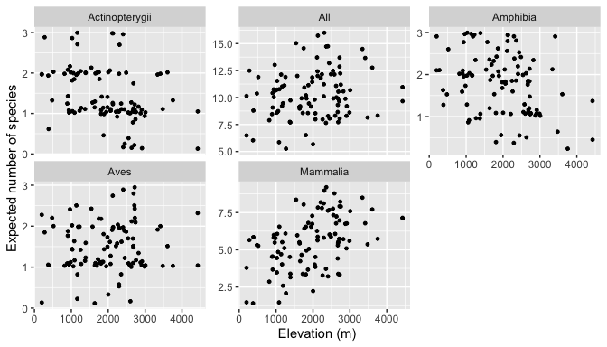<!-- -->

Expected richness correlates with elevation at 0.47 for mammals and -0.39 for fish, so the two groups are concentrated in different parts of the elevation range.

> These are posterior means. To get intervals, we would need the occupancy state of every species at every site in each posterior draw, which occJSDM does not yet return.

### What would occupancy be at new sites?

`predictNewSites()` predicts occupancy, with intervals, at sites you did not survey, from the values of their measured covariates, in their original units. (This does assume that you have measured these covariates at unsurveyed sites, which might require some fieldwork.)

Here we predict along an elevation gradient, inside and outside protected areas, at low and at high human modification (hmi of 0.2 and 0.5, both within the range of the surveyed sites). The factor must have the same levels as in the fitted data. `useBiotic = FALSE` leaves out the hidden environmental covariates, whose values at unsurveyed sites are unknown.

``` r
# results = "hide" keeps the progress lines that predictNewSites() prints out of this page
new_sites <- expand.grid(
  elevation = seq(500, 4000, by = 500),
  hmi = c(0.2, 0.5),
  protected = factor(c("not_protected", "protected"), levels = levels(info$protected))
)
prediction <- predictNewSites(fit, X_psi = new_sites, useBiotic = FALSE)
```

``` r
dim(prediction)  # quantile by site by species
```

    #> [1]  3 32 20

One panel for each level of human modification. The panels share the occupancy axis, so they can be compared directly:

``` r
red_species <- species[traits[species, "red_listed"] == 1][1]
predicted <- cbind(new_sites, t(prediction[, , match(red_species, species)]))  # the array has no species names
names(predicted)[4:6] <- c("lower", "median", "upper")

ggplot(predicted, aes(elevation, median,
                      colour = protected, fill = protected)) +
  geom_ribbon(aes(ymin = lower, ymax = upper), alpha = 0.2, colour = NA) +
  geom_line() +
  facet_wrap(~ hmi, labeller = label_both) +  # facets share the y axis by default
  guides(colour = guide_legend(reverse = TRUE),
         fill = guide_legend(reverse = TRUE)) +  # protected on top
  labs(x = "Elevation (m)", y = "Predicted occupancy", title = red_species)
```

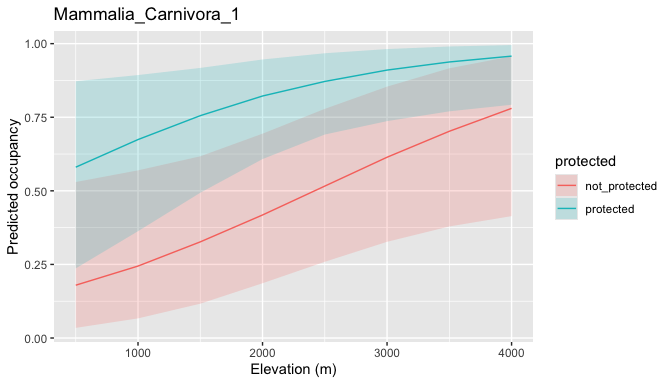<!-- -->

Mammalia_Carnivora_1 is the species that we predict, and it is Red Listed. Its predicted occupancy is higher inside protected areas than outside at 16 of the 16 combinations of elevation and human modification, by 0.14 to 0.44. Higher human modification lowers it at 16 of the 16 combinations of elevation and protection, by 0.14 to 0.44.

### Would more field samples or PCRs help?

`plotCumulativeSpeciesDetections()` answers this for a site where every one of the 20 species is present: how many of them would be detected, with a 95% interval, using up to `M` field samples and up to `K` PCR replicates of one primer (here primer 1). The first plot puts PCR replicates on the x axis, with one row per number of field samples; `byK = FALSE` swaps them:

``` r
set.seed(20261101)  # the plot simulates detections, so a seed gives the same result every time
cumulative <- plotCumulativeSpeciesDetections(fit, M = 6, K = 6, primer = 1)
cumulative
```

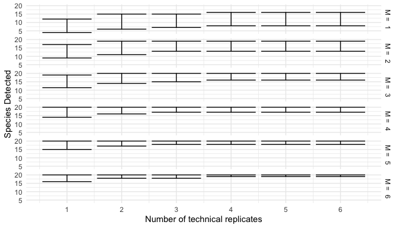<!-- -->

``` r
plotCumulativeSpeciesDetections(fit, M = 6, K = 6, primer = 1, byK = FALSE)
```

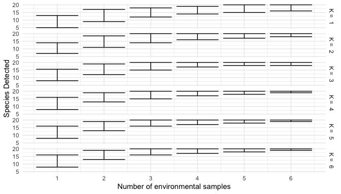<!-- -->

Where the intervals stop rising, extra effort adds little. From this survey’s design (3 water samples per site, 3 PCRs per primer), going to 6 PCRs per primer raises the midpoint of the interval by 0.5 species, and going to 6 samples raises it by 1.5. For this survey, more water samples would pay off better than more PCRs.

## Save the results as tables

Every result above can be saved as a table, one row per estimate, for a paper’s supplement, a report or further analysis. Each is an ordinary data frame, so `write.csv()` saves it, for example:

``` r
write.csv(occ_site, "occupancy_by_site.csv", row.names = FALSE)
```

`summarise_draws()`, defined in the detection section, gives the mean and 95% interval of a set of posterior draws, and the tables below use it throughout.

### Occupancy at each site

The two occupancy probabilities for every site and species, with the raw evidence beside them: how many of the site’s water samples had at least one positive PCR, and how many of its PCRs were positive.

``` r
positive <- OTU >= fit$infos$threshold  # PCR by species: detection or not
site_sample <- interaction(info$Site, info$Sample, drop = TRUE)
sample_positive <- rowsum(positive * 1, site_sample) > 0  # water sample by species
sample_site <- info$Site[match(rownames(sample_positive), site_sample)]
site_ids <- as.character(fit$infos$siteNames)
samples_positive <- rowsum(sample_positive * 1, sample_site)[site_ids, species]
samples_total <- as.vector(table(sample_site)[site_ids])
pcrs_positive <- rowsum(positive * 1, info$Site)[site_ids, species]
pcrs_total <- as.vector(table(info$Site)[site_ids])

occ_site$positive_samples <- as.vector(samples_positive)
occ_site$samples <- rep(samples_total, times = length(species))
occ_site$positive_pcrs <- as.vector(pcrs_positive)
occ_site$pcrs <- rep(pcrs_total, times = length(species))
head(occ_site)
```

    #>   Site              species predictive conditional positive_samples samples
    #> 1    1 Mammalia_Carnivora_1 0.94394379     0.99125                1       3
    #> 2    2 Mammalia_Carnivora_1 0.01998612     0.00250                0       3
    #> 3    3 Mammalia_Carnivora_1 0.37171475     0.08375                0       3
    #> 4    4 Mammalia_Carnivora_1 0.30283547     0.03450                1       3
    #> 5    5 Mammalia_Carnivora_1 0.72544360     0.99225                2       3
    #> 6    6 Mammalia_Carnivora_1 0.01447544     0.00100                0       3
    #>   positive_pcrs pcrs
    #> 1             4   18
    #> 2             0   18
    #> 3             0   18
    #> 4             1   18
    #> 5            11   18
    #> 6             0   18

### Expected species richness

``` r
head(richness)
```

    #>   Site group expected_richness
    #> 1    1   All          10.66125
    #> 2    2   All           9.14125
    #> 3    3   All          10.53225
    #> 4    4   All          11.01675
    #> 5    5   All           8.30225
    #> 6    6   All          12.46825

### Each species’ occupancy and detection

One row per species: baseline occupancy, then each detection probability and false-positive rate from the detection figure, each with its mean and 95% interval.

``` r
baseline_draws <- returnOccupancyRates(fit)
baseline_table <- data.frame(species = species,
  t(sapply(species, function(s) summarise_draws(baseline_draws[, s]))))
names(baseline_table)[-1] <- paste0("baseline_occupancy_", names(baseline_table)[-1])

detection_long$quantity <- with(detection_long, ifelse(
  stage == "Field",
  ifelse(rate == "true positive", "collection", "field_false_positive"),
  paste0(ifelse(rate == "true positive", "detection_", "lab_false_positive_"),
         sub(" ", "", primer))))
detection_wide <- reshape(
  detection_long[, c("species", "quantity", "mean", "lower", "upper")],
  idvar = "species", timevar = "quantity", direction = "wide", sep = "_")
# reshape() names columns statistic first ("mean_collection"); put the quantity first.
names(detection_wide) <- sub("^(mean|lower|upper)_(.*)$", "\\2_\\1", names(detection_wide))
detection_profile <- merge(baseline_table, detection_wide, by = "species", sort = FALSE)
names(detection_profile)
```

    #>  [1] "species"                          "baseline_occupancy_mean"         
    #>  [3] "baseline_occupancy_lower"         "baseline_occupancy_upper"        
    #>  [5] "collection_mean"                  "collection_lower"                
    #>  [7] "collection_upper"                 "field_false_positive_mean"       
    #>  [9] "field_false_positive_lower"       "field_false_positive_upper"      
    #> [11] "detection_primer1_mean"           "detection_primer1_lower"         
    #> [13] "detection_primer1_upper"          "lab_false_positive_primer1_mean" 
    #> [15] "lab_false_positive_primer1_lower" "lab_false_positive_primer1_upper"
    #> [17] "detection_primer2_mean"           "detection_primer2_lower"         
    #> [19] "detection_primer2_upper"          "lab_false_positive_primer2_mean" 
    #> [21] "lab_false_positive_primer2_lower" "lab_false_positive_primer2_upper"

``` r
head(detection_profile[, 1:7])
```

    #>                   species baseline_occupancy_mean baseline_occupancy_lower
    #> 1    Mammalia_Carnivora_1               0.2109519                0.0878658
    #> 2    Mammalia_Carnivora_2               0.5589355                0.3851396
    #> 3    Mammalia_Carnivora_3               0.3964375                0.1867493
    #> 4 Mammalia_Artiodactyla_1               0.3352183                0.1513847
    #> 5 Mammalia_Artiodactyla_2               0.7786903                0.6071220
    #> 6 Mammalia_Artiodactyla_3               0.3350513                0.1288267
    #>   baseline_occupancy_upper collection_mean collection_lower collection_upper
    #> 1                0.3782598       0.6462035        0.5351612        0.7540891
    #> 2                0.7225921       0.7472916        0.6627107        0.8287881
    #> 3                0.6374365       0.6206160        0.5302884        0.7103777
    #> 4                0.5656302       0.5237191        0.4261652        0.6253207
    #> 5                0.9126814       0.5951725        0.5137220        0.6776404
    #> 6                0.5879193       0.5217793        0.4011004        0.6608472

### Environmental effects

One row per species and coefficient, on the logit scale, with whether the 95% interval excludes zero:

``` r
cov_effects <- expand.grid(coefficient = dimnames(B)[[2]], species = species,
                           stringsAsFactors = FALSE)[, c("species", "coefficient")]
cov_effects <- cbind(cov_effects, t(mapply(function(s, k) summarise_draws(B[, k, s]),
                                           cov_effects$species, cov_effects$coefficient)))
cov_effects$excludes_zero <- cov_effects$lower > 0 | cov_effects$upper < 0
rownames(cov_effects) <- NULL
head(cov_effects)
```

    #>                species        coefficient        mean      lower      upper
    #> 1 Mammalia_Carnivora_1          elevation  0.74414032  0.1349591  1.4333857
    #> 2 Mammalia_Carnivora_1                hmi -0.97617329 -1.7404341 -0.2667189
    #> 3 Mammalia_Carnivora_1 protectedprotected  1.91058121  0.7550454  3.2487078
    #> 4 Mammalia_Carnivora_2          elevation -0.07139485 -0.5649723  0.4268145
    #> 5 Mammalia_Carnivora_2                hmi -0.72683966 -1.2719572 -0.2149193
    #> 6 Mammalia_Carnivora_2 protectedprotected  0.20826166 -0.7096157  1.1797593
    #>   excludes_zero
    #> 1          TRUE
    #> 2          TRUE
    #> 3          TRUE
    #> 4         FALSE
    #> 5          TRUE
    #> 6         FALSE

### Trait-by-environment effects

One row per trait and covariate:

``` r
trait_env <- expand.grid(trait = dimnames(G)[[3]], covariate = dimnames(G)[[2]],
                         stringsAsFactors = FALSE)
trait_env <- cbind(trait_env, t(mapply(function(tr, k) summarise_draws(G[, k, tr]),
                                       trait_env$trait, trait_env$covariate)))
trait_env$excludes_zero <- trait_env$lower > 0 | trait_env$upper < 0
rownames(trait_env) <- NULL
trait_env
```

    #>             trait          covariate        mean       lower      upper
    #> 1 log10_body_mass          elevation -0.01346391 -0.32787793  0.3099990
    #> 2      red_listed          elevation  0.28866350 -0.03371873  0.6138030
    #> 3 log10_body_mass                hmi -0.54528548 -0.87473441 -0.2396036
    #> 4      red_listed                hmi -0.06790410 -0.38790229  0.2554758
    #> 5 log10_body_mass protectedprotected  0.10524823 -0.45230278  0.6637677
    #> 6      red_listed protectedprotected  0.79028840  0.21539124  1.3505637
    #>   excludes_zero
    #> 1         FALSE
    #> 2         FALSE
    #> 3          TRUE
    #> 4         FALSE
    #> 5         FALSE
    #> 6          TRUE

### Residual associations

Only the species pairs whose residual correlation has a 95% interval that excludes zero, which keeps the table short however many species there are:

``` r
pairs_idx <- which(pair, arr.ind = TRUE)
assoc_all <- data.frame(
  species_1 = species[pairs_idx[, 1]],
  species_2 = species[pairs_idx[, 2]],
  median = cor_q["50%", , ][pairs_idx],
  lower = cor_q["2.5%", , ][pairs_idx],
  upper = cor_q["97.5%", , ][pairs_idx]
)
assoc_pairs <- subset(assoc_all, lower > 0 | upper < 0)
rownames(assoc_pairs) <- NULL
nrow(assoc_pairs)
```

    #> [1] 75

``` r
head(assoc_pairs[order(-abs(assoc_pairs$median)), ])
```

    #>                  species_1                      species_2     median      lower
    #> 15 Mammalia_Artiodactyla_3        Mammalia_Eulipotyphla_1  0.9820741  0.7878456
    #> 62    Aves_Passeriformes_1 Actinopterygii_Cypriniformes_2  0.9818822  0.7979446
    #> 5     Mammalia_Carnivora_3        Mammalia_Artiodactyla_3  0.9816878  0.8151113
    #> 64    Aves_Passeriformes_3 Actinopterygii_Cypriniformes_2 -0.9816507 -0.9999528
    #> 46    Aves_Passeriformes_2               Amphibia_Anura_2  0.9780605  0.7409533
    #> 36    Aves_Passeriformes_1           Aves_Passeriformes_3 -0.9773162 -0.9999447
    #>         upper
    #> 15  0.9999604
    #> 62  0.9999445
    #> 5   0.9999705
    #> 64 -0.8272817
    #> 46  0.9999592
    #> 36 -0.7623376

### Hidden environmental covariates

Each site’s estimated values of the two hidden environmental covariates, with 95% intervals:

``` r
n_hidden <- dim(scores)[3]
hidden_table <- data.frame(
  site = rep(dimnames(scores)[[2]], times = n_hidden),
  covariate = rep(paste0("hidden_", seq_len(n_hidden)), each = dim(scores)[2]),
  median = as.vector(scores["50%", , ]),
  lower = as.vector(scores["2.5%", , ]),
  upper = as.vector(scores["97.5%", , ])
)
head(hidden_table)
```

    #>   site covariate     median      lower       upper
    #> 1    1  hidden_1  0.7964221 -0.3004775 2.231718024
    #> 2    2  hidden_1 -0.7516902 -2.4639255 0.515912159
    #> 3    3  hidden_1 -1.0866117 -2.8331841 0.255096303
    #> 4    4  hidden_1 -0.9429887 -2.4885424 0.185072379
    #> 5    5  hidden_1  0.5346641 -0.7422857 2.077200680
    #> 6    6  hidden_1 -1.4612268 -3.3114622 0.006098331

### Convergence

The convergence table from the start of this page is itself worth reporting, at least for the flagged parameters:

``` r
flagged
```

    #> # A tibble: 10 × 5
    #>    param      label1                  label2                   rhat   ess
    #>    <chr>      <chr>                   <chr>                   <dbl> <dbl>
    #>  1 beta0_psi  Mammalia_Eulipotyphla_2 1                        1.01  509.
    #>  2 beta_psi   elevation               Mammalia_Rodentia_1      1.01  651.
    #>  3 beta_psi   elevation               Mammalia_Eulipotyphla_2  1.01  721.
    #>  4 beta_psi   elevation               Amphibia_Anura_3         1.01  854.
    #>  5 beta_psi   hmi                     Mammalia_Artiodactyla_1  1.01  733.
    #>  6 beta_psi   protectedprotected      Mammalia_Carnivora_3     1.02  604.
    #>  7 beta_psi   protectedprotected      Mammalia_Rodentia_1      1.00  291.
    #>  8 beta_psi   protectedprotected      Mammalia_Eulipotyphla_2  1.01  240.
    #>  9 beta_psi   protectedprotected      Amphibia_Anura_3         1.00  399.
    #> 10 beta_theta (Intercept)             Mammalia_Rodentia_2      1.01  388.

## Where to go next

- `?runOccJSDM` for every fitting argument, including the priors, and the help page of each function used above.
- The [teaching lessons](https://github.com/AlexDiana/occJSDM#teaching-lessons), which go beyond this quickstart: they explain what the model does, then fit it to simulated surveys whose truth is known and check its answers against that truth and against other packages. The README lists them with the question each one answers. Start with Lesson 1. They are still being reviewed.
- [Lesson 3](https://github.com/AlexDiana/occJSDM/blob/main/vignettes/occJSDM-lesson-3.md) reads these same outputs against a simulated survey whose truth is known, to show how far each can be trusted.
- `vignette("simulateOccJSDMData", package = "occJSDM")` to simulate a survey of your own design.
- The [Known limitations](https://github.com/AlexDiana/occJSDM#known-limitations) section of the README, before relying on the estimates.
