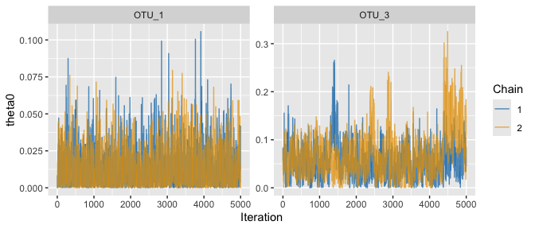
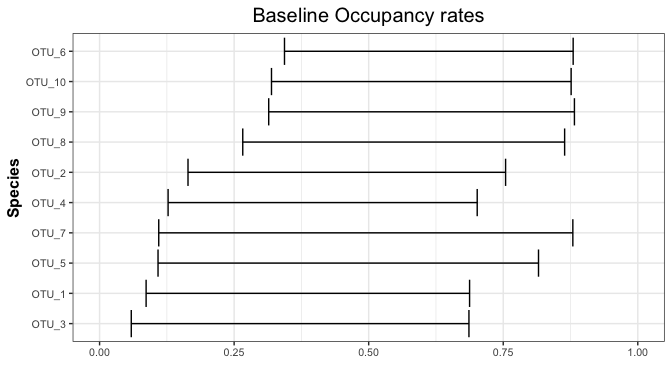
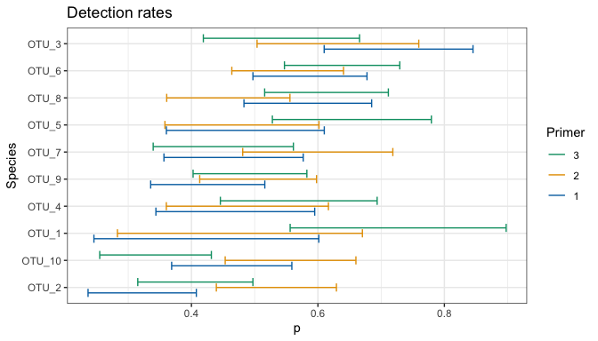

occJSDM: quickstart
================

occJSDM uses eDNA surveys to estimate which species occupy which sites. It allows for false negatives (from imperfect field collection, imperfect PCR detection or both) and for false positives (from contamination in the field, in the lab or both). It models the species jointly: their responses to the environment, the role of their traits, and associations between species that the covariates do not explain, optionally with a spatial field, although note that the spatial field submodel requires considerable field data. It can also analyse ordinary presence/absence surveys, in which each species is recorded as present or absent at each site and the records are assumed to be free of detection error. In that case occJSDM fits only the joint species distribution model (JSDM).

This quickstart shows how the input data must be structured, makes a fitting call and takes a first look at the output, using the example data shipped with the package.

## The example data

`sampledata` is a simulated two-stage eDNA survey of 10 species at 100 sites, stored as an R list. Each site has `M = 3` field samples, and each sample was tested with `P = 3` primers, with `K = 2` PCR replicates per sample-primer combination.

``` r
library(occJSDM)

sampledata <- sampledata # this loads the package's sampledata into your environment
str(sampledata, max.level = 1)
```

    #> List of 3
    #>  $ info  :'data.frame':  1800 obs. of  9 variables:
    #>  $ OTU   : num [1:1800, 1:10] 0 0 0 0 0 0 0 0 0 0 ...
    #>   ..- attr(*, "dimnames")=List of 2
    #>  $ traits: num [1:10, 1:3] 0.291 1.066 -0.388 0.745 -0.786 ...
    #>   ..- attr(*, "dimnames")=List of 2

``` r
head(sampledata$info)
```

    #>   Site Sample Primer X_psi.EnvCov.1 X_psi.EnvCov.2      Xs.1      Xs.2
    #> 1    1      1      1      0.8139789       1.023953 0.5219804 0.3722027
    #> 2    1      1      1      0.8139789       1.023953 0.5219804 0.3722027
    #> 3    1      1      2      0.8139789       1.023953 0.5219804 0.3722027
    #> 4    1      1      2      0.8139789       1.023953 0.5219804 0.3722027
    #> 5    1      1      3      0.8139789       1.023953 0.5219804 0.3722027
    #> 6    1      1      3      0.8139789       1.023953 0.5219804 0.3722027
    #>   X_theta.1  X_theta.2
    #> 1 0.4053109 -0.9819493
    #> 2 0.4053109 -0.9819493
    #> 3 0.4053109 -0.9819493
    #> 4 0.4053109 -0.9819493
    #> 5 0.4053109 -0.9819493
    #> 6 0.4053109 -0.9819493

``` r
head(sampledata$OTU)
```

    #>      OTU_1 OTU_2 OTU_3 OTU_4 OTU_5 OTU_6 OTU_7 OTU_8 OTU_9 OTU_10
    #> [1,]     0     0     0     0     0     0     0     0     0      0
    #> [2,]     0     0     0     0     0     0     0     0     0      0
    #> [3,]     0   103     0     0     0     0     0     0     0      0
    #> [4,]     0     0     0     0     0     0     0     0     0      0
    #> [5,]     0     0     0     0     0     0     0     0     0      8
    #> [6,]     0     0     3     0     0     0     0     0     0      0

``` r
head(sampledata$traits)
```

    #>          Trait_1    Trait_2     Trait_3
    #> OTU_1  0.2909804 -0.1002952  0.11265191
    #> OTU_2  1.0663243  0.7323336  0.67823219
    #> OTU_3 -0.3882628  0.3663281  0.10090282
    #> OTU_4  0.7448647 -0.9704403  0.09222693
    #> OTU_5 -0.7861890  1.9523576 -0.94755456
    #> OTU_6  0.7987446  0.2122473 -0.39934472

It has three parts:

- `info` has one row per PCR reaction: the `Site`, the field `Sample` the DNA came from, the `Primer`, and the covariates. Columns beginning `X_psi.` are occupancy covariates, columns beginning `X_theta.` are collection covariates, and `Xs.1` and `Xs.2` are the site coordinates.
- Look at the `info` dataframe in detail. How many rows are there per site? Why?

``` r
View(sampledata$info)
```

- `OTU` has one column per species and one row for each row of `info`, holding that species’ read count in that reaction. Read counts can be supplied as they are, without converting the OTU table: `runOccJSDM()` converts each count to a binary (detection or non-detection), and a PCR reaction with at least `threshold` reads counts as a detection.

- `traits` has one row per species.

`runOccJSDM()` uses the structure of `info` to choose which model to fit. Here each sample has several rows, one per primer and PCR replicate, so it fits the two-stage occupancy model. If instead `info` had only one row per site, with no sample or PCR replicates, `runOccJSDM()` would skip the detection stages and fit a JSDM to the observed presence/absence.

## Fit the model

You can either load the precomputed model results from `sampleresults` or fit the model live. Fitting live will take up to several minutes depending on your machine but has the advantage of testing whether your machine can run occJSDM. How long it takes depends mostly on the BLAS library your R uses: the README's *Speed: use an optimised BLAS* section shows how to check it and, on a Mac, how to switch to Apple's Accelerate, which made this fit about 1.5 times faster and spatial fits far faster; the BLAS is also part of the "same software" in the next sentence. On the other hand, using the same seed number only produces *exactly* the same results as in `sampleresults` if run on the same machine and software (M4 MacBook Air, macOS 27.0.1, R 4.5.0) and with the same model arguments (priors, number of chains). Running on a different platform could result in small numerical differences.

Choose this option

``` r
set.seed(20261007)

fit <- runOccJSDM(
  data = sampledata,
  listParams = list(n_factors = 2),
  threshold = 1,
  occCovariates = c("X_psi.EnvCov.1", "X_psi.EnvCov.2"),
  collCovariates = c("X_theta.1", "X_theta.2"),
  spatCovariates = c("Xs.1", "Xs.2"),
  MCMCparams = list(nchain = 2, nburn = 5000, niter = 5000, nthin = 1),
  summarisedLatentPresences = TRUE
)
```

- `threshold`: a reaction with at least this many reads counts as a detection. This is the recommended default.
- `occCovariates`, `collCovariates` and `spatCovariates` name the columns in `info` to use for occupancy, for collection and for the spatial field.
  - The example includes the `spatCovariates` line to show how the full model is specified. The beta’s spatial model is very underpowered, though, so we recommend leaving that line out of your own fits for now.
- The optional species trait data are taken from `sampledata$traits`.
- `n_factors` is the number of latent factors that capture associations between species.
- `MCMCparams` sets the number of chains, the burn-in and kept iterations, and the thinning.
- The priors have defaults, which `listPriors` changes. `?runOccJSDM` describes every argument.

Or choose this option. The rest of the lesson uses these precomputed results.

``` r
fit <- sampleresults
```

## Check that the chains agree

Before reading any estimate, check that the chains have converged on the same answer.

``` r
diagnostics <- returnConvergenceDiagnostics(fit)
summary(diagnostics$rhat)
```

    #>    Min. 1st Qu.  Median    Mean 3rd Qu.    Max. 
    #>  0.9999  1.0002  1.0010  1.0054  1.0053  1.0830

``` r
summary(diagnostics$ess)
```

    #>    Min. 1st Qu.  Median    Mean 3rd Qu.    Max. 
    #>   137.7   438.0  2169.3  2538.8  4272.3  8402.3

``` r
head(diagnostics[order(-diagnostics$rhat), c("param", "label1", "label2", "rhat", "ess")])
```

    #> # A tibble: 6 × 5
    #>   param      label1         label2  rhat   ess
    #>   <chr>      <chr>          <chr>  <dbl> <dbl>
    #> 1 theta0     OTU_3          1       1.08  269.
    #> 2 theta0     OTU_5          1       1.04  240.
    #> 3 beta_psi   X_psi.EnvCov.2 OTU_7   1.04  151.
    #> 4 beta0_psi  OTU_6          1       1.04  418.
    #> 5 beta_theta (Intercept)    OTU_7   1.03  807.
    #> 6 beta_psi   X_psi.EnvCov.2 OTU_5   1.03  148.

`summary()` is base R’s own function, not occJSDM’s, so its help page is `?base::summary`. For a numeric column it reports the minimum, the quartiles, the mean and the maximum.

To browse the whole table, sorted with the worst `rhat` first:

``` r
View(diagnostics[order(-diagnostics$rhat), c("param", "label1", "label2", "rhat", "ess")])
```

`rhat` compares the chains with each other: values close to 1 mean they agree, and larger values call for longer runs or a closer look at the parameters concerned.

`ess` is the effective number of independent draws behind each estimate. The table covers the occupancy and detection coefficients.

A common rule of thumb flags any coefficient with `rhat > 1.01` or `ess < 400`:

``` r
nonconvergedcoefs <- diagnostics[order(-diagnostics$rhat), c("param", "label1", "label2", "rhat", "ess")] |>
  dplyr::filter(rhat > 1.01 | ess < 400)
nrow(nonconvergedcoefs)
```

    #> [1] 35

``` r
head(nonconvergedcoefs)
```

    #> # A tibble: 6 × 5
    #>   param      label1         label2  rhat   ess
    #>   <chr>      <chr>          <chr>  <dbl> <dbl>
    #> 1 theta0     OTU_3          1       1.08  269.
    #> 2 theta0     OTU_5          1       1.04  240.
    #> 3 beta_psi   X_psi.EnvCov.2 OTU_7   1.04  151.
    #> 4 beta0_psi  OTU_6          1       1.04  418.
    #> 5 beta_theta (Intercept)    OTU_7   1.03  807.
    #> 6 beta_psi   X_psi.EnvCov.2 OTU_5   1.03  148.

In this quickstart example, 35 of the 130 reported coefficients are flagged, which means that they are deemed not to have converged (i.e. are not reliable). The largest `rhat` is about 1.083, for the field false-positive rate (`theta0`) of `OTU_3`.

`plotTraceplot()` shows the chains themselves. Here are the `theta0` draws for `OTU_3` and, for comparison, `OTU_1`, whose `rhat` is 1.00:

``` r
theta0_draws <- fit$results_output$theta0_output
plotTraceplot(theta0_draws[c(3, 1), , , drop = FALSE],
              param_name = "theta0",
              dimnames1 = fit$infos$speciesNames[c(3, 1)])
```

<!-- -->

For `OTU_1` the two chains overlap throughout. For `OTU_3`, chain 1 wanders upwards near the end of the run while chain 2 does not, and that disagreement is what `rhat` measures.

The table does not cover every parameter. When it finishes, `runOccJSDM()` checks each block of parameters and warns about any block whose largest `rhat` exceeds 1.1 or whose smallest `ess` is below 50. For this fit it warned about the spatial-field coefficients (`Bs`) and the trait terms attached to them (`Gs`, `As`, `Cs`). You see these warnings only if you fit live, and they are another reason to leave the spatial field out of your own fits for now.

Normally, before going on, you would run longer chains and check them again, but note that more iterations do not guarantee that the chains will agree.

For the purposes of this quickstart lesson, we move now to the results.

## Look at the results

Each species’ baseline occupancy probability, with its 95% credible interval. This is `beta0_psi` in the diagnostics table, converted from the logit scale to a probability; `returnOccupancyRates()` returns the draws.

``` r
plotOccupancyRates(fit, idx_species = 1:10)
```

<!-- -->

Each species’ probability, for each primer, that a PCR reaction detects its DNA when that DNA is present in the sample. This is `p` in the diagnostics table:

``` r
plotDetectionRates(fit, idx_species = 1:10)
```

<!-- -->

In this example, no primer is best for every species. Primer 3 has the highest detection rate for `OTU_1`, with an interval that barely overlaps primer 1’s, but it is clearly worse than primer 2 at detecting `OTU_10`.

The package’s other `plot...()` and `return...()` functions cover covariate effects, collection and false-positive rates, species associations, ordination, variation partitioning and prediction at new sites. Each has its own help page.

## Where to go next

- `?runOccJSDM` for every fitting argument, including the priors.
- `vignette("simulateOccJSDMData", package = "occJSDM")` to simulate a survey whose truth you know, so that you can compare the model’s answers with it. The truth behind `sampledata` is not stored with it.
- The [Known limitations](https://github.com/AlexDiana/occJSDM#known-limitations) section of the README, before relying on the estimates.

The detailed teaching lessons are first drafts only and are awaiting a full line-by-line review.
