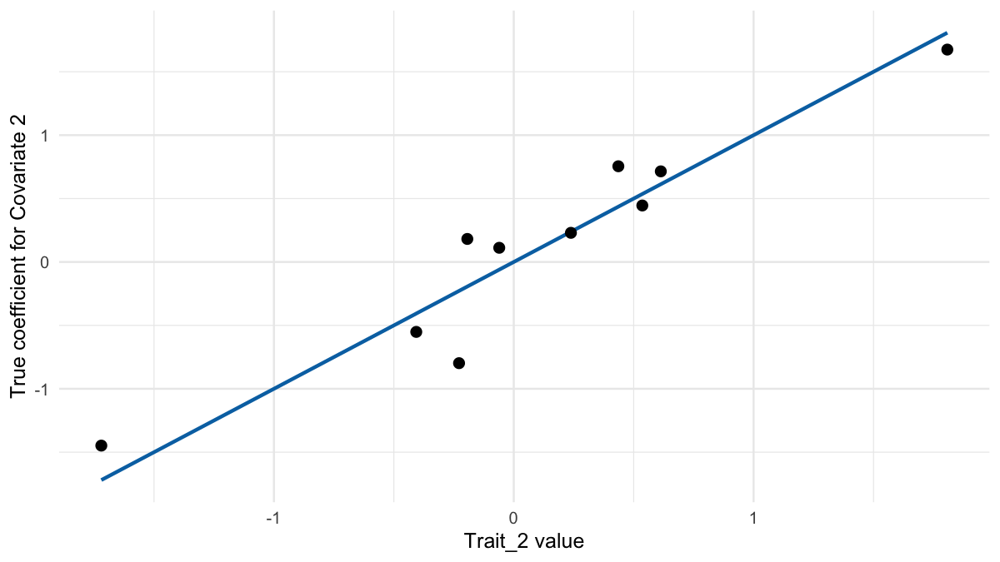
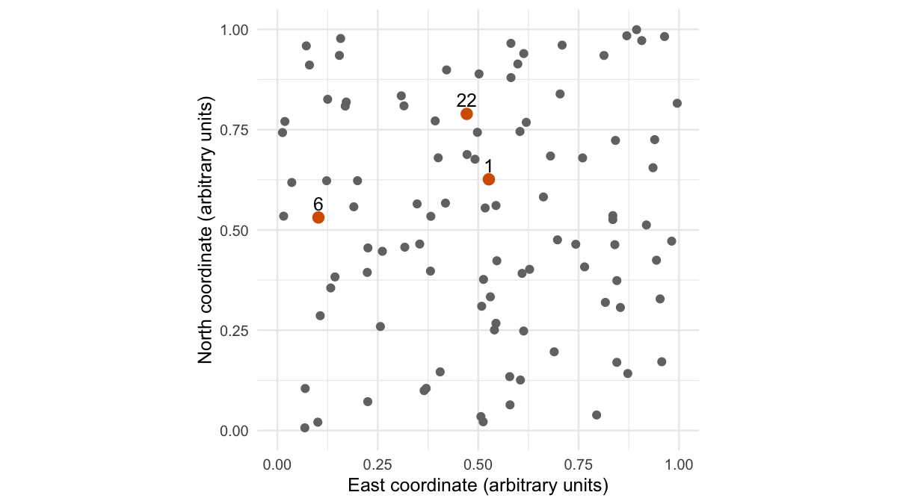
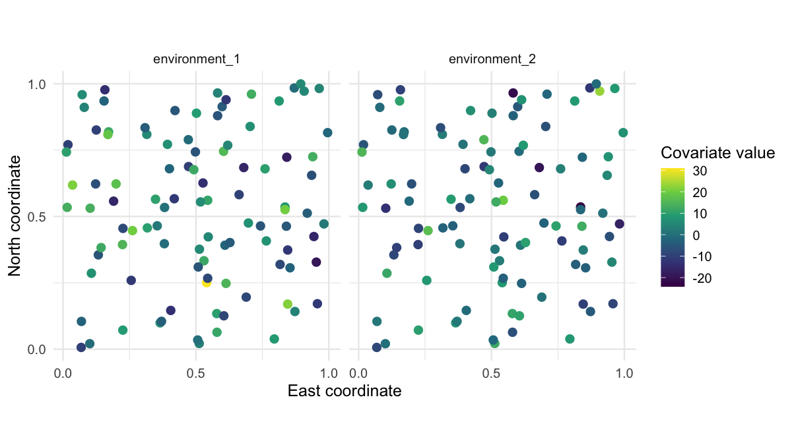
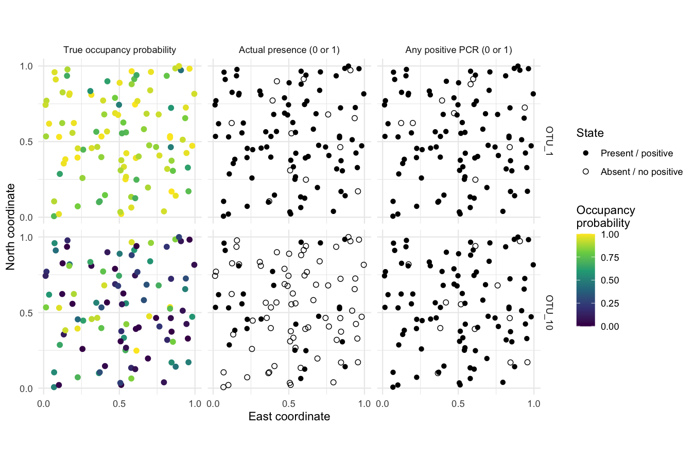
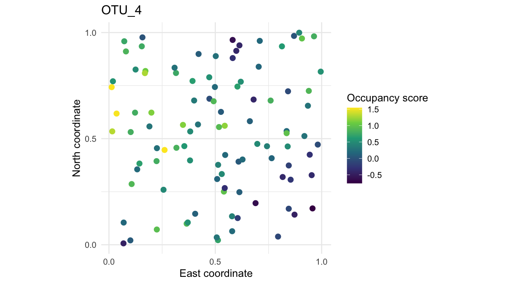

Lesson 0 (optional): Create and explore a simulated survey
================

## Where this lesson fits

occJSDM uses the results from an eDNA survey to estimate which species occupy which sites. It accounts for *false negatives* (from imperfect field collection, imperfect PCR detection, or both) and for *false positives* (from contamination in the field, in the lab or both). The [Quickstart](occJSDM-00-quickstart.md) lesson shows an example fit on the package’s simulated, example dataset.

**This is Lesson 0, and it is optional because it is somewhat technical**. Read this lesson if you want to understand where that simulated dataset came from, change the simulation settings to create a new simulated dataset, or learn how to prepare the tables and figures yourself. The reason that we simulate a dataset is because with a simulated dataset, we know which species are in which sites, so when we fit a model to the dataset, we can measure how close the model’s answers are to the right answers. We cannot do this with a real survey, because we do not know the truth.

This simulated survey has no spatial structure. Its sites do have coordinates, which let us draw maps, but location does not generate its environmental values or enter its fitted model. That makes it a good place to start: the model’s answers can be checked without also asking whether it has captured a spatial pattern.

[Lesson 1](occJSDM-lesson-1.md) **is the usual starting point and explains step by step what an occupancy model and a joint species distribution model do**. If you are already familiar with occupancy and joint species distribution models, you can skip directly to [Lesson 2](occJSDM-lesson-2.md), where we will fit the occJSDM model to the simulated dataset that we create in this lesson.

## Load the teaching data and the R tools

The teaching data are in the occJSDM repository, not in the installed package, so first clone or download [the repository from GitHub](https://github.com/AlexDiana/occJSDM). The code reads the data by paths relative to the repository’s `vignettes` directory, **so that directory must be your working directory for this lesson.** Knitting the lesson, or running a chunk with its green arrow in RStudio, does this automatically. If you instead send lines to the console from the repository root, first run `setwd("vignettes")`.

The teaching data are kept out of the installed package on purpose, not just until the lessons are approved. The saved simulations and model fits take about 11 MB, far more than an R package should carry, and the lessons are web pages built from the repository rather than vignettes installed with the package.

**What this lesson assumes you know.** The code uses base R and the tidyverse: the pipe `|>`, and from dplyr and tidyr, the verbs listed below. If any are new to you, the two chapters of *R for Data Science* on [data transformation](https://r4ds.hadley.nz/data-transform) and [data tidying](https://r4ds.hadley.nz/data-tidy) teach everything used here. Operations that are unusual, such as joining two tables on species identity, are explained when they appear.

- `select()` and `pull()` to choose columns, or to take one column out as a vector.
- `filter()`, `distinct()`, `arrange()`, `slice_head()` and `slice_sample()` to keep, deduplicate, order and pick rows, including a random pick.
- `mutate()`, `transmute()` and `case_when()` to add or recode columns (`transmute()` keeps only the new ones), and `group_by()`, `summarise()` and `count()` to summarise or count by group.
- `bind_cols()` to put two tables side by side, and `left_join()` and `anti_join()` to combine tables on shared identifiers, or to drop the rows that match.
- `pivot_longer()` to move from one column per measurement to one row per measurement.

``` r
library(dplyr)
library(tidyr)
library(tibble)
library(ggplot2)

lesson <- readRDS("teaching-data/nonspatial-lesson.rds")

simulation <- lesson$input$sim
survey_data <- simulation$data_list
known_truth <- simulation$true_params

format_percent <- function(probability, digits = 1) {
  paste0(formatC(100 * probability, format = "f", digits = digits), "%")
}
```

`format_percent()` prints probabilities as percentages in the text.

Here is what the saved file holds.

``` r
# These are the data tables that occJSDM receives, stored together in one R list.
str(survey_data, max.level = 1)
```

    #> List of 3
    #>  $ info  :'data.frame':  3600 obs. of  8 variables:
    #>  $ OTU   : num [1:3600, 1:10] 0 0 0 0 0 0 0 1 0 0 ...
    #>   ..- attr(*, "dimnames")=List of 2
    #>  $ traits: num [1:10, 1:2] 0.088 0.421 -0.204 1.41 0.018 ...
    #>   ..- attr(*, "dimnames")=List of 2

``` r
# In RStudio, View() opens each table in a spreadsheet-like viewer.
if (interactive()) {
  View(survey_data$info)
  View(survey_data$OTU)
  View(survey_data$traits)
}

names(lesson)
```

    #>  [1] "schema"                    "input"                    
    #>  [3] "observations"              "cases"                    
    #>  [5] "cells"                     "groups"                   
    #>  [7] "rates"                     "samples"                  
    #>  [9] "diagnostics"               "manifests"                
    #> [11] "input_md5"                 "summary_source_hashes"    
    #> [13] "reconstruction_difference"

``` r
names(known_truth)
```

    #> [1] "jsdmParams_true" "beta_theta_true" "z_true"          "w_true"         
    #> [5] "p_true"          "q_true"

`survey_data` is the eDNA and trait data that occJSDM receives from the ecologist, in three tables: `info`, `OTU` and `traits`.

`known_truth` is the true (simulated) community, which occJSDM is not allowed to see when it fits the model. `z_true` records whether each species truly occupies each site, and `w_true` whether its DNA truly entered each field sample. `jsdmParams_true` holds the ecological model’s coefficients and each site’s true occupancy score for each species. `beta_theta_true` holds the collection coefficients, and `p_true` and `q_true` the laboratory rates. “Specify the observation model” (below) explains the two-stage process that these truths describe.

`lesson` is the saved file that Lesson 2 also reads. `input` holds the simulation. `cases` holds the four detection examples that Lesson 2 selected. Most of the other components summarise Lesson 2’s model fits, which this lesson does not use.

Now we show how to simulate the dataset. We need to make a lot of decisions about the survey design, the nature and levels of observation errors, and the ecologies of the species being surveyed.

## Specify the survey design

These are the settings that we used to create our teaching dataset.

``` r
n_sites <- 100
n_species <- 10
samples_per_site <- 3
n_primers <- 2
pcrs_per_primer <- 6

n_field_samples <- n_sites * samples_per_site
n_pcr_observations <- n_field_samples * n_primers * pcrs_per_primer

tibble(
  quantity = c("Sites", "Species", "Field samples", "PCR reactions"),
  number = c(n_sites, n_species, n_field_samples, n_pcr_observations)
)
```

    #> # A tibble: 4 × 2
    #>   quantity      number
    #>   <chr>          <dbl>
    #> 1 Sites            100
    #> 2 Species           10
    #> 3 Field samples    300
    #> 4 PCR reactions   3600

There are 300 field samples and 3,600 PCR reactions. In metabarcoding, each PCR reaction yields multiple read counts, one for every detected species, so there are not separate PCRs per species. Here, six PCR replicates means **six per primer per field sample**.

These numbers are chosen for teaching. 100 sites and 10 species make a community small enough for the lessons to display every site and species. 3 replicate field samples per site is realistic, matches the Quickstart’s `sampledata`, and lets occJSDM weigh a sample’s positive detection against that site’s other samples to infer false positives. (3 replicate field samples is the minimum needed to make this inference. [Lesson 2’s appendix](occJSDM-lesson-2.md#why-the-survey-has-three-field-samples-per-site) explains why 2 samples per site are not enough.) Finally, 2 primers with 6 PCRs each give every sample 12 PCRs. The lab replicates let occJSDM estimate the laboratory detection and false-positive rates. We recommend a minimum of 3 lab replicates per primer. Of course, your own surveys will differ from these numbers.

The simulator software uses these variable names: `M` is the vector that holds the number of field samples at each site, and `K` is the vector that holds the number of PCRs for each combination of field sample and primer. `K` runs through the samples in order, with each sample’s primers together. By using vectors, we allow the possibility of unequal replication (e.g. most sites got 3 field replicates but some only got 2). In this dataset, every sample got `K=6` PCR replicates, so their order does not matter. A **trait** is a measured property of each species, such as body size. An **occupancy covariate** describes the habitat at a site, such as canopy cover, that could plausibly affect whether a species is present or absent at that site. A **collection covariate** describes how each field sample was taken, such as the volume of water filtered, which changes how likely a sample is to capture DNA, not whether the species is present or absent.

``` r
survey_settings <- list(
  n = n_sites, # from above
  S = n_species, # from above
  g = 2,                         # Two measured traits per species.
  M = rep(samples_per_site, n_sites), # or one can create an unbalanced design
  P = n_primers, # from above
  K = rep(pcrs_per_primer, n_field_samples * n_primers), # or one can create an unbalanced design
  ncov_psi = 2,                   # Two environmental covariates per site.
  ncov_theta = 1                  # One collection covariate per field sample.
)

str(survey_settings)
```

    #> List of 8
    #>  $ n         : num 100
    #>  $ S         : num 10
    #>  $ g         : num 2
    #>  $ M         : num [1:100] 3 3 3 3 3 3 3 3 3 3 ...
    #>  $ P         : num 2
    #>  $ K         : num [1:600] 6 6 6 6 6 6 6 6 6 6 ...
    #>  $ ncov_psi  : num 2
    #>  $ ncov_theta: num 1

`M` has 100 values, one per site, and `K` has 600, one per field sample and primer; the other settings are single numbers.

## Specify the observation model (decide how collection and PCR can fail)

An eDNA survey is a **two-stage process**: DNA is collected in the field, then detected by PCR in the laboratory. Each stage can go wrong in two ways:

- In the field (**Stage 1**), a species either occupies a site or not, and each field sample either captures its DNA or not. Collection can miss a species that is present, which is a **false negative**. It can also pick up the species’ DNA when the species is absent from the site, for example from equipment used at another site. That is a **field-stage false positive**.

- In the laboratory (**Stage 2**), a PCR can miss DNA that is in the sample, **another false negative**. It can also report DNA that is not there, through contamination in the laboratory, which is a **laboratory false positive**.

The simulator gives each of these four events a probability:

- `theta`, the collection probability: the probability that a field sample captures the species’ DNA when the species occupies the site. A collection failure, a **false negative** at the field stage, has probability `1 - theta`.
- `theta0`: the probability that the species’ DNA enters a field sample although the species does not occupy the site, the field-stage **false positive**.
- `p`: the probability that a PCR detects the species when its DNA is in the sample. A PCR failure, a **false negative** at the laboratory stage, has probability `1 - p`.
- `q`: the probability that a PCR reports the species when its DNA is not in the sample, the laboratory **false positive**.

[Lesson 1](occJSDM-lesson-1.md#what-an-occupancy-model-does) runs a greatly simplified version of this process, with a single detection probability and no false positives. [Lesson 2](occJSDM-lesson-2.md#three-questions-three-different-truths) runs the full (two-stage) model.

The two probabilities of a true event, `theta` and `p`, are not single numbers. `p` has one value for each primer and species. `theta` has one value for each field sample and species, because it also depends on the sample’s collection covariate (see below).

In the simulation, we let the species differ in how reliably they are collected and detected. For example, the probability that primer 1 detects DNA in the sample rises from 0.35 to 0.85 across the ten species. The second primer has slightly higher probabilities.

``` r
primer_1_detection <- seq(0.35, 0.85, length.out = n_species)
primer_2_detection <- pmin(0.95, primer_1_detection + 0.10)

observation_settings <- list(
  p = rbind(primer_1_detection, primer_2_detection),
  q = rbind(
    seq(0.025, 0.065, length.out = n_species),
    seq(0.065, 0.025, length.out = n_species)
  ),
  theta0 = seq(0.02, 0.08, length.out = n_species),
  theta_baseline = seq(0.35, 0.75, length.out = n_species),
  mu1 = 5,
  sigma1 = 1,
  mu0 = 1.5,
  sigma0 = 1
)

str(observation_settings)
```

    #> List of 8
    #>  $ p             : num [1:2, 1:10] 0.35 0.45 0.406 0.506 0.461 ...
    #>   ..- attr(*, "dimnames")=List of 2
    #>   .. ..$ : chr [1:2] "primer_1_detection" "primer_2_detection"
    #>   .. ..$ : NULL
    #>  $ q             : num [1:2, 1:10] 0.025 0.065 0.0294 0.0606 0.0339 ...
    #>  $ theta0        : num [1:10] 0.02 0.0267 0.0333 0.04 0.0467 ...
    #>  $ theta_baseline: num [1:10] 0.35 0.394 0.439 0.483 0.528 ...
    #>  $ mu1           : num 5
    #>  $ sigma1        : num 1
    #>  $ mu0           : num 1.5
    #>  $ sigma0        : num 1

`p` and `q` are matrices with one row per primer and one column per species. `theta0` and `theta_baseline` have one value per species, and the four read-count settings are single numbers. The settings have these meanings:

- `p`: the probability of a laboratory detection event when the species’ DNA is in the sample, for each primer and species.
- `q`: the probability of a laboratory false-positive event when the DNA is absent from the sample, for each primer and species.
- `theta0`: the probability that DNA enters a sample even though the species is absent from the site, for each species (field false-positive error).
- `theta_baseline`: the collection probability `theta` at a collection-covariate value of zero, given that the species occupies the site (true positive). The actual collection probability also varies with that covariate. The simulator draws each species’ slope on the covariate itself, and `known_truth$beta_theta_true` holds the slopes it drew.
- `mu1` and `sigma1`: the mean and standard deviation, on a log-read scale, of the read count from a true detection event.
- `mu0` and `sigma0`: the same for a laboratory false-positive event.

There is therefore not one `theta` but many: each field sample has its own collection probability for each species. On the logit scale, `theta` is the species’ intercept plus its slope times the sample’s collection covariate. `theta_baseline` sets the intercept, as `logit(theta_baseline)`, and the simulator draws each species’ slope as -1, 0 or 1. The collection covariate itself is drawn from a standard normal distribution for each field sample. With 300 field samples and 10 species, the survey has 3,000 values of `theta`. `known_truth$beta_theta_true` holds the intercepts (first row) and slopes (second row).

The setting values we choose make OTU_1 the hardest species to detect. It has the lowest collection probability at baseline (0.35) and the lowest PCR detection probability on both primers (0.35 and 0.45). OTU_10 is the easiest, at 0.75, 0.85 and 0.95. The maps below compare the two species. `pmin(0.95, ...)` caps primer 2’s probabilities at 0.95. No value exceeds the cap with these settings, but the cap keeps every probability valid if you raise the first line. The two primers’ `q` run in opposite directions across the species, so no species has a high laboratory false-positive rate on both primers. `theta0` increases from species to species such that field contamination is commonest for OTU_10.

Next, the simulator turns the outcome of each PCR into a read count. A PCR has one of three outcomes for each species: a **detection event** (the species’ DNA is in the sample and the PCR amplifies it, probability `p`), a **laboratory false-positive event** (the DNA is not in the sample but contamination is amplified, probability `q`), or no event, which gives zero reads. For each event, the simulator draws a value on the log-read scale, converts it with `round(exp(log_read) - 1)` and sets negative counts to zero. Given the `mu1` and `mu0` values from above of 5 and 1.5, respectively, a true detection event therefore gives about 147 reads at the median, and a laboratory false-positive event about 3. A field-stage false positive gives as many reads as a true detection, because its sample truly holds the species’ DNA. An event can also produce zero reads, when the draw falls below `log(1.5)`. With these settings, that almost never happens to a true detection event (0.0002% of them), but it does happen to 13.7% of laboratory false-positive events, which is about one in 7.

occJSDM does not use the read counts themselves. `runOccJSDM()` only asks whether each PCR has at least `threshold` reads, and we recommend leaving `threshold` at its default of 1. A laboratory false-positive event that produced zero reads is therefore invisible: it looks like an ordinary negative PCR. So the rate at which contamination actually produces a positive PCR is a little lower than the `q` set above, about 86% of it. (The same is true of `p`, but by a negligible amount.) Lesson 2 therefore compares its fitted `p` and `q` with these slightly lower rates of positive PCRs, not with the settings above.

occJSDM assumes that the survey was run with good field and laboratory practice, so that contamination, and therefore false positives, are infrequent. It expresses this through its **priors**, the starting beliefs about plausible rates that the observations then update. The default priors on `q` and `theta0` are both Beta(1, 20), which has mean 1/(1 + 20), about 4.8%, and puts 95% of its weight below 13.9%. This simulation’s contamination rates are chosen using that assumption: the lab false-positive probability `q` runs from 2.5% to 6.5%, and the field false-positive probability `theta0` runs from 2.0% to 8.0%. Lesson 2 explains [how good practice enters the model](occJSDM-lesson-2.md#how-does-good-practice-enter-the-model) and [stress-tests the effect of violating this assumption in practice](occJSDM-lesson-2.md#what-changes-if-we-are-less-confident-about-low-contamination) by refitting with priors that expect more contamination.

## Specify the ecological model

Now we specify the ecological model, which sets the probability that each species occupies each site. On the logit scale it adds three parts: the species’ baseline occupancy, its responses to each site’s known (i.e. measured) environmental covariates, and, optionally, its responses to each site’s hidden (i.e. unmeasured) environmental covariates. Hidden environmental covariates need not represent particular biological mechanisms. An inverse logit function then turns the sum of these three terms into a probability.

Optionally, we can let each species’ responses to the environment be determined in part by its traits, some of which we measure and some of which we don’t. Whatever part of a species’ response its traits do not explain is its own **remainder**, a species-specific amount added on top, so two species with identical traits can still respond differently. **How traits drive each species’ responses** (below) gives the formula.

Because several species are likely to respond to any given hidden factor, groups of responding species will occur together more or less often than the measured environment predicts. These manifest as the associations between species that a joint species distribution model estimates, and the number of factors is what the Quickstart’s `n_factors` sets. [Lesson 1](occJSDM-lesson-1.md#what-a-joint-model-does) explains them in more detail.

``` r
# Note that we do not use all the ecological settings, although we do set their values for completeness.
ecological_settings <- list(
  gt = 1,                        # One unmeasured trait per species.
  d = 2,                         # Two hidden site factors.
  ds = 0,                        # Spatial setting, off here; see the appendix.
  sigma_b = 0.5,                  # Spread of environmental responses beyond traits.
  sigma_bs = 0.5,                 # No effect: the simulator never draws with it.
  sigma_ts = 0.5,                 # No effect: the simulator never uses it.
  sigma_h = 1,                    # Spread of the hidden site factors.
  sigma_s = 0.5,                  # Spatial setting, off here; see the appendix.
  l_s = 0.3,                      # Spatial setting, off here; see the appendix.
  tau = rep(1, n_species),         # Required, but used only by model = "continuous".
  useSpatField = FALSE
)

str(ecological_settings)
```

    #> List of 11
    #>  $ gt          : num 1
    #>  $ d           : num 2
    #>  $ ds          : num 0
    #>  $ sigma_b     : num 0.5
    #>  $ sigma_bs    : num 0.5
    #>  $ sigma_ts    : num 0.5
    #>  $ sigma_h     : num 1
    #>  $ sigma_s     : num 0.5
    #>  $ l_s         : num 0.3
    #>  $ tau         : num [1:10] 1 1 1 1 1 1 1 1 1 1
    #>  $ useSpatField: logi FALSE

`tau` must be supplied, but it has no effect on this survey. It is used only when the simulator is asked for `model = "continuous"` data, where it is the standard deviation of the random noise added to each species’ continuous response. It is the only setting with one value per species; every other setting is a single number or a switch.

`gt = 1` gives each species one unmeasured trait, which although not in the trait table, also shapes how the species responds to the environment. We also choose to simulate 2 hidden environmental covariates. In Lesson 2, occJSDM will try to estimate 1 hidden trait with `n_lattrait = 1` and two hidden environmental covariates with `n_factors = 2`, although of course, normally, we would not know *a priori* how many of these hidden factors to try to estimate.

`sigma_b` sets how differently species respond to the same environment beyond what their traits predict: a larger value makes their responses more varied. `sigma_h` sets how much the hidden factors vary between sites: a larger value makes them matter more for occupancy, and so strengthens the associations between species.

An important choice for this lesson is `useSpatField = FALSE`: in this simulation, we do not create any spatial fields (= patchy, unmeasured environmental covariates) or simulate any dispersal processes. The simulator still draws site coordinates, whether or not the field is on, which let us visualise the data in a map. `ds`, `sigma_s` and `l_s` set the spatial field, so they have no effect while `useSpatField = FALSE`; [the appendix](#simulate-a-survey-with-a-spatial-field) shows how to switch it on.

Finally, `sigma_bs` and `sigma_ts` are accepted but have no effect. In the fitted model, `sigma_bs` sets how much species differ in their responses to spatial covariates, but the simulator never generates such responses. `sigma_ts` is passed on and never used. You can leave both out.

## How traits drive each species’ responses

A species’ trait **coefficient** for an environmental covariate says how its occupancy score changes as that covariate rises. It is positive if the species does better at higher environmental covariate values and negative if it does worse. The simulator standardises each covariate before using it, so a coefficient is the change in the score, on the logit scale, per standard deviation of the covariate. The coefficients are not drawn independently for each species. Each species’ coefficients are the sum of three parts. The first is its measured traits multiplied by a **trait-effect matrix** `G`. The second is its unmeasured traits `A` multiplied by their own effect matrix `C`, and the third is a remainder of its own, `Bt`. In matrix form, with `Tr` the trait table:

`B = t(Tr %*% G + A %*% C + Bt)`

`t()` turns the sum around so that `B` has one row per covariate and one column per species. The simulator, `simulateData()` in `R/jsdmfun.R`, draws each part as follows:

- `G`: each entry is -1, 0 or 1, chosen at random. A measured trait therefore lowers, does not change or raises a species’ response to a covariate, by one unit for each unit of the trait. The traits themselves are drawn from a standard normal distribution, so a trait value of 1 is one standard deviation above the average species.
- `A`: each species’ values of its unmeasured traits, drawn from a standard normal distribution, with one column for each of the `gt` unmeasured traits.
- `C`: the effects of the unmeasured traits, drawn like `G`, except that its diagonal is set to 1 and the entries below it to 0. The first unmeasured trait therefore always raises the response to the first covariate.
- `Bt`: the remainder, drawn from a normal distribution with standard deviation `sigma_b`. Together with the unmeasured traits, it is why two species with identical measured traits can still respond differently.

The saved truth holds every part. Here are `G` and `C` for this survey, labelled with the traits and covariates they connect.

``` r
jsdm_truth <- known_truth$jsdmParams_true
Tr <- as.matrix(survey_data$traits)
covariate_names <- c("Covariate 1", "Covariate 2")

trait_effects <- jsdm_truth$G
dimnames(trait_effects) <- list(colnames(Tr), covariate_names)
trait_effects
```

    #>         Covariate 1 Covariate 2
    #> Trait_1          -1           0
    #> Trait_2          -1           1

``` r
unmeasured_effects <- jsdm_truth$C
dimnames(unmeasured_effects) <- list("Unmeasured trait", covariate_names)
unmeasured_effects
```

    #>                  Covariate 1 Covariate 2
    #> Unmeasured trait           1           0

``` r
describe_effect <- function(entry) c("lowers", "does not change", "raises")[entry + 2]
```

Covariate 1 and Covariate 2 are the two environmental covariates mapped below, the columns `X_psi.EnvCov.1` and `X_psi.EnvCov.2` of `info` that “Extract the three model-input objects” describes. In this survey `Tr` is 10 species by 2 traits, and `G` is 2 traits by 2 covariates. `A` is 10 species by 1 unmeasured trait, and `C` is 1 by 2.

`Bt` and the sum are 10 species by 2 covariates. Read `G` one row at a time. Trait_1 lowers the response to Covariate 1 and does not change the response to Covariate 2. Trait_2 lowers the response to Covariate 1 and raises the response to Covariate 2. In `C`, the unmeasured trait raises the response to Covariate 1 and does not change the response to Covariate 2.

To confirm that this formula is what generated the survey, recalculate the coefficients from their parts and compare them with the saved ones.

``` r
rebuilt_B <- with(jsdm_truth, t(Tr %*% G + A %*% C + Bt))

# The rebuilt matrix carries species names from the trait table; the saved one has none.
all.equal(unname(rebuilt_B), jsdm_truth$B)
```

    #> [1] TRUE

`all.equal()` returns `TRUE`: the three parts add up to the coefficients that set every species’ occupancy probability in this survey.

Each species has one coefficient for each environmental covariate: one column of `B`. How much of a species’ coefficient do its measured traits explain? If they explain most of it, species with similar trait values respond to the environment in similar ways, and a model can learn `G` from the survey. If the remainder dominates, traits tell us little. The plot below shows this for one covariate and one measured trait that acts on it (the chunk prefers a covariate on which only one measured trait acts). Each point is a species: its true coefficient for that covariate against its value of the trait. The line is that trait’s part alone, its `G` entry times the trait value.

``` r
# Prefer the covariate on which the fewest measured traits act (at least one).
traits_acting <- colSums(jsdm_truth$G != 0)
stopifnot(any(traits_acting > 0))
candidates <- which(traits_acting > 0)
shown_covariate <- candidates[which.min(traits_acting[candidates])]
shown_trait <- which(jsdm_truth$G[, shown_covariate] != 0)[1]
trait_slope <- jsdm_truth$G[shown_trait, shown_covariate]

# Is the trait's part the only systematic part of this coefficient?
only_this_trait <- traits_acting[shown_covariate] == 1 &&
  all(jsdm_truth$C[, shown_covariate] == 0)
untouched_traits <- colnames(Tr)[jsdm_truth$G[, shown_covariate] == 0]

trait_scatter <- tibble(
  species = rownames(Tr),
  trait_value = Tr[, shown_trait],
  coefficient = jsdm_truth$B[shown_covariate, ],
  trait_prediction = trait_slope * Tr[, shown_trait]
)

ggplot(trait_scatter, aes(x = trait_value)) +
  geom_line(aes(y = trait_prediction), colour = "#0072B2", linewidth = 1) +
  geom_point(aes(y = coefficient), size = 2.5) +
  labs(
    x = paste(colnames(Tr)[shown_trait], "value"),
    y = paste("True coefficient for", covariate_names[shown_covariate])
  ) +
  theme_minimal(base_size = 12)
```

<figure>

<figcaption aria-hidden="true">Each point is one species: its true coefficient for the covariate against its value of a measured trait that acts on it. The line is that trait’s part of the coefficient alone. The vertical gaps between the points and the line are the parts of the coefficient that this trait does not explain.</figcaption>
</figure>

The chunk picks Covariate 2 and Trait_2, whose `G` entry is 1, so the line has slope 1. The points rise with the line, because the sign of the slope follows the `G` entry. They scatter around it because the other parts add to each species’ coefficient. Here no other measured trait and no unmeasured trait acts on this covariate, so the gaps are the remainder alone. Trait_1 has a `G` entry of 0 for this covariate. Plotted against it, the coefficients would vary only through parts that do not involve that trait, and no trend would be expected.

occJSDM estimates this same formula. When you give `runOccJSDM()` a trait table and set `n_lattrait`, the number of unmeasured traits, it estimates `G`, `A`, `C` and each species’ remainder from the survey. With ten species there are only ten points like those above from which to learn `G`, so [Lesson 3’s trait section](occJSDM-lesson-3.md#traits-ask-a-harder-different-question) asks how well it can be recovered.

## Recreate the dataset if you want to

The simulator draws the environmental values, traits, coefficients and hidden factors from the settings above. It then calculates occupancy probabilities and draws actual presence or absence from those probabilities.

The following optional chunk shows the simulator call itself. It is displayed but not run when knitting, because the figures use the saved simulation. To recreate the data yourself, run the chunk with occJSDM installed. `model = "two_stage"` produces PCR read counts. The simulator can also produce `"occupancy"` data, with one record per field sample and no PCR stage, and `"binary"` presence/absence data, like the presence/absence case described in the Quickstart. `"occupancy"` data have one record per field sample: whether the sample captured the species’ DNA. That is a classic single-stage occupancy dataset in which the field samples are the replicates. It is not the same as two-stage data with one PCR per sample (`K = 1`), which would still include PCR failures and laboratory false positives.

``` r
library(occJSDM)

set.seed(20260919)

new_simulation <- simulateOccJSDMData(
  list_datasettings = survey_settings,
  list_params = observation_settings,
  list_jsdmParams = ecological_settings,
  model = "two_stage" # "occupancy" and "binary" are the alternatives
)

new_survey_data <- new_simulation$data_list
new_known_truth <- new_simulation$true_params
```

`simulateOccJSDMData()` labels the truth matrices with the same site, sample and species IDs as `info` and `OTU`, so truth can be joined to observations by identifier, as below.

If you run this chunk with different settings, you get a new dataset, and the model fits saved in `teaching-data/nonspatial-lesson.rds` no longer belong to it: fit the new dataset before comparing estimates with truth. The appendix records the package revision and seed of the saved simulation, and the R version recorded with the matching fits.

## Extract the three model-input objects from the simulator output

occJSDM receives three input tables: `info` describes each PCR reaction, `OTU` holds its read counts, and `traits` describes each species. We extract these tables from `survey_data`, the saved simulation loaded at the start, not from `new_survey_data`, so that everything below matches the model fits in Lesson 2.

``` r
info <- as_tibble(survey_data$info) # study design and covariates
OTU <- as_tibble(survey_data$OTU) # read counts

traits <- survey_data$traits |> # trait table
  as.data.frame() |>
  rownames_to_column("species") |>
  as_tibble()

info |>
  slice_head(n = 36) |>
  knitr::kable(digits = 2)
```

| Site | Sample | Primer | X_psi.EnvCov.1 | X_psi.EnvCov.2 | Xs.1 | Xs.2 | X_theta |
|-----:|-------:|-------:|---------------:|---------------:|-----:|-----:|--------:|
|    1 |      1 |      1 |         -13.96 |          -2.28 | 0.53 | 0.63 |    0.05 |
|    1 |      1 |      1 |         -13.96 |          -2.28 | 0.53 | 0.63 |    0.05 |
|    1 |      1 |      1 |         -13.96 |          -2.28 | 0.53 | 0.63 |    0.05 |
|    1 |      1 |      1 |         -13.96 |          -2.28 | 0.53 | 0.63 |    0.05 |
|    1 |      1 |      1 |         -13.96 |          -2.28 | 0.53 | 0.63 |    0.05 |
|    1 |      1 |      1 |         -13.96 |          -2.28 | 0.53 | 0.63 |    0.05 |
|    1 |      1 |      2 |         -13.96 |          -2.28 | 0.53 | 0.63 |    0.05 |
|    1 |      1 |      2 |         -13.96 |          -2.28 | 0.53 | 0.63 |    0.05 |
|    1 |      1 |      2 |         -13.96 |          -2.28 | 0.53 | 0.63 |    0.05 |
|    1 |      1 |      2 |         -13.96 |          -2.28 | 0.53 | 0.63 |    0.05 |
|    1 |      1 |      2 |         -13.96 |          -2.28 | 0.53 | 0.63 |    0.05 |
|    1 |      1 |      2 |         -13.96 |          -2.28 | 0.53 | 0.63 |    0.05 |
|    1 |      2 |      1 |         -13.96 |          -2.28 | 0.53 | 0.63 |    0.16 |
|    1 |      2 |      1 |         -13.96 |          -2.28 | 0.53 | 0.63 |    0.16 |
|    1 |      2 |      1 |         -13.96 |          -2.28 | 0.53 | 0.63 |    0.16 |
|    1 |      2 |      1 |         -13.96 |          -2.28 | 0.53 | 0.63 |    0.16 |
|    1 |      2 |      1 |         -13.96 |          -2.28 | 0.53 | 0.63 |    0.16 |
|    1 |      2 |      1 |         -13.96 |          -2.28 | 0.53 | 0.63 |    0.16 |
|    1 |      2 |      2 |         -13.96 |          -2.28 | 0.53 | 0.63 |    0.16 |
|    1 |      2 |      2 |         -13.96 |          -2.28 | 0.53 | 0.63 |    0.16 |
|    1 |      2 |      2 |         -13.96 |          -2.28 | 0.53 | 0.63 |    0.16 |
|    1 |      2 |      2 |         -13.96 |          -2.28 | 0.53 | 0.63 |    0.16 |
|    1 |      2 |      2 |         -13.96 |          -2.28 | 0.53 | 0.63 |    0.16 |
|    1 |      2 |      2 |         -13.96 |          -2.28 | 0.53 | 0.63 |    0.16 |
|    1 |      3 |      1 |         -13.96 |          -2.28 | 0.53 | 0.63 |    1.65 |
|    1 |      3 |      1 |         -13.96 |          -2.28 | 0.53 | 0.63 |    1.65 |
|    1 |      3 |      1 |         -13.96 |          -2.28 | 0.53 | 0.63 |    1.65 |
|    1 |      3 |      1 |         -13.96 |          -2.28 | 0.53 | 0.63 |    1.65 |
|    1 |      3 |      1 |         -13.96 |          -2.28 | 0.53 | 0.63 |    1.65 |
|    1 |      3 |      1 |         -13.96 |          -2.28 | 0.53 | 0.63 |    1.65 |
|    1 |      3 |      2 |         -13.96 |          -2.28 | 0.53 | 0.63 |    1.65 |
|    1 |      3 |      2 |         -13.96 |          -2.28 | 0.53 | 0.63 |    1.65 |
|    1 |      3 |      2 |         -13.96 |          -2.28 | 0.53 | 0.63 |    1.65 |
|    1 |      3 |      2 |         -13.96 |          -2.28 | 0.53 | 0.63 |    1.65 |
|    1 |      3 |      2 |         -13.96 |          -2.28 | 0.53 | 0.63 |    1.65 |
|    1 |      3 |      2 |         -13.96 |          -2.28 | 0.53 | 0.63 |    1.65 |

``` r
OTU |>
  slice_head(n = 18) |>
  knitr::kable()
```

| OTU_1 | OTU_2 | OTU_3 | OTU_4 | OTU_5 | OTU_6 | OTU_7 | OTU_8 | OTU_9 | OTU_10 |
|------:|------:|------:|------:|------:|------:|------:|------:|------:|-------:|
|     0 |     0 |   246 |     0 |     0 |     0 |   246 |     0 |     0 |      0 |
|     0 |     0 |     0 |     0 |     0 |     0 |     0 |     0 |     0 |      0 |
|     0 |     0 |     0 |     0 |   217 |     0 |  1256 |     0 |     0 |      0 |
|     0 |     0 |    30 |     0 |   798 |     0 |   197 |    35 |     0 |      0 |
|     0 |     0 |     0 |     0 |     0 |     0 |     0 |     0 |     0 |     10 |
|     0 |     0 |     0 |     0 |   198 |     0 |     0 |     0 |     0 |      0 |
|     0 |     0 |     0 |     0 |    48 |     0 |    13 |     0 |     0 |      0 |
|     1 |     0 |    71 |     0 |     0 |     0 |    70 |     0 |     0 |      0 |
|     0 |     0 |   163 |     0 |     0 |     0 |   125 |     0 |     0 |      0 |
|     0 |     0 |    19 |     0 |   408 |     0 |     0 |     0 |     0 |      0 |
|     0 |     0 |     0 |     0 |    89 |     0 |   187 |     0 |     0 |      0 |
|     0 |     0 |     0 |     0 |   162 |     0 |    19 |     0 |     0 |      0 |
|     0 |     0 |     0 |     0 |     0 |   795 |     0 |     0 |     0 |    120 |
|     0 |     0 |     0 |     0 |     0 |   147 |     0 |     0 |     0 |      0 |
|     0 |     0 |     0 |     0 |     0 |    50 |     0 |     0 |    11 |     66 |
|     0 |     0 |     0 |     0 |     0 |   175 |     0 |     0 |     0 |    115 |
|   115 |     0 |     0 |     0 |     0 |    61 |     0 |     0 |     0 |      0 |
|     0 |     0 |     0 |     0 |     0 |   308 |     0 |     0 |     0 |     92 |

``` r
traits |>
  knitr::kable(digits = 3)
```

| species | Trait_1 | Trait_2 |
|:--------|--------:|--------:|
| OTU_1   |   0.088 |  -0.407 |
| OTU_2   |   0.421 |   0.536 |
| OTU_3   |  -0.204 |   0.613 |
| OTU_4   |   1.410 |  -0.194 |
| OTU_5   |   0.018 |   1.808 |
| OTU_6   |   0.467 |   0.238 |
| OTU_7   |   0.755 |   0.436 |
| OTU_8   |   0.381 |  -0.061 |
| OTU_9   |  -1.007 |  -0.228 |
| OTU_10  |  -0.391 |  -1.720 |

The `info` table contains the study design and the predictors. It has one row per PCR reaction: its `Site`, its field `Sample` and its `Primer`, followed by the covariates. Columns beginning `X_psi.` are the occupancy covariates, `X_theta` is the collection covariate, and `Xs.1` and `Xs.2` are the site coordinates. The first 36 rows are site 1’s replicates: samples 1 to 3 in that site, primers 1 to 2 in each sample, and PCRs 1 to 6 of each primer ($3 \times 2 \times 6 = 36$). Therefore, **Site conditions** (`X_psi`) repeat across all 36 rows because all the samples, primers, and PCRs belong to the same site. **Collection conditions** (`X_theta`) repeat across only the 12 PCRs from each field sample, since different samples can have different collection covariates (e.g. water volume).

There is no column that numbers the PCR replicates. Each row of `info` is one PCR, and the PCR replicates of a sample and primer are simply the rows that share the same `Site`, `Sample` and `Primer`. occJSDM treats those replicates as interchangeable, so it never needs to know which was PCR 1 and which was PCR 6, and `runOccJSDM()` counts them for each sample and primer. The rows also need not arrive in any particular order, because `runOccJSDM()` sorts them by `Site`, `Sample` and `Primer` itself, moving each `OTU` row with its `info` row. What matters is that row *i* of `info` and row *i* of `OTU` describe the same PCR, so never sort one of them on its own.

The `OTU` table has one row per PCR reaction, **in the same order as `info`**, and one read-count column per species. OTU stands for operational taxonomic unit: these columns correspond to the OTU table from your own bioinformatic pipeline. OTU can contain the read counts because `runOccJSDM()` converts the counts to a binary detection/non-detection at the user-defined read-count `threshold` (default = 1).

> IMPORTANT
>
> If you use [DAMe](https://github.com/dougwyu/DAMe) for your bioinformatic pipeline, build the OTU table from DAMe’s `--per-pcr` output, as its [tutorial](https://github.com/dougwyu/DAMe/blob/master/tutorial/README.md#per-pcr-otu-tables-for-occupancy-and-detection-models) explains. By default, DAMe filters on a per-sample basis, so weak detections in samples that fail its filter criteria are deleted. occJSDM needs these weak detections to infer false positives.
>
> Similarly, if you build your OTU table with another pipeline, such as DADA2, do not carry out the common step of filtering out low-read OTU cells (for example, setting cells with 2 or fewer reads to 0). occJSDM needs to see these detection events to infer false positives.

Finally, the `traits` table has one row per species (OTU), with two simulated trait measurements. Its row names must match the column names of `OTU`, because `runOccJSDM()` matches traits to species by name.

## Follow the simulated observations back to their known source

Because the simulation kept the truth, we can label every PCR (= every row of the OTU table) with what actually produced its result. That reveals the false positives and false negatives that occJSDM has to infer.

We need a new table format to link the `OTU` *observations* to the ecological ‘truth’, which was created by the simulator. Use `bind_cols` to combine `info` and `OTU`, number the PCR replicates within each sample and primer (the `PCR` column is only for display; occJSDM never needs it), and then use `pivot_longer` to format a new table with **one row per species and PCR reaction**. Finally, add the column `positive` designating a detection as positive if that row (i.e. that species in that PCR) has ≥ 1 read, which matches our use of `threshold = 1`.

``` r
observed_pcrs <- bind_cols(info, OTU) |>
  group_by(Site, Sample, Primer) |>
  mutate(PCR = row_number()) |>
  ungroup() |>
  pivot_longer(
    cols = all_of(colnames(survey_data$OTU)),
    names_to = "species",
    values_to = "reads"
  ) |>
  mutate(
    Site = as.character(Site),
    Sample = as.character(Sample),
    positive = as.integer(reads >= 1)
  )
```

The new table has 36,000 rows: 3,600 PCR reactions for each of 10 species. A missing read count would remain missing; this survey has none. A PCR whose result was lost would be `NA`, whereas a field sample that was never analysed is represented by absent rows, as “Unequal numbers of field samples” shows.

Now turn the true site and sample states from `known_truth` into tables. The saved matrices have site or sample IDs as row names and species IDs as column names. `rownames_to_column()` makes the row identifier an explicit column. Join these tables to `observed_pcrs`.

``` r
presence_truth <- known_truth$z_true |>
  as.data.frame() |>
  rownames_to_column("Site") |>
  pivot_longer(cols = -Site, names_to = "species", values_to = "presence")

sample_truth <- known_truth$w_true |>
  as.data.frame() |>
  rownames_to_column("Sample") |>
  pivot_longer(cols = -Sample, names_to = "species", values_to = "dna_in_sample")

observations_with_truth <- observed_pcrs |>
  left_join(presence_truth, by = c("Site", "species")) |>
  left_join(sample_truth, by = c("Sample", "species")) |>
  mutate(
    source = case_when(
      is.na(positive) ~ "Missing",
      positive == 0 & presence == 0 ~ "True negative",
      positive == 0 ~ "False negative",
      dna_in_sample == 0 ~ "Laboratory false positive",
      presence == 0 ~ "Field-stage false positive",
      TRUE ~ "True detection"
    )
  )

weak_case <- lesson$cases |>
  filter(case == "Weak true detection")

weak_pcrs <- observations_with_truth |>
  filter(
    species == weak_case$species,
    Site == as.character(weak_case$Site),
    Sample == as.character(weak_case$Sample)
  ) |>
  select(Site, Sample, Primer, PCR, reads, positive, presence, dna_in_sample, source)

knitr::kable(weak_pcrs)
```

| Site | Sample | Primer | PCR | reads | positive | presence | dna_in_sample | source         |
|:-----|:-------|-------:|----:|------:|---------:|---------:|--------------:|:---------------|
| 6    | 18     |      1 |   1 |     0 |        0 |        1 |             1 | False negative |
| 6    | 18     |      1 |   2 |     0 |        0 |        1 |             1 | False negative |
| 6    | 18     |      1 |   3 |     0 |        0 |        1 |             1 | False negative |
| 6    | 18     |      1 |   4 |     0 |        0 |        1 |             1 | False negative |
| 6    | 18     |      1 |   5 |     0 |        0 |        1 |             1 | False negative |
| 6    | 18     |      1 |   6 |     0 |        0 |        1 |             1 | False negative |
| 6    | 18     |      2 |   1 |     0 |        0 |        1 |             1 | False negative |
| 6    | 18     |      2 |   2 |   105 |        1 |        1 |             1 | True detection |
| 6    | 18     |      2 |   3 |   596 |        1 |        1 |             1 | True detection |
| 6    | 18     |      2 |   4 |     0 |        0 |        1 |             1 | False negative |
| 6    | 18     |      2 |   5 |     0 |        0 |        1 |             1 | False negative |
| 6    | 18     |      2 |   6 |     0 |        0 |        1 |             1 | False negative |

`left_join()` attaches the true states by site, sample and species identity, so the tables need not share a row order. Sample IDs are unique across the whole survey in this dataset, so sample plus species identifies a sample state.

The columns `presence` and `dna_in_sample` are **known-truth labels supplied by the simulation,** and the new `source` column uses these known-truth labels to interpret each `read_count` observation for each species in each PCR. A negative PCR is a **true negative** if the species does not occupy the site and a **false negative** (a missed detection) if it does. A positive PCR in a sample without DNA is a **laboratory false positive**, contamination in the laboratory, even if the species happened to occupy the site. A positive from DNA in an unoccupied site’s sample is a **field-stage false positive**, contamination in the field. Any other positive is a **true detection**.

The `weak_case` table shows Lesson 2’s weak true-detection example: OTU_1 at Site 6 in Sample 18. This species truly occupies the site (`presence` = 1), and its DNA was successfully collected into the sample (`dna_in_sample` = 1). Yet only 2 of the 12 PCRs are positive, with 105 and 596 reads, from primer 2. The other 10 are false negatives.

Because of the known-truth labels from the simulator, we know that this is a weak detection of a true presence, but occJSDM does not know. It has to decide between a weak detection of a true presence or a false-positive detection of a true absence. In Lesson 2, we ask which explanation occJSDM favours: weak detection or false positive.

`weak_case` comes from `lesson$cases`, a small table saved with the teaching data. It lists four examples, each one species in one field sample, that Lesson 2 uses to show how occJSDM reasons about individual detections: weak true detection, laboratory false positive, strong true detection, and field-stage false positive. They were picked from the known truth and the observed PCRs before any model was fitted, so they were not chosen to make the model look good. This lesson uses them only for the table above and to mark their sites on the map below.

Across the whole survey, how common is each outcome? Count the PCRs with each label, with the median read count of each.

``` r
source_counts <- observations_with_truth |>
  group_by(source) |>
  summarise(pcrs = n(), median_reads = median(reads), .groups = "drop") |>
  arrange(desc(pcrs))

source_counts
```

    #> # A tibble: 5 × 3
    #>   source                      pcrs median_reads
    #>   <chr>                      <int>        <dbl>
    #> 1 True negative              16349            0
    #> 2 False negative             11544            0
    #> 3 True detection              6344          149
    #> 4 Laboratory false positive    960            4
    #> 5 Field-stage false positive   803          153

``` r
pcrs_with <- setNames(source_counts$pcrs, source_counts$source)
```

Each row is one kind of outcome. Together the rows cover all 36,000 observations, one per species and PCR (100 sites $\times$ 3 samples $\times$ 2 primers $\times$ 6 PCRs $\times$ 10 species). `pcrs` counts the observations with each outcome, and `median_reads` is their median read count. Most observations are negative: 16,349 true negatives at sites the species does not occupy and 11,544 false negatives at sites it does. A false negative is any negative PCR at a truly occupied site.

False negatives include the negative PCRs of present species whose DNA failed to be collected in the field in stage 1 (8,348 of them), plus the PCRs that failed to amplify successfully collected DNA in the lab in stage 2. That is why false negatives outnumber the 6,344 true detections.

Of the 8,107 total positive PCRs, 960 are laboratory false positives, and 803 are field-stage false positives. Together, they make 21.7% of all positive PCRs.

The read counts follow the simulator settings. Laboratory false positives have a median of only 4 reads, against 149 for true detections. These are median read counts of positive PCRs only. They mirror a survey run with good practice, in which laboratory contamination is rare and usually weak.

The laboratory false positives’ median sits above the simulator setting’s median of about 3 reads because their zero-read events, about 1 in 7, are left out. The true detections’ median also differs from the simulator setting’s 147 only by chance, because almost none of their events give zero reads. Field-stage false positives have 153, as many as true detections, because the simulator treats their samples like any sample that contains the species’ DNA. In a real survey, field contamination usually comes from trace amounts of DNA, so it would probably give low read counts too.

None of these read counts matter to occJSDM, which never sees them. `runOccJSDM()` turns every count into a positive or a negative PCR at `threshold`, so a positive with 2 reads and one with 2,000 reads look the same to the model. The read-count settings therefore affect a fit only through how often an event produces zero reads and so is not seen at all. To a person reading the OTU table, a low count may hint at contamination, but occJSDM infers false positives from the pattern of positives across field samples and PCRs, not from read counts.

## Put the sites and environmental conditions on a map

To visualise the environmental conditions on a map, we create a simplified table from `info` with one site per row, and we assign `Xs.1` to “east” and `Xs.2` to “north”. The coordinates run from zero to one in arbitrary units.

``` r
site_covariates <- info |>
  transmute(
    Site = as.character(Site),
    east = Xs.1,
    north = Xs.2,
    environment_1 = X_psi.EnvCov.1,
    environment_2 = X_psi.EnvCov.2
  ) |>
  distinct()

site_covariates |>
  slice_head(n = 6) |>
  knitr::kable(digits = 3)
```

| Site |  east | north | environment_1 | environment_2 |
|:-----|------:|------:|--------------:|--------------:|
| 1    | 0.526 | 0.626 |       -13.959 |        -2.285 |
| 2    | 0.382 | 0.534 |         0.418 |        -8.001 |
| 3    | 0.381 | 0.397 |        -0.297 |         1.073 |
| 4    | 0.261 | 0.447 |        20.232 |        16.847 |
| 5    | 0.935 | 0.655 |        -6.642 |         5.103 |
| 6    | 0.102 | 0.531 |        13.607 |       -13.299 |

The map marks the sites of the four detection examples in `lesson$cases`, described above.

``` r
example_sites <- lesson$cases |>
  distinct(Site) |>
  mutate(Site = as.character(Site)) |>
  left_join(site_covariates, by = "Site")

ggplot(site_covariates, aes(x = east, y = north)) +
  geom_point(colour = "grey45", size = 2) +
  geom_point(data = example_sites, colour = "#D55E00", size = 3) +
  geom_text(data = example_sites, aes(label = Site), nudge_y = 0.035) +
  coord_equal(xlim = c(0, 1), ylim = c(0, 1)) +
  labs(x = "East coordinate (arbitrary units)", y = "North coordinate (arbitrary units)") +
  theme_minimal(base_size = 12)
```

<figure>

<figcaption aria-hidden="true">The 100 simulated sampling sites. The highlighted sites hold the four detection examples used in Lesson 2; the laboratory false-positive and field-stage false-positive examples share Site 1. They were selected from known truth and observed detection patterns, before examining fitted probabilities.</figcaption>
</figure>

Next, `pivot_longer()` converts the two environmental columns into one value column and a label saying which covariate it belongs to, so that each covariate can have its own panel.

``` r
environment_long <- site_covariates |>
  pivot_longer(
    cols = starts_with("environment_"),
    names_to = "covariate",
    values_to = "value"
  )

ggplot(environment_long, aes(x = east, y = north, colour = value)) +
  geom_point(size = 2.5) +
  facet_wrap(~ covariate) +
  scale_colour_viridis_c(name = "Covariate value") +
  scale_x_continuous(breaks = c(0, 0.5, 1)) +
  scale_y_continuous(breaks = c(0, 0.5, 1)) +
  coord_equal() +
  labs(x = "East coordinate", y = "North coordinate") +
  theme_minimal(base_size = 12)
```

<figure>

<figcaption aria-hidden="true">Environmental values at the actual sampled sites. In this first dataset, neighbouring sites do not systematically share similar conditions. Both panels use the same arbitrary measurement scale.</figcaption>
</figure>

The covariate values are in arbitrary units, from -24.2 to 30.9 across both covariates. The patchiness is intentional in this dataset: the simulator drew environmental values independently of coordinates (there are no spatial fields in this simulated dataset). Later, in [Lesson 7](occJSDM-lesson-7.md) we introduce a smooth environmental gradient, so that geography becomes informative about habitat conditions.

## Map probability, actual occurrence and detection separately

Consider OTU_1 and OTU_10, the species used in Lesson 2’s detection examples. The settings above make them the hardest and the easiest species to detect, so their maps show how *detectability* translates to *detections*.

First calculate whether there was *any* positive PCR for each species at each site. This deliberately simple rule ignores imperfect detection, so it gives what is known as a ‘naive’ occupancy estimate, which misses occupied sites where no PCR found the species’ DNA (false-negative error). It also counts unoccupied sites where contamination produced a positive (false-positive error). Naive occupancy can therefore understate or overstate where a species occurs. However, in occJSDM, we assume that good field and lab practice has been followed such that contamination is reasonably expected to be infrequent and weak. Even so, rare contamination adds up when each site has many PCRs. With 36 PCRs at each site, a small chance of a false positive in each PCR makes at least one stray positive at a site likely, so naive occupancy can overstate occupancy even when contamination is rare. In this survey it does so for both species below.

``` r
site_detections <- observations_with_truth |>
  group_by(Site, species) |>
  summarise(
    any_positive = if (all(is.na(positive))) {
      NA_real_
    } else {
      as.numeric(any(positive == 1, na.rm = TRUE))
    },
    .groups = "drop"
  ) |>
  mutate(Site = as.character(Site))

# Convert the true occupancy scores to probabilities, then to a long table.
occupancy_truth <- known_truth$jsdmParams_true$eta |>
  plogis() |>
  as.data.frame() |>
  rownames_to_column("Site") |>
  pivot_longer(cols = -Site, names_to = "species", values_to = "probability")

species_truth <- occupancy_truth |>
  filter(species %in% c("OTU_1", "OTU_10")) |>
  left_join(presence_truth, by = c("Site", "species")) |>
  left_join(site_detections, by = c("Site", "species")) |>
  left_join(site_covariates, by = "Site")

truth_map_data <- species_truth |>
  pivot_longer(
    cols = c(probability, presence, any_positive),
    names_to = "quantity",
    values_to = "value"
  ) |>
  mutate(
    quantity = factor(
      quantity,
      levels = c("probability", "presence", "any_positive"),
      labels = c(
        "True occupancy probability", "Actual presence (0 or 1)",
        "Any positive PCR (0 or 1)"
      )
    )
  )
```

Two details of this chunk. First, `any_positive` is set to `NA`, not 0, for a site with no PCR results at all, so that a site that was never observed is not counted as a negative. Every site in this survey has results, so this does not arise here, but it can in your own data. Second, `eta` is the true occupancy score that the simulator saved in `known_truth$jsdmParams_true$eta`, one value for each site and species. It is the sum of the three parts described in “Specify the ecological model”: the baseline, the responses to the measured environment and the responses to the hidden factors, on the logit scale. `plogis()`, the inverse logit, converts it to an occupancy probability.

``` r
# Probabilities are shown by colour; the 0/1 states by filled (1) or hollow (0) circles.
ggplot(truth_map_data, aes(x = east, y = north)) +
  geom_point(
    data = filter(truth_map_data, quantity == "True occupancy probability"),
    aes(colour = value), size = 2
  ) +
  geom_point(
    data = filter(truth_map_data, quantity != "True occupancy probability"),
    aes(shape = factor(value, levels = c(1, 0))), size = 2
  ) +
  facet_grid(species ~ quantity) +
  scale_colour_viridis_c(limits = c(0, 1), name = "Occupancy\nprobability") +
  scale_shape_manual(
    values = c("1" = 16, "0" = 1),
    labels = c("1" = "Present / positive", "0" = "Absent / no positive"),
    name = "State"
  ) +
  scale_x_continuous(breaks = c(0, 0.5, 1)) +
  scale_y_continuous(breaks = c(0, 0.5, 1)) +
  coord_equal() +
  labs(x = "East coordinate", y = "North coordinate") +
  theme_minimal(base_size = 11)
```

<figure>

<figcaption aria-hidden="true">Left: true occupancy probability. Middle: the actual presence (filled) or absence (hollow) drawn using that probability. Right: whether any of the 36 PCRs at that site was positive (filled) or none was (hollow). Differences between the middle and right panels expose false negatives and false positives. All values come from the simulation; no fitted estimates are shown here.</figcaption>
</figure>

Read one row of maps from left to right. A high-probability site need not be occupied in this particular realization (*a true absence, despite the environmental conditions*). And an occupied site might produce no positive PCRs (*a false negative, despite true presence*). An unoccupied site can have a positive PCR (*a false positive*), from contamination in the field or in the laboratory. To see how often each happens, we count the sites in each combination of true presence and any positive PCR. Then, at the occupied sites, check whether any field sample collected the species’ DNA.

``` r
species_truth |>
  count(species, presence, any_positive)
```

    #> # A tibble: 7 × 4
    #>   species presence any_positive     n
    #>   <chr>      <int>        <dbl> <int>
    #> 1 OTU_1          0            0     5
    #> 2 OTU_1          0            1     8
    #> 3 OTU_1          1            0     4
    #> 4 OTU_1          1            1    83
    #> 5 OTU_10         0            0    12
    #> 6 OTU_10         0            1    60
    #> 7 OTU_10         1            1    28

In this table, `presence` is the true site state, `any_positive` is naive occupancy (‘any detection is considered a presence’), and `n` counts sites.

``` r
occupied_sites <- observations_with_truth |>
  filter(species %in% c("OTU_1", "OTU_10"), presence == 1) |>
  group_by(species, Site) |>
  summarise(
    dna_collected = any(dna_in_sample == 1),
    any_positive = any(positive == 1),
    .groups = "drop"
  )

occupied_sites |>
  count(species, dna_collected, any_positive)
```

    #> # A tibble: 4 × 4
    #>   species dna_collected any_positive     n
    #>   <chr>   <lgl>         <lgl>        <int>
    #> 1 OTU_1   FALSE         FALSE            4
    #> 2 OTU_1   FALSE         TRUE            20
    #> 3 OTU_1   TRUE          TRUE            63
    #> 4 OTU_10  TRUE          TRUE            28

``` r
rule_summary <- species_truth |>
  group_by(species) |>
  summarise(
    occupied = sum(presence == 1),
    rule_sites = sum(any_positive == 1),
    missed = sum(presence == 1 & any_positive == 0),
    false_sites = sum(presence == 0 & any_positive == 1),
    .groups = "drop"
  ) |>
  mutate(rule = case_when(
    rule_sites > occupied ~ "overstates occupancy",
    rule_sites < occupied ~ "understates occupancy",
    TRUE ~ "matches"
  ))

rule_summary
```

    #> # A tibble: 2 × 6
    #>   species occupied rule_sites missed false_sites rule                
    #>   <chr>      <int>      <int>  <int>       <int> <chr>               
    #> 1 OTU_1         87         91      4           8 overstates occupancy
    #> 2 OTU_10        28         88      0          60 overstates occupancy

In the `rule_summary` table, `occupied` is the number of truly occupied sites, `rule_sites` is the naive number of sites deemed to have the species, `missed` is the number of truly occupied sites with no positive (false negatives), and `false_sites` is the number of unoccupied sites with at least one detection (false positives). In this instance of the simulation, the naive rule overstates occupancy for OTU_1, placing the species at 91 sites against 87 truly occupied. It overstates occupancy for OTU_10, with 88 detections against 28 true presences.

However, the reasons differ between the two species.

**OTU_1** is hard to collect and hard to detect, so we would expect many false negatives. Yet only 4 of its 87 occupied sites have no positive PCR. Part of the reason is hidden. The `occupied_sites` table shows that at 24 occupied sites, no field sample collected OTU_1’s DNA (`dna_collected` is FALSE), so every PCR there should have been negative. Yet 20 of those sites have a positive PCR anyway, which can only have come from laboratory contamination. On the map of positives these sites look right, but for the wrong reason: a false positive has hidden a false negative. On top of that, 8 of the 13 sites where OTU_1 is absent have a positive PCR, which is why the naive rule overstates its occupancy.

**OTU_10** is easy to collect and detect, so false negatives are rare: its DNA reached a field sample at every one of its 28 occupied sites, and the naive rule misses none of them. Its errors are false positives instead: 60 of the 72 sites where it is absent have a positive PCR, 19 of them from field contamination. With 36 PCRs at each site, even a few percent chance of a laboratory false positive in each PCR makes at least one stray positive likely, and OTU_10 also has the highest field contamination rate. Lesson 2 asks how much of this occJSDM can correct.

## Unequal numbers of field samples

Real surveys are often unbalanced: a field sample is lost, a primer fails on some samples, or some PCRs are not run. occJSDM accepts unequal replication at every level: different numbers of field samples per site, of primers per sample, and of PCRs per sample and primer. Nothing needs to be declared, because `runOccJSDM()` counts the rows in each site, sample and primer itself. To make a dataset unbalanced, drop the rows of whatever was lost from both `info` and `OTU`, and keep the identifiers of what remains. A lost sample is represented by **absent rows**, not by zero reads or `NA` results.

Here we remove one **field sample at each of three randomly chosen sites**. The seed, 3947, was fixed before any model was fitted.

``` r
sample_keys <- survey_data$info |>
  distinct(Site, Sample) |>
  arrange(Site, Sample)

set.seed(3947)
removed_sites <- sample(sort(unique(sample_keys$Site)), size = 3)
removed_samples <- sample_keys |>
  filter(Site %in% removed_sites) |>
  group_by(Site) |>
  slice_sample(n = 1) |>
  ungroup() |>
  arrange(Site)

removed_samples
```

    #> # A tibble: 3 × 2
    #>    Site Sample
    #>   <dbl>  <dbl>
    #> 1    12     36
    #> 2    31     91
    #> 3    52    154

This removes Sample 36 from Site 12, Sample 91 from Site 31 and Sample 154 from Site 52. The chunk below drops the same rows from both tables, and `stopifnot()` checks the result, stopping with an error if any check fails. Run checks like these whenever you subset your own data.

``` r
retained_rows <- survey_data$info |>
  mutate(original_row = row_number()) |>
  anti_join(removed_samples, by = c("Site", "Sample")) |>
  pull(original_row)

unbalanced_data <- survey_data
unbalanced_data$info <- survey_data$info[retained_rows, , drop = FALSE]
unbalanced_data$OTU <- survey_data$OTU[retained_rows, , drop = FALSE]

samples_per_site_unbalanced <- unbalanced_data$info |>
  distinct(Site, Sample) |>
  count(Site, name = "samples")

pcrs_per_primer_unbalanced <- unbalanced_data$info |>
  count(Site, Sample, Primer, name = "PCRs")

stopifnot(
  nrow(unbalanced_data$info) == 3564,
  nrow(unbalanced_data$OTU) == 3564,
  n_distinct(unbalanced_data$info$Sample) == 297,
  nrow(samples_per_site_unbalanced) == 100,
  all(samples_per_site_unbalanced$samples >= 1),
  nrow(pcrs_per_primer_unbalanced) == 297 * 2,
  all(pcrs_per_primer_unbalanced$PCRs == 6),
  identical(colnames(unbalanced_data$OTU), colnames(survey_data$OTU)),
  identical(unbalanced_data$traits, survey_data$traits)
)

samples_per_site_unbalanced |>
  count(samples, name = "sites")
```

    #>   samples sites
    #> 1       2     3
    #> 2       3    97

97 sites still have 3 field samples and 3 now have 2. We keep the original sample IDs, so they are no longer consecutive, which occJSDM accepts. The original `known_truth` still describes every simulated sample, including the removed ones.

The cost of unequal replication is less information where replicates were lost, and so less certainty about those sites. [Lesson 2](occJSDM-lesson-2.md#fit-a-survey-with-unequal-replication) fits this reduced survey and compares its answers with the same truths.

Continue to [Lesson 1: What occupancy models and joint species distribution models do](occJSDM-lesson-1.md), then [Lesson 2: Fit the model and compare its answers with truth](occJSDM-lesson-2.md).

## Appendix: evidence and reproduction

This appendix records the package revision, seed and software environment of the saved simulation, and how the lesson’s code for the unequal survey is checked. It also shows how to simulate a survey with a spatial field.

The simulation was made at occJSDM revision **a56f554** with seed **20260919**. The recorded R version of the matching fits is **R version 4.5.0 (2025-04-11)**. Exact reproduction requires the recorded code and software environment as well as the seed, because a different package or R version can turn the same seed into different random draws. To install that revision, pass it as the `ref` argument of `remotes::install_github("AlexDiana/occJSDM")`. The package versions are recorded in `lesson$manifests[["default"]]$session`. Instructions for regenerating the saved bundle are in [the lesson build README](https://github.com/AlexDiana/occJSDM/blob/main/dev/simstudy/vignette-lesson/README.md).

The two chunks that prepare the unequal survey, `unbalanced-select-samples` and `unbalanced-paired-rows`, are checked by `dev/simstudy/vignette-lesson/unbalanced-verify.R`. It runs them exactly as displayed here and confirms that they produce the reduced survey of Lesson 2’s saved fit, with every truth unchanged.

### Simulate a survey with a spatial field

This lesson’s survey has no spatial field. This subsection shows how to switch one on, for a reader who wants test data in which nearby sites resemble each other. Fitting a model that learns such a pattern, and placing sites so that it can, is taught in [the spatial lesson](occJSDM-lesson-7.md).

A **spatial field** is a smooth random surface over the site coordinates. The simulator adds it to each species’ occupancy score, so nearby sites share more of it than distant ones. A species then does better or worse in whole patches of the survey area. Four settings control it:

- `useSpatField = TRUE` switches the field on.
- `sigma_s` is the field’s variance at a site. The kernel that sets how much two sites share, `sigma_s * exp(-d^2 / (2 * l_s^2))` for sites a distance `d` apart, equals `sigma_s` at zero distance, so `sigma_s` is a variance, not a standard deviation. The lesson’s 0.5 gives a standard deviation of about 0.71 on the logit scale at any one site. Within one survey the spread across sites is smaller, because nearby sites share the same part of the field.
- `l_s` is the distance over which sites stay similar, in the units of the coordinates. The coordinates are drawn uniformly on the unit square. With `l_s` at 0.3 two sites 0.3 apart have a correlation of 0.61 in the field, and sites twice as far apart 0.14.
- `ds` is 0 here, which gives one field shared by every species. A positive value gives each species its own field instead, built from `ds` underlying patterns shared across species. Some species then tend to do well in the same patches, and others in opposite ones.

The chunk below runs the simulator twice with this lesson’s own settings and saved seed: once as saved, and once with the field switched on by `modifyList()`. It uses new object names, so it changes nothing used above.

``` r
spatial_settings <- modifyList(ecological_settings, list(useSpatField = TRUE))

set.seed(lesson$input$seed)
field_off <- occJSDM::simulateOccJSDMData(
  survey_settings, observation_settings, ecological_settings,
  model = "two_stage"
)

set.seed(lesson$input$seed)
field_on <- occJSDM::simulateOccJSDMData(
  survey_settings, observation_settings, spatial_settings,
  model = "two_stage"
)

# The rerun without the field is this lesson's survey, draw for draw,
# and both runs place the sites at the same coordinates.
identical(field_off$data_list, survey_data)
```

    #> [1] FALSE

``` r
identical(field_on$data_list$info[c("Xs.1", "Xs.2")], survey_data$info[c("Xs.1", "Xs.2")])
```

    #> [1] TRUE

``` r
variance_shares <- function(simulation) {
  simulation$true_params$jsdmParams_true$varPart |>
    mutate(species = colnames(survey_data$OTU), .before = 1) |>
    as_tibble()
}

shares_off <- variance_shares(field_off)
shares_on <- variance_shares(field_on)
shares_off
```

    #> # A tibble: 10 × 5
    #>    species Environmental Spatial Biotic  Total
    #>    <chr>           <dbl>   <dbl>  <dbl>  <dbl>
    #>  1 OTU_1           0.235       0  0.765 0.131 
    #>  2 OTU_2           0.671       0  0.329 0.326 
    #>  3 OTU_3           0.508       0  0.492 0.275 
    #>  4 OTU_4           1           0  0     0.0847
    #>  5 OTU_5           0.425       0  0.575 0.293 
    #>  6 OTU_6           0.305       0  0.695 0.219 
    #>  7 OTU_7           0.506       0  0.494 0.270 
    #>  8 OTU_8           0.572       0  0.428 0.285 
    #>  9 OTU_9           0.442       0  0.558 0.294 
    #> 10 OTU_10          0.547       0  0.453 0.330

``` r
shares_on
```

    #> # A tibble: 10 × 5
    #>    species Environmental Spatial Biotic Total
    #>    <chr>           <dbl>   <dbl>  <dbl> <dbl>
    #>  1 OTU_1           0.135  0.150   0.715 0.131
    #>  2 OTU_2           0.629  0.0858  0.285 0.332
    #>  3 OTU_3           0.464  0.0866  0.449 0.274
    #>  4 OTU_4           0.507  0.493   0     0.118
    #>  5 OTU_5           0.380  0.0996  0.521 0.305
    #>  6 OTU_6           0.232  0.115   0.653 0.209
    #>  7 OTU_7           0.446  0.0929  0.461 0.265
    #>  8 OTU_8           0.531  0.103   0.366 0.295
    #>  9 OTU_9           0.394  0.0892  0.517 0.299
    #> 10 OTU_10          0.507  0.0802  0.412 0.338

The first `TRUE` confirms that the rerun without the field reproduces this lesson’s survey exactly, so the second run differs only in the switch. The second confirms that the site coordinates are the same in both runs: the simulator draws them before it reads the switch. The environment, traits, coefficients and hidden factors are drawn before the switch too, so they are also the same. Only the field, and the presence and detections drawn after it, differ.

`varPart` describes, for each species, how much its true occupancy probability varies across the 100 sites and which source drives that variation. `Total` is the standard deviation of the occupancy probability across sites. `Environmental`, `Spatial` and `Biotic` are the relative contributions of the environmental covariates, the spatial field and the hidden site factors, and they add up to one for each species. The simulator finds each contribution by comparing the standard deviation with that source included and left out, over every combination of the other two. They say which source matters most for a species, but they are not pieces of `Total`: multiplying one by `Total` does not give that source’s standard deviation. Without the field, the spatial contribution is 0 for every species. With it, the spatial contribution ranges from 8.0% for OTU_10 to 49.3% for OTU_4. The environmental contribution is lower with the field for all 10 species, and the hidden-factor contribution for all 9 species that have one (OTU_4 has none in either run). With `ds = 0` the field is the same surface for every species, so on its own it varies every species’ occupancy probability by the same amount. Its relative contribution therefore tends to be largest for species whose other sources vary them least. Without the field, OTU_4 has a `Total` of 0.085, the lowest of the ten species.

The map below shows the continuous occupancy score, `eta`, of that species with the field on, at each site’s coordinates.

``` r
field_species <- shares_on$species[which.max(shares_on$Spatial)]
field_scores <- field_on$true_params$jsdmParams_true$eta

field_map <- field_on$data_list$info |>
  distinct(Site, east = Xs.1, north = Xs.2) |>
  mutate(score = field_scores[Site, match(field_species, colnames(survey_data$OTU))])

ggplot(field_map, aes(x = east, y = north, colour = score)) +
  geom_point(size = 2.5) +
  scale_colour_viridis_c(name = "Occupancy score") +
  scale_x_continuous(breaks = c(0, 0.5, 1)) +
  scale_y_continuous(breaks = c(0, 0.5, 1)) +
  coord_equal() +
  labs(x = "East coordinate", y = "North coordinate", title = field_species) +
  theme_minimal(base_size = 12)
```

<figure>

<figcaption aria-hidden="true">True occupancy score (logit scale) of the species with the largest spatial share, simulated with the spatial field switched on. Nearby sites tend to have similar scores, but the environment and hidden factors also vary the score from site to site, so the pattern is only partly spatial.</figcaption>
</figure>

A map of the 0/1 occupancy states, `z_true`, shows the pattern less clearly. Each state is a single random draw from the probability, and the environment and hidden factors add variation that is not spatial. To make the spatial signal stronger in your own test data, raise `sigma_s`, the direct lever, or lower `sigma_h` to weaken the hidden factors. `l_s` sets the size of the patches. On the unit square, values near 1 or more spread each patch over most of the survey area, which flattens the field across sites and lowers its contribution.
