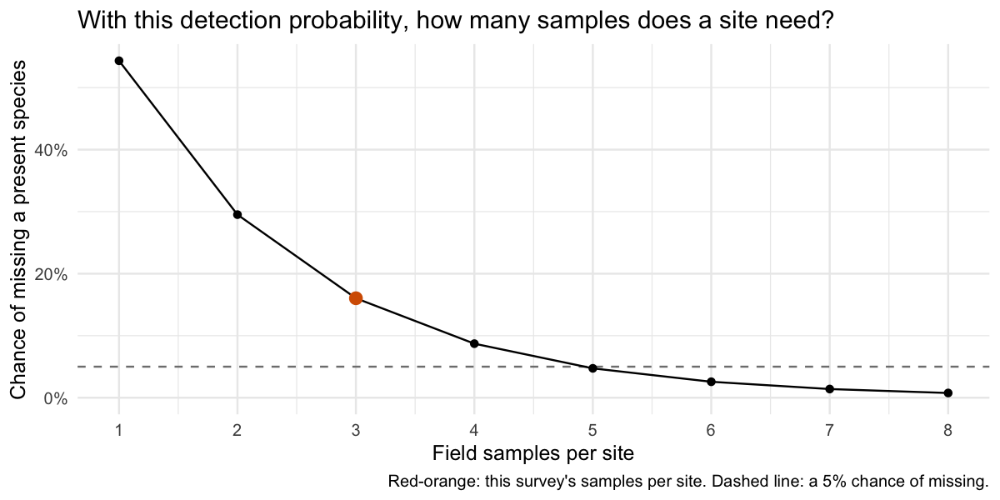

Lesson 1: What occupancy models and joint species distribution models do
================

## What this lesson is about

This lesson explains, by hand and without fitting a model,

1.  what a one-species, single-season occupancy model does with replicate samples, and

2.  what a *joint* species distribution model adds to the simpler alternative of modelling each species on its own.

This is the first required lesson, so every reader starts here. It assumes no familiarity with occJSDM or with occupancy models. Run the code chunks in order; they take a few seconds and read no saved files.

**What this lesson assumes you know about R.** The code uses base R and the tidyverse: the pipe `|>`, and from dplyr and tidyr, the verbs listed below. If any is new, the two chapters of *R for Data Science* on [data transformation](https://r4ds.hadley.nz/data-transform) and [data tidying](https://r4ds.hadley.nz/data-tidy) teach everything in an afternoon. Operations that are unusual are explained where they appear.

- `select()` and `filter()` to choose columns and keep rows.
- `arrange()` and `count()` to order and count rows.
- `mutate()` and `if_else()` to add or recode columns, and `group_by()` and `summarise()` to summarise by group.
- `uncount()` to repeat each row a given number of times.

``` r
library(dplyr)
library(tidyr)
library(tibble)
library(ggplot2)

format_percent <- function(probability, digits = 1) {
  paste0(formatC(100 * probability, format = "f", digits = digits), "%")
}

theme_set(ggplot2::theme_minimal(base_size = 12))
```

`format_percent()` prints probabilities as percentages in the text.

## What an occupancy model does

**Every presence/absence survey raises the same question: if we did not find a species at a site, was it truly absent, or did we miss it?** A single-season occupancy model answers the question by using replicate samples, taken at each site within one season. The model assumes three things:

- Each site is either occupied by the species or not, for the whole season. The probability that a site is occupied by the species is `psi`.
- Each replicate sample at an occupied site detects the species with probability `p`, independently of the other samples. Since we realistically let `p` be less than 1, it is possible for all replicates to fail to detect a species despite it being present, which is a false-negative error.
- An unoccupied site never produces a detection. This is the no-false-positive assumption. In Lesson 2, we relax this assumption and allow false positives.

To see what the model does, we **simulate** a survey of one species in which these three assumptions hold exactly. Simulating means that we choose the values of `psi` and `p` ourselves and generate the dataset with them. This lets us check the model’s answers against the truth. A real survey never sees the truth and is subject to **false-negative error**: a species that is present but not detected. (Lesson 2 moves to a realistic eDNA survey, with many species, a field stage and a laboratory stage, and both false positives and false negatives.)

The survey has 100 sites with 3 samples each, set in the chunk below. Each site has a habitat covariate, which we will call `environment`, and the probability that the site is occupied by the species rises with the value of the `environment` covariate. Each sample has an `effort` covariate, such as the volume of water filtered, and the probability that the sample detects the species (when it is present) rises with the value of the `effort` covariate.

To start, we ignore both these covariates and treat `psi` and `p` as single numbers, as the simplest occupancy model does.

``` r
set.seed(4)
n_sites <- 100
samples_per_site <- 3

# The true coefficients, on the logit scale
true_coefficients <- c(psi_intercept = 0, psi_environment = 1,
                       p_intercept = -0.5, p_effort = 1)

sites <- tibble(Site = 1:n_sites, 
                environment = rnorm(n_sites)) |>
  mutate(psi = plogis(true_coefficients[["psi_intercept"]] +
                        true_coefficients[["psi_environment"]] * environment),
         z = rbinom(n_sites, size = 1, prob = psi))

one_stage <- sites |>
  uncount(samples_per_site) |>
  group_by(Site) |>
  mutate(Sample = row_number()) |>
  ungroup() |>
  mutate(effort = rnorm(n()),
         p = plogis(true_coefficients[["p_intercept"]] +
                      true_coefficients[["p_effort"]] * effort),
         detected = rbinom(n(), size = 1, prob = z * p)) |>
  select(Site, Sample, environment, effort, z, detected)

head(one_stage, 9)
```

    #> # A tibble: 9 × 6
    #>    Site Sample environment effort     z detected
    #>   <int>  <int>       <dbl>  <dbl> <int>    <int>
    #> 1     1      1       0.217  0.877     0        0
    #> 2     1      2       0.217 -0.816     0        0
    #> 3     1      3       0.217  1.54      0        0
    #> 4     2      1      -0.542  1.37      1        1
    #> 5     2      2      -0.542 -0.483     1        0
    #> 6     2      3      -0.542  0.550     1        1
    #> 7     3      1       0.891 -0.857     1        0
    #> 8     3      2       0.891 -0.707     1        0
    #> 9     3      3       0.891 -2.10      1        0

The code chunk works in two steps, first simulate the sites and then simulate the samples.

- `rnorm()` draws each covariate value at random, with mean 0 and standard deviation 1.
- `plogis()` turns `intercept + slope * covariate` into a probability between 0 and 1. The intercepts and slopes in `true_coefficients` are on this logit scale. With a slope of 1, a site one standard deviation above the average habitat has a probability of occupancy of 73.1%, against 50.0% at an average site.
- `rbinom(size = 1, prob = psi)` flips a coin for each site that comes up 1 with probability `psi`. The result, `z`, is the true site state: 1 if the species occupies the site.
- `uncount()` repeats each site’s row 3 times, representing one row per sample, and `Sample` numbers the samples 1 to 3 within each site. Some surveys instead number samples across the whole survey, as Lesson 2’s data do; occJSDM accepts either, because it identifies a sample by its `Site` and `Sample` together.
- A sample detects the species with probability `z * p`. At an occupied site this is `p`. At an empty site it is 0, so an empty site can never produce a detection. That one multiplication is the no-false-positive assumption.

`one_stage` has one row per sample and so 3 rows per site. `z` is the truth, which a real survey would not know, and `detected` is what the survey records. In the first three sites, the species is absent from site 1, so none of its samples detects it. It is present at site 2, and 2 of its 3 samples detected it. It is also present at site 3, but 0 of its 3 samples detected it: a false negative at the site level, which looks exactly like site 1 in the survey’s records.

An occupancy model works with each site’s **detection history**, so we count the detections at each site. We keep the true state, in the column `occupied`, to check the answers, and we summarise the result in a table.

``` r
site_history <- one_stage |>
  group_by(Site) |>
  summarise(
    samples = n(),
    detections = sum(detected),
    occupied = first(z),
    .groups = "drop"
  )

count(site_history, detections, occupied)
```

    #> # A tibble: 5 × 3
    #>   detections occupied     n
    #>        <int>    <int> <int>
    #> 1          0        0    50
    #> 2          0        1    12
    #> 3          1        1    19
    #> 4          2        1    14
    #> 5          3        1     5

Each row of the summary table is a combination of detections and the true state (0/1), and the number `n` of sites with that combination. At 5 sites, all 3 samples detected the species. At 14 sites, 2 of 3 samples detected it, and at 19 sites, only 1 did. Because there are no false positives in this survey, every site with a detection is truly occupied.

Now we consider the sites with no detections. We have seen that 1 or 2 of the 3 samples at an occupied site can miss the species, so all 3 can miss it too. In this survey that happened at 12 sites: the species was present, but no sample detected it. These sites are the **false negatives**. At the other 50 sites with no detections, the species was truly absent: these are the **true negatives**. In total, 62 sites have no detections. A real survey sees only the `detections` column, so these two groups look identical.

The job of an occupancy model is to estimate how many of the 62 all-negative sites are in fact occupied, without peeking at the truth.

We start with the simplest method: just ignore the possibility of false negatives. This is known as **naive occupancy**, and it is the fraction of sites with at least one detection. Every all-negative site is counted as empty.

To do better than naive occupancy, we apply an occupancy model. It needs one calculation for each kind of site.

A site where the species was detected in `d` of its `M` samples must be occupied, so its probability is `psi * p^d * (1 - p)^(M - d)`: occupied, then detected `d` times and missed `M - d` times. A site with no detections could be in either state, so its probability is the sum of two routes: `psi * (1 - p)^M`, occupied but missed by every sample, plus `1 - psi`, empty. Multiplying these probabilities over all sites gives the **likelihood**, the probability of the survey’s whole pattern for a given `psi` and `p`. Maximum likelihood chooses the pair that makes the observed pattern most probable.

A small example shows what that means. Take just two sites with 3 samples each: site A, where the species was detected in 2 samples, and site B, where it was never detected. Guess that `psi` is 0.5 and `p` is 0.4, and ask how probable each site’s record would be if the guess were right. Then try a second guess, with `p` raised to 0.6.

``` r
two_site_likelihood <- function(psi, p) {
  site_A <- psi * p^2 * (1 - p)          # occupied, detected twice, missed once
  site_B <- psi * (1 - p)^3 + (1 - psi)  # occupied and missed three times, or empty
  c(site_A = site_A, site_B = site_B, likelihood = site_A * site_B)
}

guesses <- rbind(first_guess = two_site_likelihood(psi = 0.5, p = 0.4),
                 second_guess = two_site_likelihood(psi = 0.5, p = 0.6))
round(guesses, 3)
```

    #>              site_A site_B likelihood
    #> first_guess   0.048  0.608      0.029
    #> second_guess  0.072  0.532      0.038

With the first guess, site A’s record has probability 0.048. Site B’s record has probability 0.608: the two routes to no detections, 0.108 for occupied but missed and 0.5 for empty, are added, because either produces the same record. The sites are independent, so the probability of seeing both records is the product of the two, 0.029. That product is the likelihood of the first guess. The second guess scores 0.038, which is higher, so it explains these two sites better. Maximum likelihood is this comparison made systematically over every possible guess, with all 100 sites in the product.

The likelihood is not the probability that a guess is correct. The data stay fixed and the guesses change, and the likelihood scores how well each guess explains the data. A product of 100 numbers below 1 is also extremely small, too small for a computer to handle reliably, which is why the code below adds the logarithms of the site probabilities instead of multiplying the probabilities. The best guess is the same either way.

The function below writes the two lines on the log scale, so that the product over sites becomes a sum. `optim()` searches for the best pair. It searches on the logit scale, and `plogis()` turns each number it tries into a probability between 0 and 1. `fnscale = -1` tells it to maximise rather than minimise.

``` r
naive_occupancy <- mean(site_history$detections > 0)

one_stage_loglik <- function(par, history) {
  psi <- plogis(par[1])
  p <- plogis(par[2])
  with(history, {
    detected_sites <- detections > 0
    ll_detected <- log(psi) + detections * log(p) + (samples - detections) * log(1 - p)
    ll_missed <- log(psi * (1 - p)^samples + (1 - psi))
    sum(ifelse(detected_sites, ll_detected, ll_missed))
  })
}

fit <- optim(c(0, 0), one_stage_loglik, history = site_history,
             control = list(fnscale = -1))
estimates <- c(psi = plogis(fit$par[1]), p = plogis(fit$par[2]))
round(estimates, 3)
```

    #>   psi     p 
    #> 0.453 0.457

The model estimates that a site is occupied with probability 45.3% and that each sample at an occupied site detects the species with probability 45.7%. The information about `p` comes from the sites with detections, where we know the species was present. At those sites, 54.4% of samples detected it, which is higher than the model’s `p`. The difference is not a mistake. A site joins that group only if at least one of its samples succeeded, so the raw share overstates how often a sample succeeds. The likelihood corrects for this.

Now we compare these with the truth. The true detection probability of each sample is calculated from that sample’s effort and the true coefficients, exactly as in the simulation. We average it over the samples at occupied sites, because `p` describes only those: at an empty site there is nothing to detect.

``` r
true_p <- plogis(true_coefficients[["p_intercept"]] +
                   true_coefficients[["p_effort"]] * one_stage$effort)

round(c(
  naive_occupancy = naive_occupancy,
  estimated_psi = estimates[["psi"]],
  true_fraction_occupied = mean(site_history$occupied),
  estimated_p = estimates[["p"]],
  true_mean_p = mean(true_p[one_stage$z == 1])
), 3)
```

    #>        naive_occupancy          estimated_psi true_fraction_occupied 
    #>                  0.380                  0.453                  0.500 
    #>            estimated_p            true_mean_p 
    #>                  0.457                  0.393

Naive occupancy, 38.0%, is too low, because it counts the missed sites as absent. The model’s `psi`, 45.3%, is closer to the true fraction of sites occupied, 50.0%, but still low, and its `p`, 45.7%, is higher than the true mean detection probability of the samples at occupied sites, 39.3%. Part of the gap is chance: the estimates come from one survey of 100 sites, of which only 50 were occupied. Part of it is that this model assumes every sample has the same `p`, while in our survey `p` rises with effort. The sites with detections are mostly sites whose samples happened to be good, so `p` estimated from them is too high. A `p` that is too high makes a complete miss look rarer than it is, so the model adds back too few missed sites, and `psi` comes out too low. The section on covariates removes most of this gap by giving the model the effort of each sample.

## The sites where the species was missed

The estimates tell us more than the overall occupancy. They also say how likely it is that a particular all-negative site is occupied. The calculation uses `M`, the number of samples per site, read from the data; every site here has 3.

``` r
M <- unique(site_history$samples)
psi_hat <- estimates[["psi"]]
p_hat <- estimates[["p"]]

occupied_and_missed <- psi_hat * (1 - p_hat)^M
empty <- 1 - psi_hat
conditional_occupancy <- occupied_and_missed / (occupied_and_missed + empty)

round(c(occupied_and_missed = occupied_and_missed,
        empty = empty,
        conditional_occupancy = conditional_occupancy), 3)
```

    #>   occupied_and_missed                 empty conditional_occupancy 
    #>                 0.073                 0.547                 0.117

``` r
missed <- site_history |> filter(detections == 0)

c(no_detection_sites = nrow(missed),
  expected_occupied = round(nrow(missed) * conditional_occupancy, 1),
  actually_occupied = sum(missed$occupied))
```

    #> no_detection_sites  expected_occupied  actually_occupied 
    #>               62.0                7.3               12.0

<!--# START HERE. Is this section calculating the number of false-negative sites, not which sites are false negatives, since this section doesn't consider covariates? -->

Readers often find this step the hardest, so take it slowly, counting whole sites rather than probabilities. Of 100 sites like these, the model expects `psi =` 45.3 to be occupied. At each occupied site, the chance that all 3 samples miss the species is `(1 - p)^M`, 16.0%, so it expects 7.3 occupied sites to produce no detections. It also expects 54.7 sites to be truly empty. Both groups end up in the same place in the survey, among the sites with no detections, and nothing in the detections tells them apart. The **conditional probability of occupancy** is the occupied group’s share of the all-negative sites: `psi * (1 - p)^M / (psi * (1 - p)^M + 1 - psi)`, which is 11.7% here. In words, given that a site produced no detections, it is the probability that the species is nonetheless there.

Multiplying by the number of all-negative sites gives how many of them the model expects to be occupied: 62 sites times 11.7% is 7.3. The simulation shows that 12 actually were. This is also where `psi` comes from. The 38 sites with detections, plus the 7.3 expected among the all-negative sites, make 45.3% of the 100 sites, which is the model’s estimate of `psi`. An occupancy model does not simply scale up naive occupancy. It adds back the sites that its detection probability says were missed.

This model gives every all-negative site the same conditional probability, because it knows nothing that distinguishes one site from another. The next section gives it something.

## Covariates say which sites those are

Two kinds of measured covariate can tell the all-negative sites apart. An **occupancy covariate** describes the habitat: where the habitat suits the species, a site is more likely to be occupied before we look at any samples. A **collection covariate** describes how each sample was taken: where collection was poor, a miss is less surprising. In our survey the occupancy covariate is `environment`, measured once per site, and the collection covariate is `effort`, measured for each sample.

Each covariate enters through the same logistic link that the simulation used. A site’s occupancy probability is `plogis(a + b * environment)` and a sample’s detection probability is `plogis(c + d * effort)`, four numbers in all. Both covariates were simulated with mean 0 and standard deviation 1, so `a` and `c` describe an average site and an average sample, and the slopes are changes per standard deviation. On your own survey, `scale()` puts measured covariates on the same footing.

The likelihood has the same two lines as before. The only change is that each site now has its own `psi`, and each sample its own `p`.

``` r
covariate_loglik <- function(par, d) {
  psi <- plogis(par[1] + par[2] * d$environment)
  p <- plogis(par[3] + par[4] * d$effort)
  per_sample <- ifelse(d$detected == 1, log(p), log(1 - p))
  by_site <- d |>
    mutate(per_sample = per_sample, psi = psi) |>
    group_by(Site) |>
    summarise(
      psi = first(psi),
      detected_any = any(detected == 1),
      ll_if_occupied = sum(per_sample),
      .groups = "drop"
    )
  with(by_site, sum(ifelse(detected_any,
    log(psi) + ll_if_occupied,
    log(psi * exp(ll_if_occupied) + (1 - psi)))))
}

fit_cov <- optim(c(0, 0, 0, 0), covariate_loglik, d = one_stage,
                 control = list(fnscale = -1), method = "BFGS")
coefficients <- setNames(fit_cov$par, c("psi_intercept", "psi_environment", "p_intercept", "p_effort"))
round(coefficients, 3)
```

    #>   psi_intercept psi_environment     p_intercept        p_effort 
    #>          -0.162           1.150          -0.517           1.604

The four numbers are on the logit scale. The habitat slope, `psi_environment`, is positive, so the species is more likely to occupy sites with high values of `environment`. The effort slope, `p_effort`, is positive: a sample’s chance of detecting the species is 37.3% at average effort, 0.6% at the lowest effort in the survey and 99.0% at the highest.

Now we repeat the conditional calculation for each all-negative site, with that site’s own numbers. The chance that every sample misses a species that is present is the product of `1 - p` over the site’s samples. A site whose samples were all taken with little effort therefore has a high chance of missing it. The conditional probability then has the same form as before: `psi * miss / (psi * miss + 1 - psi)`.

``` r
missed_by_site <- one_stage |>
  mutate(
    psi = plogis(coefficients[["psi_intercept"]] + coefficients[["psi_environment"]] * environment),
    p = plogis(coefficients[["p_intercept"]] + coefficients[["p_effort"]] * effort)
  ) |>
  group_by(Site) |>
  summarise(
    detected_any = any(detected == 1),
    environment = first(environment),
    mean_effort = mean(effort),
    psi = first(psi),
    miss = prod(1 - p),
    occupied = first(z),
    .groups = "drop"
  ) |>
  filter(!detected_any) |>
  mutate(conditional = psi * miss / (psi * miss + 1 - psi)) |>
  select(-detected_any) |>
  arrange(desc(conditional))

n_shown <- 10
head(missed_by_site, n_shown)
```

    #> # A tibble: 10 × 7
    #>     Site environment mean_effort   psi  miss occupied conditional
    #>    <int>       <dbl>       <dbl> <dbl> <dbl>    <int>       <dbl>
    #>  1    97      2.33        -0.515 0.925 0.390        1       0.829
    #>  2    55      1.97        -0.812 0.891 0.374        1       0.754
    #>  3     3      0.891       -1.22  0.703 0.714        1       0.629
    #>  4    23      1.31        -0.399 0.793 0.335        1       0.562
    #>  5    30      1.24        -0.104 0.780 0.263        0       0.482
    #>  6    49      0.724       -0.515 0.662 0.425        0       0.454
    #>  7    80     -0.0517      -1.33  0.445 0.809        1       0.393
    #>  8    60      1.35        -0.102 0.800 0.158        0       0.387
    #>  9    42      0.182       -1.08  0.512 0.554        1       0.367
    #> 10    31      0.153       -0.630 0.504 0.494        0       0.334

Each row is one all-negative site, ranked by its conditional probability of occupancy. `environment` is the site’s scaled habitat value and `mean_effort` the mean scaled effort of its samples. `psi` is the site’s probability of occupancy from its habitat, `miss` is the chance that all its samples miss a species that is present, and `occupied` is the simulation’s answer. Read the top rows from left to right. Suitable habitat raises `psi`, low collection effort raises `miss`, and the sites where both are high are where the species most probably hides. At the top site, site 97, the habitat gives a probability of occupancy of 92.5%, and the chance that its samples would all miss the species is 39.0%. Together they give 82.9%.

``` r
missed_by_site |>
  mutate(group = if_else(row_number() <= n_shown, "most likely", "the others")) |>
  group_by(group) |>
  summarise(
    sites = n(),
    expected_occupied = round(sum(conditional), 1),
    actually_occupied = sum(occupied),
    .groups = "drop"
  )
```

    #> # A tibble: 2 × 4
    #>   group       sites expected_occupied actually_occupied
    #>   <chr>       <int>             <dbl>             <int>
    #> 1 most likely    10               5.2                 6
    #> 2 the others     52               5.4                 6

The simulation’s `occupied` column confirms the ranking. Of the 10 all-negative sites the model ranks as most likely to be occupied, 6 were occupied. Of the other 52, only 6 were. The `expected_occupied` column adds up the conditional probabilities in each group. Across all the all-negative sites the model expected 10.6 to be occupied, against 12 that were. The model without covariates gave every one of these sites the same 11.7%. Habitat and effort cannot say for certain which sites are occupied, because even where the habitat suits the species, whether it is there is still chance: the simulation drew `z` with `rbinom()`. They do say where to look. On your own survey, this is the reason to record collection conditions for every sample: without them, a miss in a poor sample looks the same as a miss in a good one.

These are the two covariate groups that `runOccJSDM()` takes: `occCovariates` for occupancy, which the package calls `psi`, and `collCovariates` for collection, which it calls `theta`.

## How many replicates are enough

The question every survey designer asks is how many samples a site needs. If each sample detects a species that is present with probability `p`, the chance that all `M` samples miss it is `(1 - p)^M`, and the chance of at least one detection is `1 - (1 - p)^M`. The figure uses the detection probability estimated above.

``` r
replicate_design <- tibble(samples = 1:8) |>
  mutate(chance_of_missing = (1 - p_hat)^samples)

ggplot(replicate_design, aes(samples, chance_of_missing)) +
  geom_hline(yintercept = 0.05, linetype = "dashed", colour = "grey50") +
  geom_line() +
  geom_point() +
  geom_point(data = filter(replicate_design, samples == M), colour = "#D55E00", size = 3) +
  scale_x_continuous(breaks = 1:8) +
  scale_y_continuous(labels = scales::percent, limits = c(0, NA)) +
  labs(x = "Field samples per site", y = "Chance of missing a present species",
       title = "With this detection probability, how many samples does a site need?",
       caption = "Red-orange: this survey's samples per site. Dashed line: a 5% chance of missing.")
```

<!-- -->

Each point is the chance that a site occupied by the species produces no detections, for a given number of samples. One sample misses the species 54.3% of the time. This survey’s 3 samples miss it 16.0% of the time, which is why the previous sections found occupied sites among the all-negative ones. Reaching a 5% chance of missing would take 5 samples per site.

The number of replicates is a design decision, and the detection probability sets it. A pilot survey that estimates `p` for the species you care most about tells you how many samples you need; a species that is harder to detect needs more. The covariate section suggests a second lever: raising the effort per sample raises `p`, and a higher `p` needs fewer samples.

The package fits this one-stage occupancy model too. It does so when `info` has repeated rows for each site but no `Sample` column, so that each row is one sample with one detection record. The chunk below builds that input from our simulated survey, and it is not run when knitting. `info` holds the site and the covariates, and `OTU` holds the detection records as a matrix with one column per species, here just one, so the two line up row for row. The records are already 0 or 1, so the default `threshold` of one read leaves them unchanged.

``` r
library(occJSDM)

one_stage_data <- list(
  info = one_stage |>
    select(Site, environment, effort) |>
    as.data.frame(),
  OTU = one_stage |>
    select(species = detected) |>
    as.matrix()
)

fit_one_stage <- runOccJSDM(
  data = one_stage_data,
  occCovariates = "environment",
  collCovariates = "effort",
  spatCovariates = NULL,
  MCMCparams = list(nchain = 2, nburn = 2000, niter = 2000, nthin = 1)
)
# occJSDM prints "occJSDM has inferred occupancy data" for this shape.
```

The message confirms that `runOccJSDM()` inferred the one-stage model. It is the hand calculation’s model with covariates. Its collection probability, `theta`, is the per-sample detection probability that the hand calculation called `p`, and it depends on `effort` as our `p` did. Given many species, the package fits them all together, with the hidden site factors that the second half of this lesson describes. It also estimates a rate of field-stage false positives, with a prior that expects the rate to be small, as Lesson 2 explains. Our survey has none, so the hand calculation leaves that rate out. The chain settings are short, for a quick look; check that the chains agree before reading the results, as Lesson 2 shows.

False positives are excluded from this half of the lesson by construction. They arrive in Lesson 2 with the second stage, PCR detection in the laboratory, which brings laboratory false positives as well as field-stage ones. There, the same replication logic protects site occupancy against contamination at collection.

## What a joint model does

A species distribution model relates the occurrence of one species to the environment. Fit one for each species and you have a stacked model: a set of independent models. Stacking is easy, and it is often fine for predicting one species at a time. What it cannot do is say anything about how species occur together beyond what the measured environment explains, because it assumes that species are independent once the covariates are known. A **joint species distribution model** (JSDM) fits all the species together and adds one thing: the **residual correlation** among species. After the measured environment has been accounted for, do two species still tend to occur together, or apart? Two practical consequences follow. A rare species borrows strength from the better-recorded species it tends to occur with. And predictions can be conditional: given that species A was recorded at a site, how likely is species B?

Hidden factors are a familiar idea outside ecology. A recommender system takes a table of viewers by films and finds two small tables whose product reproduces it: a score for each viewer on a few hidden dimensions, and a position for each film on the same dimensions. The dimensions turn out to be genres that nobody labelled. Replace viewers by sites and films by species, and the same arithmetic recovers unmeasured habitat axes from which species occur together. Here is that arithmetic on a toy community of six sites and five species, with two hidden gradients that we call wetness and shade.

``` r
species_scores <- rbind(                 # species x hidden gradients
  species_A = c(wet = 1.0, shade = 0.0),
  species_B = c(0.9, 0.1),
  species_C = c(0.6, 0.6),
  species_D = c(0.1, 0.9),
  species_E = c(0.0, 1.0)
)
site_scores <- rbind(                    # sites x hidden gradients
  site_1 = c(wet = 1.5, shade = 0.0),
  site_2 = c(1.2, 0.2),
  site_3 = c(1.0, 1.0),
  site_4 = c(0.2, 1.3),
  site_5 = c(0.0, 1.5),
  site_6 = c(0.3, 0.3)
)
suitability <- site_scores %*% t(species_scores)
round(suitability, 2)
```

    #>        species_A species_B species_C species_D species_E
    #> site_1       1.5      1.35      0.90      0.15       0.0
    #> site_2       1.2      1.10      0.84      0.30       0.2
    #> site_3       1.0      1.00      1.20      1.00       1.0
    #> site_4       0.2      0.31      0.90      1.19       1.3
    #> site_5       0.0      0.15      0.90      1.35       1.5
    #> site_6       0.3      0.30      0.36      0.30       0.3

``` r
round(svd(suitability)$d, 3)
```

    #> [1] 4.217 2.344 0.000 0.000 0.000

Each species has a score on each hidden gradient: species_A is a wet-ground specialist, species_E a shade specialist and species_C sits between them. Each site has a score on the same gradients. A cell of `suitability` is the site’s scores multiplied by the species’ scores and added up, so it is high where the two line up. Take site_3, at 1 on both gradients, and species_C, at 0.6 on both: their cell is 1 times 0.6 plus 1 times 0.6, which is 1.2. The wet site with no shade, site_1, scores 1.5 for species_A and 0 for species_E.

The table has 30 numbers, but the second printout shows that only 2 of its singular values are not zero. The number of singular values that are not zero is the number of independent patterns in a table, so every column here is a mixture of the same 2 patterns. The two small tables hold 22 numbers and reproduce all 30. Lesson 2’s survey, 100 sites by 10 species, is 1,000 cells, while two hidden factors need 2 × (100 + 10) = 220 scores.

A survey does not record suitability. It records presence or absence, which depends on suitability. Suppose, for the toy, that a species is present wherever its suitability exceeds 0.5.

``` r
presence <- (suitability > 0.5) * 1
presence
```

    #>        species_A species_B species_C species_D species_E
    #> site_1         1         1         1         0         0
    #> site_2         1         1         1         0         0
    #> site_3         1         1         1         1         1
    #> site_4         0         0         1         1         1
    #> site_5         0         0         1         1         1
    #> site_6         0         0         0         0         0

This is the kind of table a survey gives you. The hidden gradients show through it: the wet sites, site_1 and site_2, hold species_A, species_B and species_C; the shaded sites, site_4 and site_5, hold species_C, species_D and species_E; site_3 holds everything and site_6 nothing. Nobody labelled the gradients, but the co-occurrence pattern groups the sites and the species along them. A JSDM works backwards from a table like this to the hidden gradients behind it.

There is a catch in reading those gradients. Rotate both sets of scores by the same angle, and every individual score changes but the table does not.

``` r
theta <- pi / 6
rotation <- matrix(c(cos(theta), sin(theta), -sin(theta), cos(theta)), 2, 2)

round(rbind(original = species_scores["species_A", ],
            rotated = (species_scores %*% rotation)["species_A", ]), 3)
```

    #>            wet shade
    #> original 1.000   0.0
    #> rotated  0.866  -0.5

``` r
max(abs((site_scores %*% rotation) %*% t(species_scores %*% rotation) - suitability))
```

    #> [1] 2.220446e-16

``` r
round(species_scores %*% t(species_scores), 2)
```

    #>           species_A species_B species_C species_D species_E
    #> species_A       1.0      0.90      0.60      0.10       0.0
    #> species_B       0.9      0.82      0.60      0.18       0.1
    #> species_C       0.6      0.60      0.72      0.60       0.6
    #> species_D       0.1      0.18      0.60      0.82       0.9
    #> species_E       0.0      0.10      0.60      0.90       1.0

After the rotation, species_A moves from (1, 0) to (0.866, -0.5), so the axis we called wetness is no longer the wetness axis. Yet the rebuilt table differs from the original by at most 2e-16 in R’s scientific notation, which is rounding error. The names “wet” and “shade” were never in the data; we imposed them. The individual scores are therefore not identified: many sets of scores fit the data equally well.

What survives rotation is the last printout, the species-by-species table of cross-products. Read it as a table of which species go together. The pair species_A and species_B scores 0.9, and so does the pair species_D and species_E. The pair species_A and species_E scores 0, because they share no gradient. The middle species, species_C, is moderately similar to everything, because it straddles both gradients. **This species-by-species matrix is the interpretable output, and the individual scores are not.** Scaled to correlations, it is what the package reports as the residual correlations between species.

Real data also contain measured covariates. Part of a species’ suitability is explained by environment we measured, and only the rest by hidden gradients. The model then has two parts, `suitability = X %*% B + site_scores %*% t(species_scores)`: a measured part, where `X` holds each site’s environmental covariates and `B` each species’ response to them, plus a hidden part for the structure we did not measure.

Swap the recommender’s nouns for ecology and nothing else changes:

- Viewers become **sites**, and films become **species**.
- The table of ratings becomes the site-by-species table of **occurrences**.
- Viewer attributes, such as age, become the **environmental covariates**, and each species has its own response to them.
- Film positions on the hidden dimensions become the **species loadings**, the species scores above.
- Viewer tastes become **site scores** on the same hidden gradients.
- The film-by-film similarity becomes the **species association matrix**, the residual correlations.

An unmeasured environmental gradient, such as soil pH, plays the role of a genre. Sites differ along it and species respond to it, but nobody measured it, and its fingerprint is a group of species that occur together more often than the measured environment predicts.

## What a joint model adds to a factorisation

A JSDM uses that low-rank idea, but it is not a factorisation of your data matrix, and the difference is worth stating plainly. **A factorisation describes the table you have. A JSDM estimates how species covary, so that it can reason about tables you do not have.** Three additions make the difference.

- **It factors the residual, not the data.** The measured environment enters first as an ordinary regression, one coefficient vector per species. The hidden factors are then asked to explain only what the environment left over. That is why the output is called a *residual* correlation. If you measure a gradient that the factors had been standing in for and add it as a covariate, the association it produced shrinks. That is the model working as intended, not a contradiction.
- **It is a probability model of a presence or absence.** A recommender regresses 1s and 0s as if they were continuous scores and reports a fitted number per cell. A JSDM treats each cell as a Bernoulli outcome whose probability is a logit or probit transform of the linear predictor. That gives a likelihood, and with it uncertainty for every parameter, sensible behaviour for rare species, and a basis for comparing models.
- **It treats the site scores as random and averages over them.** In a recommender, each viewer’s score vector is a parameter, because recommending to that viewer needs it. In a JSDM, a site’s hidden scores are assumed to be drawn from a standard normal distribution. Packages that fit by optimisation, such as gllvm and sjSDM in Lesson 5, average over every value the scores could take and keep only the species loadings; Bayesian packages, such as occJSDM and Hmsc, sample the scores for the fitted sites but likewise average over them at new sites. Because the scores are independent standard normals, the covariance between two species’ residuals at a site is the dot product of their two loading rows. That holds at any site, sampled or not. The loading matrix therefore describes the community rather than the particular sites surveyed, and the species-by-species matrix built from it is what the packages report as the residual covariance or association matrix.

Put together, these define the **joint probability distribution of the whole species vector at a site**. That is the sense in which the model is joint. Two things follow that no factorisation offers. First, recording one species at a site tells you something about the others, because it is evidence about that site’s hidden scores. Second, the same model answers two different prediction questions, depending on whether such evidence is available. [Lesson 5](occJSDM-lesson-5.md) makes that distinction precise in its section “Two probability questions that must not be mixed”, and its [exercise](occJSDM-lesson-5.md#exercise-predict-one-species-given-another) shows the first consequence in numbers.

In occJSDM’s terms, the number of hidden site factors is `n_factors` in `listParams`, and Lesson 2’s fits use 2, matching the simulation. The site scores are returned by `returnOrdinationScores()` and the species loadings by `returnFactorLoadings()`; Lesson 3 writes their product for species `j` at site `i` as `U_i L_j`. `returnResidualCorrelationMatrix()` multiplies each posterior draw of the loadings by its own transpose, scales the result to correlations, and returns the lower limit, median and upper limit of each correlation. For the toy community, the same scaling gives:

``` r
round(cov2cor(species_scores %*% t(species_scores)), 2)
```

    #>           species_A species_B species_C species_D species_E
    #> species_A      1.00      0.99      0.71      0.11      0.00
    #> species_B      0.99      1.00      0.78      0.22      0.11
    #> species_C      0.71      0.78      1.00      0.78      0.71
    #> species_D      0.11      0.22      0.78      1.00      0.99
    #> species_E      0.00      0.11      0.71      0.99      1.00

The pair species_A and species_B, which load on the same gradient, has a correlation of 0.99; species_A and species_E, which share none, have 0; species_C is correlated with both ends at 0.71. In a fitted model, each of these numbers comes with a credible interval, the range holding the middle 95% of the posterior draws.

## What you can now recognise in the other lessons

- **The two stages of an eDNA survey.** [Lesson 2](occJSDM-lesson-2.md#three-questions-three-different-truths) adds the second stage, PCR detection in the laboratory, to the collection stage used here, and allows false positives at both stages.
- **Replicates as protection.** The replication logic of “How many replicates are enough” returns in [Lesson 2’s conclusions](occJSDM-lesson-2.md#what-this-lesson-showed): more field samples per site guard site occupancy against contamination at collection.
- **Assumptions written as priors.** The no-false-positive assumption made here becomes, in [Lesson 2](occJSDM-lesson-2.md#how-does-good-practice-enter-the-model), a prior that expects contamination to be uncommon without ruling it out.
- **Estimates with uncertainty.** The hand calculation gave single best values; [Lesson 3](occJSDM-lesson-3.md#put-the-true-coefficient-beside-its-estimate) reads the fitted model’s estimates with their credible intervals.
- **Hidden factors and residual correlations.** The species-by-species matrix of the toy community is what [Lesson 3’s association section](occJSDM-lesson-3.md#residual-species-associations-did-we-recover-what-was-put-in) compares with truth, and the rotation problem is why its [ordination section](occJSDM-lesson-3.md#ordination-compare-the-combined-effect-before-naming-the-axes) compares combined effects before naming axes.
- **Conditional prediction.** [Lesson 5’s exercise](occJSDM-lesson-5.md#exercise-predict-one-species-given-another) predicts one species from the presence of another, which only a joint model can do.

Continue to [Lesson 2: Fit the model and compare its answers with truth](occJSDM-lesson-2.md).
