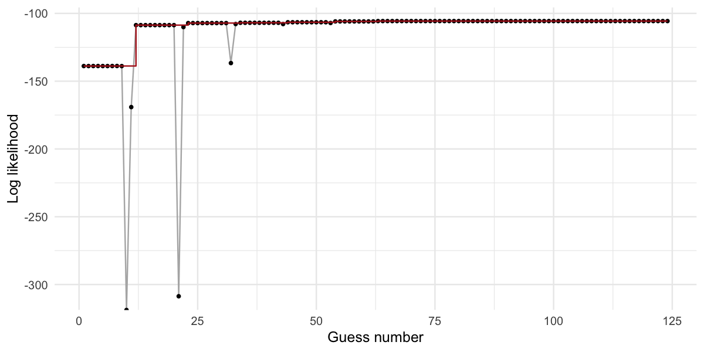
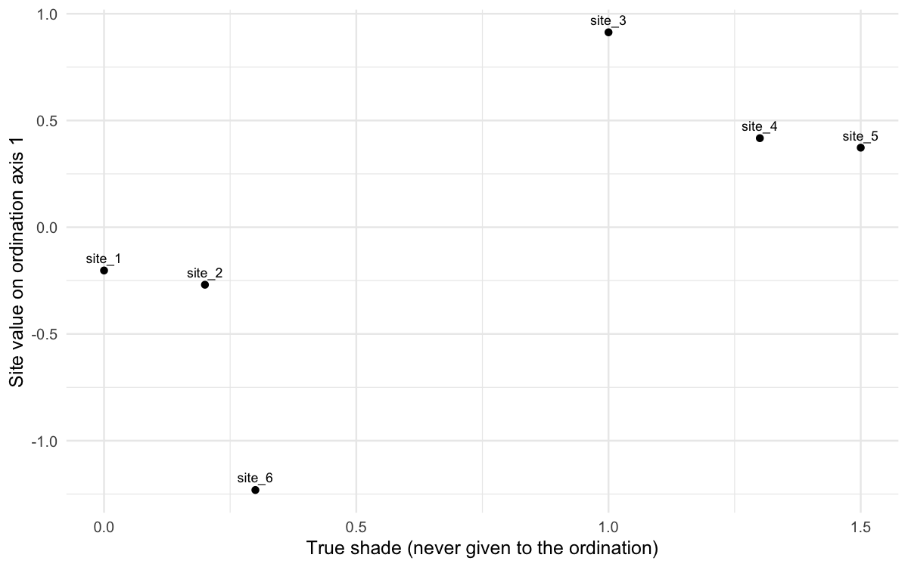
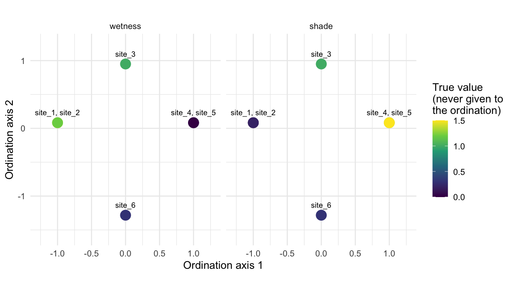

Lesson 1: What occupancy models and joint species distribution models do
================

## What this lesson is about

This lesson explains, mostly by hand,

1.  what a one-species, single-season occupancy model does with replicate samples, ending with the same model fitted by occJSDM, and

2.  what a *joint* species distribution model adds to the simpler alternative of modelling each species on its own.

This is the first required lesson, so every reader starts here. It assumes no familiarity with occJSDM or with occupancy models. Run the code chunks in order; they take a few seconds and read no saved files.

**What this lesson assumes you know about R.** The code uses base R and the tidyverse: the pipe `|>`, and from dplyr and tidyr, the verbs listed below. If any is new, the two chapters of *R for Data Science* on [data transformation](https://r4ds.hadley.nz/data-transform) and [data tidying](https://r4ds.hadley.nz/data-tidy) teach everything in an afternoon. Operations that are unusual are explained where they appear.

- `select()`, `filter()` and `slice()` to choose columns and keep rows.
- `arrange()` and `count()` to order and count rows.
- `mutate()` and `if_else()` to add or recode columns, `across()` to apply one change to several columns, and `group_by()` and `summarise()` to summarise by group.
- `uncount()` to repeat each row a given number of times, and `expand_grid()` to make every combination of two sets of values.

``` r
library(dplyr)
library(tidyr)
library(tibble)
library(ggplot2)

format_percent <- function(probability, digits = 1) {
  paste0(formatC(100 * probability, format = "f", digits = digits), "%")
}

theme_set(ggplot2::theme_minimal(base_size = 12))
```

`format_percent()` prints probabilities as percentages in the text.

## What an occupancy model does

**Every presence/absence survey raises the same question: if we did not find a species at a site, was it truly absent, or did we miss it?** A single-season occupancy model answers the question by using replicate samples, taken at each site within one season. The model assumes three things:

- Each site is either occupied by the species or not, for the whole season. The probability that a site is occupied by the species is `psi`.
- Each replicate sample at an occupied site detects the species with probability `p`, independently of the other samples. Since we realistically let `p` be less than 1, it is possible for all replicates to fail to detect a species despite it being present, which is a false-negative error.
- An unoccupied site never produces a detection. This is the no-false-positive assumption. In Lesson 2, we relax this assumption and allow false positives.

To see what the model does, we **simulate** a survey of one species in which these three assumptions hold exactly. Simulating means that we choose the values of `psi` and `p` ourselves and generate the dataset with them. This lets us check the model’s answers against the truth. A real survey never sees the truth, and it can miss species that are present. (Lesson 2 moves to a realistic eDNA survey, with many species, a field stage and a laboratory stage, and both false positives and false negatives.)

The survey has 100 sites with 3 samples each, set in the chunk below. Each site has a habitat covariate, which we will call `environment`, and the probability that the site is occupied by the species rises with the value of the `environment` covariate. Each sample has an `effort` covariate, such as the volume of water filtered, and the probability that the sample detects the species (when it is present) rises with the value of the `effort` covariate.

To start, we ignore both these covariates and treat `psi` and `p` as single numbers, as the simplest occupancy model does.

``` r
set.seed(4)
n_sites <- 100
samples_per_site <- 3

# The true coefficients, on the logit scale
true_coefficients <- c(psi_intercept = 0.5, psi_environment = 1,
                       p_intercept = -1, p_effort = 1)

sites <- tibble(Site = 1:n_sites, 
                environment = rnorm(n_sites)) |>
  mutate(psi = plogis(true_coefficients[["psi_intercept"]] +
                        true_coefficients[["psi_environment"]] * environment),
         z = rbinom(n_sites, size = 1, prob = psi))

one_stage <- sites |>
  uncount(samples_per_site) |>
  group_by(Site) |>
  mutate(Sample = row_number()) |>
  ungroup() |>
  mutate(effort = rnorm(n()),
         p = plogis(true_coefficients[["p_intercept"]] +
                      true_coefficients[["p_effort"]] * effort),
         detected = rbinom(n(), size = 1, prob = z * p)) |>
  select(Site, Sample, environment, effort, z, detected)

head(one_stage, 9)
```

    #> # A tibble: 9 × 6
    #>    Site Sample environment effort     z detected
    #>   <int>  <int>       <dbl>  <dbl> <int>    <int>
    #> 1     1      1       0.217  0.877     0        0
    #> 2     1      2       0.217 -0.816     0        0
    #> 3     1      3       0.217  1.54      0        0
    #> 4     2      1      -0.542  1.37      1        1
    #> 5     2      2      -0.542 -0.483     1        0
    #> 6     2      3      -0.542  0.550     1        0
    #> 7     3      1       0.891 -0.857     1        0
    #> 8     3      2       0.891 -0.707     1        0
    #> 9     3      3       0.891 -2.10      1        0

The code chunk works in two steps: first it simulates the sites, then the samples.

- `rnorm()` draws each covariate value at random, with mean 0 and standard deviation 1.
- `plogis()` turns `intercept + slope * covariate` into a probability between 0 and 1. The intercepts and slopes in `true_coefficients` are on this logit scale. With a slope of 1, a site one standard deviation above the average habitat has a probability of occupancy of 81.8%, against 62.2% at an average site.
- `rbinom(size = 1, prob = psi)` flips a coin for each site that comes up 1 with probability `psi`. The result, `z`, is the true site state: 1 if the species occupies the site.
- `uncount()` repeats each site’s row 3 times, representing one row per sample, and `Sample` numbers the samples 1 to 3 within each site. Some surveys instead number samples across the whole survey, as Lesson 2’s data do; occJSDM accepts either, because it identifies a sample by its `Site` and `Sample` together.
- A sample detects the species with probability `z * p`. At an occupied site this is `p`. At an empty site it is 0, so an empty site can never produce a detection. That one multiplication is the no-false-positive assumption.

`one_stage` has one row per sample and so 3 rows per site. `z` is the truth, which a real survey would not know, and `detected` is what the survey records. In the first three sites, the species is absent from site 1, so none of its samples detects it. It is present at site 2, and 1 of its 3 samples detected it. It is also present at site 3, but 0 of its 3 samples detected it: a false negative at the site level, which looks exactly like site 1 in the survey’s records.

An occupancy model works with each site’s **detection history**, so we count the detections at each site. We keep the true state, in the column `occupied`, to check the answers, and we summarise the result in a table.

``` r
site_history <- one_stage |>
  group_by(Site) |>
  summarise(
    samples = n(),
    detections = sum(detected),
    occupied = first(z),
    .groups = "drop"
  )

count(site_history, detections, occupied)
```

    #> # A tibble: 5 × 3
    #>   detections occupied     n
    #>        <int>    <int> <int>
    #> 1          0        0    40
    #> 2          0        1    23
    #> 3          1        1    22
    #> 4          2        1    14
    #> 5          3        1     1

Each row of the summary table is a combination of detections and the true state (0/1), and the number `n` of sites with that combination. The number of sites where all 3 samples detected the species is 1, where 2 of 3 samples detected it is 14, and where only 1 did is 22. Because there are no false positives in this survey, every site with a detection is truly occupied.

Now we consider the sites with no detections. We have seen that 1 or 2 of the 3 samples at an occupied site can miss the species, so all 3 can miss it too. In this survey that happened at 23 sites: the species was present, but no sample detected it. These sites are the **false negatives**. At the other 40 sites with no detections, the species was truly absent: these are the **true negatives**. In total, 63 sites have no detections. A real survey sees only the `detections` column, so these two groups look identical.

The job of an occupancy model is to estimate how many of the 63 all-negative sites are in fact occupied, without peeking at the truth.

We start with the simplest method: just ignore the possibility of false negatives. This is known as **naive occupancy**, and it is the fraction of sites with at least one detection. Every all-negative site is counted as empty.

To do better than naive occupancy, we apply an occupancy model. It needs one calculation for each kind of site.

A site where the species was detected in `d` of its `M` samples must be occupied, so its probability is `psi * p^d * (1 - p)^(M - d)`: occupied, then detected `d` times and missed `M - d` times. A site with no detections could be in either state, so its probability is the sum of two routes: `psi * (1 - p)^M`, occupied but missed by every sample, plus `1 - psi`, empty. Multiplying these probabilities over all sites gives the **likelihood**, the probability of the survey’s whole pattern for a given `psi` and `p`. Maximum likelihood chooses the pair that makes the observed pattern most probable.

A small example shows what “multiplying over all sites” means. Take just **two** sites with 3 samples each: site A, where the species was detected in 2 samples, and site B, where it was never detected. Start with a guess that `psi` is 0.5 and `p` is 0.4, and ask how probable each site’s record would be if the guess were right. Then try a second guess, with `p` raised to 0.6.

In the `two_site_likelihood` function, the probabilities for site A and site B are multiplied together to produce the likelihood for this particular history of detections (2 detections in site A, 0 in site B). We then use `two_site_likelihood` to score two guesses of `psi` and `p`. The guess with the higher likelihood explains the data better, and the guess with the highest likelihood of all is the dataset’s best estimate of `psi` and `p`.

``` r
two_site_likelihood <- function(psi, p) {
  site_A <- psi * p^2 * (1 - p)          # occupied, detected twice, missed once
  site_B <- psi * (1 - p)^3 + (1 - psi)  # occupied and missed three times, or empty
  c(site_A = site_A, site_B = site_B, likelihood = site_A * site_B)
}

guesses <- rbind(first_guess = two_site_likelihood(psi = 0.5, p = 0.4),
                 second_guess = two_site_likelihood(psi = 0.5, p = 0.6))
round(guesses, 3)
```

    #>              site_A site_B likelihood
    #> first_guess   0.048  0.608      0.029
    #> second_guess  0.072  0.532      0.038

With the first guess (`psi` = 0.5 and `p` = 0.4), site A’s record has probability 0.048. Site B’s record has probability 0.608, which is the sum of the two routes to no detections: 0.108 for occupied but missed + 0.5 for empty. Sites A and B are independent, so the probability of seeing both records is the product of the two probabilities, 0.029. That product is the likelihood of the first guess.

The second guess scores 0.038, which is higher, so it explains these two sites better.

> Hand-calculate the numbers in the previous two paragraphs.
>
> Why are the probabilities of the two possible routes to no detections in Site B summed together?
>
> Why are the probabilities of the two outcomes in Sites A and B multiplied together?

To find the maximum likelihood for all 100 sites, we let the computer try many pairs of `psi` and `p`, moving towards pairs with higher likelihoods, as described below.

The likelihood is not the probability that a guess is correct. **The likelihood scores how well each guess explains the data**.

> A computational issue: when computers multiply many extremely small numbers, the product can become too small to store and is rounded to zero, and many likelihood probabilities are extremely small numbers. But there is a clever fix. Instead of multiplying two extremely small numbers, *it is mathematically equivalent to sum the logarithms* of two extremely small numbers, so this is what the computer code does when it calculates likelihoods.

The function `one_stage_loglik` does the same thing as `two_site_likelihood`, but it (1) does it for any number of sites, and (2) uses the method of adding logarithms to calculate the likelihood. The R function `optim()` then searches systematically for the `psi` and `p` pair (the guess) that maximises the likelihood. It searches on the logit scale, and `plogis()` turns each number it tries into a probability between 0 and 1. `fnscale = -1` tells it to maximise rather than minimise the likelihood. We give `optim()` only the columns a real survey would have, so the `occupied` column, the truth, is dropped first.

``` r
naive_occupancy <- mean(site_history$detections > 0)

one_stage_loglik <- function(par, history) {
  psi <- plogis(par[1])
  p <- plogis(par[2])
  with(history, {
    detected_sites <- detections > 0
    ll_detected <- log(psi) + detections * log(p) + (samples - detections) * log(1 - p)
    ll_missed <- log(psi * (1 - p)^samples + (1 - psi))
    sum(ifelse(detected_sites, ll_detected, ll_missed))
  })
}

observed_history <- select(site_history, Site, samples, detections)  # only give the optim() function the data, omitting the column `occupied`, which contains the truth

fit <- optim(c(0, 0), one_stage_loglik, history = observed_history,
             control = list(fnscale = -1)) # it runs super fast

estimates <- c(psi = plogis(fit$par[1]), p = plogis(fit$par[2]))

round(estimates, 3)
```

    #>   psi     p 
    #> 0.519 0.340

The model estimates (by maximising the likelihood) that any given site is occupied with probability `psi` = 51.9% and that each sample at an occupied site detects the species with probability `p` = 34.0%.

To get some intuition about how we estimated `p` (the probability of detection when the species is present), we can look at the number of successful detections in `site_history`. There were 37 sites where the species was detected at least once. If detection were perfect, we would expect 111 total detections, but in fact, we only got 53 detections. So a simple estimate of detection probability is 53 `/` 111 = 0.477.

Now, this hand-calculated estimate of p is higher than the model’s estimate, 0.34, because the correct denominator is bigger than 111 since some sites contain the species, but all the samples failed to detect. The likelihood also estimated the true number of occupied sites, out of 100: 51.9.

Now we compare the model-estimated values with the truth, which we can do because we simulated the dataset in the first place. The true detection probability of each sample is calculated from that sample’s effort and the true coefficients. We average it over the samples at occupied sites, because `p` applies only to occupied sites.

``` r
true_p <- plogis(true_coefficients[["p_intercept"]] +
                   true_coefficients[["p_effort"]] * one_stage$effort)

round(c(
  naive_occupancy = naive_occupancy,
  estimated_psi = estimates[["psi"]],
  true_fraction_occupied = mean(site_history$occupied),
  estimated_p = estimates[["p"]],
  true_mean_p = mean(true_p[one_stage$z == 1])
), 3)
```

    #>        naive_occupancy          estimated_psi true_fraction_occupied 
    #>                  0.370                  0.519                  0.600 
    #>            estimated_p            true_mean_p 
    #>                  0.340                  0.291

Naive occupancy, 37.0%, is too low, because it counts the missed sites as absent. The model’s estimated `psi`, 51.9%, is closer to the true fraction of sites occupied, 60.0%, albeit still too low, and its estimated `p`, 34.0%, is higher than the true mean detection probability of the samples at occupied sites, 29.1%.

Part of the gap is chance: the estimates come from just one survey of 100 sites, of which only 60 were occupied. Part of it is that this model assumes every sample has the same `p`, while in our simulation `p` rises with effort, which we have not incorporated into the model. The sites with detections are mostly sites whose samples happened to be good, so `p` estimated from them is too high. A `p` that is too high makes a complete miss look rarer than it is, so the model adds back too few missed sites, and `psi` comes out too low. Below, we make the model more complex by adding in sampling effort, and we find that doing so removes most of this gap.

## How many all-negative sites are occupied?

We can calculate how many of the all-negative sites the model expects to be occupied. The calculation uses the two estimates, `psi` and `p`, plus `M`, the number of samples per site, which is 3 at every site in this dataset.

``` r
M <- unique(site_history$samples)
psi_hat <- estimates[["psi"]]
p_hat <- estimates[["p"]]

occupied_and_missed <- psi_hat * (1 - p_hat)^M
empty <- 1 - psi_hat
conditional_occupancy <- occupied_and_missed / (occupied_and_missed + empty)

round(c(occupied_and_missed = occupied_and_missed,
        empty = empty,
        conditional_occupancy = conditional_occupancy), 3)
```

    #>   occupied_and_missed                 empty conditional_occupancy 
    #>                 0.149                 0.481                 0.236

``` r
missed <- site_history |> filter(detections == 0)

c(no_detection_sites = nrow(missed),
  expected_occupied = round(nrow(missed) * conditional_occupancy, 1),
  actually_occupied = sum(missed$occupied))
```

    #> no_detection_sites  expected_occupied  actually_occupied 
    #>               63.0               14.9               23.0

Readers often find this step the hardest, so take it slowly. Over all 100 sites, the model had estimated from the survey data that `psi =` 51.9% were truly occupied. Of course, we did not actually detect the species in that many sites because at the occupied sites, there is a chance that all 3 samples miss the species: `(1 - p)^M`, 28.7%.

Accordingly, we detected the species at 37 sites, which is clearly less than what the model estimates as the true number of occupied sites: 51.9. Thus, the number of apparently empty sites that the model thinks are truly occupied is the difference between those two numbers: 14.9 sites.

We can calculate this number a second way. An all-negative site is either occupied but missed by every sample, with probability `psi * (1 - p)^M`, or empty, with probability `1 - psi`. The **conditional probability of occupancy** is the occupied group’s share of the all-negative sites: `psi * (1 - p)^M / (psi * (1 - p)^M + 1 - psi)`, which is 23.6% here. In words, given that a site produced no detections, it is the probability that the species is nonetheless there. Multiplying by the number of all-negative sites gives how many of them the model expects to be occupied: 63 sites times 23.6% is 14.9. The two ways agree because they must: at the maximum-likelihood estimate, `psi` is exactly the share of sites made up of those with detections plus those the model expects were missed.

Now, the model’s estimate is not perfect. It expects 14.9 occupied sites among the all-negative ones, but we know the truth, which is that 23 all-negative sites actually contained the species. In the next section, we add a **collection** covariate and an **occupancy** covariate to the model. Together they improve the estimate of how many all-negative sites are occupied, and in the section after that, we use them to rank the all-negative sites by how likely each is to hold the species.

## Adding covariates to the likelihood

Two kinds of measured covariate can separate the all-negative sites into truly empty and occupied but species not detected.

- During a survey, the ecologist typically measures features of the ***site*** that are likely to affect its suitability for the species. For example, this might be river width or vegetation type. These are coded as **occupancy covariates**.

- The ecologist also records variables that might affect how likely each ***sample*** is to detect the species. For example, if the sample type is water, a **collection covariate** might be the volume of water per sample, and if, say, all three sample volumes are low, we would be less surprised if the samples fail to detect the species. In turn, this means that **we would be slightly more likely to believe that the species could truly be at that site**.

In our survey, the occupancy covariate is called `environment`, measured once per site, and the collection covariate is called `effort`, measured once per sample.

Each covariate enters the likelihood equation through the same logistic link that we used in the simulation. A site’s occupancy probability is `plogis(a + b * environment)` and a sample’s detection probability is `plogis(c + d * effort)`, giving us four parameters (numbers) to estimate. For example, if `b` is a positive number, then a higher value of the occupancy covariate for a site predicts that the site has a higher probability of occupancy by the species.

Both covariates were simulated with mean 0 and standard deviation 1, so the intercepts `a` and `c` describe an average site and an average sample, and the slopes `b` and `d` describe changes per standard deviation. `scale()` puts the measured covariates on the same footing.

The likelihood has the same two routes as before: a site with a detection must be occupied, and a site with no detections is either empty or occupied-but-missed-by-every-sample. What changes is that each **site** now has its own `psi`, from its own value of `environment`, and each **sample** has its own `p`, from its own value of `effort`. So we can no longer work from the `site_history` table, which has one row per site and only reports the sum of the detections. We return to the per-sample table, `one_stage`, which has one row per sample, because each sample has its own `effort` and its own result.

To understand how the new likelihood function uses `one_stage`, we first calculate a likelihood by hand for two sites, sites 2 and 3. Site 2 is like site A from the previous section: the species was detected, in 1 of its 3 samples. Site 3 is like site B: no sample detected the species, even though it is present (which we know only because we simulated its presence). We also need a guess for the four numbers, just as we needed a guess for `psi` and `p` before. We try `a` = 0, `b` = 1, `c` = 0 and `d` = 1.

**Step 1: a `psi` for each site and a `p` for each sample.**

``` r
guess_cov <- c(a = 0, b = 1, c = 0, d = 1)

two_sites <- one_stage |>
  filter(Site %in% c(2, 3)) |>
  select(Site, Sample, environment, effort, detected) |>
  mutate(psi = plogis(guess_cov[["a"]] + guess_cov[["b"]] * environment),
         p = plogis(guess_cov[["c"]] + guess_cov[["d"]] * effort))

two_sites
```

    #> # A tibble: 6 × 7
    #>    Site Sample environment effort detected   psi     p
    #>   <int>  <int>       <dbl>  <dbl>    <int> <dbl> <dbl>
    #> 1     2      1      -0.542  1.37         1 0.368 0.798
    #> 2     2      2      -0.542 -0.483        0 0.368 0.381
    #> 3     2      3      -0.542  0.550        0 0.368 0.634
    #> 4     3      1       0.891 -0.857        0 0.709 0.298
    #> 5     3      2       0.891 -0.707        0 0.709 0.330
    #> 6     3      3       0.891 -2.10         0 0.709 0.109

Each row is one sample. The `environment` value is the same in all three rows of a site because it is measured once per site. As a result, `psi` is also the same in all three rows of a site. Site 3’s habitat value is higher than site 2’s, so under this guess, site 3 is more likely to be occupied: `psi` for site 3 = 70.9% against `psi` for site 2 = 36.8%.

`p` changes from row to row, because each sample has its own `effort`. Site 3’s samples were all taken with low effort (more negative numbers), so each sample at site 3 had only a small chance of detecting the species, between 10.9% and 33.0%.

Thus, given the measured `environment` of each site and `effort` of each sample, and a guess at `a`, `b`, `c` and `d` (which set the species’ occupancy and detection at an average site and sample, and how each changes with `environment` and `effort`), we can calculate two probabilities for each of the six samples: `psi`, the chance that its site is occupied, and `p`, the chance that it detects the species if the site is occupied. You can see these probabilities in `two_sites`, and it is easy to imagine doing this for any number of sites.

**Step 2: the probability of each sample’s result, if the site is occupied.**

We now have an estimated probability `p` for every sample (calculated from the sample’s `effort` and our guess parameters). Suppose for now that the species is truly at the site. Then a sample that detected it must have done so with that sample’s probability `p`, and a sample that missed it must have done so with that sample’s probability `1 - p`. Let’s make a new table, `sample_probs`, showing these `p` and `1 - p` values, which we convert to logs.

``` r
sample_probs <- two_sites |>
  mutate(if_occupied = ifelse(detected == 1, p, 1 - p),
         per_sample = log(if_occupied))

select(sample_probs, Site, Sample, detected, effort, p, if_occupied, per_sample)
```

    #> # A tibble: 6 × 7
    #>    Site Sample detected effort     p if_occupied per_sample
    #>   <int>  <int>    <int>  <dbl> <dbl>       <dbl>      <dbl>
    #> 1     2      1        1  1.37  0.798       0.798     -0.226
    #> 2     2      2        0 -0.483 0.381       0.619     -0.480
    #> 3     2      3        0  0.550 0.634       0.366     -1.01 
    #> 4     3      1        0 -0.857 0.298       0.702     -0.354
    #> 5     3      2        0 -0.707 0.330       0.670     -0.401
    #> 6     3      3        0 -2.10  0.109       0.891     -0.116

``` r
# pull out site 2 to check by hand below
site2 <- filter(sample_probs, Site == 2)
```

Read the `if_occupied` column. In site 2, sample 1 has an `if_occupied` value of 79.8%: if the species is at the site, that sample had a 79.8% probability of detecting it, and in fact the sample did detect the species.

Now, interestingly, site 2, sample 2 has a 61.9% probability of *not* detecting (`1 - p`) the species, which traces back to the calculated probability `p` = 38.1% of detecting, which itself traces back to that sample’s `effort` value, which was -0.483, meaning that effort in that sample was 0.5 standard deviations below the mean. And *that* traces back to our guesses `c` = 0 and `d` = 1 for how to translate effort to a probability of detection: `plogis(0 + 1 * effort)`. A 61.9% chance of missing the species is not small, and indeed, the sample did not detect the species. So we can say that our current guesses of `c` = 0 and `d` = 1 fit reasonably well with this data point. The big question is how well the same `c` and `d` values fit with *all* of the data points, relative to all the other guesses. The likelihood scores that for each guess, and `optim()` searches for the guess with the best score.

> N.B. The `if_occupied` column is here only to make the step visible. The function below skips straight to calculating the `per_sample` column, which is `log(if_occupied)`.

**Step 3: combine each site’s samples into one row.**

We also want to assess our guesses of `a` = 0 and `b` = 1, which determine `psi`, the probability that the species is at the site, given that site’s `environment` value: `psi = plogis(a + b * environment)`. To do this, we first need to combine the sample probabilities that we calculated above into a single probability, per site, of that site’s whole record of detections and misses, if the species is there.

Because the samples at an occupied site are independent (the model assumes this, and we design sampling to try to fulfil the assumption), the probability of the site’s whole detection record (across all its samples) is the product of its samples’ probabilities. With logs, the product is a sum. `group_by(Site)` and `summarise()` do this for each site and keep two other things the next step needs: the site’s `psi` value, which is calculated from the guesses and the site’s environment value (see previous paragraph), and whether any of its samples detected the species.

``` r
by_site <- sample_probs |>
  group_by(Site) |>
  summarise(
    psi = first(psi), 
    detected_any = any(detected == 1), 
    ll_if_occupied = sum(per_sample), # per_sample holds log(if_occupied)
    .groups = "drop"
  )

by_site
```

    #> # A tibble: 2 × 4
    #>    Site   psi detected_any ll_if_occupied
    #>   <int> <dbl> <lgl>                 <dbl>
    #> 1     2 0.368 TRUE                 -1.71 
    #> 2     3 0.709 FALSE                -0.870

`first(psi)` takes the site’s `psi` from its first row; any row would do, since they are all the same.

`ll_if_occupied` is the log probability of the site’s record, if the site is occupied by the species. In other words, for a given relationship between sample effort and detection probability `p` that we get from our guessed `c` and `d` values, it is the combined probability of achieving that site’s total record of detections and misses, assuming that the species is present, presented in log form.

We can hand calculate this. The three `if_occupied` values from site 2 were 0.798, 0.619 and 0.366. Their product is 0.1808, and its log is -1.71, which is `ll_if_occupied` for site 2 in the table.

> Why only “if occupied”? If the species is *absent* from a site, the probability of a given detection record is easy to calculate.
>
> If every sample produced no detection, the probability of this outcome is 1, because an empty site can only produce misses.
>
> The probability of one or more samples being positive is 0. That is, it’s impossible for a positive detection when the species is absent, since we assume no false positives in this model. We incorporate this logic into Step 4 below.

For site 3, `exp(ll_if_occupied)` turns `ll_if_occupied` back into a probability, 41.9%: the chance that all three samples missed a species that was truly present. This number plays the part of `(1 - p)^3` in the first model, which had no covariates, but here, it is built from three different values of `p`. The value is large here because site 3’s samples all had low effort. So even if the species were there, there was a 41.9% chance that all three would miss it. Three misses at site 3 are therefore weak evidence that the species is absent. Combining this miss probability with site 3’s `psi` gives the probability that the species is there despite no detections, which we calculate for every all-negative site later in this section.

**Step 4: the two routes, site by site.**

We have combined the separate sample probabilities for a site into a single value `ll_if_occupied`, creating the new table `by_site` with one row per site. Now we can calculate the probability of the detection record for a given full set of guesses (`a`, `b`, `c`, and `d`), which combine with each site’s `environment` and each sample’s `effort` to give `psi`, the probability that the species is at the site, and `p`, the probability that each sample detects it if it is there.

To bring it back to the beginning, `a`, `b`, `c` and `d` are what we want to estimate from the data, and with them we can use the `environment` value to calculate `psi` for any site and the `effort` value to calculate `p` for any sample.

``` r
site_routes <- by_site |>
  mutate(ll_site = ifelse(detected_any,
                          log(psi) + ll_if_occupied, 
                          log(psi * exp(ll_if_occupied) + (1 - psi))))

site_routes
```

    #> # A tibble: 2 × 5
    #>    Site   psi detected_any ll_if_occupied ll_site
    #>   <int> <dbl> <lgl>                 <dbl>   <dbl>
    #> 1     2 0.368 TRUE                 -1.71   -2.71 
    #> 2     3 0.709 FALSE                -0.870  -0.531

``` r
# pull out site 3 to check by hand below
site3 <- filter(site_routes, Site == 3)
site3_missed <- site3$psi * exp(site3$ll_if_occupied)  # occupied but missed by all three samples
```

Looking at `site_routes`, site 2 had a detection (`detected_any = TRUE`), so it must be occupied. Its log probability is therefore `log(psi)`, for occupied, plus `ll_if_occupied`, for this record of samples.

> Don’t forget that by adding these two logged values, we are really multiplying their probabilities: the species is present AND its samples gave this record of detections and misses. When we have an AND relationship between two probabilities, we multiply, because `ll_if_occupied` is already the probability of the record *given* that the species is present. This is the calculation we did for site A, just in logs and with a separate `p` for each sample.
>
> `ll_if_occupied` is calculated with `c` and `d`, and `psi` is calculated with `a` and `b`, so `log(psi) + ll_if_occupied` calculates the log probability of the detection record given all four guessed values: `a`, `b`, `c`, and `d`.

Site 3 had no detections (`detected_any = FALSE`), so we add the two routes: `psi * exp(ll_if_occupied)` for occupied but missed by all three samples, plus `1 - psi` for empty. The empty route is really `(1 - psi) * 1`: the chance that the site is empty, times the probability that an empty site gives all misses, which is 1 (see the callout in Step 3).

> The complication here is that we don’t want to multiply probabilities for this case. We want to add the two probabilities: (1) the species is present AND not detected by any sample OR (2) the species is absent. When two routes are mutually exclusive (a site can’t be both occupied and empty), the probability of one OR the other is their sum. Because `ll_if_occupied` is logged, we turn it back into a probability with `exp()` (= un-log), add the two routes, and take the log of the total.

We can hand calculate this too. For site 3, occupied but missed is 0.709 × 0.419 = 0.297, and empty is 0.291. The total is 0.588, and its log is -0.531, which is `ll_site` for site 3 in the table.

**Step 5: add up the sites.**

The log likelihood of the guess for these two sites is the sum of the sites’ values: -2.71 + -0.53 = -3.24. Adding logs multiplies probabilities, so this is the log of the probability of site 2’s record AND site 3’s record, which we can multiply because the sites are independent.

`covariate_loglik()` in the next chunk does the five steps above in one go for all of the sites at once. Its four numbers, `par[1]` to `par[4]`, are `a`, `b`, `c` and `d`. Run on sites 2 and 3 with our guess, it gives the same answer as the hand calculation.

`optim()` uses `covariate_loglik()` to try many guesses of the four numbers, starting from four zeros, and keeps the guess with the highest log likelihood. `method = "BFGS"` uses the slope of the log likelihood to decide which way to step, which is usually faster and more reliable than the default when there are several numbers to find. We look at what it did below.

``` r
# from the one-stage-mle code chunk above:  calculating likelihood *without* covariates
# one_stage_loglik <- function(par, history) {
#   psi <- plogis(par[1]) # only one parameter
#   p <- plogis(par[2]) # only one parameter
#   with(history, {
#     detected_sites <- detections > 0
#     ll_detected <- log(psi) + detections * log(p) + (samples - detections) * log(1 - p)
#     ll_missed <- log(psi * (1 - p)^samples + (1 - psi))
#     sum(ifelse(detected_sites, ll_detected, ll_missed))
#   })
# }

# calculating likelihood *with* covariates
covariate_loglik <- function(par, d) {
  psi <- plogis(par[1] + par[2] * d$environment) # 2 parameters, and psi depends on the environment
  p <- plogis(par[3] + par[4] * d$effort) # 2 parameters, and p depends on the effort
  per_sample <- ifelse(d$detected == 1, log(p), log(1 - p))
  by_site <- d |>
    mutate(per_sample = per_sample, psi = psi) |>
    group_by(Site) |>
    summarise(
      psi = first(psi),
      detected_any = any(detected == 1),
      ll_if_occupied = sum(per_sample),
      .groups = "drop"
    )
  with(by_site, sum(ifelse(detected_any,
    log(psi) + ll_if_occupied,
    log(psi * exp(ll_if_occupied) + (1 - psi)))))
}

covariate_loglik(guess_cov, two_sites)  # the hand calculation for sites 2 and 3, again, using the guesses: a = 0, b = 1, c = 0, d = 1
```

    #> [1] -3.243681

``` r
observed_samples <- select(one_stage, Site, environment, effort, detected)  # This is the survey data only

fit_cov <- optim(c(0, 0, 0, 0), covariate_loglik, d = observed_samples,
                 control = list(fnscale = -1), method = "BFGS")
# optim(initial_values_of_parameters_to_estimate, likelihood_function, data, method). It is extremely fast, but in fact, it has tried many different guesses. 

coefficients <- setNames(fit_cov$par, c("psi_intercept", "psi_environment", "p_intercept", "p_effort")) # extract the guesses that produce the maximum likelihood value

tibble(letter = c("a", "b", "c", "d"),
       coefficient = names(coefficients),
       estimate = round(coefficients, 3))
```

    #> # A tibble: 4 × 3
    #>   letter coefficient     estimate
    #>   <chr>  <chr>              <dbl>
    #> 1 a      psi_intercept      0.166
    #> 2 b      psi_environment    0.858
    #> 3 c      p_intercept       -1.11 
    #> 4 d      p_effort           1.62

The four numbers are on the logit scale.

The habitat slope, `psi_environment` or `b`, is positive, so the species is more likely to occupy sites with high values of `environment`.

The effort slope, `p_effort` or `d`, is positive: a sample’s chance of detecting the species is 24.7% at average effort, 0.3% at the lowest effort in the survey and 98.3% at the highest.

**How much work did `optim()` do?** To see, we wrap `covariate_loglik()` in a function that also writes down every guess it is asked to score, and run the same search again.

``` r
trail <- list()
tracked_loglik <- function(par, d) {
  ll <- covariate_loglik(par, d)
  trail[[length(trail) + 1]] <<- c(a = par[1], b = par[2], c = par[3], d = par[4], loglik = ll)  # <<- adds to `trail` outside the function
  ll
}

fit_tracked <- optim(c(0, 0, 0, 0), tracked_loglik, d = observed_samples,
                     control = list(fnscale = -1), method = "BFGS")

guesses_tried <- as_tibble(do.call(rbind, trail)) |>
  mutate(guess = row_number(), .before = 1) |>
  mutate(best_so_far = cummax(loglik))

fit_cov$counts       # what optim() reports
```

    #> function gradient 
    #>       28       12

``` r
fit_cov$convergence  # 0 means it stopped because it had converged
```

    #> [1] 0

``` r
nrow(guesses_tried)  # how many times the likelihood was actually calculated
```

    #> [1] 124

``` r
slice(guesses_tried, c(1:10, n())) # showing the first ten and the last
```

    #> # A tibble: 11 × 7
    #>    guess      a      b       c      d loglik best_so_far
    #>    <int>  <dbl>  <dbl>   <dbl>  <dbl>  <dbl>       <dbl>
    #>  1     1  0      0       0      0      -139.       -139.
    #>  2     2  0.001  0       0      0      -139.       -139.
    #>  3     3 -0.001  0       0      0      -139.       -139.
    #>  4     4  0      0.001   0      0      -139.       -139.
    #>  5     5  0     -0.001   0      0      -139.       -139.
    #>  6     6  0      0       0.001  0      -139.       -139.
    #>  7     7  0      0      -0.001  0      -139.       -139.
    #>  8     8  0      0       0      0.001  -139.       -139.
    #>  9     9  0      0       0     -0.001  -139.       -139.
    #> 10    10 -6.00   9.93  -13.0   34.6    -Inf        -139.
    #> 11   124  0.166  0.858  -1.11   1.62   -106.       -106.

``` r
ggplot(guesses_tried, aes(guess, loglik)) +
  geom_line(colour = "grey70") +
  geom_point(size = 1) +
  geom_step(aes(y = best_so_far), colour = "firebrick") +
  labs(x = "Guess number", y = "Log likelihood")
```

<!-- -->

`optim()` reports that it scored 28 guesses and calculated 12 gradients. A gradient tells it which direction is uphill. Because we did not give `optim()` a formula for the gradient, it estimates each one by nudging each of the four numbers a tiny amount up and down and scoring the result, which costs 8 more likelihood calculations per gradient. In total, the likelihood was calculated 124 times. The first 10 rows of the table `guesses_tried` show this: the starting guess of four zeros, then `a` nudged up and down by 0.001, then `b`, then `c`, then `d`. Then `optim()` tries a new guess starting in row 10.

The plot shows the search, one point per guess. The flat runs of points are those nudges: each run is one gradient being estimated, and the nudges are too small to change the log likelihood visibly. After each gradient, `optim()` takes a step uphill. The deep dips are steps that went too far: the new guess scored worse, so `optim()` threw it away and tried a shorter step in the same direction. Guess 10 went so far that one of its probabilities rounded to zero, giving a log likelihood of `-Inf`; the plot draws it at the bottom edge. The red line is the best log likelihood found so far, which is the guess `optim()` keeps. It starts at -138.8 for four zeros, jumps up within the first few steps, and then creeps up to -105.658, where no small change to `a`, `b`, `c` or `d` makes it any higher. The last row of the table is that best guess, which are the four numbers reported in `coefficients`. Each point is one full run of the five steps above, over all 100 sites. (Our hand calculation scored -3.244 for just two sites, so it is not on this scale.)

## Which all-negative sites are most likely occupied?

With the fitted coefficients, we can repeat the conditional calculation for each all-negative site, with that site’s own numbers. The chance that every sample misses a species that is present is the product of `1 - p` over the site’s samples. A site whose samples were all taken with little effort therefore has a high chance of missing it. The conditional probability then has the same form as before: `psi * miss / (psi * miss + 1 - psi)`.

``` r
missed_by_site <- one_stage |>
  mutate(
    psi = plogis(coefficients[["psi_intercept"]] + coefficients[["psi_environment"]] * environment),
    p = plogis(coefficients[["p_intercept"]] + coefficients[["p_effort"]] * effort)
  ) |>
  group_by(Site) |>
  summarise(
    detected_any = any(detected == 1),
    environment = first(environment),
    mean_effort = mean(effort),
    psi = first(psi),
    miss = prod(1 - p),
    occupied = first(z),
    .groups = "drop"
  ) |>
  filter(!detected_any) |>
  mutate(conditional = psi * miss / (psi * miss + 1 - psi)) |>
  select(-detected_any) |>
  arrange(desc(conditional))

n_shown <- 10
head(missed_by_site, n_shown)
```

    #> # A tibble: 10 × 7
    #>     Site environment mean_effort   psi  miss occupied conditional
    #>    <int>       <dbl>       <dbl> <dbl> <dbl>    <int>       <dbl>
    #>  1    21      1.54        -0.236 0.816 0.545        1       0.707
    #>  2    64      2.06         0.151 0.874 0.307        1       0.681
    #>  3     3      0.891       -1.22  0.717 0.828        1       0.678
    #>  4    23      1.31        -0.399 0.784 0.514        1       0.651
    #>  5     5      1.64        -0.461 0.828 0.348        1       0.626
    #>  6    35      0.861       -0.833 0.712 0.636        1       0.611
    #>  7    30      1.24        -0.104 0.774 0.439        0       0.600
    #>  8    49      0.724       -0.515 0.687 0.600        0       0.569
    #>  9    60      1.35        -0.102 0.790 0.281        0       0.514
    #> 10    80     -0.0517      -1.33  0.530 0.890        1       0.501

Each row is one all-negative site, ranked by its conditional probability of occupancy.

`environment` is the site’s scaled habitat value and `mean_effort` the mean scaled effort of its samples. `psi` is the site’s probability of occupancy from its habitat, `miss` is the chance that all its samples miss a species that is present, and `occupied` is the true presence (1) or absence (0) from the simulation, which the model never sees. Read the top rows from left to right. Suitable habitat raises `psi`, low collection effort raises `miss`, and the sites where both are high are where the species most probably hides.

The conditional probability of occupancy answers a different question from `psi`. `psi` is the chance that the species is at the site *before* we look at the samples, from the site’s habitat alone. The conditional probability is the chance *after* we have looked and learned that every sample missed. Those misses are evidence against presence, so the conditional probability is always lower than `psi`. How much lower depends on `miss`: if the samples would probably have missed the species anyway (because `effort` was low), the misses tell us little.

To see the calculation, take the top site, site 21, and imagine 1,000 sites exactly like it, with the same habitat and the same sampling effort.

``` r
top_site <- missed_by_site[1, ]
copies <- 1000

occupied_copies <- copies * top_site$psi
missed_copies <- occupied_copies * top_site$miss  # occupied, but every sample missed
empty_copies <- copies * (1 - top_site$psi)       # empty, so every sample missed

round(c(occupied = occupied_copies,
        occupied_and_missed = missed_copies,
        empty = empty_copies,
        share_occupied = missed_copies / (missed_copies + empty_copies)), 3)
```

    #>            occupied occupied_and_missed               empty      share_occupied 
    #>             815.858             445.008             184.142               0.707

Of the 1,000 copies, `psi` = 81.6% are occupied: 816 sites. At each of them, every sample misses with probability `miss` = 54.5%, so 445 occupied sites produce no detections. The other 184 sites are empty, and they produce no detections too. So 629 of the copies look exactly like site 21 in the survey, and 445 of those are occupied: 70.7%. That share is the conditional probability of occupancy, and it is what `psi * miss / (psi * miss + 1 - psi)` calculates.

Had site 21’s samples been good, with `miss` = 5%, only 41 of the 816 occupied copies would have produced no detections, and the conditional probability would fall to 18.1%. The same three misses mean much more when the samples were good.

``` r
missed_by_site |>
  mutate(group = if_else(row_number() <= n_shown, "most likely", "the others")) |>
  group_by(group) |>
  summarise(
    sites = n(),
    expected_occupied = round(sum(conditional), 1),
    actually_occupied = sum(occupied),
    .groups = "drop"
  )
```

    #> # A tibble: 2 × 4
    #>   group       sites expected_occupied actually_occupied
    #>   <chr>       <int>             <dbl>             <int>
    #> 1 most likely    10               6.1                 7
    #> 2 the others     53              12.1                16

The simulation’s `occupied` column confirms the ranking. Of the 10 all-negative sites the model ranks as most likely to be occupied, 7 were occupied. Of the other 53, only 16 were occupied. The `expected_occupied` column adds up the conditional probabilities in each group. Across all the all-negative sites the model expected 18.3 to be occupied, against 23 that were. The model without covariates gave every one of these sites the same 23.6%.

Habitat and effort cannot say for certain which sites are occupied, because even where the habitat suits the species, species presence is still subject to chance. The simulation drew `z` (true presence) with `rbinom()`. Habitat and effort do say where to look. On your own surveys, this is the reason to record collection conditions for every sample: without them, a miss in a poor sample looks the same as a miss in a good one.

These are the two covariate groups that `runOccJSDM()` takes: `occCovariates` for occupancy, which the package calls `psi`, and `collCovariates` for collection, which it calls `theta`.

## How many replicates are enough?

The question every survey designer asks is how many samples a site needs. If each sample detects a species that is present with probability `p`, the chance that all `M` samples miss it is `(1 - p)^M`, and the chance of at least one detection is `1 - (1 - p)^M`. This assumes that every sample has the same `p`, which in our survey means the same effort. So we use the covariate fit and draw one line for each of three efforts: low (one standard deviation below average), average, and high (one standard deviation above).

``` r
effort_levels <- c(low = -1, average = 0, high = 1)  # in standard deviations of effort
effort_p <- plogis(coefficients[["p_intercept"]] + coefficients[["p_effort"]] * effort_levels)

replicate_design <- expand_grid(effort = names(effort_levels), samples = 1:15) |>
  mutate(p = effort_p[effort],
         chance_of_missing = (1 - p)^samples,
         effort = factor(effort, levels = names(effort_levels)))

ggplot(replicate_design, aes(samples, chance_of_missing, colour = effort)) +
  geom_hline(yintercept = 0.05, linetype = "dashed", colour = "grey50") +
  geom_vline(xintercept = M, linetype = "dotted", colour = "grey50") +
  geom_line() +
  geom_point() +
  scale_x_continuous(breaks = 1:15) +
  scale_y_continuous(labels = scales::percent, limits = c(0, 1)) +
  scale_colour_manual(values = c(low = "#0072B2", average = "grey20", high = "#D55E00")) +
  labs(x = "Field samples per site", y = "Chance of missing a present species",
       colour = "Effort per sample",
       title = "How many samples does a site need?",
       caption = "Dotted line: this survey's samples per site. Dashed line: a 5% chance of missing.")
```

<!-- -->

``` r
samples_needed <- ceiling(log(0.05) / log(1 - effort_p))  # samples for a 5% chance of missing
tibble(effort = names(effort_levels), p = round(effort_p, 3), samples_for_5_percent = samples_needed)
```

    #> # A tibble: 3 × 3
    #>   effort      p samples_for_5_percent
    #>   <chr>   <dbl>                 <dbl>
    #> 1 low     0.061                    48
    #> 2 average 0.247                    11
    #> 3 high    0.624                     4

Each point is the chance that an occupied site produces no detections, for a given number of samples, all taken at the same effort. At average effort, one sample detects the species 24.7% of the time, so it misses 75.3% of the time. This survey’s 3 samples at average effort miss it 42.7% of the time, which is why the previous sections found occupied sites among the all-negative ones, and reaching a 5% chance of missing would take 11 samples per site. At high effort, 4 samples are enough. At low effort, each sample detects the species only 6.1% of the time, and reaching 5% would take 48 samples, far off the plot.

The number of replicates is a design decision, and the detection probability sets it. A pilot survey that estimates `p` for the species you care most about tells you how many samples you need; a species that is harder to detect needs more. The figure also shows a second lever, which the covariate sections found: raising the effort per sample raises `p`, and a higher `p` needs far fewer samples.

## How the occupancy model uses covariates, in brief

For every site, the model asks two questions: how likely was the species to be here, given the habitat (`psi`), and how likely were we to see it if it was here, given how each sample was taken (`p`)? It then chooses the `a`, `b`, `c` and `d` that make the survey we actually got as probable as possible.

Different sites teach the model different things.

| Site | What it tells the model | Informs |
|:---|:---|:---|
| Detected in at least one sample | The species is certainly there. The site’s habitat shows where the species lives, and its hits and misses, set against each sample’s effort, show how detection depends on effort. | `a` and `b`, and most of what is learned about `c` and `d` |
| No detections, after good samples | A blank after good samples is strong evidence of absence, so the site counts as probably empty. | `a` and `b`, where the species is not; `c` and `d`, how many blanks to expect |
| No detections, after poor samples | A blank after poor samples is weak evidence, so the site stays close to its habitat-based `psi`. | Little |

The all-negative sites matter for detection too: the model has to expect about as many blanks as the survey produced. And the two halves of the model keep each other honest. Habitat says where the species should be, and effort says how hard we looked. Without effort, a miss in a poor sample looks the same as a miss in a good one, which is why the first model, without covariates, underestimated `psi` and overestimated `p`.

occJSDM fits exactly this model, as the next section shows.

## Fitting the same model with occJSDM

The occJSDM package can fit a one-stage occupancy model with covariates. It does so when `info` has repeated rows for each `Site` but no `Sample` column, so that each row is one sample with one detection record. The chunk below builds that input from our simulated survey and fits the model, which takes a few seconds. `info` holds the sites and the covariates, and `OTU` holds the detection records as a matrix with one column per species, here just one, so the two line up row for row. The records are already 0 or 1, so the default `threshold` of one read leaves them unchanged.

``` r
library(occJSDM)

one_stage_data <- list(
  info = one_stage |>
    select(Site, environment, effort) |>
    as.data.frame(),
  OTU = one_stage |>
    select(species = detected) |>
    as.matrix()
)

head(one_stage_data$info)
```

    #>   Site environment     effort
    #> 1    1   0.2167549  0.8769847
    #> 2    1   0.2167549 -0.8161958
    #> 3    1   0.2167549  1.5392933
    #> 4    2  -0.5424926  1.3745257
    #> 5    2  -0.5424926 -0.4832487
    #> 6    2  -0.5424926  0.5503500

``` r
head(one_stage_data$OTU)
```

    #>      species
    #> [1,]       0
    #> [2,]       0
    #> [3,]       0
    #> [4,]       1
    #> [5,]       0
    #> [6,]       0

``` r
fit_one_stage <- runOccJSDM(
  data = one_stage_data,
  occCovariates = "environment",
  collCovariates = "effort",
  spatCovariates = NULL,
  MCMCparams = list(nchain = 2, nburn = 2000, niter = 2000, nthin = 1)
)
```

When you run the chunk, these messages at the start confirm that `runOccJSDM()` inferred the one-stage model. (They are hidden on this page, along with the convergence report that follows them.)

> Sample column missing, but detected repeated observations for some sites
>
> Only 0 and 1 detected
>
> occJSDM has inferred occupancy data

The package estimates the same four coefficients. Its occupancy probability, `psi`, depends on `environment` through `a` and `b`, and its collection probability, `theta`, is the per-sample detection probability that the hand calculation called `p`, depending on `effort` through `c` and `d`. We pull out the posterior draws of all four with `returnPosteriorDraws()` and set them beside the hand calculation’s values and the true values from the simulation. Then we compare each sample’s `theta`, from `computeAverageCollectionProbs()`, with the hand calculation’s `p` for the same sample.

One step comes first. Before fitting, occJSDM **standardises** each covariate: it subtracts the covariate’s mean and divides by its standard deviation (across sites for `environment`, across samples for `effort`), so that all covariates are on the same scale. Its coefficients therefore describe a change of one standard deviation, not one unit, and the chunk converts them back to the raw scale that the hand calculation used. (Lesson 3 does the reverse, putting the truth on the standardised scale.)

``` r
# occJSDM fits standardised covariates; convert an intercept and slope back to the raw scale of x
unstandardise <- function(intercept, slope, x) {
  list(intercept = intercept - slope * mean(x) / sd(x),
       slope = slope / sd(x))
}

theta_draws <- returnPosteriorDraws(fit_one_stage, "beta_theta")[, "species", , ]  # coefficient x iteration x chain
psi_raw <- unstandardise(intercept = as.vector(returnPosteriorDraws(fit_one_stage, "beta0_psi")),
                         slope = as.vector(returnPosteriorDraws(fit_one_stage, "beta_psi")),
                         x = sites$environment)
theta_raw <- unstandardise(intercept = as.vector(theta_draws["(Intercept)", , ]),
                           slope = as.vector(theta_draws["effort", , ]),
                           x = one_stage$effort)

package_draws <- list(psi_intercept = psi_raw$intercept, psi_environment = psi_raw$slope,
                      p_intercept = theta_raw$intercept, p_effort = theta_raw$slope)

coefficient_table <- tibble(
  coefficient = c("a (psi_intercept)", "b (psi_environment)", "c (p_intercept)", "d (p_effort)"),
  truth = true_coefficients[names(package_draws)],
  hand = coefficients[names(package_draws)],
  median = sapply(package_draws, median),        # the package's posterior median
  lower = sapply(package_draws, quantile, 0.025), # and its 95% credible interval
  upper = sapply(package_draws, quantile, 0.975)
) |>
  mutate(truth_inside = truth >= lower & truth <= upper)

coefficient_table |>
  mutate(across(where(is.numeric), \(x) round(x, 2)))
```

    #> # A tibble: 4 × 7
    #>   coefficient         truth  hand median lower upper truth_inside
    #>   <chr>               <dbl> <dbl>  <dbl> <dbl> <dbl> <lgl>       
    #> 1 a (psi_intercept)     0.5  0.17   0.07 -0.62  0.89 TRUE        
    #> 2 b (psi_environment)   1    0.86   0.7   0.04  1.66 TRUE        
    #> 3 c (p_intercept)      -1   -1.11  -1.03 -1.6  -0.47 TRUE        
    #> 4 d (p_effort)          1    1.62   1.61  1.05  2.32 FALSE

``` r
sample_theta <- one_stage |>
  select(Site, Sample, effort) |>
  mutate(hand_p = plogis(coefficients[["p_intercept"]] + coefficients[["p_effort"]] * effort),
         package_theta = computeAverageCollectionProbs(fit_one_stage)[, "species"])

head(sample_theta)
```

    #> # A tibble: 6 × 5
    #>    Site Sample effort hand_p package_theta
    #>   <int>  <int>  <dbl>  <dbl>         <dbl>
    #> 1     1      1  0.877 0.576         0.593 
    #> 2     1      2 -0.816 0.0803        0.0916
    #> 3     1      3  1.54  0.799         0.800 
    #> 4     2      1  1.37  0.753         0.758 
    #> 5     2      2 -0.483 0.130         0.144 
    #> 6     2      3  0.550 0.445         0.465

For every coefficient, the package’s median is close to the hand calculation’s value, and the package adds a 95% credible interval, which the hand calculation did not. The `truth_inside` column checks each interval against the true value. The intervals for a, b and c contain their true values, and the interval for d, 1.05 to 2.32, just misses its true value, 1.

The occupancy coefficients `a` and `b` are much less certain than the detection coefficients `c` and `d`: the interval for `b` runs from 0.04 to 1.66. The reason for lower certainty in `a` and `b` is that occupancy is never fully observed. A site with a detection is certainly occupied, but an all-negative site may be empty or occupied and missed, so the model learns `a` and `b` from 100 site-level outcomes, some of them uncertain. The package’s `b` is a little smaller than the hand calculation’s, partly because its priors pull coefficients towards zero, which matters most when the data are weak, and partly because a posterior median is not the same as a single best value.

In contrast, the model learns `c` and `d` directly from the many samples at those sites.

Why are both the hand and occJSDM estimates of `d` too steep? It is because everything the survey knows about `d` comes from the samples at the occupied sites, and this survey has only 53 detections among its 180 samples at occupied sites. By chance, its low-effort samples detected the species less often than their true `p`, and its high-effort samples more often, so the data themselves rise more steeply with effort than the truth does.

A simulation lets us check this, because we know which sites are occupied:

``` r
one_stage |>
  filter(z == 1) |>                                   # truly occupied: known only in a simulation
  mutate(effort_band = cut(effort, breaks = c(-Inf, -1, 0, 1, Inf)),
         true_p = plogis(true_coefficients[["p_intercept"]] + true_coefficients[["p_effort"]] * effort)) |>
  group_by(effort_band) |>
  summarise(samples = n(),
            observed_rate = mean(detected),
            true_p = mean(true_p)) |>
  mutate(across(c(observed_rate, true_p), \(x) round(x, 3)))
```

    #> # A tibble: 4 × 4
    #>   effort_band samples observed_rate true_p
    #>   <fct>         <int>         <dbl>  <dbl>
    #> 1 (-Inf,-1]        36         0.028  0.076
    #> 2 (-1,0]           56         0.161  0.19 
    #> 3 (0,1]            59         0.356  0.358
    #> 4 (1, Inf]         29         0.759  0.619

In the lowest band, the observed detection rate is below the true `p`, and in the highest band it is above. Even an analyst who knew which sites were occupied, and fitted the effort slope to those samples alone with an ordinary logistic regression (`glm()`), would get 1.7. The estimates are faithful to the data; the data are a slightly unlucky draw. That is what a 95% interval allows for: across many surveys, about one interval in twenty misses the truth, and a different `set.seed()` would usually give an interval that contains 1.

In short, the inaccurate estimate of `d` is just a bit of bad luck. With more data, especially more samples per site and a greater range of sampling effort (e.g. water volume), the model would more likely have returned a more accurate estimate of `d`, the effect of effort on probability of detection `p`. The lesson here is that one might want to deliberately add extra samples with low and high effort levels if one wants to estimate this parameter `d` better.

Sample by sample, `theta` and the hand calculation’s `p` are almost the same: their correlation across all 300 samples is 0.9997. They differ a little because the package reports the average of `theta` over its posterior draws, not `theta` at a single best guess, and because its priors pull the estimates slightly.

## From occupancy models to species distribution models

So far we have modelled one species and dealt with observation error. occJSDM does that, but it is also a particular kind of species distribution model (SDM): a *joint* SDM.

In fact, you have already fitted one SDM. The occupancy part of our model, `psi = plogis(a + b * environment)`, relates a species’ presence or absence to the environment. An SDM is used in two ways.

- First, to **understand** what drives a species’ distribution: here, `b` is positive, so the species is more likely to occupy sites with high values of `environment`.

- Second, to **predict** presence or absence at sites where we have measured the environment but have not surveyed the species. For example, here is the fitted model’s probability of occupancy at five such sites.

``` r
new_sites <- tibble(environment = c(-2, -1, 0, 1, 2))  # environment measured, species not surveyed

new_sites |>
  mutate(psi = plogis(coefficients[["psi_intercept"]] + coefficients[["psi_environment"]] * environment)) |>
  mutate(psi = round(psi, 3))
```

    #> # A tibble: 5 × 2
    #>   environment   psi
    #>         <dbl> <dbl>
    #> 1          -2 0.175
    #> 2          -1 0.334
    #> 3           0 0.541
    #> 4           1 0.736
    #> 5           2 0.868

A new site two standard deviations *below* the average `environment` has a 17.5% probability of being occupied, and one two standard deviations *above* has 86.8%.

An eDNA survey usually records many species. The simplest approach fits a separate SDM to each of those species, a **stacked SDM**. Stacking is easy, and it is often fine for predicting one species at a time, but it treats the species as independent once the covariates are known. A **joint SDM** (JSDM) fits all the species in one model, which has several advantages:

- **Residual co-occurrence.** It estimates which species occur together, or apart, **more often than predicted by their responses to the measured environmental covariates**. Such associations can point to unmeasured environmental gradients or, more cautiously, to interactions between species.
- **Conditional prediction.** Recording one or more species at a site (e.g. with an in-person survey) can improve predictions for other species at that site. A stacked SDM cannot do this.
- **Model-based ordination.** A classical ordination, such as NMDS, of a raw community table often just rediscovers the environmental gradients you have already measured. A JSDM’s estimated values of the hidden environmental covariates at each site, in contrast, are an ordination of what the measured environment has not explained, so they can reveal *unmeasured* environmental gradients. The sites at the two ends of an axis are then the places to look for what drives it, for example by measuring candidate variables there.

Residual co-occurrence and conditional prediction both rest on one technique, **factorisation**. With 100 species there are $4{,}950 \left(= \frac{100 \times 99}{2}\right)$ pairs of species, far too many correlations to reliably estimate directly from the raw data table: most correlations would be little more than noise. A JSDM instead assumes that a few hidden environmental covariates explain species co-occurrences, and the JSDM estimates these from the whole survey at once. Each site gets a *value* of each hidden environmental covariate, and each species a *response* (a coefficient) to each one. With 100 species and two hidden covariates, there are 200 species responses (100 species × 2 covariates). The 4,950 species correlations can then be calculated from the responses: for each pair of species, multiply their responses covariate by covariate and add up the products. Species that respond alike to the hidden covariates are positively correlated, species that respond in opposite directions are negatively correlated, and species that respond to different gradients are not correlated.

The next two sections show how JSDMs work, **with observation error set aside** (we assume that we see true presence and absence). In [Lesson 2](occJSDM-lesson-2.md), we will put an occupancy model and a joint species distribution model together.

## What a joint species distribution model does

We start by **simulating** a small community in which we decide (1) the environmental conditions of each site and (2) how each species responds to those environmental conditions (the species’ niches). From those choices we generate the presence/absence table that a survey would record, and we see how much of the community’s structure can be recovered from the survey data alone.

This is the strategy of all these lessons: give a model only the survey data, then check its answers against the simulation’s starting conditions that produced the data.

Our toy community has six sites, five species, and two environmental gradients, which we will call ‘wetness’ and ‘shade’. To keep the idea clear, we leave out observation error and choose simple numbers by hand instead of drawing them at random.

**Step 1: many species on measured gradients.**

Start with the easy case, in which we have measured both gradients at every site. Two tables describe the community. `X` holds each site’s value on each gradient, and `B` holds each species’ response to each gradient.

``` r
X <- rbind(                           # sites x measured gradients
  site_1 = c(wet = 1.5, shade = 0.0),
  site_2 = c(1.2, 0.2),
  site_3 = c(1.0, 1.0),
  site_4 = c(0.2, 1.3),
  site_5 = c(0.0, 1.5),
  site_6 = c(0.3, 0.3)
)
B <- rbind(                           # species x responses to the gradients
  species_A = c(wet = 1.0, shade = 0.0),
  species_B = c(0.9, 0.1),
  species_C = c(0.6, 0.6),
  species_D = c(0.1, 0.9),
  species_E = c(-0.4, 1.0)
)
X
```

    #>        wet shade
    #> site_1 1.5   0.0
    #> site_2 1.2   0.2
    #> site_3 1.0   1.0
    #> site_4 0.2   1.3
    #> site_5 0.0   1.5
    #> site_6 0.3   0.3

``` r
B
```

    #>            wet shade
    #> species_A  1.0   0.0
    #> species_B  0.9   0.1
    #> species_C  0.6   0.6
    #> species_D  0.1   0.9
    #> species_E -0.4   1.0

In `X`, each row is a site: site_1 is wet and unshaded, site_2 mostly wet and a bit shaded, site_3 both wet and shady, site_4 and site_5 dry and shady, and site_6 mostly dry and mostly unshaded.

In `B`, each row is a species. A positive number means the species does better where that gradient is high, a negative number means it does worse, and zero means it does not respond. species_A is a wet-ground specialist that is indifferent to shade; species_B is almost the same; species_C responds moderately positively to wetness and shade; species_D is mostly indifferent to wetness and likes shade; and species_E is a shade lover that likes dry ground (its negative response to wetness).

**A site suits a species when the site has a lot of what the species likes.** We can see this by multiplying the two tables together using a bit of matrix algebra. We multiply the site’s value by the species’ response, and then add up the gradients. `%*%`, R’s matrix multiplication, does this for every site and species at once. `t()` turns `B` on its side so that the gradients line up.

``` r
suitability <- X %*% t(B)
round(suitability, 2)
```

    #>        species_A species_B species_C species_D species_E
    #> site_1       1.5      1.35      0.90      0.15     -0.60
    #> site_2       1.2      1.10      0.84      0.30     -0.28
    #> site_3       1.0      1.00      1.20      1.00      0.60
    #> site_4       0.2      0.31      0.90      1.19      1.22
    #> site_5       0.0      0.15      0.90      1.35      1.50
    #> site_6       0.3      0.30      0.36      0.30      0.18

`suitability` has one row per site and one column per species. It is not a probability: a higher value means more suitable habitat for that species, and the value can be negative (not suitable).

- Take site_3, which `X` had defined as both wet and shady (both values are 1), and species_C, which moderately prefers both wet and shady conditions (both species values are 0.6). The site_3/species_C cell in suitability is 1.2. This number is calculated as follows: 1 times 0.6 plus 1 times 0.6.

- The wet and open site_1 scores 1.5 for the wet specialist species_A, and -0.6 for species_E, which is negative because species_E avoids wet ground.

If we could directly measure suitability in the field, we would know most of what we want to know when predicting species distributions. The problem is that we can’t measure suitability; we can only measure species presence/absence (or abundance). Presence/absence (or abundance) *depend on* suitability but with noise.

So for our final simulation step, we calculate a presence/absence table. Let’s suppose that a species is present wherever its suitability exceeds 0.5. (A real model would also add randomness, so that a suitable site is only likely to be occupied, but we aren’t doing that.)

``` r
presence <- (suitability > 0.5) * 1
presence
```

    #>        species_A species_B species_C species_D species_E
    #> site_1         1         1         1         0         0
    #> site_2         1         1         1         0         0
    #> site_3         1         1         1         1         1
    #> site_4         0         0         1         1         1
    #> site_5         0         0         1         1         1
    #> site_6         0         0         0         0         0

`presence` is our survey dataset. Each species’ column was generated from the sites’ gradient values in `X` and that species’ own row of `B`.

So where are we at this point?

- An ecologist will normally use fieldwork to produce two data tables: `X` and `presence`. `X` measures some environmental conditions at each survey site. `presence` records the presence/absence of some species at each site.

- The SDM’s job is to use `X` and `presence` to estimate the `B` table, which you can think of as describing each species’ niche, or environmental preferences. Technically, `B` holds the species’ coefficients.

- If you have measured every environmental gradient (here, we have assumed that there are only two gradients and that we have measured them both), then it is fairly straightforward to estimate `B` from `X` and `presence`, depending on how much noise there is and how well you have measured `X`.

Let’s try. Fitting one model per species’ column is a stacked SDM. A real SDM would use a logistic regression, like the `optim()` fit earlier, but for mathy-technical reasons, a logistic SDM would break down on our toy example. So we use an ordinary linear regression, `lm()`.

``` r
stacked_sdm <- lm(presence ~ X)      # one linear model per species' column
# R is smart and if you give it the presence table, it knows to fit each column of presence separately.

B_estimated <- t(coef(stacked_sdm))  # species x coefficients, like B

round(cbind(estimated_wet = B_estimated[, "Xwet"], true_wet = B[, "wet"],
            estimated_shade = B_estimated[, "Xshade"], true_shade = B[, "shade"]), 2)
```

    #>           estimated_wet true_wet estimated_shade true_shade
    #> species_A          1.06      1.0            0.28        0.0
    #> species_B          1.06      0.9            0.28        0.1
    #> species_C          0.81      0.6            0.78        0.6
    #> species_D          0.32      0.1            1.06        0.9
    #> species_E          0.32     -0.4            1.06        1.0

The B estimates are directionally correct (but with lots of error): species_A and species_B respond mostly to wetness, species_D and species_E mostly to shade, and species_C responds to both.

These estimates are not exactly the same as the true values in `B` though, and two failures show what presence/absence throws away.

- First, species_A and species_B get identical estimates, as do species_D and species_E, because their columns of `presence` are identical: a 0/1 table cannot tell them apart.

- Second, species_E’s dislike of wet ground (-0.4) comes out as a weak liking (0.32), because a 0/1 table records only whether a site is above the threshold, not how unsuitable it is.

More sites, or abundances instead of presence/absence, would bring the estimates closer to `B`. But more data alone cannot finish the job, because of a second obstacle: we can never measure all relevant environmental gradients, so our `X` table will always be incomplete. Given incomplete `X` tables, can we still learn species niches `B`? It turns out that if we survey many species at once and analyse them with a joint species distribution model, we can partially solve the unmeasured environmental covariate problem.

**Step 2: suppose shade had never been measured.**

Suppose that shade was not measured and we only have measures of wetness. The most that wetness alone can explain is each species’ response to wetness (for the toy, we use the true responses instead of the rough estimates above, to keep the numbers clean). Subtract that part from `suitability`, and see what is left over.

``` r
wet_only_suitability <- X[, "wet", drop = FALSE] %*% t(B[, "wet", drop = FALSE])
leftover <- suitability - wet_only_suitability

round(suitability, 2)
```

    #>        species_A species_B species_C species_D species_E
    #> site_1       1.5      1.35      0.90      0.15     -0.60
    #> site_2       1.2      1.10      0.84      0.30     -0.28
    #> site_3       1.0      1.00      1.20      1.00      0.60
    #> site_4       0.2      0.31      0.90      1.19      1.22
    #> site_5       0.0      0.15      0.90      1.35      1.50
    #> site_6       0.3      0.30      0.36      0.30      0.18

``` r
round(wet_only_suitability, 2)
```

    #>        species_A species_B species_C species_D species_E
    #> site_1       1.5      1.35      0.90      0.15     -0.60
    #> site_2       1.2      1.08      0.72      0.12     -0.48
    #> site_3       1.0      0.90      0.60      0.10     -0.40
    #> site_4       0.2      0.18      0.12      0.02     -0.08
    #> site_5       0.0      0.00      0.00      0.00      0.00
    #> site_6       0.3      0.27      0.18      0.03     -0.12

``` r
heat_table(leftover)
```

<div id="eqffqaevjz" style="padding-left:0px;padding-right:0px;padding-top:10px;padding-bottom:10px;overflow-x:auto;overflow-y:auto;width:auto;height:auto;">
<style>#eqffqaevjz table {
  font-family: system-ui, 'Segoe UI', Roboto, Helvetica, Arial, sans-serif, 'Apple Color Emoji', 'Segoe UI Emoji', 'Segoe UI Symbol', 'Noto Color Emoji';
  -webkit-font-smoothing: antialiased;
  -moz-osx-font-smoothing: grayscale;
}
&#10;#eqffqaevjz thead, #eqffqaevjz tbody, #eqffqaevjz tfoot, #eqffqaevjz tr, #eqffqaevjz td, #eqffqaevjz th {
  border-style: none;
}
&#10;#eqffqaevjz p {
  margin: 0;
  padding: 0;
}
&#10;#eqffqaevjz .gt_table {
  display: table;
  border-collapse: collapse;
  line-height: normal;
  margin-left: auto;
  margin-right: auto;
  color: #333333;
  font-size: 16px;
  font-weight: normal;
  font-style: normal;
  background-color: #FFFFFF;
  width: auto;
  border-top-style: solid;
  border-top-width: 2px;
  border-top-color: #A8A8A8;
  border-right-style: none;
  border-right-width: 2px;
  border-right-color: #D3D3D3;
  border-bottom-style: solid;
  border-bottom-width: 2px;
  border-bottom-color: #A8A8A8;
  border-left-style: none;
  border-left-width: 2px;
  border-left-color: #D3D3D3;
}
&#10;#eqffqaevjz .gt_caption {
  padding-top: 4px;
  padding-bottom: 4px;
}
&#10;#eqffqaevjz .gt_title {
  color: #333333;
  font-size: 125%;
  font-weight: initial;
  padding-top: 4px;
  padding-bottom: 4px;
  padding-left: 5px;
  padding-right: 5px;
  border-bottom-color: #FFFFFF;
  border-bottom-width: 0;
}
&#10;#eqffqaevjz .gt_subtitle {
  color: #333333;
  font-size: 85%;
  font-weight: initial;
  padding-top: 3px;
  padding-bottom: 5px;
  padding-left: 5px;
  padding-right: 5px;
  border-top-color: #FFFFFF;
  border-top-width: 0;
}
&#10;#eqffqaevjz .gt_heading {
  background-color: #FFFFFF;
  text-align: center;
  border-bottom-color: #FFFFFF;
  border-left-style: none;
  border-left-width: 1px;
  border-left-color: #D3D3D3;
  border-right-style: none;
  border-right-width: 1px;
  border-right-color: #D3D3D3;
}
&#10;#eqffqaevjz .gt_bottom_border {
  border-bottom-style: solid;
  border-bottom-width: 2px;
  border-bottom-color: #D3D3D3;
}
&#10;#eqffqaevjz .gt_col_headings {
  border-top-style: solid;
  border-top-width: 2px;
  border-top-color: #D3D3D3;
  border-bottom-style: solid;
  border-bottom-width: 2px;
  border-bottom-color: #D3D3D3;
  border-left-style: none;
  border-left-width: 1px;
  border-left-color: #D3D3D3;
  border-right-style: none;
  border-right-width: 1px;
  border-right-color: #D3D3D3;
}
&#10;#eqffqaevjz .gt_col_heading {
  color: #333333;
  background-color: #FFFFFF;
  font-size: 100%;
  font-weight: normal;
  text-transform: inherit;
  border-left-style: none;
  border-left-width: 1px;
  border-left-color: #D3D3D3;
  border-right-style: none;
  border-right-width: 1px;
  border-right-color: #D3D3D3;
  vertical-align: bottom;
  padding-top: 5px;
  padding-bottom: 6px;
  padding-left: 5px;
  padding-right: 5px;
  overflow-x: hidden;
}
&#10;#eqffqaevjz .gt_column_spanner_outer {
  color: #333333;
  background-color: #FFFFFF;
  font-size: 100%;
  font-weight: normal;
  text-transform: inherit;
  padding-top: 0;
  padding-bottom: 0;
  padding-left: 4px;
  padding-right: 4px;
}
&#10;#eqffqaevjz .gt_column_spanner_outer:first-child {
  padding-left: 0;
}
&#10;#eqffqaevjz .gt_column_spanner_outer:last-child {
  padding-right: 0;
}
&#10;#eqffqaevjz .gt_column_spanner {
  border-bottom-style: solid;
  border-bottom-width: 2px;
  border-bottom-color: #D3D3D3;
  vertical-align: bottom;
  padding-top: 5px;
  padding-bottom: 5px;
  overflow-x: hidden;
  display: inline-block;
  width: 100%;
}
&#10;#eqffqaevjz .gt_spanner_row {
  border-bottom-style: hidden;
}
&#10;#eqffqaevjz .gt_group_heading {
  padding-top: 8px;
  padding-bottom: 8px;
  padding-left: 5px;
  padding-right: 5px;
  color: #333333;
  background-color: #FFFFFF;
  font-size: 100%;
  font-weight: initial;
  text-transform: inherit;
  border-top-style: solid;
  border-top-width: 2px;
  border-top-color: #D3D3D3;
  border-bottom-style: solid;
  border-bottom-width: 2px;
  border-bottom-color: #D3D3D3;
  border-left-style: none;
  border-left-width: 1px;
  border-left-color: #D3D3D3;
  border-right-style: none;
  border-right-width: 1px;
  border-right-color: #D3D3D3;
  vertical-align: middle;
  text-align: left;
}
&#10;#eqffqaevjz .gt_empty_group_heading {
  padding: 0.5px;
  color: #333333;
  background-color: #FFFFFF;
  font-size: 100%;
  font-weight: initial;
  border-top-style: solid;
  border-top-width: 2px;
  border-top-color: #D3D3D3;
  border-bottom-style: solid;
  border-bottom-width: 2px;
  border-bottom-color: #D3D3D3;
  vertical-align: middle;
}
&#10;#eqffqaevjz .gt_from_md > :first-child {
  margin-top: 0;
}
&#10;#eqffqaevjz .gt_from_md > :last-child {
  margin-bottom: 0;
}
&#10;#eqffqaevjz .gt_row {
  padding-top: 8px;
  padding-bottom: 8px;
  padding-left: 5px;
  padding-right: 5px;
  margin: 10px;
  border-top-style: solid;
  border-top-width: 1px;
  border-top-color: #D3D3D3;
  border-left-style: none;
  border-left-width: 1px;
  border-left-color: #D3D3D3;
  border-right-style: none;
  border-right-width: 1px;
  border-right-color: #D3D3D3;
  vertical-align: middle;
  overflow-x: hidden;
}
&#10;#eqffqaevjz .gt_stub {
  color: #333333;
  background-color: #FFFFFF;
  font-size: 100%;
  font-weight: initial;
  text-transform: inherit;
  border-right-style: solid;
  border-right-width: 2px;
  border-right-color: #D3D3D3;
  padding-left: 5px;
  padding-right: 5px;
}
&#10;#eqffqaevjz .gt_stub_row_group {
  color: #333333;
  background-color: #FFFFFF;
  font-size: 100%;
  font-weight: initial;
  text-transform: inherit;
  border-right-style: solid;
  border-right-width: 2px;
  border-right-color: #D3D3D3;
  padding-left: 5px;
  padding-right: 5px;
  vertical-align: top;
}
&#10;#eqffqaevjz .gt_row_group_first td {
  border-top-width: 2px;
}
&#10;#eqffqaevjz .gt_row_group_first th {
  border-top-width: 2px;
}
&#10;#eqffqaevjz .gt_summary_row {
  color: #333333;
  background-color: #FFFFFF;
  text-transform: inherit;
  padding-top: 8px;
  padding-bottom: 8px;
  padding-left: 5px;
  padding-right: 5px;
}
&#10;#eqffqaevjz .gt_first_summary_row {
  border-top-style: solid;
  border-top-color: #D3D3D3;
}
&#10;#eqffqaevjz .gt_first_summary_row.thick {
  border-top-width: 2px;
}
&#10;#eqffqaevjz .gt_last_summary_row {
  padding-top: 8px;
  padding-bottom: 8px;
  padding-left: 5px;
  padding-right: 5px;
  border-bottom-style: solid;
  border-bottom-width: 2px;
  border-bottom-color: #D3D3D3;
}
&#10;#eqffqaevjz .gt_grand_summary_row {
  color: #333333;
  background-color: #FFFFFF;
  text-transform: inherit;
  padding-top: 8px;
  padding-bottom: 8px;
  padding-left: 5px;
  padding-right: 5px;
}
&#10;#eqffqaevjz .gt_first_grand_summary_row {
  padding-top: 8px;
  padding-bottom: 8px;
  padding-left: 5px;
  padding-right: 5px;
  border-top-style: double;
  border-top-width: 6px;
  border-top-color: #D3D3D3;
}
&#10;#eqffqaevjz .gt_last_grand_summary_row_top {
  padding-top: 8px;
  padding-bottom: 8px;
  padding-left: 5px;
  padding-right: 5px;
  border-bottom-style: double;
  border-bottom-width: 6px;
  border-bottom-color: #D3D3D3;
}
&#10;#eqffqaevjz .gt_striped {
  background-color: rgba(128, 128, 128, 0.05);
}
&#10;#eqffqaevjz .gt_table_body {
  border-top-style: solid;
  border-top-width: 2px;
  border-top-color: #D3D3D3;
  border-bottom-style: solid;
  border-bottom-width: 2px;
  border-bottom-color: #D3D3D3;
}
&#10;#eqffqaevjz .gt_footnotes {
  color: #333333;
  background-color: #FFFFFF;
  border-bottom-style: none;
  border-bottom-width: 2px;
  border-bottom-color: #D3D3D3;
  border-left-style: none;
  border-left-width: 2px;
  border-left-color: #D3D3D3;
  border-right-style: none;
  border-right-width: 2px;
  border-right-color: #D3D3D3;
}
&#10;#eqffqaevjz .gt_footnote {
  margin: 0px;
  font-size: 90%;
  padding-top: 4px;
  padding-bottom: 4px;
  padding-left: 5px;
  padding-right: 5px;
}
&#10;#eqffqaevjz .gt_sourcenotes {
  color: #333333;
  background-color: #FFFFFF;
  border-bottom-style: none;
  border-bottom-width: 2px;
  border-bottom-color: #D3D3D3;
  border-left-style: none;
  border-left-width: 2px;
  border-left-color: #D3D3D3;
  border-right-style: none;
  border-right-width: 2px;
  border-right-color: #D3D3D3;
}
&#10;#eqffqaevjz .gt_sourcenote {
  font-size: 90%;
  padding-top: 4px;
  padding-bottom: 4px;
  padding-left: 5px;
  padding-right: 5px;
}
&#10;#eqffqaevjz .gt_left {
  text-align: left;
}
&#10;#eqffqaevjz .gt_center {
  text-align: center;
}
&#10;#eqffqaevjz .gt_right {
  text-align: right;
  font-variant-numeric: tabular-nums;
}
&#10;#eqffqaevjz .gt_font_normal {
  font-weight: normal;
}
&#10;#eqffqaevjz .gt_font_bold {
  font-weight: bold;
}
&#10;#eqffqaevjz .gt_font_italic {
  font-style: italic;
}
&#10;#eqffqaevjz .gt_super {
  font-size: 65%;
}
&#10;#eqffqaevjz .gt_footnote_marks {
  font-size: 75%;
  vertical-align: 0.4em;
  position: initial;
}
&#10;#eqffqaevjz .gt_asterisk {
  font-size: 100%;
  vertical-align: 0;
}
&#10;#eqffqaevjz .gt_indent_1 {
  text-indent: 5px;
}
&#10;#eqffqaevjz .gt_indent_2 {
  text-indent: 10px;
}
&#10;#eqffqaevjz .gt_indent_3 {
  text-indent: 15px;
}
&#10;#eqffqaevjz .gt_indent_4 {
  text-indent: 20px;
}
&#10;#eqffqaevjz .gt_indent_5 {
  text-indent: 25px;
}
&#10;#eqffqaevjz .katex-display {
  display: inline-flex !important;
  margin-bottom: 0.75em !important;
}
&#10;#eqffqaevjz div.Reactable > div.rt-table > div.rt-thead > div.rt-tr.rt-tr-group-header > div.rt-th-group:after {
  height: 0px !important;
}
</style>
<table class="gt_table" data-quarto-disable-processing="false" data-quarto-bootstrap="false">
  <thead>
    <tr class="gt_col_headings">
      <th class="gt_col_heading gt_columns_bottom_border gt_left" rowspan="1" colspan="1" scope="col" id="a::stub"></th>
      <th class="gt_col_heading gt_columns_bottom_border gt_right" rowspan="1" colspan="1" scope="col" id="species_A">species_A</th>
      <th class="gt_col_heading gt_columns_bottom_border gt_right" rowspan="1" colspan="1" scope="col" id="species_B">species_B</th>
      <th class="gt_col_heading gt_columns_bottom_border gt_right" rowspan="1" colspan="1" scope="col" id="species_C">species_C</th>
      <th class="gt_col_heading gt_columns_bottom_border gt_right" rowspan="1" colspan="1" scope="col" id="species_D">species_D</th>
      <th class="gt_col_heading gt_columns_bottom_border gt_right" rowspan="1" colspan="1" scope="col" id="species_E">species_E</th>
    </tr>
  </thead>
  <tbody class="gt_table_body">
    <tr><th id="stub_1_1" scope="row" class="gt_row gt_left gt_stub">site_1</th>
<td headers="stub_1_1 species_A" class="gt_row gt_right" style="background-color: #FFFFFF; color: #000000;">0.00</td>
<td headers="stub_1_1 species_B" class="gt_row gt_right" style="background-color: #FFFFFF; color: #000000;">0.00</td>
<td headers="stub_1_1 species_C" class="gt_row gt_right" style="background-color: #FFFFFF; color: #000000;">0.00</td>
<td headers="stub_1_1 species_D" class="gt_row gt_right" style="background-color: #FFFFFF; color: #000000;">0.00</td>
<td headers="stub_1_1 species_E" class="gt_row gt_right" style="background-color: #FFFFFF; color: #000000;">0.00</td></tr>
    <tr><th id="stub_1_2" scope="row" class="gt_row gt_left gt_stub">site_2</th>
<td headers="stub_1_2 species_A" class="gt_row gt_right" style="background-color: #FFFFFF; color: #000000;">0.00</td>
<td headers="stub_1_2 species_B" class="gt_row gt_right" style="background-color: #FFFCFC; color: #000000;">0.02</td>
<td headers="stub_1_2 species_C" class="gt_row gt_right" style="background-color: #FCEEEC; color: #000000;">0.12</td>
<td headers="stub_1_2 species_D" class="gt_row gt_right" style="background-color: #FBE5E3; color: #000000;">0.18</td>
<td headers="stub_1_2 species_E" class="gt_row gt_right" style="background-color: #FAE2E0; color: #000000;">0.20</td></tr>
    <tr><th id="stub_1_3" scope="row" class="gt_row gt_left gt_stub">site_3</th>
<td headers="stub_1_3 species_A" class="gt_row gt_right" style="background-color: #FFFFFF; color: #000000;">0.00</td>
<td headers="stub_1_3 species_B" class="gt_row gt_right" style="background-color: #FDF1EF; color: #000000;">0.10</td>
<td headers="stub_1_3 species_C" class="gt_row gt_right" style="background-color: #EBA9A3; color: #000000;">0.60</td>
<td headers="stub_1_3 species_D" class="gt_row gt_right" style="background-color: #DC7F79; color: #FFFFFF;">0.90</td>
<td headers="stub_1_3 species_E" class="gt_row gt_right" style="background-color: #D6706B; color: #FFFFFF;">1.00</td></tr>
    <tr><th id="stub_1_4" scope="row" class="gt_row gt_left gt_stub">site_4</th>
<td headers="stub_1_4 species_A" class="gt_row gt_right" style="background-color: #FFFFFF; color: #000000;">0.00</td>
<td headers="stub_1_4 species_B" class="gt_row gt_right" style="background-color: #FCECEB; color: #000000;">0.13</td>
<td headers="stub_1_4 species_C" class="gt_row gt_right" style="background-color: #E2908A; color: #000000;">0.78</td>
<td headers="stub_1_4 species_D" class="gt_row gt_right" style="background-color: #CA5754; color: #FFFFFF;">1.17</td>
<td headers="stub_1_4 species_E" class="gt_row gt_right" style="background-color: #C14244; color: #FFFFFF;">1.30</td></tr>
    <tr><th id="stub_1_5" scope="row" class="gt_row gt_left gt_stub">site_5</th>
<td headers="stub_1_5 species_A" class="gt_row gt_right" style="background-color: #FFFFFF; color: #000000;">0.00</td>
<td headers="stub_1_5 species_B" class="gt_row gt_right" style="background-color: #FCE9E7; color: #000000;">0.15</td>
<td headers="stub_1_5 species_C" class="gt_row gt_right" style="background-color: #DC7F79; color: #FFFFFF;">0.90</td>
<td headers="stub_1_5 species_D" class="gt_row gt_right" style="background-color: #BE393D; color: #FFFFFF;">1.35</td>
<td headers="stub_1_5 species_E" class="gt_row gt_right" style="background-color: #B2182B; color: #FFFFFF;">1.50</td></tr>
    <tr><th id="stub_1_6" scope="row" class="gt_row gt_left gt_stub">site_6</th>
<td headers="stub_1_6 species_A" class="gt_row gt_right" style="background-color: #FFFFFF; color: #000000;">0.00</td>
<td headers="stub_1_6 species_B" class="gt_row gt_right" style="background-color: #FEFBFA; color: #000000;">0.03</td>
<td headers="stub_1_6 species_C" class="gt_row gt_right" style="background-color: #FBE5E3; color: #000000;">0.18</td>
<td headers="stub_1_6 species_D" class="gt_row gt_right" style="background-color: #F8D8D5; color: #000000;">0.27</td>
<td headers="stub_1_6 species_E" class="gt_row gt_right" style="background-color: #F7D4D0; color: #000000;">0.30</td></tr>
  </tbody>
  &#10;</table>
</div>

``` r
heat_table(B, digits = 1)
```

<div id="fgvlqcwsxx" style="padding-left:0px;padding-right:0px;padding-top:10px;padding-bottom:10px;overflow-x:auto;overflow-y:auto;width:auto;height:auto;">
<style>#fgvlqcwsxx table {
  font-family: system-ui, 'Segoe UI', Roboto, Helvetica, Arial, sans-serif, 'Apple Color Emoji', 'Segoe UI Emoji', 'Segoe UI Symbol', 'Noto Color Emoji';
  -webkit-font-smoothing: antialiased;
  -moz-osx-font-smoothing: grayscale;
}
&#10;#fgvlqcwsxx thead, #fgvlqcwsxx tbody, #fgvlqcwsxx tfoot, #fgvlqcwsxx tr, #fgvlqcwsxx td, #fgvlqcwsxx th {
  border-style: none;
}
&#10;#fgvlqcwsxx p {
  margin: 0;
  padding: 0;
}
&#10;#fgvlqcwsxx .gt_table {
  display: table;
  border-collapse: collapse;
  line-height: normal;
  margin-left: auto;
  margin-right: auto;
  color: #333333;
  font-size: 16px;
  font-weight: normal;
  font-style: normal;
  background-color: #FFFFFF;
  width: auto;
  border-top-style: solid;
  border-top-width: 2px;
  border-top-color: #A8A8A8;
  border-right-style: none;
  border-right-width: 2px;
  border-right-color: #D3D3D3;
  border-bottom-style: solid;
  border-bottom-width: 2px;
  border-bottom-color: #A8A8A8;
  border-left-style: none;
  border-left-width: 2px;
  border-left-color: #D3D3D3;
}
&#10;#fgvlqcwsxx .gt_caption {
  padding-top: 4px;
  padding-bottom: 4px;
}
&#10;#fgvlqcwsxx .gt_title {
  color: #333333;
  font-size: 125%;
  font-weight: initial;
  padding-top: 4px;
  padding-bottom: 4px;
  padding-left: 5px;
  padding-right: 5px;
  border-bottom-color: #FFFFFF;
  border-bottom-width: 0;
}
&#10;#fgvlqcwsxx .gt_subtitle {
  color: #333333;
  font-size: 85%;
  font-weight: initial;
  padding-top: 3px;
  padding-bottom: 5px;
  padding-left: 5px;
  padding-right: 5px;
  border-top-color: #FFFFFF;
  border-top-width: 0;
}
&#10;#fgvlqcwsxx .gt_heading {
  background-color: #FFFFFF;
  text-align: center;
  border-bottom-color: #FFFFFF;
  border-left-style: none;
  border-left-width: 1px;
  border-left-color: #D3D3D3;
  border-right-style: none;
  border-right-width: 1px;
  border-right-color: #D3D3D3;
}
&#10;#fgvlqcwsxx .gt_bottom_border {
  border-bottom-style: solid;
  border-bottom-width: 2px;
  border-bottom-color: #D3D3D3;
}
&#10;#fgvlqcwsxx .gt_col_headings {
  border-top-style: solid;
  border-top-width: 2px;
  border-top-color: #D3D3D3;
  border-bottom-style: solid;
  border-bottom-width: 2px;
  border-bottom-color: #D3D3D3;
  border-left-style: none;
  border-left-width: 1px;
  border-left-color: #D3D3D3;
  border-right-style: none;
  border-right-width: 1px;
  border-right-color: #D3D3D3;
}
&#10;#fgvlqcwsxx .gt_col_heading {
  color: #333333;
  background-color: #FFFFFF;
  font-size: 100%;
  font-weight: normal;
  text-transform: inherit;
  border-left-style: none;
  border-left-width: 1px;
  border-left-color: #D3D3D3;
  border-right-style: none;
  border-right-width: 1px;
  border-right-color: #D3D3D3;
  vertical-align: bottom;
  padding-top: 5px;
  padding-bottom: 6px;
  padding-left: 5px;
  padding-right: 5px;
  overflow-x: hidden;
}
&#10;#fgvlqcwsxx .gt_column_spanner_outer {
  color: #333333;
  background-color: #FFFFFF;
  font-size: 100%;
  font-weight: normal;
  text-transform: inherit;
  padding-top: 0;
  padding-bottom: 0;
  padding-left: 4px;
  padding-right: 4px;
}
&#10;#fgvlqcwsxx .gt_column_spanner_outer:first-child {
  padding-left: 0;
}
&#10;#fgvlqcwsxx .gt_column_spanner_outer:last-child {
  padding-right: 0;
}
&#10;#fgvlqcwsxx .gt_column_spanner {
  border-bottom-style: solid;
  border-bottom-width: 2px;
  border-bottom-color: #D3D3D3;
  vertical-align: bottom;
  padding-top: 5px;
  padding-bottom: 5px;
  overflow-x: hidden;
  display: inline-block;
  width: 100%;
}
&#10;#fgvlqcwsxx .gt_spanner_row {
  border-bottom-style: hidden;
}
&#10;#fgvlqcwsxx .gt_group_heading {
  padding-top: 8px;
  padding-bottom: 8px;
  padding-left: 5px;
  padding-right: 5px;
  color: #333333;
  background-color: #FFFFFF;
  font-size: 100%;
  font-weight: initial;
  text-transform: inherit;
  border-top-style: solid;
  border-top-width: 2px;
  border-top-color: #D3D3D3;
  border-bottom-style: solid;
  border-bottom-width: 2px;
  border-bottom-color: #D3D3D3;
  border-left-style: none;
  border-left-width: 1px;
  border-left-color: #D3D3D3;
  border-right-style: none;
  border-right-width: 1px;
  border-right-color: #D3D3D3;
  vertical-align: middle;
  text-align: left;
}
&#10;#fgvlqcwsxx .gt_empty_group_heading {
  padding: 0.5px;
  color: #333333;
  background-color: #FFFFFF;
  font-size: 100%;
  font-weight: initial;
  border-top-style: solid;
  border-top-width: 2px;
  border-top-color: #D3D3D3;
  border-bottom-style: solid;
  border-bottom-width: 2px;
  border-bottom-color: #D3D3D3;
  vertical-align: middle;
}
&#10;#fgvlqcwsxx .gt_from_md > :first-child {
  margin-top: 0;
}
&#10;#fgvlqcwsxx .gt_from_md > :last-child {
  margin-bottom: 0;
}
&#10;#fgvlqcwsxx .gt_row {
  padding-top: 8px;
  padding-bottom: 8px;
  padding-left: 5px;
  padding-right: 5px;
  margin: 10px;
  border-top-style: solid;
  border-top-width: 1px;
  border-top-color: #D3D3D3;
  border-left-style: none;
  border-left-width: 1px;
  border-left-color: #D3D3D3;
  border-right-style: none;
  border-right-width: 1px;
  border-right-color: #D3D3D3;
  vertical-align: middle;
  overflow-x: hidden;
}
&#10;#fgvlqcwsxx .gt_stub {
  color: #333333;
  background-color: #FFFFFF;
  font-size: 100%;
  font-weight: initial;
  text-transform: inherit;
  border-right-style: solid;
  border-right-width: 2px;
  border-right-color: #D3D3D3;
  padding-left: 5px;
  padding-right: 5px;
}
&#10;#fgvlqcwsxx .gt_stub_row_group {
  color: #333333;
  background-color: #FFFFFF;
  font-size: 100%;
  font-weight: initial;
  text-transform: inherit;
  border-right-style: solid;
  border-right-width: 2px;
  border-right-color: #D3D3D3;
  padding-left: 5px;
  padding-right: 5px;
  vertical-align: top;
}
&#10;#fgvlqcwsxx .gt_row_group_first td {
  border-top-width: 2px;
}
&#10;#fgvlqcwsxx .gt_row_group_first th {
  border-top-width: 2px;
}
&#10;#fgvlqcwsxx .gt_summary_row {
  color: #333333;
  background-color: #FFFFFF;
  text-transform: inherit;
  padding-top: 8px;
  padding-bottom: 8px;
  padding-left: 5px;
  padding-right: 5px;
}
&#10;#fgvlqcwsxx .gt_first_summary_row {
  border-top-style: solid;
  border-top-color: #D3D3D3;
}
&#10;#fgvlqcwsxx .gt_first_summary_row.thick {
  border-top-width: 2px;
}
&#10;#fgvlqcwsxx .gt_last_summary_row {
  padding-top: 8px;
  padding-bottom: 8px;
  padding-left: 5px;
  padding-right: 5px;
  border-bottom-style: solid;
  border-bottom-width: 2px;
  border-bottom-color: #D3D3D3;
}
&#10;#fgvlqcwsxx .gt_grand_summary_row {
  color: #333333;
  background-color: #FFFFFF;
  text-transform: inherit;
  padding-top: 8px;
  padding-bottom: 8px;
  padding-left: 5px;
  padding-right: 5px;
}
&#10;#fgvlqcwsxx .gt_first_grand_summary_row {
  padding-top: 8px;
  padding-bottom: 8px;
  padding-left: 5px;
  padding-right: 5px;
  border-top-style: double;
  border-top-width: 6px;
  border-top-color: #D3D3D3;
}
&#10;#fgvlqcwsxx .gt_last_grand_summary_row_top {
  padding-top: 8px;
  padding-bottom: 8px;
  padding-left: 5px;
  padding-right: 5px;
  border-bottom-style: double;
  border-bottom-width: 6px;
  border-bottom-color: #D3D3D3;
}
&#10;#fgvlqcwsxx .gt_striped {
  background-color: rgba(128, 128, 128, 0.05);
}
&#10;#fgvlqcwsxx .gt_table_body {
  border-top-style: solid;
  border-top-width: 2px;
  border-top-color: #D3D3D3;
  border-bottom-style: solid;
  border-bottom-width: 2px;
  border-bottom-color: #D3D3D3;
}
&#10;#fgvlqcwsxx .gt_footnotes {
  color: #333333;
  background-color: #FFFFFF;
  border-bottom-style: none;
  border-bottom-width: 2px;
  border-bottom-color: #D3D3D3;
  border-left-style: none;
  border-left-width: 2px;
  border-left-color: #D3D3D3;
  border-right-style: none;
  border-right-width: 2px;
  border-right-color: #D3D3D3;
}
&#10;#fgvlqcwsxx .gt_footnote {
  margin: 0px;
  font-size: 90%;
  padding-top: 4px;
  padding-bottom: 4px;
  padding-left: 5px;
  padding-right: 5px;
}
&#10;#fgvlqcwsxx .gt_sourcenotes {
  color: #333333;
  background-color: #FFFFFF;
  border-bottom-style: none;
  border-bottom-width: 2px;
  border-bottom-color: #D3D3D3;
  border-left-style: none;
  border-left-width: 2px;
  border-left-color: #D3D3D3;
  border-right-style: none;
  border-right-width: 2px;
  border-right-color: #D3D3D3;
}
&#10;#fgvlqcwsxx .gt_sourcenote {
  font-size: 90%;
  padding-top: 4px;
  padding-bottom: 4px;
  padding-left: 5px;
  padding-right: 5px;
}
&#10;#fgvlqcwsxx .gt_left {
  text-align: left;
}
&#10;#fgvlqcwsxx .gt_center {
  text-align: center;
}
&#10;#fgvlqcwsxx .gt_right {
  text-align: right;
  font-variant-numeric: tabular-nums;
}
&#10;#fgvlqcwsxx .gt_font_normal {
  font-weight: normal;
}
&#10;#fgvlqcwsxx .gt_font_bold {
  font-weight: bold;
}
&#10;#fgvlqcwsxx .gt_font_italic {
  font-style: italic;
}
&#10;#fgvlqcwsxx .gt_super {
  font-size: 65%;
}
&#10;#fgvlqcwsxx .gt_footnote_marks {
  font-size: 75%;
  vertical-align: 0.4em;
  position: initial;
}
&#10;#fgvlqcwsxx .gt_asterisk {
  font-size: 100%;
  vertical-align: 0;
}
&#10;#fgvlqcwsxx .gt_indent_1 {
  text-indent: 5px;
}
&#10;#fgvlqcwsxx .gt_indent_2 {
  text-indent: 10px;
}
&#10;#fgvlqcwsxx .gt_indent_3 {
  text-indent: 15px;
}
&#10;#fgvlqcwsxx .gt_indent_4 {
  text-indent: 20px;
}
&#10;#fgvlqcwsxx .gt_indent_5 {
  text-indent: 25px;
}
&#10;#fgvlqcwsxx .katex-display {
  display: inline-flex !important;
  margin-bottom: 0.75em !important;
}
&#10;#fgvlqcwsxx div.Reactable > div.rt-table > div.rt-thead > div.rt-tr.rt-tr-group-header > div.rt-th-group:after {
  height: 0px !important;
}
</style>
<table class="gt_table" data-quarto-disable-processing="false" data-quarto-bootstrap="false">
  <thead>
    <tr class="gt_col_headings">
      <th class="gt_col_heading gt_columns_bottom_border gt_left" rowspan="1" colspan="1" scope="col" id="a::stub"></th>
      <th class="gt_col_heading gt_columns_bottom_border gt_right" rowspan="1" colspan="1" scope="col" id="wet">wet</th>
      <th class="gt_col_heading gt_columns_bottom_border gt_right" rowspan="1" colspan="1" scope="col" id="shade">shade</th>
    </tr>
  </thead>
  <tbody class="gt_table_body">
    <tr><th id="stub_1_1" scope="row" class="gt_row gt_left gt_stub">species_A</th>
<td headers="stub_1_1 wet" class="gt_row gt_right" style="background-color: #B2182B; color: #FFFFFF;">1.0</td>
<td headers="stub_1_1 shade" class="gt_row gt_right" style="background-color: #FFFFFF; color: #000000;">0.0</td></tr>
    <tr><th id="stub_1_2" scope="row" class="gt_row gt_left gt_stub">species_B</th>
<td headers="stub_1_2 wet" class="gt_row gt_right" style="background-color: #BE393D; color: #FFFFFF;">0.9</td>
<td headers="stub_1_2 shade" class="gt_row gt_right" style="background-color: #FCE9E7; color: #000000;">0.1</td></tr>
    <tr><th id="stub_1_3" scope="row" class="gt_row gt_left gt_stub">species_C</th>
<td headers="stub_1_3 wet" class="gt_row gt_right" style="background-color: #DC7F79; color: #FFFFFF;">0.6</td>
<td headers="stub_1_3 shade" class="gt_row gt_right" style="background-color: #DC7F79; color: #FFFFFF;">0.6</td></tr>
    <tr><th id="stub_1_4" scope="row" class="gt_row gt_left gt_stub">species_D</th>
<td headers="stub_1_4 wet" class="gt_row gt_right" style="background-color: #FCE9E7; color: #000000;">0.1</td>
<td headers="stub_1_4 shade" class="gt_row gt_right" style="background-color: #BE393D; color: #FFFFFF;">0.9</td></tr>
    <tr><th id="stub_1_5" scope="row" class="gt_row gt_left gt_stub">species_E</th>
<td headers="stub_1_5 wet" class="gt_row gt_right" style="background-color: #B0BEDE; color: #000000;">−0.4</td>
<td headers="stub_1_5 shade" class="gt_row gt_right" style="background-color: #B2182B; color: #FFFFFF;">1.0</td></tr>
  </tbody>
  &#10;</table>
</div>

``` r
heat_table(X, digits = 1)
```

<div id="oilczeggru" style="padding-left:0px;padding-right:0px;padding-top:10px;padding-bottom:10px;overflow-x:auto;overflow-y:auto;width:auto;height:auto;">
<style>#oilczeggru table {
  font-family: system-ui, 'Segoe UI', Roboto, Helvetica, Arial, sans-serif, 'Apple Color Emoji', 'Segoe UI Emoji', 'Segoe UI Symbol', 'Noto Color Emoji';
  -webkit-font-smoothing: antialiased;
  -moz-osx-font-smoothing: grayscale;
}
&#10;#oilczeggru thead, #oilczeggru tbody, #oilczeggru tfoot, #oilczeggru tr, #oilczeggru td, #oilczeggru th {
  border-style: none;
}
&#10;#oilczeggru p {
  margin: 0;
  padding: 0;
}
&#10;#oilczeggru .gt_table {
  display: table;
  border-collapse: collapse;
  line-height: normal;
  margin-left: auto;
  margin-right: auto;
  color: #333333;
  font-size: 16px;
  font-weight: normal;
  font-style: normal;
  background-color: #FFFFFF;
  width: auto;
  border-top-style: solid;
  border-top-width: 2px;
  border-top-color: #A8A8A8;
  border-right-style: none;
  border-right-width: 2px;
  border-right-color: #D3D3D3;
  border-bottom-style: solid;
  border-bottom-width: 2px;
  border-bottom-color: #A8A8A8;
  border-left-style: none;
  border-left-width: 2px;
  border-left-color: #D3D3D3;
}
&#10;#oilczeggru .gt_caption {
  padding-top: 4px;
  padding-bottom: 4px;
}
&#10;#oilczeggru .gt_title {
  color: #333333;
  font-size: 125%;
  font-weight: initial;
  padding-top: 4px;
  padding-bottom: 4px;
  padding-left: 5px;
  padding-right: 5px;
  border-bottom-color: #FFFFFF;
  border-bottom-width: 0;
}
&#10;#oilczeggru .gt_subtitle {
  color: #333333;
  font-size: 85%;
  font-weight: initial;
  padding-top: 3px;
  padding-bottom: 5px;
  padding-left: 5px;
  padding-right: 5px;
  border-top-color: #FFFFFF;
  border-top-width: 0;
}
&#10;#oilczeggru .gt_heading {
  background-color: #FFFFFF;
  text-align: center;
  border-bottom-color: #FFFFFF;
  border-left-style: none;
  border-left-width: 1px;
  border-left-color: #D3D3D3;
  border-right-style: none;
  border-right-width: 1px;
  border-right-color: #D3D3D3;
}
&#10;#oilczeggru .gt_bottom_border {
  border-bottom-style: solid;
  border-bottom-width: 2px;
  border-bottom-color: #D3D3D3;
}
&#10;#oilczeggru .gt_col_headings {
  border-top-style: solid;
  border-top-width: 2px;
  border-top-color: #D3D3D3;
  border-bottom-style: solid;
  border-bottom-width: 2px;
  border-bottom-color: #D3D3D3;
  border-left-style: none;
  border-left-width: 1px;
  border-left-color: #D3D3D3;
  border-right-style: none;
  border-right-width: 1px;
  border-right-color: #D3D3D3;
}
&#10;#oilczeggru .gt_col_heading {
  color: #333333;
  background-color: #FFFFFF;
  font-size: 100%;
  font-weight: normal;
  text-transform: inherit;
  border-left-style: none;
  border-left-width: 1px;
  border-left-color: #D3D3D3;
  border-right-style: none;
  border-right-width: 1px;
  border-right-color: #D3D3D3;
  vertical-align: bottom;
  padding-top: 5px;
  padding-bottom: 6px;
  padding-left: 5px;
  padding-right: 5px;
  overflow-x: hidden;
}
&#10;#oilczeggru .gt_column_spanner_outer {
  color: #333333;
  background-color: #FFFFFF;
  font-size: 100%;
  font-weight: normal;
  text-transform: inherit;
  padding-top: 0;
  padding-bottom: 0;
  padding-left: 4px;
  padding-right: 4px;
}
&#10;#oilczeggru .gt_column_spanner_outer:first-child {
  padding-left: 0;
}
&#10;#oilczeggru .gt_column_spanner_outer:last-child {
  padding-right: 0;
}
&#10;#oilczeggru .gt_column_spanner {
  border-bottom-style: solid;
  border-bottom-width: 2px;
  border-bottom-color: #D3D3D3;
  vertical-align: bottom;
  padding-top: 5px;
  padding-bottom: 5px;
  overflow-x: hidden;
  display: inline-block;
  width: 100%;
}
&#10;#oilczeggru .gt_spanner_row {
  border-bottom-style: hidden;
}
&#10;#oilczeggru .gt_group_heading {
  padding-top: 8px;
  padding-bottom: 8px;
  padding-left: 5px;
  padding-right: 5px;
  color: #333333;
  background-color: #FFFFFF;
  font-size: 100%;
  font-weight: initial;
  text-transform: inherit;
  border-top-style: solid;
  border-top-width: 2px;
  border-top-color: #D3D3D3;
  border-bottom-style: solid;
  border-bottom-width: 2px;
  border-bottom-color: #D3D3D3;
  border-left-style: none;
  border-left-width: 1px;
  border-left-color: #D3D3D3;
  border-right-style: none;
  border-right-width: 1px;
  border-right-color: #D3D3D3;
  vertical-align: middle;
  text-align: left;
}
&#10;#oilczeggru .gt_empty_group_heading {
  padding: 0.5px;
  color: #333333;
  background-color: #FFFFFF;
  font-size: 100%;
  font-weight: initial;
  border-top-style: solid;
  border-top-width: 2px;
  border-top-color: #D3D3D3;
  border-bottom-style: solid;
  border-bottom-width: 2px;
  border-bottom-color: #D3D3D3;
  vertical-align: middle;
}
&#10;#oilczeggru .gt_from_md > :first-child {
  margin-top: 0;
}
&#10;#oilczeggru .gt_from_md > :last-child {
  margin-bottom: 0;
}
&#10;#oilczeggru .gt_row {
  padding-top: 8px;
  padding-bottom: 8px;
  padding-left: 5px;
  padding-right: 5px;
  margin: 10px;
  border-top-style: solid;
  border-top-width: 1px;
  border-top-color: #D3D3D3;
  border-left-style: none;
  border-left-width: 1px;
  border-left-color: #D3D3D3;
  border-right-style: none;
  border-right-width: 1px;
  border-right-color: #D3D3D3;
  vertical-align: middle;
  overflow-x: hidden;
}
&#10;#oilczeggru .gt_stub {
  color: #333333;
  background-color: #FFFFFF;
  font-size: 100%;
  font-weight: initial;
  text-transform: inherit;
  border-right-style: solid;
  border-right-width: 2px;
  border-right-color: #D3D3D3;
  padding-left: 5px;
  padding-right: 5px;
}
&#10;#oilczeggru .gt_stub_row_group {
  color: #333333;
  background-color: #FFFFFF;
  font-size: 100%;
  font-weight: initial;
  text-transform: inherit;
  border-right-style: solid;
  border-right-width: 2px;
  border-right-color: #D3D3D3;
  padding-left: 5px;
  padding-right: 5px;
  vertical-align: top;
}
&#10;#oilczeggru .gt_row_group_first td {
  border-top-width: 2px;
}
&#10;#oilczeggru .gt_row_group_first th {
  border-top-width: 2px;
}
&#10;#oilczeggru .gt_summary_row {
  color: #333333;
  background-color: #FFFFFF;
  text-transform: inherit;
  padding-top: 8px;
  padding-bottom: 8px;
  padding-left: 5px;
  padding-right: 5px;
}
&#10;#oilczeggru .gt_first_summary_row {
  border-top-style: solid;
  border-top-color: #D3D3D3;
}
&#10;#oilczeggru .gt_first_summary_row.thick {
  border-top-width: 2px;
}
&#10;#oilczeggru .gt_last_summary_row {
  padding-top: 8px;
  padding-bottom: 8px;
  padding-left: 5px;
  padding-right: 5px;
  border-bottom-style: solid;
  border-bottom-width: 2px;
  border-bottom-color: #D3D3D3;
}
&#10;#oilczeggru .gt_grand_summary_row {
  color: #333333;
  background-color: #FFFFFF;
  text-transform: inherit;
  padding-top: 8px;
  padding-bottom: 8px;
  padding-left: 5px;
  padding-right: 5px;
}
&#10;#oilczeggru .gt_first_grand_summary_row {
  padding-top: 8px;
  padding-bottom: 8px;
  padding-left: 5px;
  padding-right: 5px;
  border-top-style: double;
  border-top-width: 6px;
  border-top-color: #D3D3D3;
}
&#10;#oilczeggru .gt_last_grand_summary_row_top {
  padding-top: 8px;
  padding-bottom: 8px;
  padding-left: 5px;
  padding-right: 5px;
  border-bottom-style: double;
  border-bottom-width: 6px;
  border-bottom-color: #D3D3D3;
}
&#10;#oilczeggru .gt_striped {
  background-color: rgba(128, 128, 128, 0.05);
}
&#10;#oilczeggru .gt_table_body {
  border-top-style: solid;
  border-top-width: 2px;
  border-top-color: #D3D3D3;
  border-bottom-style: solid;
  border-bottom-width: 2px;
  border-bottom-color: #D3D3D3;
}
&#10;#oilczeggru .gt_footnotes {
  color: #333333;
  background-color: #FFFFFF;
  border-bottom-style: none;
  border-bottom-width: 2px;
  border-bottom-color: #D3D3D3;
  border-left-style: none;
  border-left-width: 2px;
  border-left-color: #D3D3D3;
  border-right-style: none;
  border-right-width: 2px;
  border-right-color: #D3D3D3;
}
&#10;#oilczeggru .gt_footnote {
  margin: 0px;
  font-size: 90%;
  padding-top: 4px;
  padding-bottom: 4px;
  padding-left: 5px;
  padding-right: 5px;
}
&#10;#oilczeggru .gt_sourcenotes {
  color: #333333;
  background-color: #FFFFFF;
  border-bottom-style: none;
  border-bottom-width: 2px;
  border-bottom-color: #D3D3D3;
  border-left-style: none;
  border-left-width: 2px;
  border-left-color: #D3D3D3;
  border-right-style: none;
  border-right-width: 2px;
  border-right-color: #D3D3D3;
}
&#10;#oilczeggru .gt_sourcenote {
  font-size: 90%;
  padding-top: 4px;
  padding-bottom: 4px;
  padding-left: 5px;
  padding-right: 5px;
}
&#10;#oilczeggru .gt_left {
  text-align: left;
}
&#10;#oilczeggru .gt_center {
  text-align: center;
}
&#10;#oilczeggru .gt_right {
  text-align: right;
  font-variant-numeric: tabular-nums;
}
&#10;#oilczeggru .gt_font_normal {
  font-weight: normal;
}
&#10;#oilczeggru .gt_font_bold {
  font-weight: bold;
}
&#10;#oilczeggru .gt_font_italic {
  font-style: italic;
}
&#10;#oilczeggru .gt_super {
  font-size: 65%;
}
&#10;#oilczeggru .gt_footnote_marks {
  font-size: 75%;
  vertical-align: 0.4em;
  position: initial;
}
&#10;#oilczeggru .gt_asterisk {
  font-size: 100%;
  vertical-align: 0;
}
&#10;#oilczeggru .gt_indent_1 {
  text-indent: 5px;
}
&#10;#oilczeggru .gt_indent_2 {
  text-indent: 10px;
}
&#10;#oilczeggru .gt_indent_3 {
  text-indent: 15px;
}
&#10;#oilczeggru .gt_indent_4 {
  text-indent: 20px;
}
&#10;#oilczeggru .gt_indent_5 {
  text-indent: 25px;
}
&#10;#oilczeggru .katex-display {
  display: inline-flex !important;
  margin-bottom: 0.75em !important;
}
&#10;#oilczeggru div.Reactable > div.rt-table > div.rt-thead > div.rt-tr.rt-tr-group-header > div.rt-th-group:after {
  height: 0px !important;
}
</style>
<table class="gt_table" data-quarto-disable-processing="false" data-quarto-bootstrap="false">
  <thead>
    <tr class="gt_col_headings">
      <th class="gt_col_heading gt_columns_bottom_border gt_left" rowspan="1" colspan="1" scope="col" id="a::stub"></th>
      <th class="gt_col_heading gt_columns_bottom_border gt_right" rowspan="1" colspan="1" scope="col" id="wet">wet</th>
      <th class="gt_col_heading gt_columns_bottom_border gt_right" rowspan="1" colspan="1" scope="col" id="shade">shade</th>
    </tr>
  </thead>
  <tbody class="gt_table_body">
    <tr><th id="stub_1_1" scope="row" class="gt_row gt_left gt_stub">site_1</th>
<td headers="stub_1_1 wet" class="gt_row gt_right" style="background-color: #B2182B; color: #FFFFFF;">1.5</td>
<td headers="stub_1_1 shade" class="gt_row gt_right" style="background-color: #FFFFFF; color: #000000;">0.0</td></tr>
    <tr><th id="stub_1_2" scope="row" class="gt_row gt_left gt_stub">site_2</th>
<td headers="stub_1_2 wet" class="gt_row gt_right" style="background-color: #C85250; color: #FFFFFF;">1.2</td>
<td headers="stub_1_2 shade" class="gt_row gt_right" style="background-color: #FAE2E0; color: #000000;">0.2</td></tr>
    <tr><th id="stub_1_3" scope="row" class="gt_row gt_left gt_stub">site_3</th>
<td headers="stub_1_3 wet" class="gt_row gt_right" style="background-color: #D6706B; color: #FFFFFF;">1.0</td>
<td headers="stub_1_3 shade" class="gt_row gt_right" style="background-color: #D6706B; color: #FFFFFF;">1.0</td></tr>
    <tr><th id="stub_1_4" scope="row" class="gt_row gt_left gt_stub">site_4</th>
<td headers="stub_1_4 wet" class="gt_row gt_right" style="background-color: #FAE2E0; color: #000000;">0.2</td>
<td headers="stub_1_4 shade" class="gt_row gt_right" style="background-color: #C14244; color: #FFFFFF;">1.3</td></tr>
    <tr><th id="stub_1_5" scope="row" class="gt_row gt_left gt_stub">site_5</th>
<td headers="stub_1_5 wet" class="gt_row gt_right" style="background-color: #FFFFFF; color: #000000;">0.0</td>
<td headers="stub_1_5 shade" class="gt_row gt_right" style="background-color: #B2182B; color: #FFFFFF;">1.5</td></tr>
    <tr><th id="stub_1_6" scope="row" class="gt_row gt_left gt_stub">site_6</th>
<td headers="stub_1_6 wet" class="gt_row gt_right" style="background-color: #F7D4D0; color: #000000;">0.3</td>
<td headers="stub_1_6 shade" class="gt_row gt_right" style="background-color: #F7D4D0; color: #000000;">0.3</td></tr>
  </tbody>
  &#10;</table>
</div>

In the coloured tables, deeper red marks larger values and blue marks negative ones.

To recap, `suitability` is the suitability of each site for each species, taking into account both wetness and shade. `wet_only_suitability` is the suitability taking into account only wetness. `leftover` is the difference between the two. Logically, the values in `leftover` are the part of `suitability` predicted by shade (although you as an ecologist would not know this, because you didn’t measure shade).

Looking at `B`, we see that species_A likes wet sites (1.0) and is indifferent to shade (0.0). Looking at `leftover`, the species_A column is all 0s, because wetness explains all of species_A’s distribution and there is nothing left over to explain.

`B` also shows that the other species respond to shade, and `leftover` contains this information. species_C, species_D, and species_E have the largest values in `leftover`, and these are the species with the strongest positive responses to shade in `B`.

**Most importantly, these three species all have their largest values in the same sites: site_3, site_4, and site_5, which are the shadiest sites in `X`** (species_B also follows this pattern, but faintly). In other words, these three species’ leftover values rise and fall together over sites, and this shared pattern is the fingerprint of the missing environmental gradient. A stacked SDM fits each species on its own, so it can never see any shared patterns, but a joint model, which fits all the species together, can.

Intuitively, this is just saying what ecologists have always known: groups of species occur together because the species have similar environmental preferences. We can turn this around and say that **when** we see a group of species occur in one place and not in another place, we infer that the environment differs between those two places.

**Step 3: shared species distribution patterns can be used to partly recover a hidden environmental gradient.**

We can use the shared species distributions, as seen in the previous step, to estimate a hidden environmental gradient. Each **site** gets an estimated **value** on that hidden gradient, which stands in for the unmeasured environmental value, and each **species** gets an estimated **response** to the gradient, which plays the part of its coefficient.

Imagine that we have the survey data, `presence`, and only one measured environmental covariate, wetness. Now we pull out information on any unmeasured gradients that also drive species presence/absence, which in this case will be shade.

First, fit the stacked SDM from Step 1 with wetness alone. Second, calculate a table of species **residuals**: the observed 0 or 1 in `presence` minus the value the SDM fitted.

Third, to see whether the residuals contain a gradient, we ordinate them. An ordination (we use a principal component analysis with `prcomp()`) places the sites along the axis that captures the most variation in the residuals table.

``` r
wet_only_sdm <- lm(presence ~ X[, "wet"]) # the stacked SDM, with wetness only

wet_only_sdm # one intercept and one wetness slope per species
```

    #> 
    #> Call:
    #> lm(formula = presence ~ X[, "wet"])
    #> 
    #> Coefficients:
    #>              species_A  species_B  species_C  species_D  species_E
    #> (Intercept)  -0.09574   -0.09574    0.68440    0.83511    0.83511 
    #> X[, "wet"]    0.85106    0.85106    0.21277   -0.47872   -0.47872

``` r
predictions <- predict(wet_only_sdm) 
round(predictions, 2) # Each species' intercept + slope predicts its presence at each site (roughly, a probability of presence) from the site's wetness
```

    #>        species_A species_B species_C species_D species_E
    #> site_1      1.18      1.18      1.00      0.12      0.12
    #> site_2      0.93      0.93      0.94      0.26      0.26
    #> site_3      0.76      0.76      0.90      0.36      0.36
    #> site_4      0.07      0.07      0.73      0.74      0.74
    #> site_5     -0.10     -0.10      0.68      0.84      0.84
    #> site_6      0.16      0.16      0.75      0.69      0.69

``` r
presence_residuals <- presence - predictions # we calculate how different the predictions are from the observed presence/absence data, which are known as the residuals
round(presence_residuals, 2)
```

    #>        species_A species_B species_C species_D species_E
    #> site_1     -0.18     -0.18      0.00     -0.12     -0.12
    #> site_2      0.07      0.07      0.06     -0.26     -0.26
    #> site_3      0.24      0.24      0.10      0.64      0.64
    #> site_4     -0.07     -0.07      0.27      0.26      0.26
    #> site_5      0.10      0.10      0.32      0.16      0.16
    #> site_6     -0.16     -0.16     -0.75     -0.69     -0.69

``` r
## alternative method
# presence_residuals <- residuals(wet_only_sdm)  # gives the same residuals
# round(presence_residuals, 2)

ordination <- prcomp(presence_residuals)

round(ordination$sdev^2 / sum(ordination$sdev^2), 2) # the proportion of the table's variation that is captured by each principal component
```

    #> [1] 0.88 0.08 0.04 0.00 0.00

``` r
ordination$x[, "PC1"]
```

    #>     site_1     site_2     site_3     site_4     site_5     site_6 
    #> -0.2026359 -0.2694201  0.9131175  0.4172446  0.3727219 -1.2310279

PC1 captures 88% of the variation in `presence_residuals`, and we can extract a value on it for each site. Do these site values line up with each site’s shadiness from the original `X` table?

``` r
ordination_sites <- tibble(
  site = rownames(X),
  true_shade = X[, "shade"],          # known only because we simulated it
  axis_1 = ordination$x[, "PC1"]
)

ggplot(ordination_sites, aes(true_shade, axis_1, label = site)) +
  geom_point() +
  geom_text(vjust = -0.8, size = 3) +
  labs(x = "True shade (never given to the ordination)", y = "Site value on ordination axis 1")
```

<!-- -->

Partly yes. High PC1 site values do indeed predict shade, with a correlation coefficient between the site values and true shade of 0.68. The recovery is not perfect, for two reasons.

First, presence/absence is a coarse signal of suitability, as we saw in Step 1.

Second, wetness and shade are correlated across our six sites (-0.73): dry sites are also shady ones. So when the wetness-only SDM was fitted, the wetness slopes absorbed part of shade’s effect, and that part is no longer in the residuals. What PC1 recovers is the rest, the part of shade that wetness cannot predict, and with that it agrees almost perfectly (correlation 0.998). This is a real limit of JSDMs, not just of the toy: a hidden gradient can only pick up the part of an unmeasured variable that the measured covariates cannot explain.

The species’ responses to PC1 tell the same story:

``` r
heat_table(B, digits = 1)
```

<div id="hqzrhvjghb" style="padding-left:0px;padding-right:0px;padding-top:10px;padding-bottom:10px;overflow-x:auto;overflow-y:auto;width:auto;height:auto;">
<style>#hqzrhvjghb table {
  font-family: system-ui, 'Segoe UI', Roboto, Helvetica, Arial, sans-serif, 'Apple Color Emoji', 'Segoe UI Emoji', 'Segoe UI Symbol', 'Noto Color Emoji';
  -webkit-font-smoothing: antialiased;
  -moz-osx-font-smoothing: grayscale;
}
&#10;#hqzrhvjghb thead, #hqzrhvjghb tbody, #hqzrhvjghb tfoot, #hqzrhvjghb tr, #hqzrhvjghb td, #hqzrhvjghb th {
  border-style: none;
}
&#10;#hqzrhvjghb p {
  margin: 0;
  padding: 0;
}
&#10;#hqzrhvjghb .gt_table {
  display: table;
  border-collapse: collapse;
  line-height: normal;
  margin-left: auto;
  margin-right: auto;
  color: #333333;
  font-size: 16px;
  font-weight: normal;
  font-style: normal;
  background-color: #FFFFFF;
  width: auto;
  border-top-style: solid;
  border-top-width: 2px;
  border-top-color: #A8A8A8;
  border-right-style: none;
  border-right-width: 2px;
  border-right-color: #D3D3D3;
  border-bottom-style: solid;
  border-bottom-width: 2px;
  border-bottom-color: #A8A8A8;
  border-left-style: none;
  border-left-width: 2px;
  border-left-color: #D3D3D3;
}
&#10;#hqzrhvjghb .gt_caption {
  padding-top: 4px;
  padding-bottom: 4px;
}
&#10;#hqzrhvjghb .gt_title {
  color: #333333;
  font-size: 125%;
  font-weight: initial;
  padding-top: 4px;
  padding-bottom: 4px;
  padding-left: 5px;
  padding-right: 5px;
  border-bottom-color: #FFFFFF;
  border-bottom-width: 0;
}
&#10;#hqzrhvjghb .gt_subtitle {
  color: #333333;
  font-size: 85%;
  font-weight: initial;
  padding-top: 3px;
  padding-bottom: 5px;
  padding-left: 5px;
  padding-right: 5px;
  border-top-color: #FFFFFF;
  border-top-width: 0;
}
&#10;#hqzrhvjghb .gt_heading {
  background-color: #FFFFFF;
  text-align: center;
  border-bottom-color: #FFFFFF;
  border-left-style: none;
  border-left-width: 1px;
  border-left-color: #D3D3D3;
  border-right-style: none;
  border-right-width: 1px;
  border-right-color: #D3D3D3;
}
&#10;#hqzrhvjghb .gt_bottom_border {
  border-bottom-style: solid;
  border-bottom-width: 2px;
  border-bottom-color: #D3D3D3;
}
&#10;#hqzrhvjghb .gt_col_headings {
  border-top-style: solid;
  border-top-width: 2px;
  border-top-color: #D3D3D3;
  border-bottom-style: solid;
  border-bottom-width: 2px;
  border-bottom-color: #D3D3D3;
  border-left-style: none;
  border-left-width: 1px;
  border-left-color: #D3D3D3;
  border-right-style: none;
  border-right-width: 1px;
  border-right-color: #D3D3D3;
}
&#10;#hqzrhvjghb .gt_col_heading {
  color: #333333;
  background-color: #FFFFFF;
  font-size: 100%;
  font-weight: normal;
  text-transform: inherit;
  border-left-style: none;
  border-left-width: 1px;
  border-left-color: #D3D3D3;
  border-right-style: none;
  border-right-width: 1px;
  border-right-color: #D3D3D3;
  vertical-align: bottom;
  padding-top: 5px;
  padding-bottom: 6px;
  padding-left: 5px;
  padding-right: 5px;
  overflow-x: hidden;
}
&#10;#hqzrhvjghb .gt_column_spanner_outer {
  color: #333333;
  background-color: #FFFFFF;
  font-size: 100%;
  font-weight: normal;
  text-transform: inherit;
  padding-top: 0;
  padding-bottom: 0;
  padding-left: 4px;
  padding-right: 4px;
}
&#10;#hqzrhvjghb .gt_column_spanner_outer:first-child {
  padding-left: 0;
}
&#10;#hqzrhvjghb .gt_column_spanner_outer:last-child {
  padding-right: 0;
}
&#10;#hqzrhvjghb .gt_column_spanner {
  border-bottom-style: solid;
  border-bottom-width: 2px;
  border-bottom-color: #D3D3D3;
  vertical-align: bottom;
  padding-top: 5px;
  padding-bottom: 5px;
  overflow-x: hidden;
  display: inline-block;
  width: 100%;
}
&#10;#hqzrhvjghb .gt_spanner_row {
  border-bottom-style: hidden;
}
&#10;#hqzrhvjghb .gt_group_heading {
  padding-top: 8px;
  padding-bottom: 8px;
  padding-left: 5px;
  padding-right: 5px;
  color: #333333;
  background-color: #FFFFFF;
  font-size: 100%;
  font-weight: initial;
  text-transform: inherit;
  border-top-style: solid;
  border-top-width: 2px;
  border-top-color: #D3D3D3;
  border-bottom-style: solid;
  border-bottom-width: 2px;
  border-bottom-color: #D3D3D3;
  border-left-style: none;
  border-left-width: 1px;
  border-left-color: #D3D3D3;
  border-right-style: none;
  border-right-width: 1px;
  border-right-color: #D3D3D3;
  vertical-align: middle;
  text-align: left;
}
&#10;#hqzrhvjghb .gt_empty_group_heading {
  padding: 0.5px;
  color: #333333;
  background-color: #FFFFFF;
  font-size: 100%;
  font-weight: initial;
  border-top-style: solid;
  border-top-width: 2px;
  border-top-color: #D3D3D3;
  border-bottom-style: solid;
  border-bottom-width: 2px;
  border-bottom-color: #D3D3D3;
  vertical-align: middle;
}
&#10;#hqzrhvjghb .gt_from_md > :first-child {
  margin-top: 0;
}
&#10;#hqzrhvjghb .gt_from_md > :last-child {
  margin-bottom: 0;
}
&#10;#hqzrhvjghb .gt_row {
  padding-top: 8px;
  padding-bottom: 8px;
  padding-left: 5px;
  padding-right: 5px;
  margin: 10px;
  border-top-style: solid;
  border-top-width: 1px;
  border-top-color: #D3D3D3;
  border-left-style: none;
  border-left-width: 1px;
  border-left-color: #D3D3D3;
  border-right-style: none;
  border-right-width: 1px;
  border-right-color: #D3D3D3;
  vertical-align: middle;
  overflow-x: hidden;
}
&#10;#hqzrhvjghb .gt_stub {
  color: #333333;
  background-color: #FFFFFF;
  font-size: 100%;
  font-weight: initial;
  text-transform: inherit;
  border-right-style: solid;
  border-right-width: 2px;
  border-right-color: #D3D3D3;
  padding-left: 5px;
  padding-right: 5px;
}
&#10;#hqzrhvjghb .gt_stub_row_group {
  color: #333333;
  background-color: #FFFFFF;
  font-size: 100%;
  font-weight: initial;
  text-transform: inherit;
  border-right-style: solid;
  border-right-width: 2px;
  border-right-color: #D3D3D3;
  padding-left: 5px;
  padding-right: 5px;
  vertical-align: top;
}
&#10;#hqzrhvjghb .gt_row_group_first td {
  border-top-width: 2px;
}
&#10;#hqzrhvjghb .gt_row_group_first th {
  border-top-width: 2px;
}
&#10;#hqzrhvjghb .gt_summary_row {
  color: #333333;
  background-color: #FFFFFF;
  text-transform: inherit;
  padding-top: 8px;
  padding-bottom: 8px;
  padding-left: 5px;
  padding-right: 5px;
}
&#10;#hqzrhvjghb .gt_first_summary_row {
  border-top-style: solid;
  border-top-color: #D3D3D3;
}
&#10;#hqzrhvjghb .gt_first_summary_row.thick {
  border-top-width: 2px;
}
&#10;#hqzrhvjghb .gt_last_summary_row {
  padding-top: 8px;
  padding-bottom: 8px;
  padding-left: 5px;
  padding-right: 5px;
  border-bottom-style: solid;
  border-bottom-width: 2px;
  border-bottom-color: #D3D3D3;
}
&#10;#hqzrhvjghb .gt_grand_summary_row {
  color: #333333;
  background-color: #FFFFFF;
  text-transform: inherit;
  padding-top: 8px;
  padding-bottom: 8px;
  padding-left: 5px;
  padding-right: 5px;
}
&#10;#hqzrhvjghb .gt_first_grand_summary_row {
  padding-top: 8px;
  padding-bottom: 8px;
  padding-left: 5px;
  padding-right: 5px;
  border-top-style: double;
  border-top-width: 6px;
  border-top-color: #D3D3D3;
}
&#10;#hqzrhvjghb .gt_last_grand_summary_row_top {
  padding-top: 8px;
  padding-bottom: 8px;
  padding-left: 5px;
  padding-right: 5px;
  border-bottom-style: double;
  border-bottom-width: 6px;
  border-bottom-color: #D3D3D3;
}
&#10;#hqzrhvjghb .gt_striped {
  background-color: rgba(128, 128, 128, 0.05);
}
&#10;#hqzrhvjghb .gt_table_body {
  border-top-style: solid;
  border-top-width: 2px;
  border-top-color: #D3D3D3;
  border-bottom-style: solid;
  border-bottom-width: 2px;
  border-bottom-color: #D3D3D3;
}
&#10;#hqzrhvjghb .gt_footnotes {
  color: #333333;
  background-color: #FFFFFF;
  border-bottom-style: none;
  border-bottom-width: 2px;
  border-bottom-color: #D3D3D3;
  border-left-style: none;
  border-left-width: 2px;
  border-left-color: #D3D3D3;
  border-right-style: none;
  border-right-width: 2px;
  border-right-color: #D3D3D3;
}
&#10;#hqzrhvjghb .gt_footnote {
  margin: 0px;
  font-size: 90%;
  padding-top: 4px;
  padding-bottom: 4px;
  padding-left: 5px;
  padding-right: 5px;
}
&#10;#hqzrhvjghb .gt_sourcenotes {
  color: #333333;
  background-color: #FFFFFF;
  border-bottom-style: none;
  border-bottom-width: 2px;
  border-bottom-color: #D3D3D3;
  border-left-style: none;
  border-left-width: 2px;
  border-left-color: #D3D3D3;
  border-right-style: none;
  border-right-width: 2px;
  border-right-color: #D3D3D3;
}
&#10;#hqzrhvjghb .gt_sourcenote {
  font-size: 90%;
  padding-top: 4px;
  padding-bottom: 4px;
  padding-left: 5px;
  padding-right: 5px;
}
&#10;#hqzrhvjghb .gt_left {
  text-align: left;
}
&#10;#hqzrhvjghb .gt_center {
  text-align: center;
}
&#10;#hqzrhvjghb .gt_right {
  text-align: right;
  font-variant-numeric: tabular-nums;
}
&#10;#hqzrhvjghb .gt_font_normal {
  font-weight: normal;
}
&#10;#hqzrhvjghb .gt_font_bold {
  font-weight: bold;
}
&#10;#hqzrhvjghb .gt_font_italic {
  font-style: italic;
}
&#10;#hqzrhvjghb .gt_super {
  font-size: 65%;
}
&#10;#hqzrhvjghb .gt_footnote_marks {
  font-size: 75%;
  vertical-align: 0.4em;
  position: initial;
}
&#10;#hqzrhvjghb .gt_asterisk {
  font-size: 100%;
  vertical-align: 0;
}
&#10;#hqzrhvjghb .gt_indent_1 {
  text-indent: 5px;
}
&#10;#hqzrhvjghb .gt_indent_2 {
  text-indent: 10px;
}
&#10;#hqzrhvjghb .gt_indent_3 {
  text-indent: 15px;
}
&#10;#hqzrhvjghb .gt_indent_4 {
  text-indent: 20px;
}
&#10;#hqzrhvjghb .gt_indent_5 {
  text-indent: 25px;
}
&#10;#hqzrhvjghb .katex-display {
  display: inline-flex !important;
  margin-bottom: 0.75em !important;
}
&#10;#hqzrhvjghb div.Reactable > div.rt-table > div.rt-thead > div.rt-tr.rt-tr-group-header > div.rt-th-group:after {
  height: 0px !important;
}
</style>
<table class="gt_table" data-quarto-disable-processing="false" data-quarto-bootstrap="false">
  <thead>
    <tr class="gt_col_headings">
      <th class="gt_col_heading gt_columns_bottom_border gt_left" rowspan="1" colspan="1" scope="col" id="a::stub"></th>
      <th class="gt_col_heading gt_columns_bottom_border gt_right" rowspan="1" colspan="1" scope="col" id="wet">wet</th>
      <th class="gt_col_heading gt_columns_bottom_border gt_right" rowspan="1" colspan="1" scope="col" id="shade">shade</th>
    </tr>
  </thead>
  <tbody class="gt_table_body">
    <tr><th id="stub_1_1" scope="row" class="gt_row gt_left gt_stub">species_A</th>
<td headers="stub_1_1 wet" class="gt_row gt_right" style="background-color: #B2182B; color: #FFFFFF;">1.0</td>
<td headers="stub_1_1 shade" class="gt_row gt_right" style="background-color: #FFFFFF; color: #000000;">0.0</td></tr>
    <tr><th id="stub_1_2" scope="row" class="gt_row gt_left gt_stub">species_B</th>
<td headers="stub_1_2 wet" class="gt_row gt_right" style="background-color: #BE393D; color: #FFFFFF;">0.9</td>
<td headers="stub_1_2 shade" class="gt_row gt_right" style="background-color: #FCE9E7; color: #000000;">0.1</td></tr>
    <tr><th id="stub_1_3" scope="row" class="gt_row gt_left gt_stub">species_C</th>
<td headers="stub_1_3 wet" class="gt_row gt_right" style="background-color: #DC7F79; color: #FFFFFF;">0.6</td>
<td headers="stub_1_3 shade" class="gt_row gt_right" style="background-color: #DC7F79; color: #FFFFFF;">0.6</td></tr>
    <tr><th id="stub_1_4" scope="row" class="gt_row gt_left gt_stub">species_D</th>
<td headers="stub_1_4 wet" class="gt_row gt_right" style="background-color: #FCE9E7; color: #000000;">0.1</td>
<td headers="stub_1_4 shade" class="gt_row gt_right" style="background-color: #BE393D; color: #FFFFFF;">0.9</td></tr>
    <tr><th id="stub_1_5" scope="row" class="gt_row gt_left gt_stub">species_E</th>
<td headers="stub_1_5 wet" class="gt_row gt_right" style="background-color: #B0BEDE; color: #000000;">−0.4</td>
<td headers="stub_1_5 shade" class="gt_row gt_right" style="background-color: #B2182B; color: #FFFFFF;">1.0</td></tr>
  </tbody>
  &#10;</table>
</div>

``` r
heat_table(ordination$rotation[, "PC1", drop = FALSE], digits = 2)
```

<div id="gsvsecetpg" style="padding-left:0px;padding-right:0px;padding-top:10px;padding-bottom:10px;overflow-x:auto;overflow-y:auto;width:auto;height:auto;">
<style>#gsvsecetpg table {
  font-family: system-ui, 'Segoe UI', Roboto, Helvetica, Arial, sans-serif, 'Apple Color Emoji', 'Segoe UI Emoji', 'Segoe UI Symbol', 'Noto Color Emoji';
  -webkit-font-smoothing: antialiased;
  -moz-osx-font-smoothing: grayscale;
}
&#10;#gsvsecetpg thead, #gsvsecetpg tbody, #gsvsecetpg tfoot, #gsvsecetpg tr, #gsvsecetpg td, #gsvsecetpg th {
  border-style: none;
}
&#10;#gsvsecetpg p {
  margin: 0;
  padding: 0;
}
&#10;#gsvsecetpg .gt_table {
  display: table;
  border-collapse: collapse;
  line-height: normal;
  margin-left: auto;
  margin-right: auto;
  color: #333333;
  font-size: 16px;
  font-weight: normal;
  font-style: normal;
  background-color: #FFFFFF;
  width: auto;
  border-top-style: solid;
  border-top-width: 2px;
  border-top-color: #A8A8A8;
  border-right-style: none;
  border-right-width: 2px;
  border-right-color: #D3D3D3;
  border-bottom-style: solid;
  border-bottom-width: 2px;
  border-bottom-color: #A8A8A8;
  border-left-style: none;
  border-left-width: 2px;
  border-left-color: #D3D3D3;
}
&#10;#gsvsecetpg .gt_caption {
  padding-top: 4px;
  padding-bottom: 4px;
}
&#10;#gsvsecetpg .gt_title {
  color: #333333;
  font-size: 125%;
  font-weight: initial;
  padding-top: 4px;
  padding-bottom: 4px;
  padding-left: 5px;
  padding-right: 5px;
  border-bottom-color: #FFFFFF;
  border-bottom-width: 0;
}
&#10;#gsvsecetpg .gt_subtitle {
  color: #333333;
  font-size: 85%;
  font-weight: initial;
  padding-top: 3px;
  padding-bottom: 5px;
  padding-left: 5px;
  padding-right: 5px;
  border-top-color: #FFFFFF;
  border-top-width: 0;
}
&#10;#gsvsecetpg .gt_heading {
  background-color: #FFFFFF;
  text-align: center;
  border-bottom-color: #FFFFFF;
  border-left-style: none;
  border-left-width: 1px;
  border-left-color: #D3D3D3;
  border-right-style: none;
  border-right-width: 1px;
  border-right-color: #D3D3D3;
}
&#10;#gsvsecetpg .gt_bottom_border {
  border-bottom-style: solid;
  border-bottom-width: 2px;
  border-bottom-color: #D3D3D3;
}
&#10;#gsvsecetpg .gt_col_headings {
  border-top-style: solid;
  border-top-width: 2px;
  border-top-color: #D3D3D3;
  border-bottom-style: solid;
  border-bottom-width: 2px;
  border-bottom-color: #D3D3D3;
  border-left-style: none;
  border-left-width: 1px;
  border-left-color: #D3D3D3;
  border-right-style: none;
  border-right-width: 1px;
  border-right-color: #D3D3D3;
}
&#10;#gsvsecetpg .gt_col_heading {
  color: #333333;
  background-color: #FFFFFF;
  font-size: 100%;
  font-weight: normal;
  text-transform: inherit;
  border-left-style: none;
  border-left-width: 1px;
  border-left-color: #D3D3D3;
  border-right-style: none;
  border-right-width: 1px;
  border-right-color: #D3D3D3;
  vertical-align: bottom;
  padding-top: 5px;
  padding-bottom: 6px;
  padding-left: 5px;
  padding-right: 5px;
  overflow-x: hidden;
}
&#10;#gsvsecetpg .gt_column_spanner_outer {
  color: #333333;
  background-color: #FFFFFF;
  font-size: 100%;
  font-weight: normal;
  text-transform: inherit;
  padding-top: 0;
  padding-bottom: 0;
  padding-left: 4px;
  padding-right: 4px;
}
&#10;#gsvsecetpg .gt_column_spanner_outer:first-child {
  padding-left: 0;
}
&#10;#gsvsecetpg .gt_column_spanner_outer:last-child {
  padding-right: 0;
}
&#10;#gsvsecetpg .gt_column_spanner {
  border-bottom-style: solid;
  border-bottom-width: 2px;
  border-bottom-color: #D3D3D3;
  vertical-align: bottom;
  padding-top: 5px;
  padding-bottom: 5px;
  overflow-x: hidden;
  display: inline-block;
  width: 100%;
}
&#10;#gsvsecetpg .gt_spanner_row {
  border-bottom-style: hidden;
}
&#10;#gsvsecetpg .gt_group_heading {
  padding-top: 8px;
  padding-bottom: 8px;
  padding-left: 5px;
  padding-right: 5px;
  color: #333333;
  background-color: #FFFFFF;
  font-size: 100%;
  font-weight: initial;
  text-transform: inherit;
  border-top-style: solid;
  border-top-width: 2px;
  border-top-color: #D3D3D3;
  border-bottom-style: solid;
  border-bottom-width: 2px;
  border-bottom-color: #D3D3D3;
  border-left-style: none;
  border-left-width: 1px;
  border-left-color: #D3D3D3;
  border-right-style: none;
  border-right-width: 1px;
  border-right-color: #D3D3D3;
  vertical-align: middle;
  text-align: left;
}
&#10;#gsvsecetpg .gt_empty_group_heading {
  padding: 0.5px;
  color: #333333;
  background-color: #FFFFFF;
  font-size: 100%;
  font-weight: initial;
  border-top-style: solid;
  border-top-width: 2px;
  border-top-color: #D3D3D3;
  border-bottom-style: solid;
  border-bottom-width: 2px;
  border-bottom-color: #D3D3D3;
  vertical-align: middle;
}
&#10;#gsvsecetpg .gt_from_md > :first-child {
  margin-top: 0;
}
&#10;#gsvsecetpg .gt_from_md > :last-child {
  margin-bottom: 0;
}
&#10;#gsvsecetpg .gt_row {
  padding-top: 8px;
  padding-bottom: 8px;
  padding-left: 5px;
  padding-right: 5px;
  margin: 10px;
  border-top-style: solid;
  border-top-width: 1px;
  border-top-color: #D3D3D3;
  border-left-style: none;
  border-left-width: 1px;
  border-left-color: #D3D3D3;
  border-right-style: none;
  border-right-width: 1px;
  border-right-color: #D3D3D3;
  vertical-align: middle;
  overflow-x: hidden;
}
&#10;#gsvsecetpg .gt_stub {
  color: #333333;
  background-color: #FFFFFF;
  font-size: 100%;
  font-weight: initial;
  text-transform: inherit;
  border-right-style: solid;
  border-right-width: 2px;
  border-right-color: #D3D3D3;
  padding-left: 5px;
  padding-right: 5px;
}
&#10;#gsvsecetpg .gt_stub_row_group {
  color: #333333;
  background-color: #FFFFFF;
  font-size: 100%;
  font-weight: initial;
  text-transform: inherit;
  border-right-style: solid;
  border-right-width: 2px;
  border-right-color: #D3D3D3;
  padding-left: 5px;
  padding-right: 5px;
  vertical-align: top;
}
&#10;#gsvsecetpg .gt_row_group_first td {
  border-top-width: 2px;
}
&#10;#gsvsecetpg .gt_row_group_first th {
  border-top-width: 2px;
}
&#10;#gsvsecetpg .gt_summary_row {
  color: #333333;
  background-color: #FFFFFF;
  text-transform: inherit;
  padding-top: 8px;
  padding-bottom: 8px;
  padding-left: 5px;
  padding-right: 5px;
}
&#10;#gsvsecetpg .gt_first_summary_row {
  border-top-style: solid;
  border-top-color: #D3D3D3;
}
&#10;#gsvsecetpg .gt_first_summary_row.thick {
  border-top-width: 2px;
}
&#10;#gsvsecetpg .gt_last_summary_row {
  padding-top: 8px;
  padding-bottom: 8px;
  padding-left: 5px;
  padding-right: 5px;
  border-bottom-style: solid;
  border-bottom-width: 2px;
  border-bottom-color: #D3D3D3;
}
&#10;#gsvsecetpg .gt_grand_summary_row {
  color: #333333;
  background-color: #FFFFFF;
  text-transform: inherit;
  padding-top: 8px;
  padding-bottom: 8px;
  padding-left: 5px;
  padding-right: 5px;
}
&#10;#gsvsecetpg .gt_first_grand_summary_row {
  padding-top: 8px;
  padding-bottom: 8px;
  padding-left: 5px;
  padding-right: 5px;
  border-top-style: double;
  border-top-width: 6px;
  border-top-color: #D3D3D3;
}
&#10;#gsvsecetpg .gt_last_grand_summary_row_top {
  padding-top: 8px;
  padding-bottom: 8px;
  padding-left: 5px;
  padding-right: 5px;
  border-bottom-style: double;
  border-bottom-width: 6px;
  border-bottom-color: #D3D3D3;
}
&#10;#gsvsecetpg .gt_striped {
  background-color: rgba(128, 128, 128, 0.05);
}
&#10;#gsvsecetpg .gt_table_body {
  border-top-style: solid;
  border-top-width: 2px;
  border-top-color: #D3D3D3;
  border-bottom-style: solid;
  border-bottom-width: 2px;
  border-bottom-color: #D3D3D3;
}
&#10;#gsvsecetpg .gt_footnotes {
  color: #333333;
  background-color: #FFFFFF;
  border-bottom-style: none;
  border-bottom-width: 2px;
  border-bottom-color: #D3D3D3;
  border-left-style: none;
  border-left-width: 2px;
  border-left-color: #D3D3D3;
  border-right-style: none;
  border-right-width: 2px;
  border-right-color: #D3D3D3;
}
&#10;#gsvsecetpg .gt_footnote {
  margin: 0px;
  font-size: 90%;
  padding-top: 4px;
  padding-bottom: 4px;
  padding-left: 5px;
  padding-right: 5px;
}
&#10;#gsvsecetpg .gt_sourcenotes {
  color: #333333;
  background-color: #FFFFFF;
  border-bottom-style: none;
  border-bottom-width: 2px;
  border-bottom-color: #D3D3D3;
  border-left-style: none;
  border-left-width: 2px;
  border-left-color: #D3D3D3;
  border-right-style: none;
  border-right-width: 2px;
  border-right-color: #D3D3D3;
}
&#10;#gsvsecetpg .gt_sourcenote {
  font-size: 90%;
  padding-top: 4px;
  padding-bottom: 4px;
  padding-left: 5px;
  padding-right: 5px;
}
&#10;#gsvsecetpg .gt_left {
  text-align: left;
}
&#10;#gsvsecetpg .gt_center {
  text-align: center;
}
&#10;#gsvsecetpg .gt_right {
  text-align: right;
  font-variant-numeric: tabular-nums;
}
&#10;#gsvsecetpg .gt_font_normal {
  font-weight: normal;
}
&#10;#gsvsecetpg .gt_font_bold {
  font-weight: bold;
}
&#10;#gsvsecetpg .gt_font_italic {
  font-style: italic;
}
&#10;#gsvsecetpg .gt_super {
  font-size: 65%;
}
&#10;#gsvsecetpg .gt_footnote_marks {
  font-size: 75%;
  vertical-align: 0.4em;
  position: initial;
}
&#10;#gsvsecetpg .gt_asterisk {
  font-size: 100%;
  vertical-align: 0;
}
&#10;#gsvsecetpg .gt_indent_1 {
  text-indent: 5px;
}
&#10;#gsvsecetpg .gt_indent_2 {
  text-indent: 10px;
}
&#10;#gsvsecetpg .gt_indent_3 {
  text-indent: 15px;
}
&#10;#gsvsecetpg .gt_indent_4 {
  text-indent: 20px;
}
&#10;#gsvsecetpg .gt_indent_5 {
  text-indent: 25px;
}
&#10;#gsvsecetpg .katex-display {
  display: inline-flex !important;
  margin-bottom: 0.75em !important;
}
&#10;#gsvsecetpg div.Reactable > div.rt-table > div.rt-thead > div.rt-tr.rt-tr-group-header > div.rt-th-group:after {
  height: 0px !important;
}
</style>
<table class="gt_table" data-quarto-disable-processing="false" data-quarto-bootstrap="false">
  <thead>
    <tr class="gt_col_headings">
      <th class="gt_col_heading gt_columns_bottom_border gt_left" rowspan="1" colspan="1" scope="col" id="a::stub"></th>
      <th class="gt_col_heading gt_columns_bottom_border gt_right" rowspan="1" colspan="1" scope="col" id="PC1">PC1</th>
    </tr>
  </thead>
  <tbody class="gt_table_body">
    <tr><th id="stub_1_1" scope="row" class="gt_row gt_left gt_stub">species_A</th>
<td headers="stub_1_1 PC1" class="gt_row gt_right" style="background-color: #F4C7C2; color: #000000;">0.16</td></tr>
    <tr><th id="stub_1_2" scope="row" class="gt_row gt_left gt_stub">species_B</th>
<td headers="stub_1_2 PC1" class="gt_row gt_right" style="background-color: #F4C7C2; color: #000000;">0.16</td></tr>
    <tr><th id="stub_1_3" scope="row" class="gt_row gt_left gt_stub">species_C</th>
<td headers="stub_1_3 PC1" class="gt_row gt_right" style="background-color: #D16561; color: #FFFFFF;">0.44</td></tr>
    <tr><th id="stub_1_4" scope="row" class="gt_row gt_left gt_stub">species_D</th>
<td headers="stub_1_4 PC1" class="gt_row gt_right" style="background-color: #B31B2C; color: #FFFFFF;">0.61</td></tr>
    <tr><th id="stub_1_5" scope="row" class="gt_row gt_left gt_stub">species_E</th>
<td headers="stub_1_5 PC1" class="gt_row gt_right" style="background-color: #B31B2C; color: #FFFFFF;">0.61</td></tr>
  </tbody>
  &#10;</table>
</div>

The shade-loving species_D and species_E respond most strongly to PC1, species_C comes next, and species_A, which ignores shade, has a weak response (0.16). The sign of an ordination axis is arbitrary, so another run, or other software, might have put the shady sites at the negative end. We can interpret PC1 only because we correlated it against our site measurements of shade. With real data, you would correlate PC1 against multiple candidate variables to find a plausible interpretation.

Note that we never gave the ordination shade, or the true suitability. We gave it only `presence` and wetness. A real JSDM does the same thing more carefully: it fits the measured covariates and the hidden gradients together, on the logistic scale rather than with `lm()`, and it reports its uncertainty. It still faces both limits above.

In short, the residuals from a stacked SDM carry the fingerprint of an unmeasured gradient, and ordinating them recovers that gradient, partly, as a value for each site and a response for each species.

Finally, what if neither gradient had been measured? There would be **two** hidden gradients in the data. Could we find them from `presence` alone, without an `X` table? Look back at `presence`.

The wet sites, site_1 and site_2, hold species_A, species_B and species_C; the shaded sites, site_4 and site_5, hold species_C, species_D and species_E; site_3 holds everything and site_6 nothing. This co-occurrence pattern groups the sites and the species. To see this, we ordinate `presence` itself, with no `X` at all.

``` r
presence_ordination <- prcomp(presence)    # no X: as if neither gradient had been measured

round(presence_ordination$sdev^2 / sum(presence_ordination$sdev^2), 2)  # proportion of the variation on each axis
```

    #> [1] 0.59 0.38 0.04 0.00 0.00

``` r
round(presence_ordination$rotation[, 1:2], 2)                           # species' responses to axes 1 and 2
```

    #>            PC1  PC2
    #> species_A -0.5 0.43
    #> species_B -0.5 0.43
    #> species_C  0.0 0.50
    #> species_D  0.5 0.43
    #> species_E  0.5 0.43

The first two axes carry 97% of the variation in `presence`, and the third only 4%: two hidden gradients. Now plot the sites on both axes, coloured by their true wetness (left) and their true shade (right), which the ordination never saw.

``` r
ordination_2d <- tibble(
  site = rownames(X),
  axis_1 = round(presence_ordination$x[, "PC1"], 6),
  axis_2 = round(presence_ordination$x[, "PC2"], 6),
  wetness = X[, "wet"],                # known only because we simulated it
  shade = X[, "shade"]
) |>
  pivot_longer(c(wetness, shade), names_to = "gradient", values_to = "true_value") |>
  mutate(gradient = factor(gradient, levels = c("wetness", "shade")))

# sites with identical rows of presence land on the same point, so label them together
site_labels <- ordination_2d |>
  group_by(gradient, axis_1, axis_2) |>
  summarise(site = paste(site, collapse = ", "), .groups = "drop")

ggplot(ordination_2d, aes(axis_1, axis_2)) +
  geom_point(aes(colour = true_value), size = 5) +
  geom_text(data = site_labels, aes(label = site), vjust = -1.4, size = 3) +
  facet_wrap(~ gradient) +
  scale_colour_viridis_c(name = "True value\n(never given to\nthe ordination)") +
  scale_x_continuous(expand = expansion(mult = 0.2)) +
  scale_y_continuous(expand = expansion(mult = 0.2)) +
  coord_equal() +
  labs(x = "Ordination axis 1", y = "Ordination axis 2")
```

<!-- -->

The information is there. Wetness increases towards the upper left and shade towards the upper right. site_3, which is both wet and shady, sits at the top, and site_6, which is neither, sits at the bottom. (site_1 and site_2 share a point, as do site_4 and site_5, because their rows of `presence` are identical.) Together, the two axes predict 97% of the variation in wetness and 98% of the variation in shade.

**But neither axis 1 nor axis 2 is directly correlated with wetness or shade.** Axis 1 runs from the wet sites to the shady ones, so it correlates strongly with both, in opposite directions (-0.91 with wetness and 0.92 with shade). Axis 2 runs from the site with low wetness and low shade to the site with high wetness and high shade. (To be fair, these are reasonable alternative ways to describe the site environmental conditions.)

To line one of the axes up with one of our preferred gradients (wetness or shade), we would have to **rotate** the cloud of points, but can only rotate to line up with either wetness **or** shade. That’s because wetness and shade are themselves correlated across these sites, so no single rotation of two perpendicular axes matches both.

Everything so far, the stacked SDM, the ordinations and their site values and species responses, has described the one `presence` table we simulated. A JSDM does more than that.

## What a joint model adds to a factorisation

Our toy suitability table, `X %*% t(B)`, is a **factorisation**: a large table written as the product of two small ones, **site values** `X` times **species responses** `B`. An ordination finds such a factorisation for a table you already have. A JSDM uses the same idea to estimate how the species covary, so that it can also answer questions about data you do not have:

- **A new row: a site you have not surveyed.** Given its measured covariates, which species are likely there?
- **A partly filled row: a site where you have recorded only some species**, for example from an in-person survey. Which of the others are likely there too?
- **A repeat of the same table.** Survey the same sites again, and the 1s and 0s would come out somewhat differently by chance. A JSDM models the probabilities behind them, so it can say how much the table could vary. That is where its uncertainty comes from.

Three additions to a plain factorisation make this possible:

- **It factorises the residual, not the data.** The measured environment enters first, as an ordinary regression for each species, and the hidden environmental covariates explain only what is left over. That is why the output is called a *residual* correlation, and why adding a measured gradient as a covariate shrinks the associations it had been producing.
- **It is a probability model.** A plain factorisation treats the 1s and 0s as continuous scores. A JSDM treats each cell as a Bernoulli outcome (a coin flip) with a probability of presence, which gives a likelihood, and with it uncertainty for every parameter and sensible behaviour for rare species.
- **It treats the values of the hidden environmental covariates as random.** Instead of fitting each site’s values to reproduce its row, a JSDM assumes they are drawn from a standard normal distribution and averages over them. The covariance between two species is then the dot product of their rows of responses to the hidden covariates, at any site, surveyed or not, so the responses describe the community rather than the surveyed sites. The species-by-species matrix built from them is what the packages report as the residual correlation or association matrix.

Put together, these define the **joint probability distribution of the whole species vector at a site**. That is the sense in which the model is joint. As a result, if you happen to have information about one species at a site, the model can predict the other species slightly better, because the known species is evidence about that site’s values of the hidden environmental covariates.

## Where the above ideas come back

Each idea from this lesson returns later, now as part of the fitted model:

- **The two stages of an eDNA survey.** [Lesson 2](occJSDM-lesson-2.md#three-questions-three-different-truths) adds the second stage, PCR detection in the laboratory, to the collection stage used here, and allows false positives at both stages.
- **Replicates to reveal contamination.** The replication logic of “How many replicates are enough” returns in [Lesson 2’s conclusions](occJSDM-lesson-2.md#what-this-lesson-showed): more field samples per site do a better job of revealing contamination at collection.
- **Assumptions are written as priors.** The no-false-positive assumption that we made here becomes, in [Lesson 2](occJSDM-lesson-2.md#how-does-good-practice-enter-the-model), a prior that expects contamination to be uncommon without ruling it out.
- **Estimates with uncertainty.** The hand calculation gave single best values; [Lesson 3](occJSDM-lesson-3.md#put-the-true-coefficient-beside-its-estimate) reads the fitted model’s estimates with their credible intervals.
- **Hidden environmental covariates and residual correlations.** The species-by-species residual correlation matrix built from the species’ responses to them is what [Lesson 3’s association section](occJSDM-lesson-3.md#residual-species-associations-did-we-recover-what-was-put-in) compares with truth, and the rotation problem is why its [ordination section](occJSDM-lesson-3.md#ordination-compare-the-combined-effect-before-naming-the-axes) compares combined effects before naming axes.
- **Conditional prediction.** [Lesson 5’s exercise](occJSDM-lesson-5.md#exercise-predict-one-species-given-another) predicts one species from the presence of another, which only a joint model can do.

Continue to [Lesson 2: Fit the model and compare its answers with truth](occJSDM-lesson-2.md).
